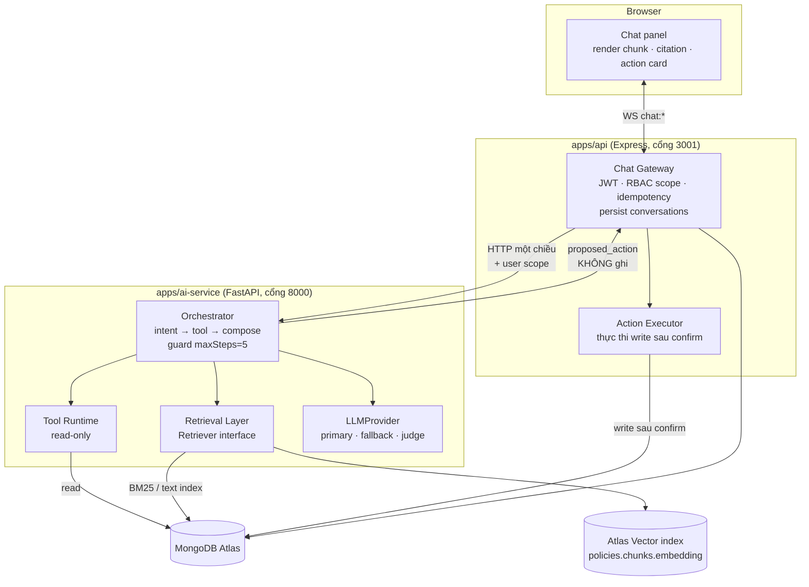
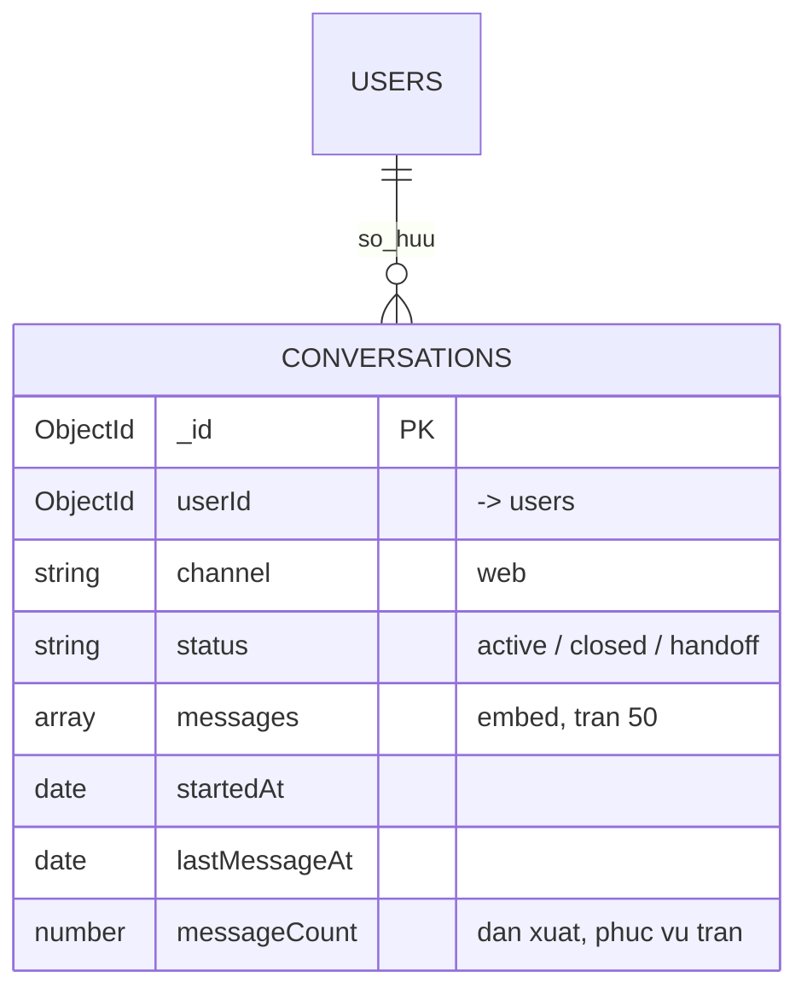

# 21 — Kiến trúc Chatbot (F3): Agent loop + Hybrid RAG

- **Trạng thái:** PROPOSED — chờ GVHD duyệt 2 điểm ở §12, chưa code
- **Ngày:** 2026-10-20
- **Phạm vi:** F3 (FR-015..FR-022) + phần đọc dữ liệu cho F1/F2/F5/F7
- **Nguồn bắt buộc:** `01-requirements.md` FR-015..022 · `02-architecture.md` §5, §12 · `05-data-model.md` §2–§4, D-08 · `08-algorithms.md` §7 · `ADR-005`, `ADR-010`, `ADR-012`
- **Nguồn quan sát thực nghiệm:** [`research/SPEC-chatbase-2026-10-20.md`](research/SPEC-chatbase-2026-10-20.md) (REA, phiên thật 2026-10-20) — chỉ dùng cho **vòng đời stream**, không copy transport

---

## 1. Quyết định kiến trúc (đã chốt trong phiên 2026-10-20)

| # | Quyết định | Lý do | Hệ quả nếu sai |
|---|---|---|---|
| D-21.1 | **Retrieval = Hybrid** (dense là chính, lexical là lưới an toàn), **không rerank** | Văn bản chính sách VN đầy mã điều/khoản/con số — chỗ embedding yếu nhất; rerank cần cross-encoder, không kịp freeze 09/11 | Tụt về `dense` hoặc `lexical` bằng config, không sửa orchestrator |
| D-21.2 | **Agent loop ở `ai-service`, nhưng `ai-service` không ghi DB** | Giữ ranh giới một chiều `api → ai-service` (`02 §5`); giải điểm treo #4 `02 §12`; RBAC enforce ở nơi có JWT | Nếu đặt ở `api` thì phải nhân đôi logic tool + guard |
| D-21.3 | **Lưu hội thoại: 1 collection `conversations`, `messages[]` embed, trần 50** | Đúng 1 collection mới, đủ dữ liệu eval; thay cho D-08 "không lưu gì" | Nếu GVHD không duyệt → rơi về phương án C (không lưu), ghi rõ giới hạn |
| D-21.4 | **Transport = WebSocket** `chat:*`, không SSE | FR-020 cần confirm hai chiều giữa stream; ADR-010 đã chốt Socket.IO | SSE sẽ phải thêm kênh phụ cho confirm |

**Không làm:** rerank cross-encoder · GraphRAG · LangChain/LangGraph · fine-tune LLM · lưu chain-of-thought.

---

## 2. Sơ đồ khối



**Bất biến ranh giới**
1. `ai-service` **không** gọi ngược `apps/api`, **không** mutate collection nào.
2. Mọi mutation đi qua `api`, sau bước confirm của người dùng (FR-020).
3. Mọi tool call phải qua RBAC + validate tham số trước khi chạy (FR-019).
4. Client không phải nguồn sự thật: lịch sử do server giữ theo `conversationId`.

---

## 3. Bốn luồng chính

### 3.1 Hỏi chính sách (RAG)
```text
client  --chat:send{clientMessageId}-----→ gateway
gateway --(auth ok, chưa thấy id này)----→ ai-service
ai      --intent=policy_qa---------------→ Retriever.hybrid(question, scope)
retriever --top-K + score----------------→ Orchestrator
orchestrator --ev rỗng?------------------→ abstain → chat:done{abstain:true, missing}
orchestrator --LLM(prompt từ ev)---------→ answer + citation[document,version,article,score]
gateway --lưu message, chat:chunk--------→ client  (nhiều delta)
gateway --chat:done{finishReason}--------→ client
```

### 3.2 Tra số liệu (tool đọc)
`intent` → tool tương ứng → đọc DB → **không** gọi LLM nếu kết quả đã là bảng có cấu trúc; LLM chỉ diễn đạt lại khi cần. Rẻ và ít sai hơn.

### 3.3 Hành động ghi (confirm)
```text
intent=write → orchestrator trả proposed_action{type, args, preview}
gateway → chat:chunk{kind:"action_proposal"}
client bấm xác nhận → chat:confirm{actionId}
gateway → Action Executor: validate RBAC + schema → execute → audit event
gateway → chat:done{applied:true, ref}
```
Quá hạn confirm hoặc từ chối → **không** mutation nào (FR-020).

### 3.4 Degraded (hết quota / provider lỗi)
Theo `08 §6` chế độ `degraded-structured`: intent bằng mẫu cố định, trả **kết quả thô** thay văn xuôi, **không** trả lời chính sách nếu top-K không đủ bằng chứng. Client hiển thị rõ "đang ở chế độ không có LLM".

---

## 4. Hợp đồng WebSocket (chốt với `06-api-spec.md`)

| Event | Chiều | Payload tối thiểu |
|---|---|---|
| `chat:send` | client → server | `{conversationId?, clientMessageId, text}` |
| `chat:accepted` | server → client | `{messageId, conversationId, at}` |
| `chat:chunk` | server → client | `{messageId, kind:"text"\|"citation"\|"action_proposal", data}` |
| `chat:confirm` | client → server | `{actionId, approve:boolean}` |
| `chat:done` | server → client | `{messageId, finishReason:"stop"\|"abstain"\|"error", score?}` |
| `chat:error` | server → client | `{messageId, code, retryable}` |

Đối chiếu với phiên Chatbase quan sát được (`research/SPEC-chatbase-2026-10-20.md` §3): `start/start-step/text-delta/finish` ánh xạ 1–1 vào `accepted/chunk/done`; `data-showQnaMatched` là bằng chứng cho thấy **data-part nghiệp vụ** là hợp lệ — ta dùng đúng chỗ đó cho `citation` và `action_proposal`.

---

## 5. Tool catalog (thay 6 tool ca kíp hiện có)

| Tool | Loại | Collection | Quyền | Ghi chú |
|---|---|---|---|---|
| `get_my_profile` | read | `employees` | own | allowlist, không phone của người khác |
| `get_my_projects` | read | `projects` | own (`assigneeIds`) | index `(assigneeIds,status)` |
| `get_project_status` | read | `projects` | own / Admin scope | |
| `get_my_kpi` | read | `evaluations` | own | cần tạo collection |
| `get_department_kpi` | read | `evaluations` | Admin | RBAC_DENIED cho Employee (FR-016) |
| `search_policy` | read | `policies` | cả 2 vai | hybrid retrieval + citation |
| `submit_report` | **write** | `reports` | assignee | confirm bắt buộc (FR-020) |

**Khoảng trống catalog** (đã ghi ở FR-022): 10 intent chưa có tool, trong đó `#12a..#12c` (nhận/từ chối/đổi phân công) thuộc FR-045 đang BLOCKED — chatbot **không** được giả tool cho các intent này, chỉ chỉ đường dashboard.

Tool hiện tại (`get_my_schedule`, `get_shift_coworkers`, `submit_attendance_correction`, `get_cash_reconciliation`, `find_replacement_staff`) thuộc domain ca kíp đã bị loại khỏi phạm vi (`20 §4`, quyết định A1) → **không port sang F3**.

---

## 6. Retrieval Layer

```text
interface Retriever {
  search(q: string, scope: Scope, k: int): Hit[]   // Hit{citation, text, score}
  name(): "lexical" | "dense" | "hybrid"
}
```

| Impl | Cơ chế | Khi dùng |
|---|---|---|
| `LexicalRetriever` | BM25 / text index trên `policies` | fallback; câu có mã điều, con số |
| `DenseRetriever` | embed câu hỏi → `$vectorSearch` top-K | câu diễn đạt tự do |
| `HybridRetriever` | fusion điểm 2 nguồn (RRF hoặc weighted) | **mặc định** |

**Tham số còn `TBD` (phải chốt trước khi eval):** `TOP_K`, `MIN_EVIDENCE`, trọng số fusion, model embedding, chunk size/overlap (`08 §7.2` vẫn `TBD`).

**Không được:** dùng chung vector index cho F4 (`ADR-005`); thêm index thứ 3 vượt trần free tier mà không xin duyệt.

---

## 7. LLM Provider

- Giữ `LLMProvider` abstraction (`ADR-012`): primary + fallback, đổi provider bằng config.
- **Data minimization trước khi ra khỏi hệ thống:** chỉ gửi allowlist (`fullName`, `level`, `department`, `skills`, `status`); cấm `bank_*`, lương, CCCD, `leave_reason` (NFR-12).
- **Judge model** riêng cho eval (faithfulness/citation) — dùng chính API dư của nhóm, không ảnh hưởng production path.
- Không log prompt chứa PII; log chỉ `messageId` + `score` + `finishReason`.

---

## 8. Guard & failure modes (FR-019)

### 8.1 Quyết định quyền là **ba giá trị**, không phải boolean

Học từ `PermissionEngine` của Skawld (`src/permissions/engine.ts`, MIT — chỉ tham khảo pattern, **không** dùng làm dependency):

```text
allow  → chạy ngay
deny   → không chạy, trả lý do (KHÔNG hỏi lại, tránh vòng lặp dụ dỗ)
ask    → hiển thị confirm cho người dùng, chờ quyết định
```

Thiết kế cũ của tôi ("write thì hiện confirm") là boolean đội lốt. Ba giá trị cho phép biểu diễn
đúng trường hợp **deny cứng**: `Employee` gọi `get_department_kpi` phải bị chặn thẳng, không được
hiện hộp thoại "bạn có muốn cho phép?" — vì người dùng bấm Có cũng không được phép.

### 8.2 Thứ tự đánh giá (tất định, không có LLM trong vòng này)

```text
1. validate tham số          → sai kiểu/thiếu field  ⇒ deny
2. rule khớp đầu tiên        → tool rule > path rule > custom rule (first match wins)
3. mặc định theo loại tool   → read: allow (nếu trong scope) · write: ask
4. ask → confirm của người dùng
```

**Bất biến quan trọng:** model **không** được tham gia bước 2–4. Model chỉ đề xuất `tool + args`;
quyền do code quyết. Nếu để model tự đánh giá "việc này có an toàn không" thì đó là lỗ hổng, không
phải tính năng.

### 8.3 Fail-closed — mọi nhánh lỗi đều là `deny`

| Tình huống | Kết quả | Nguồn pattern |
|---|---|---|
| Không có handler confirm (client cũ, lỗi UI) | **deny** | `canUseTool` undefined |
| Confirm callback throw / timeout | **deny** | callback failed |
| Người dùng đóng hộp thoại / huỷ phiên (`abort`) | **deny** | signal aborted |
| Response confirm sai shape | **deny** | invalid response |
| `updatedInput` (người dùng sửa tham số trước khi duyệt) sai schema | **deny** + validate lại | re-validate sau khi duyệt |

Điểm cuối là bài học đáng giá nhất: nếu cho phép người dùng/Admin **sửa tham số** trong lúc duyệt
(ví dụ sửa `assigneeId`), thì phải **validate lại** — nếu không, đường duyệt trở thành đường vòng qua
validate ban đầu.

### 8.4 Guard cụ thể

| Guard | Giá trị | Hành vi khi vượt | Trạng thái |
|---|---|---|---|
| `maxSteps` | 5 (FR-019) | `chat:error{code:"MAX_STEPS"}` | chốt |
| `toolTimeout` | `TBD` | `chat:error{code:"TOOL_TIMEOUT"}`, không deadlock | phải đo p95 trước khi đặt |
| `LLM timeout` | `TBD` | rơi `degraded-structured` (`08 §6`) | phải đo p95 |
| validate args | mọi tham số | `deny` + hỏi lại, **không** chạy tool | chốt |
| RBAC mỗi tool | bảng §5 | `RBAC_DENIED`, không lộ dữ liệu | chốt |
| trần kết quả tool | `TBD` | cắt + ghi log `truncated=true` | phải đo kích thước thật |
| trần `maxSteps` khi confirm | 1 lượt confirm / 1 action | action quá hạn ⇒ `deny`, không mutation | chốt |

### 8.5 Fail-closed đã có tiền lệ trong repo

Cùng nguyên tắc đã áp cho những chỗ khác, nên đây không phải quy tắc mới:
- Refresh-token reuse ⇒ revoke cả family (`ADR-008`)
- Test DB guard: sai URI ⇒ `exit 1` trước khi import app
- AI mock chat ⇒ `403` khi chưa cấu hình

### 8.6 Tham khảo (không bắt buộc đọc)

| File | Pattern | Dùng ở |
|---|---|---|
| `skawld-sdk/src/permissions/engine.ts` | tri-state + fail-closed + re-validate `updatedInput` | §8.1–8.3 |
| `skawld-sdk/src/permissions/mode.ts` | mode `default / acceptEdits / yolo` | gợi ý: `dev` vs `demo` của ta, **chưa** áp |
| `skawld-sdk/src/permissions/rules.ts` | first-match, deny thắng, tách lệnh ghép `&& \|\| ; \| &` rồi xét từng đoạn | nếu sau này có tool shell (hiện không có) |

---

## 9. Dữ liệu & ERD delta

### 9.1 `conversations` (collection thứ 12 — cần GVHD duyệt)



Chi tiết trường, bất biến, index, retention: [`design/conversations-storage.md`](design/conversations-storage.md).

**Phân biệt hai thứ dễ bị gộp làm một (bài học từ `skawld-sdk/src/core/compaction.ts`):**

| | Trần lưu trữ (DB) | Cửa sổ gửi LLM (prompt) |
|---|---|---|
| Giới hạn | 50 message / conversation | 10 lượt gần nhất + tóm tắt phần cũ |
| Ai chịu trách nhiệm | `apps/api` | `ai-service` khi dựng prompt |
| Hệ quả khi vượt | tạo conversation mới, bản cũ `closed` | nén phần cũ thành **1 message tóm tắt** ở đầu |
| Mất mát | không mất (append-only trong document) | mất chi tiết, giữ quyết định + tool + câu hỏi mở |

Lý do phải tách: trần 50 **không** bảo vệ được context window. 50 tin nhắn chính sách dài có thể vượt
ngưỡng token của model, và lúc đó nếu chỉ biết "cắt bớt" thì mất đúng phần đầu cuộc hội thoại — nơi
người dùng đã nêu ràng buộc. Nén có tóm tắt giữ được thông tin mà cắt thô thì không.

**Ngưỡng nén (chưa áp dụng, ghi để chốt sau):** kích hoạt khi `input_tokens + max_output_tokens ≥ 0.8 ×
contextWindow` — đo token thật, **không** đếm số message. Trần 50 chỉ là chốt chặn lưu trữ, không phải
logic nén.

### 9.2 `employees.profileChangeRequests` (đã duyệt 12/10, **chưa có trong ERD `05 §2`**)

Embed bounded (trần 20 request), trạng thái `PENDING|APPROVED|REJECTED`, chặn tự duyệt, resubmit giữ `previousRequestId`. Nguồn: `design/fr003-004-approval-storage.md`. → `05 §2` cần bổ sung khi cập nhật ERD.

### 9.3 Collection thiết kế có nhưng **chưa có model** trong code

`departments` · `project_events` · `evaluations` · `policies` · `notifications` · `feedback_events`

F3 **không chạy được** nếu thiếu `policies` (retrieval) và `evaluations` (KPI). Đây là phụ thuộc cứng, không phải việc "làm sau".

### 9.4 Ngoài phạm vi, không xoá

`stores`, `schedule_entries`, `attendance_corrections`, `cash_counts` (legacy ca kíp) — model còn, API đã 503. ERD tổng thể phải ghi chú "legacy, ngoài phạm vi F1–F7" để hội đồng không hỏi nhầm.

---

## 10. Eval (điều kiện để F3 có điểm khoa học)

| Metric | Đo gì | Nguồn |
|---|---|---|
| Intent→tool accuracy | câu trong catalog 28 intent → tool đúng | FR-015 |
| Retrieval recall@K | chunk đúng có trong top-K | mới, theo `08 §7` |
| Citation correctness | `document/version/article` khớp chunk | BR-15, FR-017 |
| Abstain rate / false-answer rate | từ chối đúng chỗ, không bịa | FR-018 |
| Faithfulness (judge) | câu trả lời có suy ra từ evidence | mới, LLM-as-judge |

Harness: bộ câu hỏi tất định + `temperature=0` + snapshot, chạy `pytest -m eval` trong `apps/ai-service` (`02 §8`).

---

## 11. Rủi ro & gate

| # | Rủi ro | Gate / cách chặn |
|---|---|---|
| R-21.1 | `$vectorSearch` không chạy trên Atlas M0 | **ĐÃ PROBE 2026-10-20 — PASS.** DB tạm `rea_vector_probe`: `createSearchIndexes` accepted, index `READY` sau ~30s, query trả `doc0` score 1.0 / `doc1` 0.5, DB đã drop. Hybrid khả thi về hạ tầng |
| R-21.2 | Collection thứ 12 bị GVHD từ chối | Có sẵn phương án C (không lưu), chỉ mất dữ liệu eval |
| R-21.3 | Hybrid làm trễ tiến độ | Cắt về `dense` bằng config; interface đã tách |
| R-21.4 | Gửi PII ra LLM bên thứ ba | Allowlist ở §7 + câu hỏi GVHD #5 (`01` §câu hỏi mở) |
| R-21.5 | Sai ngưỡng abstention | Hiệu chuẩn trên tập validation, ghi số thật vào báo cáo |

---

## 12. Cần duyệt trước khi code

1. **Collection thứ 12 `conversations`** (D-21.3) — trái luật baseline `05 §1.1`, phải có ý kiến GVHD.
2. **Hybrid dùng text index thứ 2** — nằm trong trần 3 index free tier (`05 §4.3`), nhưng phải xác nhận không đụng index của F4.
3. **Agent loop ở `ai-service`** (D-21.2) — đóng điểm treo #4 `02 §12`, cần ADR mới ghi lại.

## 13. Chưa quyết (ghi rõ, không giả vờ đã xong)

- `TOP_K`, `MIN_EVIDENCE`, trọng số fusion, model embedding, chunk size/overlap
- `toolTimeout`, `LLM timeout`, trần kích thước kết quả tool
- Retention của `conversations` (bao lâu thì xoá/đóng)
- Có dùng lại `feedback_events` cho đánh giá câu trả lời hay không
