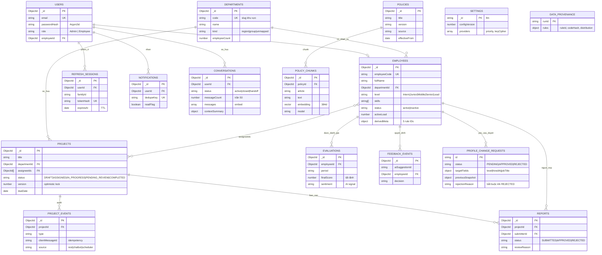

# 22 — ERD tổng thể (11 baseline + 2 mới + provenance)

- **Trạng thái:** PROPOSED — số liệu trong bảng "hiện trạng" là **đo thật ngày 2026-10-20**
- **Nguồn:** `05-data-model.md` (11 collection gốc) · `ADR-017` (settings) · `design/conversations-storage.md` · `design/data-derivation.md` · đo trực tiếp `hr_bot`
- **Thay đổi so với `05 §2`:** thêm `conversations`, `settings`, `data_provenance`; bỏ giới hạn 11 collection (`ADR-018`)

---

## 1. Hiện trạng DB thật (OBSERVED 2026-10-20)

| Collection | Docs | Trạng thái | Thuộc ERD |
|---|---:|---|---|
| `employees` | 2.439 | ✅ thật + 5 field suy diễn | HR |
| `stores` | 144 | ✅ thật (legacy ca kíp) | ngoài phạm vi |
| `schedule_entries` | 3.275 | ✅ thật (legacy) | ngoài phạm vi |
| `attendance_corrections` / `cash_*` / `training_attendance` / `schedule_*` / `raw_cells` | 115 / 19 / 8 / 134 / 32.980 | ✅ thật (thô/legacy) | ngoài phạm vi |
| `departments` | **37** | ✅ **seed 2026-10-20** | HR |
| `users` | **0** | ❌ chưa tạo | Identity |
| `projects` · `project_events` · `reports` | 0 | ❌ chưa tạo | F2 |
| `evaluations` · `notifications` · `feedback_events` | 0 | ❌ chưa tạo | F5/F7 |
| `policies` | **0** | ❌ chưa tạo | F3 |
| `conversations` | 0 | ❌ mới (ADR-018) | F3 |
| `settings` | 0 | ❌ mới (ADR-017) | hạ tầng |

**Hệ quả:** 5/13 entity đã có dữ liệu; F2/F3/F5 hiện không thể chạy vì thiếu collection, không phải thiếu code.

---

## 2. ERD

Ghi chú: `POLICY_CHUNKS` là **sub-document** trong `policies` (embed), không phải collection riêng — vẽ tách để thấy quan hệ 1-n; Atlas Vector Search đánh index trên `policies.chunks.embedding`.

---

## 3. Provenance — nguồn của từng nhóm dữ liệu

| Collection | Nguồn | Ghi chú |
|---|---|---|
| `employees` (13 field gốc) | **real** — Google Sheet GUTA | không sửa, không pseudonymize (`20 §3`) |
| `employees.level/status/departmentId/skills/activeLoad` | **derived** — R1..R5 | `derivedMeta` trên từng doc; phân bố: Lead 2 / Senior 109 / Middle 322 / Junior 1.759 / Intern 247 |
| `departments` | **derived** từ `store_raw` | 26 khu vực + 8 group + 3 unmapped = 37 |
| `users` | **synthetic** (demo) | 5 tài khoản, không cấp cho 2.439 người |
| `projects` / `reports` / `evaluations` | **generated** qua API | hoạt động thật của hệ thống, không insert tay |
| `policies` | **public-document** + **authored** | luật VN (có `source` URL) + quy chế nội bộ dán nhãn |
| `conversations` | **real runtime** | sinh khi người dùng chat |
| `settings` | **runtime config** | key mã hoá AES-256-GCM |
| legacy (`stores`, `schedule_*`, `cash_*`, `raw_cells`) | **real** | ngoài phạm vi F1–F7, không xoá |

---

## 4. Ánh xạ seed → schema ứng dụng

| Nguồn GUTA | Đích | Luật |
|---|---|---|
| `employees.store_raw` | `departments.code` | tách khu vực theo `"<BRAND> - <KV> - <địa chỉ>"` |
| `employees.job_title` | `employees.level` (tầng quản lý) | `OD/OM→Lead`; `AOM/AM/SM→Senior`; `Phụ trách CH/Bếp chính→Middle` |
| `employees.hire_date` | `employees.level` (tầng nhân viên) | `<3m→Intern`; `3–24m→Junior`; `≥24m→Middle` |
| `employees.leave_date` | `employees.status` | có ngày nghỉ → `inactive` (1.699 người) |
| `employees.job_title` | `employees.skills` | bảng ánh xạ cố định (R4) |
| `stores.store_name` | `departments` | 144 cửa hàng → 37 đơn vị |

---

## 5. Index bắt buộc

| Collection | Index | Lý do |
|---|---|---|
| `employees` | `employeeCode` UNIQUE, `departmentId`, `status` | F1 list/lọc |
| `departments` | `code` UNIQUE | ánh xạ seed |
| `projects` | `(status,dueDate)`, `(assigneeIds,status)`, `(departmentId,status,dueDate)` | F2 |
| `project_events` | `(projectId,createdAt)` + `clientMessageId` | audit + idempotency |
| `reports` | `(projectId,createdAt)` | F2 |
| `evaluations` | `(employeeId,period)` UNIQUE | F5 |
| `policies` | Vector Search trên `chunks.embedding` (384d, cosine) | F3 — **đã chứng minh chạy trên M0** |
| `conversations` | `(userId,lastMessageAt)`, `(userId,status)` | mở lại phiên |
| `notifications` | `(userId,readAt,createdAt)`, `(userId,dedupeKey)` UNIQUE | F7 |
| `refresh_sessions` | `tokenHash` UNIQUE, `expiresAt` TTL | auth |
| `settings` | `_id` | 1 document |

---

## 6. Điều chỉnh phải làm ở tài liệu cũ

| File | Sửa gì |
|---|---|
| `05-data-model.md` §1.1 | bỏ câu "không được thêm collection thứ 12"; trỏ `ADR-018` |
| `05-data-model.md` §2 | thay ERD cũ bằng ERD này (hoặc thêm link) |
| `01-requirements.md` §8 #13, #14 | đổi "chờ GVHD" → "giải quyết: ADR-017/018" |
| `README.md` | sửa F2 = vòng đời đề tài (đang ghi ca kíp) |

---

## 7. Chưa chốt trong ERD này

- `policy_chunks` tách collection hay embed: hiện chọn **embed** (theo `05 §3.8`, ADR-005); nếu >5.000 chunk thì xem lại
- `settings` có chứa feature flag khác không: hiện chỉ `llm`
- `data_provenance` có giữ mọi lần chạy hay chỉ lần mới nhất: đề xuất giữ 20 lần gần nhất (TTL)
