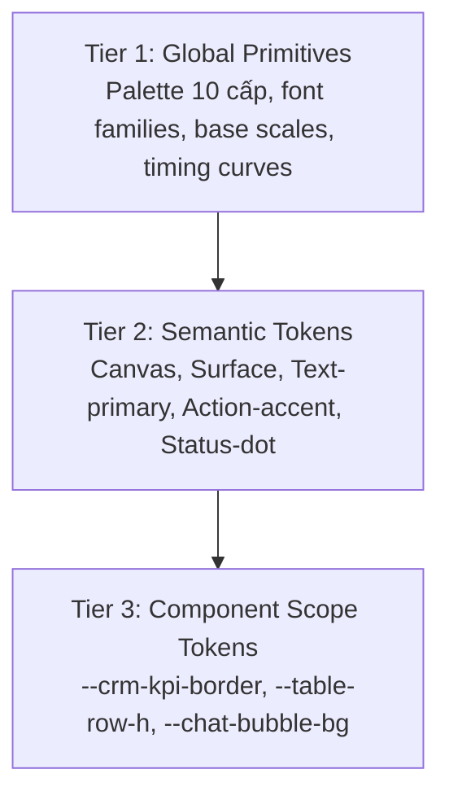

# 🏛️ DESIGN.md — Unified Enterprise Design System Specification (v3.0)

> **Dự án:** Khóa luận KLCN133 — HR BlockBot Command Center & AI Copilot  
> **Quy chuẩn:** Doanh nghiệp F&B Đa Chi Nhánh (Enterprise Multi-Outlet Workspace)  
> **Phiên bản:** v3.0 (Cập nhật toàn diện 10/2026 — Thay thế toàn bộ bản thảo cũ)  
> **Kiến trúc cốt lõi:** Swiss International Grid · Linear Minimalist Shell · Tremor Data Density · Emil Kowalski Motion Physics

---

## 1. 🎯 Design Brief (Đặc Tả Thẩm Mỹ Chuẩn Hóa)

Bản đặc tả thiết kế tuân thủ nghiêm ngặt quy trình `ak-frontend-design` và `ak-design-taste`:

```text
Register:  Product (CRM Command Center & Chat Copilot) + Brand (Folio Landing Page)
Scene:     Cửa hàng trưởng (SM) thao tác nhanh trên mobile 375px tại quầy bar ồn ào;
           Quản lý khu vực (AOM) duyệt ca trên iPad/Laptop khi di chuyển giữa các quận;
           Ban Điều Hành (Admin) giám sát 45 chi nhánh trên màn hình workstation 1440px tại trụ sở.
Direction: Swiss International / Linear Minimalist — tập trung tối đa vào dữ liệu vận hành,
           lưới 12 cột kỷ luật, viền 1px siêu mảnh, triệt tiêu trang trí thừa và chống AI-slop.
Color:     Restrained (Zero-Yellow Token System): 90% Obsidian Neutral (#090A0F..#121214),
           10% Electric Sapphire (#2563EB) cho hành động chính và focus;
           Màu trạng thái: Emerald (#10B981), Rose (#F43F5E), Slate (#64748B).
Type:      Display Serif 'Newsreader' (Landing Page) + Sans 'Geist Sans' / 'Inter' + Mono 'ui-monospace' (CRM & Chat);
           Trục tương phản: Editorial Elegance (Marketing) vs Technical Precision (SaaS).
Signature: Bảng ma trận 45 chi nhánh thời gian thực với Slide-Over Barista Drawer & AI Copilot Action Center.
Dials:     Product Register: Variance 3 / Motion 2 / Density 7
           Brand Register:   Variance 7 / Motion 5 / Density 3
```

---

## 2. 🧱 Kiến Trúc Design Tokens 3 Tầng (3-Tier Token Architecture)

Hệ thống token được phân cấp thành 3 tầng kế thừa chặt chẽ, loại bỏ hoàn toàn các giá trị hardcode tự do:



### 2.1. Tier 1: Global Primitives (Giá trị nền tảng bất biến)

```css
:root {
  /* Obsidian Charcoal Palette (Neutral) */
  --primitive-obsidian-950: #090a0f; /* Deepest canvas */
  --primitive-obsidian-900: #121214; /* Card & surface base */
  --primitive-obsidian-850: #18181b; /* Elevated surface / popover */
  --primitive-obsidian-800: #222226; /* Hover / subtle highlight */
  --primitive-obsidian-700: #333338; /* Border default */
  --primitive-obsidian-500: #64748b; /* Slate muted text */
  --primitive-obsidian-400: #94a3b8; /* Secondary text */
  --primitive-obsidian-100: #f1f5f9; /* Near white */
  --primitive-obsidian-50:  #f8fafc; /* Crisp foreground */

  /* Functional Accents */
  --primitive-sapphire-600: #1d4ed8;
  --primitive-sapphire-500: #2563eb; /* Primary action / focus */
  --primitive-sapphire-400: #3b82f6;
  --primitive-emerald-500:  #10b981; /* Shift active / on-time */
  --primitive-rose-500:     #f43f5e; /* Alert / late / error */

  /* Typography Scales */
  --font-family-display: "Newsreader", Georgia, serif;
  --font-family-sans: "Geist Sans", "Inter", system-ui, sans-serif;
  --font-family-mono: ui-monospace, "SF Mono", "JetBrains Mono", Menlo, Consolas, monospace;

  /* Shape & Radii (Border-Radius Discipline) */
  --radius-none: 0px;
  --radius-sm:   4px;  /* Badge, small input */
  --radius-md:   6px;  /* Standard button, select trigger */
  --radius-lg:   8px;  /* Modal, card, panel */
  --radius-pill: 9999px; /* Status dot, pill tag */

  /* Motion Primitives (Emil Kowalski Standard) */
  --motion-ease-snappy: cubic-bezier(0.2, 0.8, 0.2, 1);     /* Dropdowns, tooltips */
  --motion-ease-smooth: cubic-bezier(0.23, 1, 0.32, 1);    /* Modals, drawers */
  --motion-duration-fast:   140ms; /* Hover, press */
  --motion-duration-base:   220ms; /* State transitions, card emergence */
  --motion-duration-drawer: 280ms; /* Slide-over panel */
}
```

### 2.2. Tier 2: Semantic Tokens (Ngữ nghĩa chức năng)

| Semantic Token | Giá trị CSS Variable | Mục đích sử dụng | Tiêu chuẩn tương phản WCAG |
|---|---|---|---|
| `--bg-canvas` | `var(--primitive-obsidian-950)` | Nền toàn ứng dụng | Đạt nền tương phản gốc |
| `--bg-surface` | `var(--primitive-obsidian-900)` | Bề mặt Card, Header, Sidebar | Phân tách viền mờ 1px |
| `--bg-surface-elevated` | `var(--primitive-obsidian-850)` | Modal, Popover, Dropdown | Đổ bóng mờ nhẹ không neon |
| `--border-subtle` | `rgba(255, 255, 255, 0.08)` | Viền ngăn cách mặc định | Độ tương phản 3:1 |
| `--border-focus` | `var(--primitive-sapphire-500)` | Viền khi nhận focus keyboard | 2px solid rõ nét |
| `--text-primary` | `var(--primitive-obsidian-50)` | Tiêu đề, dữ liệu quan trọng | Tỷ lệ tương phản $\ge 16:1$ (AAA) |
| `--text-secondary` | `var(--primitive-obsidian-400)` | Nhãn cột, mô tả phụ | Tỷ lệ tương phản $\ge 7:1$ (AAA) |
| `--text-muted` | `var(--primitive-obsidian-500)` | Timestamp, watermark | Tỷ lệ tương phản $\ge 4.5:1$ (AA) |
| `--accent-action` | `var(--primitive-sapphire-500)` | Nút CTA, điểm sáng chính | 10% diện tích màn hình |
| `--status-active` | `var(--primitive-emerald-500)` | Đang làm việc, đúng giờ | Micro-dot 6px |
| `--status-alert` | `var(--primitive-rose-500)` | Trễ ca, thiếu nhân sự | Micro-dot 6px |

### 2.3. Quy Tắc Bất Biến Zero-Yellow (Anti-Yellow Invariant)
Toàn bộ mã hex vàng chói (`#FFD100`, `#EAB308`, `#F59E0B`, `#FDD663`) **bị cấm tuyệt đối 100%** trong toàn bộ DOM computed styles của ứng dụng. Mọi trạng thái cảnh báo/thao tác trước đây dùng màu vàng được chuyển thành:
- Thông tin trung tính: Dùng nhãn xám Slate (`#64748B` / `#94A3B8`).
- Điểm nhấn thương hiệu: Dùng Electric Sapphire (`#2563EB`).
- Kiểm tra tự động bằng Playwright assertion: `yellowCount === 0`.

---

## 3. ⚡ Chuẩn Mực Motion & Micro-Interactions (60fps GPU Engineering)

Theo triết lý của Emil Kowalski: *Invisible correctness — chi tiết vô hình tạo nên giao diện người dùng yêu thích*.

### 3.1. Bộ Lọc Tần Suất (Frequency Gate)
- **Tần suất 100+ lần/ngày (Chuyển tab, phím tắt, lọc bảng):** **0ms delay**. Không animation. Chuyển đổi trạng thái tức thời.
- **Tần suất hàng chục lần/ngày (Hover dòng bảng, nút bấm):** Phản hồi vi mô dưới **140ms**, chuyển động lún nhẹ `transform: scale(0.98)` khi `:active`.
- **Tần suất thi thoảng (Mở Drawer xem Barista, mở Auth Modal):** Chuyển cảnh êm dịu từ **220ms – 280ms**.

### 3.2. 5 Luật Sắt Motion (Hard Motion Invariants)
1. **Chỉ animate GPU Composite:** Chỉ sử dụng `transform` và `opacity`. Tuyệt đối cấm animate các thuộc tính gây reflow/layout recalculation (`width`, `height`, `top`, `left`, `margin`, `padding`).
2. **Cấm tuyệt đối `transition: all`:** Phải khai báo tường minh từng thuộc tính:
   ```css
   /* Đúng */
   transition: transform var(--motion-duration-fast) var(--motion-ease-snappy),
               opacity var(--motion-duration-fast) linear;
   /* Cấm */
   transition: all 0.3s ease;
   ```
3. **Cấm `scale(0)`:** Không vật thể nào trong thế giới thực xuất hiện từ kích thước 0. Trạng thái xuất hiện bắt đầu từ `transform: scale(0.97); opacity: 0` nở lên `scale(1); opacity: 1`.
4. **Cấm `ease-in` cho giao diện xuất hiện:** `ease-in` gây độ trễ cảm giác (perceptual lag). Luôn dùng `ease-out` (bắt đầu nhanh, tiếp đất êm).
5. **Tôn trọng quyền tiếp cận:** Bắt buộc hỗ trợ `@media (prefers-reduced-motion: reduce)`:
   ```css
   @media (prefers-reduced-motion: reduce) {
     *, *::before, *::after {
       animation-duration: 0.01ms !important;
       animation-iteration-count: 1 !important;
       transition-duration: 0.01ms !important;
     }
   }
   ```

---

## 4. 🎛️ Ma Trận 8 Trạng Thái Tương Tác (8-State Interaction Matrix)

Tất cả các thành phần tương tác (Button, Dropdown, Table Row, Input, Drawer) phải hoàn thiện đầy đủ 8 trạng thái:

| # | Trạng thái | Hành vi thị giác & Quy chuẩn kỹ thuật |
|---|---|---|
| **1** | **Default** | Bề mặt phẳng, viền `1px solid rgba(255, 255, 255, 0.08)`, chữ độ tương phản cao, số dạng `tabular-nums`. |
| **2** | **Hover** | Nâng sáng nhẹ 1 cấp (`--bg-surface-elevated`), con trỏ `cursor: pointer`. Chỉ kích hoạt trên `@media (hover: hover) and (pointer: fine)`. |
| **3** | **Focus-Visible** | Viền 2px `var(--primitive-sapphire-500)` cách phần tử 2px (`outline-offset: 2px`). Không làm mất focus ring khi điều hướng bằng phím Tab. |
| **4** | **Active (Press)** | Phản hồi xúc giác tức thời trong 80ms: `transform: scale(0.98)` trên nút bấm; làm tối nhẹ nền. |
| **5** | **Disabled** | Giảm `opacity: 0.4`, `cursor: not-allowed`, `pointer-events: none`. Không gửi bất kỳ sự kiện mạng nào. |
| **6** | **Loading (Skeleton)** | Khối xương xám trung tính với hiệu ứng shimmer mờ nhẹ (pulse 1.5s), giữ nguyên chiều cao khung bao để triệt tiêu độ giật màn hình (Zero-CLS). |
| **7** | **Empty State** | Icon vector minh họa tối giản, dòng thông báo trung thực ngắn gọn kèm nút hành động hữu ích (ví dụ: "Xóa bộ lọc" hoặc "Tạo mới"). Cấm để trang trắng trơn. |
| **8** | **Error / Success** | Border chuyển Rose (`#F43F5E`) kèm tooltip/thông báo lỗi dễ hiểu; Success chuyển viền Emerald (`#10B981`) và tự động ẩn sau 3 giây. |

---

## 5. 🖥️ Đặc Tả 4 Bề Mặt Giao Diện Trọng Tâm

```text
┌────────────────────────────────────────────────────────────────────────┐
│                        Folio Landing Page                              │
│ [Sticky Shrink Header] ───────────────> [Bento Showcase & 5-Col Kanban]│
└──────────────────────────────────┬─────────────────────────────────────┘
                                   │ Nút "Get Started" / Đăng nhập
                                   ▼
┌────────────────────────────────────────────────────────────────────────┐
│                         Auth Modal (1-Click)                           │
│  [SM - Tân Bình]       [AOM - Q1/Q3/Q10]        [Admin - Ban Điều Hành]│
└──────────────────────────────────┬─────────────────────────────────────┘
                                   │ Đăng nhập thành công
                                   ▼
┌────────────────────────────────────────────────────────────────────────┐
│                      CRM Command Center (Obsidian)                     │
│ [KPI Cards - Tremor]   [Bảng 45 Chi Nhánh] ──> [Slide-Over Barista]   │
│ [Chat Copilot Drawer] <────────────────────────[Tra cứu ca, hỏi RAG]   │
└────────────────────────────────────────────────────────────────────────┘
```

### 5.1. Folio Landing Page (`FolioLandingView.tsx`)
- **Typography:** Font Display Serif **Newsreader** kết hợp Geist Sans. Bắt buộc `text-wrap: balance` cho tiêu đề và `text-wrap: pretty` cho thân bài để triệt tiêu từ đơn côi (orphans).
- **Sticky Shrink Header:** Khi cuộn `window.scrollY > 20px`, navbar tự động co padding dọc, kích hoạt nền kính mờ `backdrop-filter: blur(24px)` và viền đáy mỏng; layout không bị nhảy (Zero-CLS).
- **Bento Feature Grid:** 4 khối bento đa năng thể hiện tính năng phân ca thông minh, đồng bộ két tiền mặt, và AI Copilot hỗ trợ tức thì.
- **Logo Marquee:** Dải logo đối tác F&B (Vinamilk, Dalatmilk, La Marzocco, Monin,...) hiển thị đơn sắc xám trung tính `opacity: 0.6`, hover lên `1.0`.

### 5.2. CRM Command Center (`CrmDashboardView.tsx`)
- **Bảng 45 Chi Nhánh:** Chiều cao dòng chuẩn mực `38px - 40px` (High-Density Workstation Grid), số liệu tiền mặt và giờ làm việc bắt buộc khai báo:
  ```css
  font-variant-numeric: tabular-nums;
  font-family: var(--font-family-mono);
  ```
- **Slide-Over Sheet (Chi Tiết Cửa Hàng & Barista):**
  - Trượt ra từ cạnh phải màn hình trong 240ms khi click vào bất kỳ dòng cửa hàng nào.
  - Hiển thị danh sách Barista trong ca trực, doanh thu ca hiện tại, và nút hành động "Gửi Cảnh Báo Telegram".
  - Đóng êm ái bằng phím Escape, click ra ngoài backdrop, hoặc nút đóng `X`.

### 5.3. Chat Copilot Action Center (`ChatDrawer.tsx`)
- **Kiến trúc:** Drawer tích hợp trực tiếp trong CRM hỗ trợ tra cứu chính sách, KPI, hỏi đáp RAG, và tạo lệnh phân ca.
- **Guardrail bảo mật:** Mọi thao tác ghi dữ liệu (Write operations) đều bắt buộc hiển thị màn hình xác nhận (Confirmation Card) do người dùng chủ động bấm.
- **Markdown & Citations:** Hiển thị trích dẫn nguồn văn bản chính sách rõ ràng, có nút click mở chi tiết điều khoản.

### 5.4. Auth Modal (`AuthModal.tsx`)
- Hỗ trợ đăng nhập nhanh 1-Click theo 3 vai trò thực tế của chuỗi:
  1. **Cửa hàng trưởng (SM):** Nguyễn Thị Phương Anh (Chi nhánh Tân Bình).
  2. **Quản lý khu vực (AOM):** Nguyễn Cao Thanh Trầm (Khu vực Q1/Q3/Q10).
  3. **Quản trị viên (Admin):** Ban Điều Hành Guta (Toàn quyền hệ thống).
- Đóng mở mượt mà bằng Escape, khóa cuộn trang (`body.style.overflow = 'hidden'`) khi mở modal và phục hồi ngay khi đóng.

---

## 6. ♿ Tiêu Chuẩn Khả Năng Tiếp Cận & Kiểm Thử Thẩm Mỹ (QA Gate)

### 6.1. Ngưỡng Chất Lượng Tối Thiểu (Acceptance Criteria)
1. **Độ tương phản WCAG 2.1 AAA:**
   - Body text trên nền Obsidian $\ge 7:1$ (thực tế đo đạt từ 7.62:1 đến 21:1).
   - UI controls và borders $\ge 3:1$.
2. **Kích thước chạm cảm ứng (Touch Targets):**
   - Mọi nút bấm và trigger trên mobile $\ge 44 \times 44$ CSS px.
3. **Hiển thị trên Mobile 320px:**
   - Tất cả các nút CTA chính hiển thị trọn vẹn trên đúng một dòng, không gãy hàng, không xuất hiện thanh cuộn ngang ngoài ý muốn (`overflow-x: hidden`).
4. **Không rớt khung hình (Solid 60fps):**
   - Đạt 60fps khi cuộn danh sách 45 chi nhánh và khi kích hoạt hiệu ứng trượt Slide-Over Drawer.

### 6.2. Lệnh Kiểm Thử Tự Động Định Kỳ
```bash
# 1. Kiểm tra toàn bộ types TypeScript
pnpm --filter web typecheck

# 2. Chạy toàn bộ 50+ kịch bản kiểm thử E2E Playwright và UI
pnpm --filter web test

# 3. Quét màu cấm Zero-Yellow tự động
node --test apps/web/test/e2e-revamp-flow.test.mjs
```
