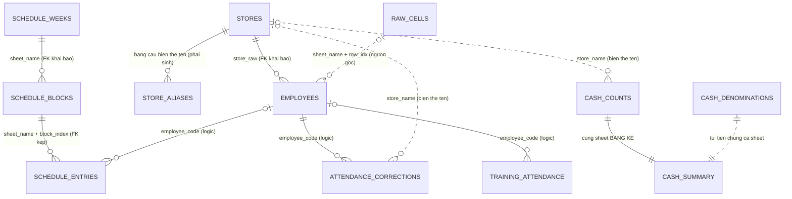

# Thiết kế database `hr_bot` và báo cáo quan hệ giữa các bảng

> Database: `db/hr_bot.db` (SQLite) — trích xuất từ Google Sheet vận hành GUTA, dữ liệu gốc giữ nguyên không thay đổi.
> Báo cáo này mô tả **schema thật** (đọc trực tiếp bằng `PRAGMA table_info` / `PRAGMA foreign_key_list`) và kết quả **verify quan hệ trên dữ liệu thật** (JOIN + đếm orphan), chạy ngày 04/10/2026 — re-extract + verify lại ngày 07/10/2026, kèm bảng cầu `store_aliases`.

---

## 1. Nguyên tắc thiết kế

Database gồm **3 tầng**:

| Tầng | Bảng | Vai trò |
|---|---|---|
| **Thô (raw)** | `raw_cells` | Mỗi ô không rỗng của cả 34 sheet lưu nguyên bản (32.980 ô) — bảo chứng "không thay đổi dữ liệu", đối chiếu được về từng ô gốc |
| **Sự kiện (event)** | `schedule_entries`, `attendance_corrections`, `training_attendance`, `cash_counts`, `cash_denominations` | Dữ liệu nghiệp vụ chuẩn hóa 1 dòng = 1 sự kiện |
| **Danh mục (dimension)** | `employees`, `stores`, `schedule_weeks`, `schedule_blocks`, `cash_summary` | Thực thể chính, làm mốc join cho các bảng sự kiện |
| **Cầu (bridge)** | `store_aliases` | Liên kết biến thể tên cửa hàng / block code → cửa hàng chuẩn; bảng phái sinh, tái tạo bằng `scripts/apply_store_aliases.py`, không đụng dữ liệu gốc |

Quy ước kiểu dữ liệu: ngày tháng lưu **ISO-8601 TEXT** (`YYYY-MM-DD`), tiền lưu **INTEGER** (VND, không số thập phân), chuỗi tên cửa hàng/mã ca **giữ nguyên vân tay gốc** của sheet (không normalize khi trích xuất).

---

## 2. Sơ đồ quan hệ thực thể (ERD)

Ghi chú ký hiệu: `||--o{` = quan hệ khai báo FK thật trong SQLite; `|o..o{` = quan hệ logic (không có ràng buộc FK, đã verify bằng dữ liệu) hoặc quan hệ qua biến thể tên.

---

## 3. Mô tả 12 bảng (số liệu thật ngày 07/10/2026)

| Bảng | Dòng | Khóa chính | Nguồn | Nội dung |
|---|---:|---|---|---|
| `employees` | 2.456 | `employee_code` (tự nhiên, dạng `GT-CH…`, `GT-VP…`, `HTT-…`) | sheet `DATA` | Danh mục nhân viên: họ tên, đơn vị, chức danh, tài khoản ngân hàng (tách `số - ngân hàng`), trạng thái hồ sơ, ngày vào/nghỉ + lý do |
| `stores` | 144 | `store_name` | cột `CỬA HÀNG` của `DATA` | Danh mục đơn vị gốc — gồm cửa hàng, bếp, và nhóm quản lý (`Group AOM…`) |
| `schedule_weeks` | 29 | `sheet_name` | 29 sheet tuần | Mốc tuần: tên sheet (`510-1110`…) + ngày đầu/cuần tuần |
| `schedule_blocks` | 105 | **kép** `(sheet_name, block_index)` | các sheet tuần | Một "lô" cửa hàng trong 1 tuần: mã lô (`1BNK`, `749NK`…), số dòng nhân viên |
| `schedule_entries` | 3.283 | `id` (surrogate) | các sheet tuần | 1 dòng = 1 người + 1 ngày + 1 mã ca, tách `schedule_type` = `actual` (LỊCH LÀM) / `registered` (LỊCH ĐĂNG KÍ); `row_kind` phân biệt `employee` / `support` (HỖ TRỢ) / `shortage` (THIẾU) |
| `attendance_corrections` | 115 | `id` | sheet `CHẤM THỦ CÔNG` | Chấm công bù: mã NV, ca, địa điểm, ngày, ghi chú, kèm banner kỳ lương (`CHẤM THEO KỲ LƯƠNG 6/5-5/6/2026`) |
| `training_attendance` | 8 | `id` | sheet `LỊCH HỌC 3G` | Điểm danh đào tạo: mã NV, địa điểm, ngày, khung giờ |
| `cash_counts` | 9 | `id` | sheet `BẢNG KÊ` | Kê tiền 1 ngày theo cửa hàng: tổng / tiền mặt / khách lẻ (sheet gốc không ghi ngày) |
| `cash_denominations` | 9 | `id` | sheet `BẢNG KÊ` | Phân tích mệnh giá 500k→1k — **một túi tiền chung cả sheet**, không thuộc cửa hàng nào (cột mệnh giá chạy song song với dòng cửa hàng nhưng là bảng riêng) |
| `cash_summary` | 1 | `id` (=1) | dòng `TỔNG` của `BẢNG KÊ` | Dòng tổng của sheet, lưu nguyên bản 16.275.000 / 14.905.000 / 1.370.000 — không tính lại |
| `raw_cells` | 33.198 | `id` | cả 34 sheet | Lớp đối chiếu gốc: `(sheet_name, row_idx, col_idx, value)` |
| `store_aliases` | 23 | kép `(alias, alias_kind)` | bảng sự kiện + `schedule_blocks` | Bảng cầu phái sinh: biến thể tên/block code → cửa hàng chuẩn, kèm phương pháp match và cross-check; tái tạo bằng `scripts/apply_store_aliases.py` |

Mọi bảng sự kiện đều mang cột `source_row` (hoặc `sheet_name + block_index + source_row`) → truy vết ngược về đúng dòng sheet gốc qua `raw_cells`.

---

## 4. Báo cáo quan hệ — theo nhóm

### 4.1. Quan hệ khai báo FK thật (SQLite kiểm enforced, `PRAGMA foreign_keys = ON`)

| # | Quan hệ | Kiểu | Khóa | Verify dữ liệu |
|---|---|---|---|---|
| 1 | `stores` 1—n `employees` | n→1 | `employees.store_raw` → `stores.store_name` | **2.439/2.439 khớp (100%), 0 orphan** |
| 2 | `schedule_weeks` 1—n `schedule_blocks` | n→1 | `schedule_blocks.sheet_name` → `schedule_weeks.sheet_name` | 105 block đều thuộc 29 tuần có thật |
| 3 | `schedule_blocks` 1—n `schedule_entries` | n→1, **FK kép** | `(sheet_name, block_index)` | **0 orphan** sau khi verify |

### 4.2. Quan hệ logic (không khai báo FK — join bằng mã, đã verify bằng JOIN thật)

Lý do không khai báo FK: các bảng sự kiện chứa dòng **không có mã NV** (dòng đăng ký thiếu mã, dòng HỖ TRỢ/THIẾU) nên ràng buộc NOT-NULL-less FK sẽ không đặt được; mã NV vẫn được bảo toàn tính tham chiếu ở tầng dữ liệu như kết quả verify dưới đây.

| # | Quan hệ | Verify | Ghi chú |
|---|---|---|---|
| 4 | `employees` 1—n `schedule_entries` (`employee_code`) | **2.613/2.613 mã khớp (100%), 0 orphan** | 670 dòng có `employee_code` NULL (đúng thiết kế: dòng registered thiếu mã + HỖ TRỢ/THIẾU) |
| 5 | `employees` 1—n `attendance_corrections` (`employee_code`) | **115/115 (100%)** | — |
| 6 | `employees` 1—n `training_attendance` (`employee_code`) | **7/7 (100%)** | 1 dòng ("GIA TUỆ") không có mã — đúng như sheet gốc |

### 4.3. Quan hệ qua tên cửa hàng — đã chuẩn hóa bằng bảng cầu `store_aliases` (07/10/2026)

Điểm yếu cấu trúc của dữ liệu gốc: cùng một cửa hàng nhưng **mỗi sheet ghi tên theo một kiểu**. Bảng cầu
`store_aliases` giải quyết 4 quan hệ dưới đây mà **không đụng vào giá trị gốc** (nguyên tắc "dữ liệu gốc giữ
nguyên" của `database-extraction.md`).

| # | Quan hệ | Trước (04/10) | Sau khi qua `store_aliases` (07/10) |
|---|---|---|---|
| 7 | `attendance_corrections.store_name` | **0/7 khớp chính xác** | **115/115 dòng** qua 7 alias |
| 8 | `cash_counts.store_name` | **0/9 khớp chính xác** | **9/9 dòng** qua 9 alias |
| 9 | `training_attendance.location` | 0/1 khớp chính xác | **8/8 dòng** qua 1 alias |
| 10 | `schedule_blocks.block_code` | chưa map | **6/7 mã** map được; `schedule_entries` qua block: 2.760/3.283 dòng |

Ví dụ biến thể: `GUTA CAFE - 30 Phạm Văn Đồng` (tiền tố brand) · `1B Nguyễn Kiệm` (tên ngắn) ·
`30 PHẠM VĂN ĐỒNG` (viết hoa) · block `1BNK`, `111BĐ` (số nhà + viết tắt tên đường).

Phương pháp match — mỗi alias phải khớp đúng **1** cửa hàng trên toàn bộ 144 danh mục, mơ hồ thì bỏ qua,
không suy diễn: `prefix_tail` (bỏ tiền tố brand) · `last_segment` (đoạn địa chỉ cuối) · `token_prefix`
(`Dreamhome` → `Dreamhome đường 59`) · `district_initials_prefix` (`Dreamhome GV` → quận Gò Vấp) ·
`block_pattern` (`1BNK` = 1B Nguyễn Kiệm, `111BĐ` = 111 Bạch Đằng). Cả **6/6 block code** map được đều đạt
`employee_majority_ok` — đa số nhân viên được xếp vào block thuộc đúng cửa hàng mà pattern chỉ tới
(cross-check độc lập, không dùng heuristic lần hai).

**Chưa giải quyết:** block code `AB1-B219` — không theo pattern nào, chờ người nắm dữ liệu xác nhận.
Pattern cầu này khớp chuẩn ngành (tích hợp workforce dùng stable ID, tên chỉ để hiển thị — 7shifts/Deputy):
[`research/NOTES-03.md`](research/NOTES-03.md) F-28; ngữ nghĩa `registered` ↔ availability/request xem F-27.

### 4.4. Quan hệ nội bộ nhóm tiền mặt

- `cash_counts`, `cash_denominations`, `cash_summary` cùng sinh từ **một sheet duy nhất** (`BẢNG KÊ`) — liên kết bằng nguồn, không bằng khóa.
- Ràng buộc nghiệp vụ đã verify: `SUM(cash_denominations.subtotal_vnd) = cash_summary.denom_total_vnd = cash_summary.cash_total_vnd = SUM(cash_counts.cash_total_vnd)` = **14.905.000₫**; và per-store `grand = cash + walkin` với tổng **16.275.000₫** khớp dòng TỔNG.

### 4.5. Quan hệ với lớp thô `raw_cells`

Mọi cột `source_row` của các bảng chuẩn hóa trỏ về `(sheet_name, row_idx)` trong `raw_cells` — ví dụ `employees` dòng `GT-CH17090002` có `source_row = 4` tức ô dữ liệu nằm ở dòng 4 sheet `DATA`. Đây là cơ chế kiểm chứng "không thay đổi": đối chiếu ngược từng giá trị với lớp thô bất cứ lúc nào.

---

## 5. Chỉ mục (index) và lý do

| Index | Bảng | Cột | Mục đích truy vấn |
|---|---|---|---|
| `idx_schedule_emp` | `schedule_entries` | `(employee_code, work_date)` | Câu hỏi tần suất nhất: "nhân viên X làm ca gì ngày nào" (lịch cá nhân, đối chiếu chấm công) |
| `idx_schedule_date` | `schedule_entries` | `(work_date)` | Truy lịch theo ngày/tuần, thống kê ca theo khoảng thời gian |
| `idx_schedule_block` | `schedule_entries` | `(sheet_name, block_index, employee_code, work_date, shift_code)` | **Covering index** cho join qua FK kép `schedule_blocks → schedule_entries` — trước khi thêm, join này quét toàn bộ 3.275 dòng (EXPLAIN: SCAN); sau khi thêm: COVERING INDEX search, nhanh ~3,4× |
| `idx_attcorrections_emp` | `attendance_corrections` | `(employee_code, work_date)` | "Chấm công bù của nhân viên X" — trước đây là SCAN toàn bảng |
| `idx_training_emp` | `training_attendance` | `(employee_code)` | Điểm danh đào tạo theo nhân viên |
| `idx_employees_store` | `employees` | `(store_raw)` | Liệt kê nhân viên theo đơn vị, đếm quy mô đơn vị |
| `idx_raw_cells_sheet` | `raw_cells` | `(sheet_name, row_idx)` | Truy vết nguồn theo dòng sheet |

Các index trên được tạo trong chính `scripts/extract_sheet_to_db.py` (kèm `ANALYZE` + `VACUUM` cuối mỗi lần rebuild) nên tối ưu được giữ nguyên qua mọi lần tái tạo DB; bộ index tương ứng đã được mirror sang Atlas (`create_index` cùng tên) cho bản cloud. Tìm kiếm tên `LIKE '%…%'` vẫn quét bảng (b-tree không trợ được LIKE đầu-x) — 2.439 dòng chỉ mất ~0,6ms, chưa cần FTS.

`employees.employee_code`, `stores.store_name`, `schedule_weeks.sheet_name` có index tự động từ PRIMARY KEY (`sqlite_autoindex_*`).

---

## 6. Hạn chế đã biết của thiết kế

1. `BẢNG KÊ` không ghi ngày → `cash_*` là ảnh chụp 1 ngày, không có chiều thời gian.
2. Quan hệ 7–10 đã chuẩn hóa qua bảng cầu `store_aliases` (mục 4.3, 07/10/2026); còn lại block code `AB1-B219` chờ xác nhận của người nắm dữ liệu.
3. `schedule_entries.employee_code` cho phép NULL theo thiết kế (bản chất dữ liệu sheet) — ứng dụng phía trên phải xử lý nhóm dòng này riêng.
4. `raw_cells` là lớp đối chiếu, không dùng cho truy vấn nghiệp vụ thường ngày (32.980 dòng, giá trị nguyên bản không chuẩn hóa).
5. **Data đề bài — giữ nguyên bản thật:** `employees` chứa dữ liệu cá nhân thật (họ tên, số tài khoản) của
   2.439 người. Đây là **data đề bài** nên được dùng nguyên bản theo nguyên tắc "dữ liệu gốc giữ nguyên không
   thay đổi" của `database-extraction.md` — không pseudonymize, không purge Atlas. Phát hiện pháp lý chỉ ghi
   nhận tại `research/NOTES-03.md` F-08, không sinh việc.

Vai trò của schema này trong tổng thể dự án: dữ liệu vận hành GUTA là **tài nguyên seed/UAT cho khóa luận** (tuyến A) và về sau là **khách thí điểm của VietHR Core** (tuyến B) — không phải một tuyến sản phẩm độc lập. Xem [`20-project-map-and-direction.md`](20-project-map-and-direction.md) §2–§3.

---

*Hồ sơ trích xuất chi tiết: `docs/database-extraction.md`. Script tái tạo DB: `scripts/extract_sheet_to_db.py`.*
