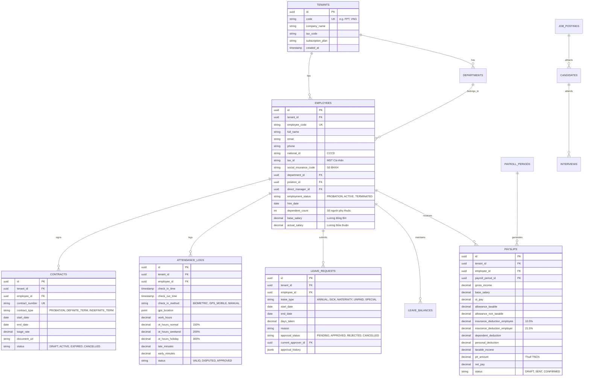

# Đề xuất Dự án: Nền tảng Quản trị Nhân sự Hiện đại cho Doanh nghiệp Việt Nam (VietHR Core)

> **Lấy cảm hứng từ:** ever-gauzy (NestJS + TypeORM + Angular)  
> **Định vị:** Tinh gọn, hiện đại, tối ưu hóa cho bài toán vận hành nhân sự tại doanh nghiệp Việt Nam (SMEs 50–500 nhân sự), tuân thủ 100% Bộ luật Lao động 2019 và Luật BHXH Việt Nam.  
> **Trạng thái:** Kế hoạch kỹ thuật & Kiến trúc chi tiết để phát triển (Ready for Implementation).
> **Vị trí trong tổng thể dự án (06/10/2026):** đây là tài liệu của **tuyến sản phẩm thương mại (VietHR Core)**,
> *ngoài phạm vi khóa luận KLCN133* — bản đồ ba tuyến và hướng đi: [`20-project-map-and-direction.md`](20-project-map-and-direction.md) §2.
> Stack (NestJS · PostgreSQL · Redis · Turborepo) cố ý khác stack khóa luận; 16 ADR trong `03-decision-records/` **không áp dụng** cho file này.
> Số pháp lý soạn ngày 18/09/2026 **đã có bản cập nhật 2026** (trần BHXH/BHYT 50,6tr từ 01/07/2026 · LTTV vùng I
> 5,31tr từ 01/01/2026 · giảm trừ gia cảnh 15,5/6,2tr từ kỳ thuế 2026 · Luật BV DLCN 91/2025 hiệu lực 01/01/2026):
> [`research/NOTES-03.md`](research/NOTES-03.md) §A — các chỗ tương ứng dưới đây đã vá kèm mốc hiệu lực.

---

## 1. Problem Statement (Bài toán Nghiệp vụ & Thị trường)

### 1.1 Điểm nghẽn HR tại các doanh nghiệp SME Việt Nam (50–500 nhân sự)
Doanh nghiệp quy mô từ 50 đến 500 nhân sự tại Việt Nam bước vào giai đoạn "gãy vỡ quy trình vận hành con người":
1. **Dữ liệu phân mảnh (Data Silo):** Thông tin nhân viên lưu trên Google Sheets/Excel, hồ sơ hợp đồng bản cứng nằm trong tủ, đơn xin nghỉ phép gửi qua Zalo/Email, dữ liệu chấm công xuất từ máy quẹt vân tay thành file `.dat` hoặc `.xls` rời rạc.
2. **Sai sót và áp lực tính lương định kỳ (Payroll Bottleneck):** Mỗi cuối tháng, phòng HR mất từ 5–7 ngày làm việc chỉ để đối soát công, bù giờ OT, tính BHXH/BHYT/BHTN theo mức lương cơ sở mới, tính thuế thu nhập cá nhân (TNCN) lũy tiến 7 bậc và gửi bảng lương (payslip) thủ công cho từng người.
3. **Mù mờ về phép năm & lịch sử công tác:** Thiếu cơ chế tự động cộng phép thâm niên (+1 ngày sau mỗi 5 năm theo Điều 114 BLLĐ 2019), không theo dõi được hạn chuyển tiếp hợp đồng (hết 2 lần xác định thời hạn phải sang không xác định thời hạn).
4. **Quy trình phê duyệt tắc nghẽn:** Quản lý bận họp không check email duyệt phép/OT; nhân viên không biết đơn của mình đang ở cấp nào, gây ức chế nội bộ và ảnh hưởng năng suất.
5. **Tuyển dụng rời rạc:** Ứng viên apply qua email/Fanpage/TopCV, CV bị trôi, lịch phỏng vấn xếp chồng chéo, không đo lường được chi phí/thời gian tuyển dụng (Time-to-hire, Cost-per-hire).

### 1.2 Vì sao các giải pháp hiện hữu thất bại?
- **Excel / Google Sheets:**
  - *Lỗ hổng:* Không phân quyền cấp dòng/cột chặt chẽ (lộ dữ liệu lương); không có Audit Log (ai sửa công thức tính lương lúc nào); dễ gãy link giữa các sheet khi số dòng tăng; không tự kích hoạt workflow.
- **Phần mềm kế toán / HR đóng gói kế thừa (Legacy HR Systems - MISA cũ, Fast, Bravo, phần mềm viết bằng VB6/WinForms):**
  - *Lỗ hổng:* Giao diện già cỗi, khó dùng, cài đặt on-premise phức tạp; không có phiên bản Web/Mobile tiện lợi cho nhân viên tự phục vụ (Self-service); chi phí customize cực đắt; nâng cấp logic thuế/bảo hiểm phụ thuộc vào đơn vị bán phần mềm.
- **Hệ thống ERP ngoại nhập (SAP SuccessFactors, Workday, Oracle HCM):**
  - *Lỗ hổng:* Chi phí bản quyền vượt quá ngân sách SME Việt Nam (tính theo USD/user/month cực cao); quy trình quá phức tạp và nặng nề; **không hỗ trợ sẵn đặc thù luật lao động, thuế TNCN và các loại phụ cấp theo luật Việt Nam** mà phải trả tiền thuê đối tác tích hợp (SI) viết plugin riêng với chi phí hàng chục nghìn USD.

### 1.3 Gap Analysis: ever-gauzy vs. Nhu cầu thực tế tại Việt Nam

| Tiêu chí | ever-gauzy (Open-Source) | Nhu cầu thực tế SME Việt Nam | Quyết định trong VietHR Core |
|---|---|---|---|
| **Định vị sản phẩm** | ERP toàn diện lai HRM: Invoicing, Inventory, Task Tracking, Time Tracking kiểu Upwork (chụp màn hình) | People Management & Operations chuyên sâu, tập trung vào vòng đời nhân sự (Onboard → Offboard) | **Bỏ toàn bộ ERP, Invoicing, Inventory, Desktop Screenshot.** Giữ và làm sâu HRM. |
| **Chấm công (Attendance)** | Đếm giờ theo task/project, timer bấm tay hoặc desktop app theo dõi phím chuột | Chấm công theo ca xoay, máy vân tay/khuôn mặt (hikvision/zkteco), GPS mobile check-in kèm geofencing | **Xây dựng module Shift Scheduling + IoT/Biometric Ingestion API + GPS Mobile Check-in.** |
| **Tính lương (Payroll)** | Sơ khai: chỉ nhân `giờ x hourly_rate` hoặc salary tĩnh, không có engine thuế địa phương | Tính lương Gross-to-Net tự động theo luật VN: BHXH/BHYT/BHTN (trần 20 lần lương cơ sở / tối thiểu vùng), Thuế TNCN 7 bậc lũy tiến, các khoản giảm trừ, phụ cấp miễn thuế | **Xây dựng Payroll Formula Engine tuân thủ Luật Lao động & Thuế Việt Nam.** |
| **Nghỉ phép (Leave)** | Khái niệm thô sơ, không gắn liền lịch làm việc và phép theo luật | Đầy đủ loại phép: Phép năm (cộng dồn thâm niên), Phép ốm đau/thai sản (hưởng BHXH), Nghỉ hiếu hỷ hưởng nguyên lương | **Workflow duyệt phép nhiều cấp (Multi-level approval) + Engine tự động tính toán số dư phép (Leave balance accrual).** |
| **Hợp đồng & Pháp lý** | Chỉ có thông tin hợp đồng dạng text cơ bản | Quản lý hợp đồng thử việc, xác định thời hạn (tối đa 2 lần), không xác định thời hạn; phụ lục hợp đồng; cảnh báo trước 15-30 ngày khi hết hạn | **Contract Lifecycle Module kèm cảnh báo quá hạn ký lại và trình ký tài liệu điện tử.** |
| **Tech Stack** | NestJS + TypeORM + Angular 15+ + Nx | Monorepo NestJS + TypeORM/Prisma + Next.js 14 (hoặc Angular 17+) + PostgreSQL | **Hiện đại hóa: Monorepo NestJS + Prisma/Drizzle (hoặc TypeORM v0.3) + Next.js 14 App Router/Tailwind/shadcn.** |

---

## 2. Core Features (MVP — Phase 1: 3 Tháng Đầu)

MVP tập trung giải quyết trọn vẹn chu trình "Nhập liệu nhân sự → Chấm công → Xin phép → Tính lương → Tuyển dụng thay thế".

```
┌────────────────────────────────────────────────────────────────────────┐
│                        CORE HR WORKFLOW (MVP)                         │
└────────────────────────────────────────────────────────────────────────┘
 [Tuyển dụng] ──> [Tạo Hồ sơ NV] ──> [Ký HĐLĐ] ──> [Gán Ca/Lịch làm việc]
                                                           │
                                                           ▼
 [Bảng Lương/Payslip] <── [Tính Lương Gross-Net] <── [Chốt Công & Phép]
```

### 2.1 Module Quản lý Nhân sự (Employee Management)
- **Hồ sơ nhân viên 360°:**
  - Thông tin định danh: Họ tên, Mã nhân viên (tự sinh theo quy tắc công ty, vd `VHR-00123`), CCCD/Hộ chiếu (ngày cấp, nơi cấp), Mã số thuế cá nhân, Số sổ BHXH.
  - Thông tin liên hệ, ngân hàng nhận lương (STK, tên ngân hàng, chi nhánh).
  - Tệp đính kèm: Scan CCCD, bằng cấp, hợp đồng, giấy khám sức khỏe.
  - Trạng thái: `PROBATION` (Thử việc), `ACTIVE` (Chính thức), `SUSPENDED` (Tạm hoãn HĐLĐ), `TERMINATED` (Đã nghỉ việc).
- **Cơ cấu tổ chức (Org Chart & Departments):**
  - Cây phòng ban phân cấp không giới hạn (Parent - Child).
  - Vị trí/Chức danh (Job Titles/Positions) chuẩn hóa kèm cấp bậc (`Level`: Intern, Junior, Middle, Senior, Lead, Manager, Director).
  - Gán người quản lý trực tiếp (`direct_manager_id`) phục vụ workflow phê duyệt tự động.
- **Lịch sử công tác (Employment History & Timeline):**
  - Theo dõi mọi biến động: Thăng chức, luân chuyển phòng ban, điều chỉnh lương, chuyển trạng thái hợp đồng, khen thưởng/kỷ luật. Có ghi nhận `effective_date` và `actor_id`.

### 2.2 Module Chấm công & Thời gian làm việc (Attendance & Time Tracking)
- **Quản lý Ca làm việc (Shift Management):**
  - Định nghĩa ca linh hoạt: Giờ vào, Giờ ra, Giờ nghỉ trưa (break time), Dung sai đi muộn/về sớm cho phép (Grace period, vd 15 phút).
  - Hỗ trợ ca văn phòng (Standard 8h-17h30), Ca gãy, Ca xoay/Ca đêm (hỗ trợ phụ cấp ca đêm theo luật).
  - Phân ca linh hoạt theo Tuần/Tháng cho từng nhân viên hoặc theo phòng ban.
- **Phương thức Check-in/Check-out đa kênh:**
  - **IoT/Biometric Ingestion API:** Endpoint nhận webhook/log từ máy chấm công vân tay/khuôn mặt (ZKTeco, Ronald Jack, Hikvision).
  - **Mobile Web GPS Check-in:** Kiểm tra tọa độ GPS nằm trong bán kính cho phép (Geofence radius ≤ 100m tính từ văn phòng/chi nhánh) và BSSID Wi-Fi văn phòng.
- **Xử lý Tăng ca (Overtime - OT) chặt chẽ:**
  - Quy trình gửi đơn xin OT trước khi làm: Số giờ dự kiến, công việc cụ thể, loại OT (ngày thường 150%, cuối tuần 200%, ngày lễ 300%).
  - Tự động đối soát giữa đơn xin OT đã duyệt và dữ liệu chấm công thực tế (lấy giá trị nhỏ hơn để tránh gian lận giờ công).
- **Tổng hợp bảng công tự động (Timesheet Consolidation):**
  - Tự động tính: Tổng ngày công chuẩn, Số ngày công thực tế, Số phút đi muộn/về sớm, Số giờ làm đêm, Số giờ OT theo từng hệ số.

### 2.3 Module Quản lý Nghỉ phép (Leave Management)
- **Thiết lập loại phép (Leave Policy):**
  - **Phép năm (Annual Leave):** Hưởng 100% lương, hạn mức cơ bản 12 ngày/năm + thâm niên (+1 ngày sau 5 năm). Cho phép cấu hình quy tắc chuyển phép thừa sang năm sau (vd hết hạn ngày 31/03 năm kế tiếp).
  - **Nghỉ ốm / Thai sản (Sick/Maternity Leave):** Nghỉ hưởng chế độ BHXH chi trả, công ty không tính lương ngày này; hệ thống xuất báo cáo Mẫu D02-LT gửi cơ quan BHXH.
  - **Nghỉ việc riêng có lương (Paid Special Leave):** Kết hôn (3 ngày), con kết hôn (1 ngày), tang chế tứ thân phụ mẫu/vợ chồng/con (3 ngày) theo Điều 115 BLLĐ.
  - **Nghỉ không lương (Unpaid Leave):** Nghỉ thỏa thuận, tự động trừ vào ngày công tính lương.
- **Leave Balance Engine (Tính số dư phép):**
  - Tự động cộng dồn (accrual) số ngày phép hàng tháng: `Số ngày phép cộng hàng tháng = 12 / 12 = 1 ngày/tháng` (tính từ tháng bắt đầu làm việc).
  - Kiểm tra điều kiện đủ số dư trước khi nhân viên bấm gửi đơn.
- **Workflow Phê duyệt (Leave Approval Workflow):**
  - Định tuyến tự động: Nhân viên tạo đơn → Quản lý trực tiếp (`direct_manager_id`) nhận thông báo duyệt → Quản lý HR duyệt bước cuối.
  - Hỗ trợ ủy quyền duyệt (Delegation) khi quản lý vắng mặt.

### 2.4 Module Tính Lương (Payroll Engine)
- **Công thức Gross-to-Net chuẩn hóa theo Luật Việt Nam:**
  - Thu nhập Gross = Lương căn bản hợp đồng + Phụ cấp đóng BHXH + Phụ cấp không đóng BHXH (ăn trưa, điện thoại, xăng xe trong định mức) + Thưởng hiệu quả/KPI + Lương làm thêm giờ (OT).
  - Các khoản trừ bảo hiểm (trừ vào lương người lao động): 8% BHXH + 1.5% BHYT + 1% BHTN (áp dụng mức trần theo lương cơ sở và mức lương tối thiểu vùng).
  - Các khoản giảm trừ gia cảnh: 11.000.000 VNĐ (bản thân) + 4.400.000 VNĐ x (số người phụ thuộc có hồ sơ hợp lệ).
  - Thu nhập tính thuế TNCN = Thu nhập chịu thuế - Các khoản đóng bảo hiểm bắt buộc - Giảm trừ gia cảnh.
  - Thuế TNCN: Áp biểu thuế lũy tiến từng phần 7 bậc (xem chi tiết ở Mục 5).
  - Thu nhập thực nhận (Net) = Thu nhập Gross - Bảo hiểm NLĐ - Thuế TNCN - Các khoản thu hồi/tạm ứng khác.
- **Tạo và gửi Phiếu lương (Payslip Generation):**
  - Tạo phiếu lương định dạng Web interactive & PDF mã hóa mật khẩu (ngày sinh nhân viên).
  - Gửi phiếu lương tự động qua Email và xem trực tiếp trên Self-service portal.
  - Nhân viên có thể bấm "Xác nhận bảng lương" hoặc "Phản hồi sai lệch" trong vòng 48h.

### 2.5 Module Tuyển dụng (Recruitment Pipeline)
- **Đăng tin tuyển dụng (Job Requisitions & Postings):**
  - Khởi tạo vị trí tuyển dụng, ngân sách lương (salary range), yêu cầu kỹ năng, mô tả công việc (JD).
  - Sinh trang tuyển dụng công khai (Public Career Portal) cho công ty.
- **Candidate Pipeline (Kanban Board):**
  - Kéo thả ứng viên qua các trạng thái: `Sourced` → `Screening` → `Interview Round 1` → `Interview Round 2` → `Offer Sent` → `Hired` → `Rejected`.
  - Phân loại lý do từ chối ứng viên (Overqualified, salary mismatch, failed technical test).
- **Lịch phỏng vấn & Offer:**
  - Đồng bộ Google Calendar/Outlook để xếp lịch phỏng vấn, gửi thư mời kèm link Google Meet/Zoom tự động cho ứng viên.
  - Tạo Offer Letter điện tử theo template mẫu, theo dõi phản hồi (Accepted/Declined).
  - **One-click Onboarding:** Khi chuyển trạng thái sang `Hired`, hệ thống tự động tạo hồ sơ nhân viên nháp (`draft employee`) kế thừa toàn bộ thông tin từ CV ứng viên mà không cần nhập lại.

---

## 3. Phase 2 Features (Mở rộng — 3 Tháng Tiếp Theo)

Sau khi hoàn thành và vận hành ổn định Phase 1, Phase 2 tập trung vào tối ưu hóa hiệu suất và tự động hóa nâng cao:

1. **Performance Reviews (OKR & KPI Management):**
   - Thiết lập mục tiêu chu kỳ (Quý/Năm): OKRs cấp công ty cascaded xuống Phòng ban và Nhân viên.
   - Chu trình đánh giá 360 độ: Nhân viên tự đánh giá (Self-review) → Đồng nghiệp đánh giá chéo (Peer review) → Quản lý chấm điểm & hiệu chỉnh (Calibration) → Phê duyệt điểm cuối cùng.
   - Báo cáo ma trận 9-Box (Performance vs. Potential) phục vụ quy hoạch cán bộ nguồn.
2. **Quản lý Đào tạo & Phát triển (Training & Development):**
   - Lộ trình phát triển kỹ năng (Skill Matrix) theo từng cấp bậc công việc.
   - Theo dõi ngân sách đào tạo, cam kết đào tạo (training bond) gắn liền với thời hạn làm việc bắt buộc.
3. **Cổng Thông tin Nhân viên Tự phục vụ (Advanced Self-Service Portal):**
   - Mobile PWA / Native App cho nhân viên: Điểm danh qua Wifi/GPS, xem ca làm việc, tra cứu phiếu lương, nộp đơn khiếu nại công, xin cấp thiết bị làm việc.
4. **Reports & Analytics Dashboard (Business Intelligence):**
   - Báo cáo biến động nhân sự: Tỷ lệ thôi việc (Turnover rate), Tỷ lệ nghỉ việc sớm (Early attrition).
   - Báo cáo cơ cấu nhân sự: Tháp tuổi, giới tính, thâm niên, cơ cấu chi phí lương theo doanh thu.
   - Báo cáo pháp lý một chạm: Tự động kết xuất báo cáo tình hình sử dụng lao động 6 tháng/năm theo Mẫu 01/PLI (Nghị định 145/2020/NĐ-CP).
5. **Document Management & E-Signature (Quản lý Tài liệu & Trình ký Hợp đồng):**
   - Sinh hợp đồng lao động, phụ lục gia hạn, quyết định bổ nhiệm từ mẫu động (Dynamic Mustache/Handlebars templates).
   - Tích hợp ký số điện tử (E-Signature) tuân thủ Luật Giao dịch điện tử Việt Nam.

---

## 4. Technical Architecture (Thiết kế Kỹ thuật Chi tiết)

```
                                 [CLIENT LAYER]
          ┌────────────────────────────────────────────────────────┐
          │  Next.js 14 App Router (Tailwind CSS + shadcn/ui)      │
          │  - HR Admin Portal    - Employee Self-Service (PWA)    │
          └───────────────────────────┬────────────────────────────┘
                                      │ HTTPS / WSS
                                      ▼
                                [API GATEWAY]
          ┌────────────────────────────────────────────────────────┐
          │  NestJS Application Gateway (REST API + WebSocket)     │
          │  - Better Auth / JWT Session Guard                     │
          │  - Tenant Isolation Interceptor (Row-Level Security)   │
          │  - Rate Limiter & Audit Logger                         │
          └───────────────┬───────────────────────┬────────────────┘
                          │                       │
         ┌────────────────┴───────────┐           │
         ▼                            ▼           ▼
┌──────────────────┐         ┌──────────────────┐  ┌────────────────┐
│ HR Core Modules  │         │ Background Queue │  │ File Storage   │
│ - Employee/Org   │         │ (BullMQ + Redis) │  │ (MinIO / S3)   │
│ - Attendance     │         │ - Gross-Net Calc │  │ - Contracts    │
│ - Leave/Workflow │         │ - Biometric Sync │  │ - Avatars, CVs │
│ - Payroll Engine │         │ - Email/Noti Job │  └────────────────┘
│ - Recruitment    │         └─────────┬────────┘
└────────┬─────────┘                   │
         │                             ▼
         └───────────────────> [DATABASE LAYER]
                      PostgreSQL 16 + pgvector
                      - Shared DB with tenant_id (RLS)
                      - Auditing & Versioning
```

### 4.1 Cấu trúc Monorepo (pnpm Workspaces + Turborepo)
```text
viet-hr/
├── apps/
│   ├── api/                  # NestJS 10+ Backend REST API
│   │   ├── src/
│   │   │   ├── modules/
│   │   │   │   ├── auth/           # Better-Auth / JWT & RBAC
│   │   │   │   ├── tenant/         # Multi-tenancy context
│   │   │   │   ├── employee/       # Hồ sơ & sơ đồ tổ chức
│   │   │   │   ├── attendance/     # Chấm công, ca, OT
│   │   │   │   ├── leave/          # Nghỉ phép, accrual engine
│   │   │   │   ├── payroll/        # Gross-to-Net calculation engine
│   │   │   │   ├── recruitment/    # Pipeline tuyển dụng
│   │   │   │   └── notification/   # In-app, Email, WebSocket
│   │   │   ├── shared/             # Interceptors, Filters, Decorators
│   │   │   └── main.ts
│   │   └── package.json
│   ├── web-admin/            # Next.js 14 App Router (Admin & Manager Portal)
│   │   ├── src/
│   │   │   ├── app/(dashboard)/    # Layout Dashboard phòng HR
│   │   │   ├── components/         # shadcn/ui primitives
│   │   │   └── lib/
│   │   └── package.json
│   └── web-portal/           # Next.js 14 (Mobile-first PWA cho Nhân viên)
│       └── package.json
├── packages/
│   ├── database/             # Prisma Schema hoặc TypeORM Entities + Migrations
│   │   ├── prisma/schema.prisma
│   │   └── src/client.ts
│   ├── payroll-engine/       # Thư viện tính thuế TNCN, BHXH đóng gói độc lập (Pure TS)
│   │   ├── src/vietnam-tax.ts
│   │   ├── src/social-insurance.ts
│   │   └── src/index.ts
│   ├── shared-types/         # DTOs, Enums, Interfaces dùng chung FE & BE
│   │   └── src/index.ts
│   └── ui-kit/               # Thiết kế theme, Tailwind presets, biểu tượng
├── docker-compose.yml        # PostgreSQL 16, Redis, MinIO
├── turbo.json
└── package.json
```

### 4.2 Thiết kế Cơ sở Dữ liệu (Database Design & ERD Entities)
Hệ thống sử dụng **PostgreSQL 16** với các quan hệ quan trọng sau:



### 4.3 Multi-Tenancy Strategy (Kiến trúc Đa Thuê bao)
Lựa chọn tối ưu cho hệ thống SaaS SME Việt Nam: **Shared Database với `tenant_id` và PostgreSQL Row-Level Security (RLS)**.
- *Lý do chọn Shared DB over Isolated DB:*
  - SME quy mô 50–500 nhân viên tạo lưu lượng vừa phải (vài chục nghìn records/tháng). Quản lý 1 DB riêng cho mỗi khách hàng (Database-per-tenant) gây bùng nổ chi phí hạ tầng, migration schema cực kỳ chậm và phức tạp khi phát hành bản vá.
- *Cơ chế Bảo mật Tuyệt đối qua PostgreSQL RLS:*
  1. Mỗi bảng nghiệp vụ đều chứa cột `tenant_id UUID NOT NULL REFERENCES tenants(id)`.
  2. Bật RLS: `ALTER TABLE employees ENABLE ROW LEVEL SECURITY;`.
  3. Tạo chính sách RLS:
     ```sql
     CREATE POLICY tenant_isolation_policy ON employees
     FOR ALL
     USING (tenant_id = NULLIF(current_setting('app.current_tenant_id', true), '')::uuid);
     ```
  4. Trong NestJS: `TenantInterceptor` trích xuất `tenant_id` từ JWT token / Subdomain của request, mở transaction và set biến cục bộ session:
     ```typescript
     await prisma.$executeRawUnsafe(`SET LOCAL app.current_tenant_id = '${tenantId}';`);
     ```
     Đảm bảo tuyệt đối không có rò rỉ dữ liệu giữa các công ty (cross-tenant data leakage) ngay cả khi developer quên mệnh đề `where: { tenant_id }`.

### 4.4 Authentication & Phân quyền (RBAC)
- Sử dụng **Better Auth** (hoặc module chuẩn hóa NestJS Passport JWT) hỗ trợ Session/Token an toàn, tương thích Edge runtime, sẵn sàng SSO (Google Workspace, Microsoft 365, Zalo ZNS).
- **Phân cấp Quyền hạn (Role-Based Access Control):**
  - `SUPER_ADMIN`: Quản trị viên hệ thống SaaS (toàn quyền nền tảng).
  - `COMPANY_ADMIN`: Giám đốc / Trưởng phòng Nhân sự (HRD) (toàn quyền trong 1 tenant).
  - `HR_OFFICER`: Chuyên viên nhân sự (quản lý hồ sơ, chấm công, soạn thảo bảng lương).
  - `LINE_MANAGER`: Quản lý trực tiếp (xem hồ sơ đội nhóm, duyệt phép, duyệt OT, đánh giá hiệu suất).
  - `EMPLOYEE`: Nhân viên thông thường (truy cập Self-service, xem payslip của mình, nộp đơn phép/OT).

### 4.5 API Design & File Storage
- **RESTful API:** Theo chuẩn JSON:API, phân trang Cursor-based cho log chấm công lớn, Versioning qua URI `/api/v1/...`.
- **WebSocket (Socket.IO):** Bắn sự kiện thời gian thực: Cập nhật phê duyệt đơn phép, thông báo chuông, tín hiệu quét vân tay thành công.
- **File Storage (S3 Compatible - MinIO hoặc Cloudflare R2):**
  - Lưu trữ: File scan hợp đồng, tài liệu CCCD, file CV ứng viên, ảnh đại diện.
  - Bảo mật: Không public URL tài liệu nhạy cảm. Toàn bộ file hợp đồng và CMND/CCCD được truy xuất thông qua **Pre-signed URL** có thời hạn tối đa 15 phút.

---

## 5. Vietnamese Labor Law Compliance (Tuân thủ Pháp lý Lao động Việt Nam)

Đây là giá trị cốt lõi tạo sự khác biệt hoàn toàn với ever-gauzy và các phần mềm nước ngoài.

```
                    ┌────────────────────────────────────────┐
                    │      THU NHẬP GROSS TRONG THÁNG        │
                    └───────────────────┬────────────────────┘
                                        │
           ┌────────────────────────────┴────────────────────────────┐
           ▼                                                         ▼
┌─────────────────────────────┐                           ┌─────────────────────────────┐
│   CÁC KHOẢN BẢO HIỂM NLĐ    │                           │    CÁC KHOẢN GIẢM TRỪ      │
│  - BHXH:  8.0%              │                           │  - Bản thân: 11.000.000 đ   │
│  - BHYT:  1.5%              │                           │  - Phụ thuộc: 4.400.000 đ/ng│
│  - BHTN:  1.0%              │                           │  - Phụ cấp miễn thuế (cơm...)│
│  (Mức trần theo luật định)  │                           └──────────────┬──────────────┘
└──────────┬──────────────────┘                                          │
           │                                                             │
           └────────────────────────────┬────────────────────────────────┘
                                        │
                                        ▼
                    ┌────────────────────────────────────────┐
                    │    THU NHẬP TÍNH THUẾ (TNCN)           │
                    │    Áp dụng biểu thuế lũy tiến 7 bậc    │
                    └───────────────────┬────────────────────┘
                                        │
                                        ▼
                    ┌────────────────────────────────────────┐
                    │      THU NHẬP THỰC NHẬN (NET)          │
                    │ = Gross - BH NLĐ - Thuế TNCN           │
                    └────────────────────────────────────────┘
```

### 5.1 Tỷ lệ Đóng Bảo hiểm Bắt buộc (BHXH, BHYT, BHTN)
Căn cứ Luật BHXH, Luật BHYT và Luật Việc làm:

| Khoản đóng bảo hiểm | Người lao động đóng | Doanh nghiệp (Người SDLĐ) đóng | Tổng cộng | Căn cứ áp dụng mức trần |
|---|---|---|---|---|
| **Bảo hiểm Xã hội (BHXH)** | **8.0%** (Hưu trí, tử tuất) | **17.5%** (14% hưu trí, 3% ốm đau - thai sản, 0.5% TNLĐ-BNN) | **25.5%** | Tối đa 20 lần Mức lương cơ sở |
| **Bảo hiểm Y tế (BHYT)** | **1.5%** | **3.0%** | **4.5%** | Tối đa 20 lần Mức lương cơ sở |
| **Bảo hiểm Thất nghiệp (BHTN)**| **1.0%** | **1.0%** | **2.0%** | Tối đa 20 lần Lương tối thiểu vùng |
| **Kinh phí Công đoàn (KPCĐ)** | *0%* | **2.0%** (trên quỹ lương đóng BHXH) | **2.0%** | Nộp cho LĐLĐ quận/huyện |
| **TỔNG CỘNG** | **10.5%** | **23.5%** (gồm cả KPCĐ) | **34.0%** | |

- **Quy tắc Mức trần đóng bảo hiểm (theo kỳ hiệu lực — nguồn: [`research/NOTES-03.md`](research/NOTES-03.md) F-01, F-02):**
  - **Kỳ 01/07/2024 → 30/06/2026:** lương cơ sở 2.340.000 VNĐ → trần BHXH/BHYT = `20 × 2.340.000 = 46.800.000 VNĐ`; LTTV vùng I 4.960.000 VNĐ → trần BHTN = `20 × 4.960.000 = 99.200.000 VNĐ`.
  - **Từ 01/07/2026:** lương cơ sở **2.530.000 VNĐ** (NĐ 161/2026/NĐ-CP) → trần BHXH/BHYT = `20 × 2.530.000 = 50.600.000 VNĐ`.
  - **Từ 01/01/2026:** LTTV vùng I **5.310.000 VNĐ** (NĐ 293/2025/NĐ-CP; vùng II/III/IV: 4.730.000 / 4.140.000 / 3.700.000) → trần BHTN vùng I = `20 × 5.310.000 = 106.200.000 VNĐ`.
  - Engine phải cấu hình trần theo kỳ hiệu lực (đã có `VIETNAM_2026_CONFIG` ở §8), không hardcode một mốc duy nhất.

### 5.2 Biểu Thuế Thu nhập Cá nhân (PIT - Lũy tiến từng phần)
Căn cứ Nghị quyết 954/2020/UBTVQH14 và Luật Thuế TNCN (biểu 7 bậc 5%–35% không đổi):
- **Kỳ quyết toán thuế 2025:** bản thân **11.000.000 VNĐ / tháng** · người phụ thuộc **4.400.000 VNĐ / người / tháng**.
- **Từ kỳ tính thuế 2026** (NQ 110/2025/UBTVQH15, hiệu lực 01/01/2026): bản thân **15.500.000 VNĐ / tháng** · người phụ thuộc **6.200.000 VNĐ / người / tháng** (nguồn: [`research/NOTES-03.md`](research/NOTES-03.md) F-03).
- Engine tham số hóa giảm trừ theo năm thuế — xem `RELIEF_BY_TAX_YEAR` ở §8.

**Bảng công thức tính nhanh thuế TNCN từng phần:**

| Bậc | Thu nhập tính thuế / tháng ($X$) | Thuế suất | Số tiền thuế phải nộp (Cách tính nhanh) |
|---|---|---|---|
| **1** | Đến 5 triệu VNĐ | 5% | $0.05 \times X$ |
| **2** | Trên 5 tr đến 10 triệu VNĐ | 10% | $0.10 \times X - 250.000$ |
| **3** | Trên 10 tr đến 18 triệu VNĐ | 15% | $0.15 \times X - 750.000$ |
| **4** | Trên 18 tr đến 32 triệu VNĐ | 20% | $0.20 \times X - 1.650.000$ |
| **5** | Trên 32 tr đến 52 triệu VNĐ | 25% | $0.25 \times X - 3.250.000$ |
| **6** | Trên 52 tr đến 80 triệu VNĐ | 30% | $0.30 \times X - 5.850.000$ |
| **7** | Trên 80 triệu VNĐ | 35% | $0.35 \times X - 9.850.000$ |

### 5.3 Quy định về Nghỉ phép (Điều 113, 114 BLLĐ 2019)
1. **Nghỉ phép năm cơ bản:**
   - 12 ngày làm việc: Người làm việc trong điều kiện bình thường.
   - 14 ngày làm việc: Lao động chưa thành niên, lao động là người khuyết tật, làm nghề nặng nhọc, độc hại, nguy hiểm.
   - 16 ngày làm việc: Làm nghề đặc biệt nặng nhọc, độc hại, nguy hiểm.
2. **Tăng ngày nghỉ theo thâm niên (Điều 114):**
   - Cứ đủ **05 năm** làm việc cho một người sử dụng lao động thì số ngày nghỉ hằng năm được tăng thêm tương ứng **01 ngày**.
3. **Nghỉ phép của nhân viên làm việc chưa đủ 12 tháng:**
   - `Số ngày nghỉ hằng năm = (Số ngày nghỉ theo quy định / 12) * Số tháng làm việc thực tế`.

### 5.4 Quy định Làm thêm giờ (Overtime - Điều 98, 107 BLLĐ 2019)
- **Hệ số tiền lương làm thêm:**
  - Vào ngày thường: Ít nhất bằng **150%** đơn giá tiền lương.
  - Vào ngày nghỉ hằng tuần (Thứ 7/CN tùy lịch công ty): Ít nhất bằng **200%**.
  - Vào ngày nghỉ lễ, tết, ngày nghỉ có hưởng lương: Ít nhất bằng **300%** (chưa kể tiền lương của ngày lễ, tết).
- **Làm việc ban đêm (22h00 đến 06h00 hôm sau):**
  - Trả thêm ít nhất **30%** tiền lương tính theo đơn giá tiền lương ban ngày.
  - Nếu làm thêm giờ ban đêm: Được trả thêm **20%** đơn giá ban ngày cho OT đêm vào ngày làm việc bình thường, **27%** cho OT đêm vào ngày nghỉ tuần/ngày lễ (NOTES-03 F-05).
- **Giới hạn số giờ làm thêm:**
  - Không quá 50% số giờ làm việc bình thường/ngày; không quá 40 giờ/tháng; không quá 200 giờ/năm (trừ trường hợp đặc thù được phép tới 300 giờ/năm).

### 5.5 Các Loại Hợp đồng Lao động (Điều 20 BLLĐ 2019)
Hệ thống loại bỏ hoàn toàn khái niệm "Hợp đồng mùa vụ" (đã bãi bỏ từ 2021) và chuẩn hóa 3 loại:
1. **Hợp đồng Thử việc (Probation Contract):** Thời gian tối đa 30 ngày (trung cấp), 60 ngày (cao đẳng, đại học trở lên), 180 ngày (vị trí quản lý doanh nghiệp).
2. **Hợp đồng Lao động Xác định Thời hạn (Definite-term):** Thời hạn từ 01 tháng đến 36 tháng.
   - *Ràng buộc pháp lý bắt buộc trong hệ thống:* Chỉ được ký tối đa **02 lần**. Hết lần thứ hai nếu người lao động tiếp tục làm việc thì **bắt buộc hệ thống phải chuyển loại hợp đồng sang Không xác định thời hạn**.
3. **Hợp đồng Lao động Không Xác định Thời hạn (Indefinite-term):** Không ấn định thời điểm chấm dứt hiệu lực.

---

## 6. Differentiation from ever-gauzy (So sánh & Cải tiến)

```text
 ┌──────────────────────────────────────────────────────────────┐
 │                     EVER-GAUZY ARCHITECTURE                  │
 │  ERP Core: Invoicing + Accounting + Expense + Inventory      │
 │  HRM: Employee + Basic Project Time Tracker (Screenshots)    │
 └──────────────────────────────┬───────────────────────────────┘
                                │
               [TÁCH VỎ, BỎ ERP & CHUYỂN HÓA SÂU]
                                │
                                ▼
 ┌──────────────────────────────────────────────────────────────┐
 │                     VIET-HR CORE ARCHITECTURE                │
 │  - BỎ: ERP, Invoicing, Inventory, Desktop Screenshot App     │
 │  - GIỮ: Clean NestJS Domain Modularization                   │
 │  - THÊM MỚI CHUYÊN SÂU:                                      │
 │    + Engine Tính lương Gross-Net theo luật VN                │
 │    + Phân ca xoay, GPS Mobile Check-in, Webhook máy vân tay  │
 │    + Quản lý HĐLĐ 2 lần xác định thời hạn & Phép thâm niên   │
 │    + UI/UX hiện đại: Next.js 14, Tailwind, shadcn/ui         │
 └──────────────────────────────────────────────────────────────┘
```

### 6.1 Những gì Kế thừa / Học hỏi từ ever-gauzy
- **Tư duy Kiến trúc Domain-driven của NestJS:** Học hỏi cách ever-gauzy tổ chức module rõ ràng theo DDD (Domain Driven Design), mỗi module độc lập có entity, service, controller, repository pattern.
- **Data Model Core Employee:** Cấu trúc bảng nhân viên linh hoạt, hỗ trợ lưu trữ metadata tùy biến.
- **Tư duy Mở rộng Plugin:** Cho phép cắm thêm các cổng tích hợp (notification channels, storage providers).

### 6.2 Những gì Cắt bỏ (Loại bỏ Over-engineering)
- **Cắt bỏ hoàn toàn các module ERP ngoại vi:** Loại bỏ Invoicing (hóa đơn bán lẻ/dự án), Inventory (quản lý kho hàng), Payments Processing, Client/Customer CRM. Doanh nghiệp SME Việt Nam cần phần mềm HR chuyên sâu, không muốn trả tiền hoặc bị rối mắt bởi một hệ thống ôm đồm nhưng nửa vời.
- **Cắt bỏ Desktop Screen Monitoring Tool:** ever-gauzy tập trung vào việc chụp ảnh màn hình nhân viên mỗi 10 phút và đếm nhấp chuột để tính giờ freelance. Văn hóa doanh nghiệp Việt Nam coi đây là xâm phạm quyền riêng tư và gây phản tác dụng; thay vào đó họ cần quản lý kỷ luật điểm danh (Shift In/Out) và kết quả công việc (KPIs).

### 6.3 Những gì Bổ sung Mới (Đặc thù Việt Nam)
1. **Bộ tính lương Gross-to-Net tự động chuẩn 100% Thuế & Bảo hiểm Việt Nam:** Không còn phải tải file Excel để tính thuế TNCN lũy tiến.
2. **Hệ thống cảnh báo Pháp lý HĐLĐ:** Đếm số lần ký HĐLĐ xác định thời hạn để cảnh báo HR không vi phạm quy định "ký quá 2 lần". Cảnh báo trước 30 ngày khi HĐ sắp hết hạn.
3. **Module Điểm danh Đa phương thức cho văn phòng & nhà xưởng:** Cổng API cắm máy vân tay trực tiếp + Điểm danh Mobile bằng Wi-Fi/GPS có Geofencing.
4. **Hệ thống Biểu mẫu Hành chính chuẩn Nhà nước:** Tự động kết xuất file mẫu báo cáo tăng/giảm lao động D02-LT (bảo hiểm xã hội) và mẫu 01/PLI (báo cáo sử dụng lao động).

### 6.4 Cải tiến Trải nghiệm Người dùng (UX Improvements)
- **Thay thế Angular cũ bằng Next.js 14 + Tailwind CSS + shadcn/ui:**
  - Tốc độ tải trang nhanh, giao diện thiết kế tối giản chuẩn quốc tế (clean, micro-interactions, dark mode hỗ trợ).
- **Trải nghiệm Mobile-first cho Nhân viên (Employee Self-Service):**
  - Nhân viên chỉ mất đúng 3 chạm trên điện thoại: Mở app → Bấm Check-in (tự nhận Wi-Fi công ty) → Xong.
  - Nộp đơn xin nghỉ/OT trong 30 giây với giao diện chọn ngày thông minh.
- **Kanban Pipeline tuyển dụng mượt mà:** Kéo thả ứng viên, xem trước file CV PDF ngay trong màn hình mà không cần mở tab mới.

---

## 7. Project Timeline & Milestones (Kế hoạch Triển khai Chi tiết)

Kế hoạch 6 tháng chia làm 2 giai đoạn: **MVP (Tháng 1 – Tháng 3)** và **Phase 2 Expansion (Tháng 4 – Tháng 6)**.

```
THÁNG 1: Core Foundation & Organization Structure
├── Sprint 1 (Tuần 1-2): Monorepo Setup, Multi-tenancy RLS, Auth & Employee 360°
└── Sprint 2 (Tuần 3-4): Departments Tree, Positions, Contract Lifecycle & Alerts

THÁNG 2: Time & Attendance + Leave Management Engine
├── Sprint 3 (Tuần 5-6): Shift Scheduler, Biometric Ingestion API & GPS Mobile Check-in
└── Sprint 4 (Tuần 7-8): Leave Balance Engine (Accrual + Thâm niên), Multi-level Approval

THÁNG 3: Payroll Engine & Recruitment Pipeline (Chốt MVP)
├── Sprint 5 (Tuần 9-10): Pure TS Gross-Net Formula Engine, Thuế TNCN 7 bậc, Payslip Gen
└── Sprint 6 (Tuần 11-12): Recruitment Kanban Board, Public Job Board, UAT & Pilot Launch

THÁNG 4 - THÁNG 6: Phase 2 Expansion
├── Tháng 4: Performance Reviews (OKR/KPI) & Chu trình đánh giá 360 độ
├── Tháng 5: Employee Mobile PWA & Báo cáo Phân tích Nhân sự (HR Analytics)
└── Tháng 6: Trình ký Điện tử Hợp đồng (E-Sign), Xuất Báo cáo D02-LT, Security Audit
```

### 7.1 Kế hoạch Chi tiết MVP: 3 Tháng (6 Sprints)

#### Tháng 1: Nền tảng Kỹ thuật, Tổ chức & Hồ sơ Nhân viên
- **Sprint 1 (Tuần 1–2): Architecture, Tenancy & Employee Core**
  - Setup Turborepo: `apps/api` (NestJS), `apps/web-admin` (Next.js), `packages/database` (Prisma + PostgreSQL).
  - Triển khai multi-tenancy qua PostgreSQL RLS và NestJS Middleware.
  - Tích hợp Auth (Better Auth), RBAC 5 vai trò.
  - CRUD Hồ sơ nhân viên, upload tài liệu CCCD lên MinIO/S3 với Presigned URL.
- **Sprint 2 (Tuần 3–4): Cơ cấu Tổ chức & Quản lý Hợp đồng**
  - Xây dựng sơ đồ cây phòng ban, danh mục chức danh, gán cấp quản lý trực tiếp.
  - Module Hợp đồng lao động: Đánh dấu loại HĐ (thử việc, xác định thời hạn lần 1/2, vô thời hạn).
  - Background Job (BullMQ): Quét hàng ngày và gửi cảnh báo hợp đồng sắp hết hạn trước 15 và 30 ngày.

#### Tháng 2: Chấm công & Quản lý Phép
- **Sprint 3 (Tuần 5–6): Phân ca & Chấm công Đa kênh**
  - Xây dựng bảng cấu hình ca làm việc (ca chuẩn, ca đêm, ca gãy) và lịch xoay ca.
  - Xây dựng Ingestion API nhận webhook nhật ký quẹt vân tay từ các hãng máy phổ biến.
  - Xây dựng tính năng Check-in Mobile định vị GPS (khoảng cách Haversine so với tọa độ văn phòng) + Kiểm tra BSSID Wi-Fi.
- **Sprint 4 (Tuần 7–8): Đơn xin OT & Engine Nghỉ phép Tự động**
  - Xây dựng luồng gửi và duyệt đơn làm thêm giờ (OT).
  - Xây dựng Leave Balance Engine: Tự động tính thâm niên +1 ngày phép sau mỗi 5 năm; cộng dồn phép hàng tháng.
  - Workflow phê duyệt nghỉ phép đa cấp: Quản lý trực tiếp duyệt → HR duyệt → Bắn thông báo Socket.IO & Email.

#### Tháng 3: Tính Lương Chuẩn Luật & Pipeline Tuyển dụng (Nghiệm thu MVP)
- **Sprint 5 (Tuần 9–10): Payroll Engine Gross-to-Net**
  - Đóng gói package `@viet-hr/payroll-engine`: Viết Unit Test 100% coverage cho các trường hợp biên của thuế TNCN 7 bậc và bảo hiểm xã hội (chạm mức trần lương cơ sở).
  - Engine chốt công tháng: Gom công thực tế, giờ OT theo các hệ số, ngày nghỉ hưởng BHXH.
  - Xuất bảng tính lương toàn công ty ra Excel và sinh Payslip PDF có mật khẩu.
- **Sprint 6 (Tuần 11–12): Tuyển dụng & Đưa vào Vận hành Thử nghiệm (Pilot)**
  - Xây dựng Kanban Board kéo thả hồ sơ ứng viên tuyển dụng.
  - Tính năng 1-Click chuyển đổi ứng viên trúng tuyển thành nhân viên chính thức.
  - Thực hiện kiểm thử toàn diện (End-to-End Testing với Playwright) cho toàn bộ luồng từ Tuyển dụng → Nhân viên → Chấm công → Tính lương.
  - Triển khai Pilot cho 02 doanh nghiệp thử nghiệm quy mô 50–100 nhân sự.

---

### 7.2 Kế hoạch Giai đoạn 2: 3 Tháng Tiếp theo (Tháng 4 – Tháng 6)

- **Tháng 4: Performance Management (OKR & KPI 360°)**
  - Thiết lập cây mục tiêu OKR công ty / phòng ban / cá nhân.
  - Chu trình đánh giá cuối quý: Tự đánh giá, chấm điểm chéo, họp hiệu chỉnh (Calibration meeting), xuất ma trận năng lực 9-Box.
- **Tháng 5: Mobile PWA Self-Service & HR Analytics Dashboard**
  - Tối ưu `apps/web-portal` thành Progressive Web App (PWA) cài đặt trực tiếp trên iOS/Android không cần qua App Store.
  - Xây dựng Dashboard báo cáo trực quan cho Giám đốc nhân sự: Tỷ lệ biến động nhân sự (Turnover rate), Phân bổ chi phí lương theo phòng ban, Biểu đồ nhân sự theo độ tuổi và giới tính.
- **Tháng 6: Tự động hóa Pháp lý & Trình ký Điện tử**
  - Xuất tự động biểu mẫu báo cáo lao động theo quy định nhà nước (Mẫu D02-LT BHXH, Mẫu 01/PLI).
  - Tích hợp ký hợp đồng điện tử qua OTP/SMS hoặc chữ ký số cá nhân.
  - Kiểm tra bảo mật (Penetration testing), tối ưu hóa cơ sở dữ liệu và chuyển giao toàn diện.

---

## 8. Sơ đồ CSDL và Mã nguồn mẫu cho Engine Tính Lương (Core Asset)

Để chứng minh tính khả thi và giúp đội ngũ phát triển bắt tay vào code ngay lập tức, dưới đây là mã nguồn TypeScript chuẩn xác của engine tính lương Gross-to-Net:

```typescript
// packages/payroll-engine/src/vietnam-tax.ts

export interface InsuranceConfig {
  baseSalaryCap: number;       // 20 × lương cơ sở (46,800,000 đ tới 30/06/2026 · 50,600,000 đ từ 01/07/2026)
  regionalMinWageCap: number;  // 20 × lương tối thiểu vùng (Vùng I: 99,200,000 đ tới 31/12/2025 · 106,200,000 đ từ 01/01/2026)
  rates: {
    social: { employee: number; employer: number };     // 8% - 17.5%
    health: { employee: number; employer: number };     // 1.5% - 3%
    unemployment: { employee: number; employer: number }; // 1% - 1%
    union: { employer: number };                        // 2%
  };
}

export const VIETNAM_2024_CONFIG: InsuranceConfig = {
  baseSalaryCap: 46_800_000,
  regionalMinWageCap: 99_200_000,
  rates: {
    social: { employee: 0.08, employer: 0.175 },
    health: { employee: 0.015, employer: 0.03 },
    unemployment: { employee: 0.01, employer: 0.01 },
    union: { employer: 0.02 },
  },
};

// Effective dates: base salary cap from 2026-07-01 (ND 161/2026: base salary 2,530,000);
// unemployment cap from 2026-01-01 (ND 293/2025: Region I minimum wage 5,310,000).
// Sources: docs/research/NOTES-03.md F-01, F-02. VIETNAM_2024_CONFIG is kept only for reconciling past payroll periods.
export const VIETNAM_2026_CONFIG: InsuranceConfig = {
  baseSalaryCap: 50_600_000,
  regionalMinWageCap: 106_200_000, // Region I; Regions II-IV: 94,600,000 / 82,800,000 / 74,000,000
  rates: {
    social: { employee: 0.08, employer: 0.175 },
    health: { employee: 0.015, employer: 0.03 },
    unemployment: { employee: 0.01, employer: 0.01 },
    union: { employer: 0.02 },
  },
};

// Family deduction per tax year: NQ 954/2020 (through tax year 2025), NQ 110/2025/UBTVQH15 (from tax year 2026)
// Source: docs/research/NOTES-03.md F-03
export const RELIEF_BY_TAX_YEAR: Record<number, { personal: number; dependent: number }> = {
  2025: { personal: 11_000_000, dependent: 4_400_000 },
  2026: { personal: 15_500_000, dependent: 6_200_000 },
};

export function calculatePersonalIncomeTax(taxableIncome: number): number {
  if (taxableIncome <= 0) return 0;
  if (taxableIncome <= 5_000_000) return taxableIncome * 0.05;
  if (taxableIncome <= 10_000_000) return taxableIncome * 0.10 - 250_000;
  if (taxableIncome <= 18_000_000) return taxableIncome * 0.15 - 750_000;
  if (taxableIncome <= 32_000_000) return taxableIncome * 0.20 - 1_650_000;
  if (taxableIncome <= 52_000_000) return taxableIncome * 0.25 - 3_250_000;
  if (taxableIncome <= 80_000_000) return taxableIncome * 0.30 - 5_850_000;
  return taxableIncome * 0.35 - 9_850_000;
}

export interface GrossToNetInput {
  grossSalary: number;
  insuranceSalary: number; // Lương thỏa thuận ghi trên HĐLĐ đóng BH
  dependents: number;
  nonTaxableAllowances: number; // Phụ cấp ăn trưa, điện thoại miễn thuế
}

export interface GrossToNetOutput {
  grossSalary: number;
  insuranceEmployee: {
    social: number;
    health: number;
    unemployment: number;
    total: number;
  };
  insuranceEmployer: {
    social: number;
    health: number;
    unemployment: number;
    union: number;
    total: number;
  };
  totalDeductions: number;
  taxableIncome: number;
  pitTax: number;
  netSalary: number;
}

export function calculateGrossToNet(input: GrossToNetInput, config = VIETNAM_2026_CONFIG, taxYear = 2026): GrossToNetOutput {
  // 1. Áp dụng mức trần bảo hiểm
  const salaryForSocialAndHealth = Math.min(input.insuranceSalary, config.baseSalaryCap);
  const salaryForUnemployment = Math.min(input.insuranceSalary, config.regionalMinWageCap);

  // 2. Bảo hiểm người lao động đóng
  const eeSocial = Math.round(salaryForSocialAndHealth * config.rates.social.employee);
  const eeHealth = Math.round(salaryForSocialAndHealth * config.rates.health.employee);
  const eeUnemployment = Math.round(salaryForUnemployment * config.rates.unemployment.employee);
  const eeInsuranceTotal = eeSocial + eeHealth + eeUnemployment;

  // 3. Bảo hiểm doanh nghiệp đóng
  const erSocial = Math.round(salaryForSocialAndHealth * config.rates.social.employer);
  const erHealth = Math.round(salaryForSocialAndHealth * config.rates.health.employer);
  const erUnemployment = Math.round(salaryForUnemployment * config.rates.unemployment.employer);
  const erUnion = Math.round(salaryForSocialAndHealth * config.rates.union.employer);
  const erInsuranceTotal = erSocial + erHealth + erUnemployment + erUnion;

  // 4. Family deduction (per tax year)
  const relief = RELIEF_BY_TAX_YEAR[taxYear] ?? RELIEF_BY_TAX_YEAR[2026];
  const totalRelief = relief.personal + (input.dependents * relief.dependent);

  // 5. Thu nhập tính thuế (Taxable Income)
  const assessableIncome = input.grossSalary - input.nonTaxableAllowances;
  const taxableIncome = Math.max(0, assessableIncome - eeInsuranceTotal - totalRelief);

  // 6. Thuế TNCN
  const pitTax = calculatePersonalIncomeTax(taxableIncome);

  // 7. Lương Net thực nhận
  const netSalary = input.grossSalary - eeInsuranceTotal - pitTax;

  return {
    grossSalary: input.grossSalary,
    insuranceEmployee: {
      social: eeSocial,
      health: eeHealth,
      unemployment: eeUnemployment,
      total: eeInsuranceTotal,
    },
    insuranceEmployer: {
      social: erSocial,
      health: erHealth,
      unemployment: erUnemployment,
      union: erUnion,
      total: erInsuranceTotal,
    },
    totalDeductions: totalRelief,
    taxableIncome,
    pitTax,
    netSalary,
  };
}
```

---

## 9. Định nghĩa Hoàn thành & Tiêu chí Nghiệm thu (Definition of Done)

Một tính năng được coi là sẵn sàng đưa vào sản xuất khi thỏa mãn checklist:
1. **Business Logic Test:** 100% các công thức Gross-to-Net, phép thâm niên, tăng ca OT có unit test với số liệu đối chiếu từ bảng tính chuẩn của kế toán trưởng doanh nghiệp thật.
2. **Security & Data Isolation:** Kiểm tra tự động (Automated test) xác nhận không có bất kỳ truy vấn nào lấy được dữ liệu của tenant khác (Tenant cross-talk test).
3. **Audit Trail:** Mọi thao tác sửa đổi công, sửa hợp đồng, duyệt phép, chỉnh sửa điểm KPI bắt buộc phải lưu bản ghi nhật ký kiểm toán (Audit log gồm: `actor_id`, `action`, `old_value`, `new_value`, `timestamp`).
4. **Performance Target:** API thời gian phản hồi p95 < 200ms cho các thao tác đọc/ghi thông thường; tác vụ tính lương hàng loạt cho 500 nhân viên thực thi dưới 5 giây thông qua background queue.
5. **Mobile Readiness:** Toàn bộ giao diện Self-service của nhân viên hiển thị hoàn hảo trên màn hình di động (iOS Safari và Android Chrome).

---

## 10. Cạnh tranh & mô hình kinh doanh (nháp từ research vòng 3 — 06/10/2026)

> Phần này trước đây thiếu hoàn toàn. Dữ liệu đầy đủ kèm URL: [`research/NOTES-03.md`](research/NOTES-03.md) §B
> (F-13..F-16). Chỉ trích con số đã verify trên trang giá hãng; report thị trường chưa đọc bản gốc thì không trích số (F-15).

### 10.1 Bối cảnh cạnh tranh — bảng giá công khai, đơn vị ₫/người/tháng nếu không ghi chú khác

| Nhóm | Sản phẩm & giá niêm yết (10/2026) | Điểm chạm với VietHR Core |
|---|---|---|
| Suite HRM SME | MISA AMIS ~1.050.000₫/tháng/30 NV (~35k) · Base từ 1.000.000₫/tháng/30 TK, tính theo module · 1Office 40k/60k/150k + phí triển khai 5–30tr + khóa hợp đồng 1 năm | Đắt nhanh khi ghép module; phí triển khai là rào cản với SME nhỏ |
| Chấm công thuần | ACheckin 25/40/49k (GPS + WiFi + FaceID) · Tanca ~15–30k | Mỏng về payroll/BHXH — khoảng chèn cho gross-to-net engine |
| Retail/F&B | iPOS HRM ~150k/tháng ("5k/ngày", chưa rõ theo cửa hàng hay người) · KiotViet Nhân sự · Sapo FnB (QR/GPS) | Đúng module §2.2 nhưng **không sản phẩm nào có chatbot hạng nhất** |
| Enterprise on-prem | FastHRM 10.000 USD license + 200 USD/người · Bravo · iHCM (quote-only) | Không cạnh tranh trực tiếp ở SME |

Bằng chứng định vị: 3 suite lớn đều đã có AI assistant — MISA AVA/OneAI (09/2025) · Base 2.0 "AI-first" (09/2026) ·
1Office 1AI — nhưng nhóm chấm công/F&B chỉ có AI nhận diện khuôn mặt (NOTES-03 F-14). Khoảng trống "chatbot HR
cho shift workforce" là chỗ đề tài khóa luận và VietHR Core cùng khai thác được.

### 10.2 Mô hình giá (khuyến nghị cần kiểm chứng tiếp — chưa chốt, cần pilot)

- Dải thị trường chấp nhận: chấm công thuần 10–40k · HRM SME 25–60k · suite đa module 100–150k (₫/người/tháng).
- Mốc gói theo team 30 người là chuẩn bảng giá VN; chiết khấu trả năm ~19% (tham chiếu Tanca).
- Free tier hiếm → cân nhắc free ≤10 NV làm kênh acquisition thay vì free trial 7–15 ngày.
- Chưa giải quyết: đơn giá thật theo người hay theo cửa hàng (iPOS), giá chốt sau thương lượng (MISA/Base).

### 10.3 Headroom thị trường (nguồn nhà nước)

Chỉ ~2,2% doanh nghiệp VN thành thạo phần mềm quản lý phục vụ phân tích/quyết định; ~60,6% đã dùng cloud
(NOTES-03 F-16, a2f.business.gov.vn). Ưu đãi chính sách: mục tiêu kinh tế số 30% GDP 2030. Con số quy mô thị
trường USD (133tr Ken Research / 112,9tr IMARC / 156tr 6Wresearch) **chưa đọc bản gốc — không đưa vào tài liệu bán hàng**.
