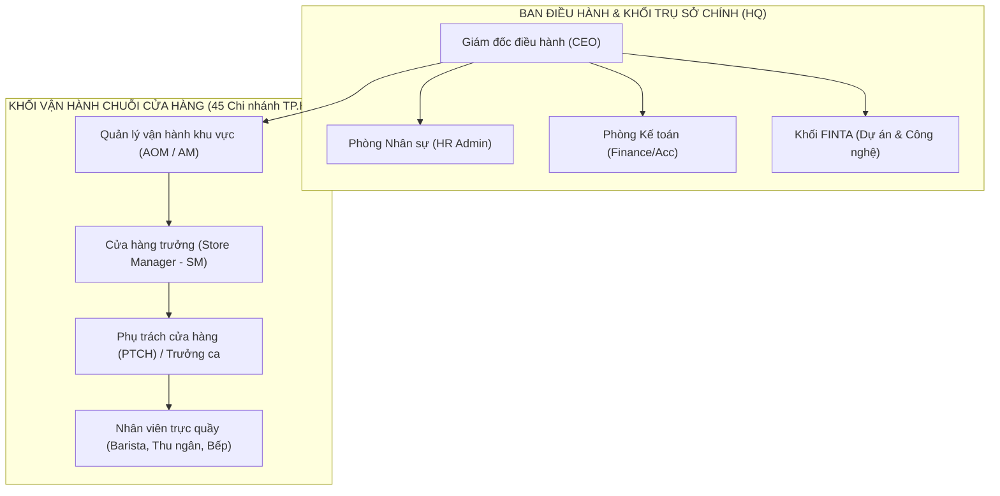
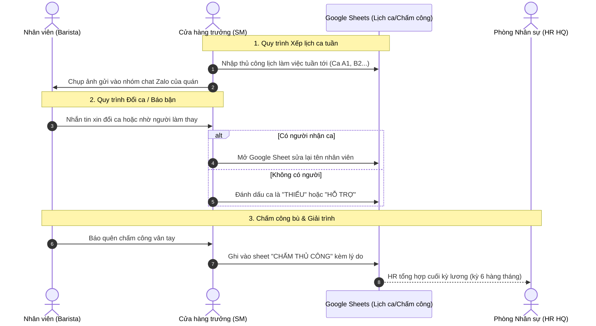
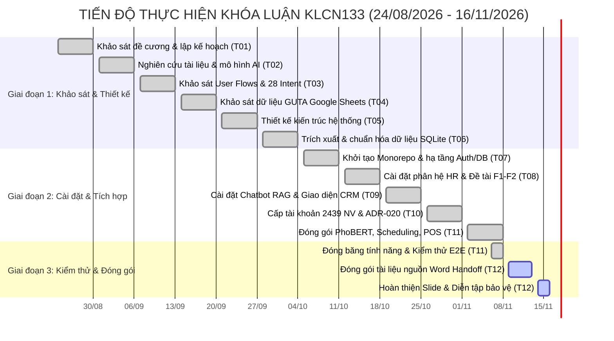

# TÀI LIỆU NGUỒN KHÓA LUẬN TỐT NGHIỆP: MỞ ĐẦU VÀ CHƯƠNG 1

- **Mã đề tài:** KLCN133
- **Tên đề tài:** Xây dựng Chatbot chuyển đổi số quản lý nhân sự
- **Đơn vị đào tạo:** Khoa Công nghệ Thông tin — Trường Đại học Công Thương TP.HCM (HUIT)
- **Giảng viên hướng dẫn:** ThS. Trần Việt Hùng (Email: `hungtv@huit.edu.vn`, SĐT: `0387510900`)
- **Nhóm sinh viên thực hiện:**
  1. Phạm Việt Hoàng — MSSV: 2001230265 — Lớp: 14DHTH09
  2. Nguyễn Thái Hòa — MSSV: 2001230252 — Lớp: 14DHTH09
  3. Nguyễn Ngọc Phi — MSSV: 2001230659 — Lớp: 14DHTH10
- **Thời gian thực hiện:** 12 tuần (24/08/2026 – 16/11/2026)
- **Tệp bàn giao:** `docs/word-handoff/01-mo-dau-va-chuong-1-khao-sat.md`

---

# PHẦN MỞ ĐẦU

### Hướng dẫn viết theo yêu cầu của Khoa
Mục này giới thiệu bối cảnh thực tiễn, tính cấp thiết của đề tài, xác định rõ đối tượng, mục tiêu, phạm vi và phương pháp nghiên cứu. Sinh viên dùng các dữ kiện dưới đây để viết thành các đoạn văn mạch lạc từ 2 đến 3 trang Word theo giọng văn học thuật, trung thực và khách quan.

## M.1. Lý do chọn đề tài (Tính cấp thiết)
- **Bối cảnh chuyển đổi số trong quản lý nhân sự (HRM):**
  - Ngành dịch vụ F&B và chuỗi bán lẻ tại Việt Nam có đặc thù vận hành với quy mô nhân sự lớn, phân tán tại nhiều điểm bán, tỷ lệ biến động lao động cao (turnover rate lớn) và lực lượng nhân sự part-time chiếm đa số.
  - Các doanh nghiệp vừa và nhỏ (SME) hoặc các chuỗi cửa hàng đang trong giai đoạn mở rộng thường phân công ca trực, giao chỉ tiêu và trao đổi chính sách qua các kênh rời rạc (Google Sheets, Zalo, Telegram).
- **Vấn đề thực tế tại đơn vị khảo sát (Chuỗi GUTA Cafe):**
  - Vòng đời công việc và ca trực không có trạng thái chính thức: Quản lý không nắm được ca nào đang thiếu người, nhiệm vụ nào sắp trễ hạn.
  - Đánh giá KPI thiếu minh bạch: Điểm số phụ thuộc nhiều vào nhận xét chủ quan của cấp trên, không truy vết được cơ sở tính điểm.
  - Chính sách và quy chế nằm rải rác: Tài liệu quy định phân tán trong nhiều tệp Word, Excel, PDF và Google Drive, khiến nhân viên liên tục hỏi lặp lại bộ phận nhân sự (HR).
  - Khó khăn trong việc phân công theo năng lực: Người quản lý thiếu công cụ trực quan để nhìn thấy kỹ năng chuyên môn của nhân viên nhằm đề xuất đúng người đúng việc.
- **Giải pháp đề xuất:** Xây dựng nền tảng kết hợp giữa **Web Dashboard quản trị** (cho Ban quản lý/HR) và **Trợ lý ảo Chatbot thông minh** (cho nhân viên) trên cùng một nguồn dữ liệu tập trung, tích hợp trí tuệ nhân tạo (AI) để giải quyết bài toán tra cứu chính sách, hỗ trợ phân công nhiệm vụ và minh bạch hóa KPI.
- **Nguồn:** `docs/00-vision-scope.md` (dòng 16-33); `docs/KLCN133_TranVietHung.docx`.

## M.2. Mục tiêu của đề tài
**Bảng M.1: Bảng đối chiếu mục tiêu tổng quát và mục tiêu cụ thể**

| STT | Mục tiêu | Nội dung cụ thể | Nguồn kiểm chứng |
|---|---|---|---|
| MT01 | Chuẩn hóa quy trình quản lý | Khảo sát hiện trạng, mô hình hóa các quy trình nghiệp vụ nhằm chuẩn hóa vòng đời phân công công việc, theo dõi tiến độ và đánh giá chỉ số hiệu suất KPI nhân sự. | `docs/KLCN133_TranVietHung.docx` |
| MT02 | Xây dựng hệ thống quản trị và giao diện hội thoại | Phát triển nền tảng ứng dụng gồm Web Dashboard quản trị dành riêng cho bộ phận Quản lý/HR và Trợ lý ảo Chatbot tương tác hằng ngày cho nhân viên, chia sẻ chung cơ sở dữ liệu. | `docs/KLCN133_TranVietHung.docx`; `docs/00-vision-scope.md` |
| MT03 | Tích hợp Trí tuệ nhân tạo (AI) | Ứng dụng mô hình ngôn ngữ tiếng Việt PhoBERT kết hợp mô hình ngôn ngữ lớn (LLM) theo cơ chế gọi hàm tự động (Function Calling) để tự động nhận diện ý định, gợi ý đề tài theo năng lực nhân viên và hỗ trợ phân tích nhận xét đánh giá. | `docs/KLCN133_TranVietHung.docx` |
| MT04 | Tự động hóa tương tác và hỗ trợ nhân sự | Hiện thực hóa quy trình tra cứu chính sách/KPI, đổi ca, nhắc hạn chót và nộp báo cáo kết quả công việc hoàn toàn thông qua hội thoại thời gian thực qua WebSocket. | `docs/KLCN133_TranVietHung.docx`; `docs/00-vision-scope.md` |

## M.3. Đối tượng và phạm vi nghiên cứu
- **Đối tượng nghiên cứu:**
  - Quy trình quản trị nhân lực chuỗi F&B: Xếp ca, đổi ca, chấm công bù, quản lý định biên, tính lương theo doanh thu và đánh giá KPI.
  - Bộ dữ liệu vận hành thực tế của chuỗi **GUTA Cafe** (dữ liệu đề tài gồm 144 đơn vị/cửa hàng, 2.439 hồ sơ nhân sự, 3.283 lượt phân ca, 115 bản ghi chấm công thủ công).
  - Mô hình xử lý ngôn ngữ tự nhiên: PhoBERT (`vinai/phobert-base`), Gemini Embeddings (`gemini-embedding-001`), mô hình ngôn ngữ lớn Google Gemini Flash với cơ chế Function Calling.
- **Phạm vi nghiên cứu (Trong phạm vi — Bắt buộc theo đề cương):**
  - **F1:** Quản lý hồ sơ nhân sự, phòng ban, chuẩn hóa 5 cấp bậc (`Intern`, `Junior`, `Middle`, `Senior`, `Lead`).
  - **F2:** Quản lý danh mục và vòng đời đề tài/công việc (`Khởi tạo` $\to$ `Đã giao` $\to$ `Đang thực hiện` $\to$ `Chờ duyệt` $\to$ `Hoàn thành`).
  - **F3:** Chatbot AI nhận diện ý định, tra cứu KPI và chính sách nhân sự qua cơ chế RAG.
  - **F4:** Thuật toán gợi ý phân công đề tài theo độ tương đồng ngữ nghĩa kỹ năng (PhoBERT).
  - **F5:** Phân tích ngữ nghĩa nhận xét của cấp quản lý nhằm hỗ trợ lượng hóa chỉ số KPI.
  - **F6:** Bảng điều khiển (Dashboard) trực quan hóa biến động hiệu suất, tỷ lệ hoàn thành công việc và trạng thái vận hành chuỗi.
  - **F7:** Tiếp nhận báo cáo nghiệm thu công việc và tự động hóa quy trình nhắc nhở hạn chót qua Chatbot.
- **Phạm vi mở rộng thực nghiệm:**
  - Quản trị ca kíp chuỗi F&B (Scheduling V1/V2): Đổi ca ngang hàng (peer swap) và nhờ hỗ trợ có quản lý duyệt (manager-assisted cover).
  - Báo cáo doanh thu POS theo ca cửa hàng (Sales report) và cấp mã nhân viên tự động `GT-CHYYMMNNNN`.
- **Ngoài phạm vi (Chủ động cắt giảm để đảm bảo tiến độ 12 tuần):**
  - Không xây dựng phân hệ tính lương chi tiết ra bảng lương chuyển khoản ngân hàng tự động.
  - Không xây dựng phân hệ phê duyệt nghỉ phép nâng cao nhiều cấp (UF-02) hoặc quy trình thôi việc/onboarding phức tạp (UF-03).
  - Không hỗ trợ nhập liệu bằng giọng nói (Voice input) hoặc trả lời bằng đa phương tiện phức tạp trong Chatbot.
- **Nguồn:** `docs/00-vision-scope.md` (dòng 46-96); `docs/scheduling-v1.md`; `docs/sales-report.md`.

## M.4. Phương pháp nghiên cứu
1. **Phương pháp nghiên cứu lý thuyết:**
   - Tìm hiểu kiến trúc xử lý ngôn ngữ tự nhiên Transformer và mô hình tiền huấn luyện cho tiếng Việt PhoBERT (Nguyen & Nguyen, 2020).
   - Nghiên cứu cơ chế RAG (Retrieval-Augmented Generation) và kỹ thuật gọi hàm tự động (Function Calling / Tool Calling) của mô hình ngôn ngữ lớn.
   - Nghiên cứu kiến trúc phần mềm sạch (Clean Architecture) và mô hình Microservices phân tách giữa Node.js backend và Python AI service.
2. **Phương pháp khảo sát và thực nghiệm dữ liệu:**
   - Trích xuất, làm sạch và chuẩn hóa toàn bộ dữ liệu vận hành từ Google Sheets của chuỗi GUTA Cafe sang hệ cơ sở dữ liệu SQLite và MongoDB Atlas.
   - Xây dựng kho tri thức số hóa từ 199 bài viết và các văn bản quy chuẩn, tài liệu PDF đào tạo của GUTA Cafe.
3. **Phương pháp xây dựng và phát triển phần mềm:**
   - Áp dụng quy trình linh hoạt (Agile) trong 12 tuần với kiến trúc Monorepo (`pnpm workspace`).
   - Kiểm thử tự động liên tục (CI/CD) qua GitHub Actions, kiểm thử giao diện E2E với Playwright và kiểm thử API với Vitest/Postman.
- **Nguồn:** `docs/00-vision-scope.md`; `docs/16-project-plan.md`.

## M.5. Bố cục của khóa luận
Báo cáo khóa luận được tổ chức thành 6 chương và các phần mở đầu, kết luận:
- **Phần Mở đầu:** Giới thiệu tính cấp thiết, mục tiêu, đối tượng, phạm vi và phương pháp nghiên cứu của đề tài.
- **Chương 1: Khảo sát hiện trạng và kế hoạch thực hiện:** Khảo sát cơ cấu tổ chức, quy trình vận hành chuỗi GUTA Cafe, phân tích các biểu mẫu có thật, đánh giá ưu nhược điểm của hệ thống cũ và lập kế hoạch thực hiện 12 tuần.
- **Chương 2: Phân tích hệ thống:** Xác định yêu cầu chức năng, phi chức năng, đặc tả Use Case nghiệp vụ và hệ thống, xây dựng sơ đồ lớp phân tích.
- **Chương 3: Thiết kế hệ thống:** Thiết kế kiến trúc tổng thể, sơ đồ triển khai, sơ đồ lớp thiết kế, mô hình dữ liệu (ERD) và thiết kế giao diện người dùng.
- **Chương 4: Thuật toán và Mô hình AI:** Trình bày thuật toán gợi ý phân công PhoBERT, cơ chế RAG tìm kiếm chính sách và quy trình xác thực hành động ghi của Chatbot.
- **Chương 5: Cài đặt hệ thống:** Trình bày chi tiết việc hiện thực hóa các chức năng trên Web Dashboard và Trợ lý ảo Chatbot.
- **Chương 6: Kiểm thử và Triển khai:** Trình bày kết quả kiểm thử API, kiểm thử E2E giao diện, đánh giá mô hình AI và quy trình triển khai hệ thống lên hạ tầng đám mây.
- **Kết luận và Hướng phát triển:** Đánh giá kết quả đạt được so với mục tiêu và đề xuất hướng mở rộng trong tương lai.

---

# CHƯƠNG 1: KHẢO SÁT HIỆN TRẠNG VÀ KẾ HOẠCH THỰC HIỆN

### Hướng dẫn viết theo yêu cầu của Khoa
Chương này chiếm 1.0 điểm trong thang điểm đánh giá của Khoa (CLO1.1: 0.75 điểm khảo sát hiện trạng; CLO6: 0.25 điểm lập kế hoạch). Cần trình bày chi tiết cơ cấu tổ chức có thật của đơn vị khảo sát, mô tả các vai trò, quy trình As-Is bằng lưu đồ rõ ràng, liệt kê các biểu mẫu đang sử dụng và lập luận logic về các vấn đề tồn tại của hệ thống cũ.

## 1.1. Khảo sát tổng quan nghiệp vụ quản lý nhân sự chuỗi F&B / Bán lẻ
- Trong mô hình chuỗi F&B, nhân sự được chia thành hai khối tách biệt:
  - **Khối Văn phòng (Head Office / Back-office):** Ban Giám đốc, Phòng Nhân sự (HR), Kế toán, Vận hành — chịu trách nhiệm ban hành quy chế, định biên, duyệt kế hoạch và phân bổ ngân sách lương.
  - **Khối Cửa hàng (Operations / Front-line):** Quản lý khu vực (AM/AOM), Cửa hàng trưởng (SM), Phụ trách cửa hàng (PTCH), Trưởng ca và các Barista/Thu ngân/Bếp — làm việc trực tiếp tại quầy theo các ca kíp linh hoạt.
- Quản trị nhân sự chuỗi đòi hỏi tính tức thời cao: biến động ca làm việc xảy ra hằng ngày, phát sinh nhu cầu đổi ca, nhờ hỗ trợ giữa các chi nhánh lân cận và giải trình quên chấm công. Việc duy trì các công cụ quản lý thủ công tạo ra độ trễ thông tin lớn và rủi ro sai sót trong tính lương.
- **Nguồn:** `docs/19-vertical-workforce-assessment.md`; `docs/research/NOTES-01.md`.

## 1.2. Dữ kiện khảo sát thực tế tại chuỗi GUTA Cafe

### 1.2.1. Cơ cấu tổ chức và các vai trò vận hành
Theo khảo sát thực tế trên dữ liệu vận hành và hệ thống sơ đồ tổ chức của GUTA Cafe (`apps/web/src/components/landing/org-chart-svg.ts` và `docs/database-design.md`), cơ cấu tổ chức bao gồm hai hệ thống chính:

**Hình 1.1: Sơ đồ cơ cấu tổ chức vận hành chuỗi GUTA Cafe**
*Nguồn: Trích xuất từ `apps/web/src/components/landing/org-chart-svg.ts` và `apps/web/scripts/build-org-chart.py`.*

**Bảng 1.1: Bảng mô tả chi tiết các vai trò và quyền hạn vận hành**

| Vai trò | Số lượng thực tế trong DB | Công việc & Trách nhiệm chính | Kênh thao tác chính hiện nay | Nguồn kiểm chứng |
|---|---:|---|---|---|
| **Giám đốc điều hành (CEO / Admin)** | 2 tài khoản quản trị | Toàn quyền kiểm soát hệ thống, phê duyệt ngân sách và chỉ tiêu kinh doanh. | Báo cáo tổng hợp | `docs/07-auth-rbac.md` |
| **Nhân sự trụ sở (HR Admin)** | Thuộc nhóm Admin | Quản lý danh mục nhân viên, hợp đồng, định biên chức danh, ban hành quy chế, xử lý khiếu nại. | File Excel `DATA` | `docs/database-extraction.md` |
| **Quản lý khu vực (AM / AOM)** | 29 nhân sự (24 AM, 5 AOM) | Phụ trách một cụm 5–10 cửa hàng theo quận; giám sát định biên, điều phối nhân sự hỗ trợ chéo, duyệt đề xuất. | Google Sheets, Zalo nhóm | `docs/database-design.md`; `ADR-020` |
| **Cửa hàng trưởng (SM / PTCH)** | 167 nhân sự (78 SM, 89 PTCH) | Quản lý trực tiếp 1 cửa hàng; xếp lịch tuần, theo dõi điểm danh, duyệt giải trình quên chấm công, chốt két tiền ca. | Sheet tuần, Zalo chi nhánh | `docs/database-design.md`; `docs/scheduling-v1.md` |
| **Nhân viên trực ca (Barista, Thu ngân, Bếp)** | 2.194 nhân viên bán hàng/pha chế + 16 nhân viên bếp | Thực hiện pha chế, thu ngân, mở/đóng ca, kiểm đếm két ca mình phụ trách, xem lịch ca, nộp giải trình. | Tin nhắn, bản in dán tại quầy | `docs/database-design.md`; `docs/database-extraction.md` |

### 1.2.2. Quy trình nghiệp vụ hiện tại (As-Is)
Hiện nay, việc vận hành tại chuỗi GUTA Cafe chủ yếu dựa trên Google Sheets tổng hợp (34 trang tính) kết hợp các nhóm trao đổi Zalo/Telegram.

**Hình 1.2: Lưu đồ quy trình xếp ca, đổi ca và chấm công bù hiện tại (As-Is)**
*Nguồn: Mô hình hóa từ `docs/database-design.md`, `docs/database-extraction.md` và `docs/scheduling-v1.md`.*

- **Quy trình xếp ca và phân bổ lịch làm việc:**
  - Hằng tuần, SM mở trang tính tuần tương ứng (ví dụ sheet `510-1110`), nhập mã ca (`A1`, `B2`, `AB1-B219`...) cho từng nhân viên theo từng ngày từ Thứ Hai đến Chủ Nhật.
  - Khi phát sinh thiếu người, SM ghi trực tiếp từ khóa `THIẾU` hoặc `HỖ TRỢ` vào ô lịch. Không có cơ chế kiểm tra tự động xem nhân viên được xếp có bị trùng ca ở cửa hàng khác hay không.
- **Quy trình chấm công và xử lý sai lệch:**
  - Nhân viên chấm công bằng máy vân tay tại cửa hàng. Khi có sự cố (mất mạng, vân tay không nhận diện, quên bấm), nhân viên phải báo riêng cho SM.
  - Định kỳ theo chu kỳ lương (từ ngày 06 tháng này đến ngày 05 tháng sau), các trường hợp bổ sung được nhập thủ công vào sheet `CHẤM THỦ CÔNG` (ghi nhận 115 bản ghi trong dữ liệu khảo sát).
- **Quy trình kiểm quỹ tiền mặt đầu/cuối ca:**
  - Tiền mặt được kiểm đếm tại cửa hàng và ghi nhận vào bảng kê (sheet `BẢNG KÊ`). Bảng kê ghi nhận tổng tiền mặt và phân rã các mệnh giá từ 500.000₫ đến 1.000₫, gom chung vào một túi tiền duy nhất cho cả ca.
- **Quy trình tra cứu quy chế và giải đáp thắc mắc:**
  - Nhân viên muốn tra cứu quyền lợi (chính sách lương theo doanh thu, định biên, chế tài vi phạm) phải hỏi SM hoặc nhắn tin trực tiếp cho nhân sự, gây quá tải cho bộ phận quản trị.
- **Nguồn:** `docs/database-design.md` (dòng 50-60); `docs/database-extraction.md` (dòng 25-45).

### 1.2.3. Danh mục biểu mẫu và văn bản quy định thực tế
Khảo sát thực địa kho dữ liệu thực tế của GUTA Cafe (`plans/reports/research-261031-1613-guta-portal-pdf-evidence-rag.md`) ghi nhận các tài liệu và biểu mẫu có thật:

**Bảng 1.2: Danh mục 9 biểu mẫu văn phòng thực tế đang áp dụng tại chuỗi GUTA Cafe**

| STT | Tên biểu mẫu | Định dạng gốc | Mục đích sử dụng nghiệp vụ | Đường dẫn lưu trữ trong repo |
|:---:|---|:---:|---|---|
| 1 | **Giấy đề nghị tạm ứng** | DOCX | Nhân viên xin tạm ứng tiền mua công cụ dụng cụ, xử lý sự cố gấp tại chi nhánh. | `data/guta_portal/documents/individual/` |
| 2 | **Giấy đề nghị hoàn ứng** | DOCX | Hoàn trả tiền tạm ứng chưa chi hết vào quỹ công ty sau khi xử lý xong việc. | `data/guta_portal/documents/individual/` |
| 3 | **Giấy thanh toán tiền tạm ứng** | XLSX | Bảng kê chi tiết các khoản chi thực tế kèm hóa đơn chứng từ để quyết toán. | `data/guta_portal/documents/individual/` |
| 4 | **Giấy đề nghị thanh toán** | DOCX | Đề nghị phòng Kế toán hoàn trả chi phí nhân viên đã chi tiền túi cho hoạt động quán. | `data/guta_portal/documents/individual/` |
| 5 | **Đơn xin nghỉ phép** | DOCX | Đơn đề đạt nguyện vọng nghỉ phép năm, nghỉ chế độ hoặc nghỉ việc riêng không lương. | `data/guta_portal/documents/individual/` |
| 6 | **Phiếu đề xuất tuyển dụng** | DOCX | Cửa hàng trưởng hoặc Trưởng bộ phận đề xuất tuyển bổ sung Barista/Thu ngân. | `data/guta_portal/documents/individual/` |
| 7 | **Mô tả công việc khung (JD)** | DOCX | Bản quy định chi tiết trách nhiệm, nhiệm vụ và tiêu chuẩn kỹ năng theo chức danh. | `data/guta_portal/documents/individual/` |
| 8 | **Đánh giá thử việc — Nhân viên** | XLSX | Phiếu chấm điểm hiệu quả công việc, thái độ và kỹ năng của Barista/Thu ngân sau thử việc. | `data/guta_portal/documents/individual/` |
| 9 | **Đánh giá thử việc — Quản lý** | XLSX | Bộ tiêu chí đánh giá năng lực lãnh đạo, quản lý ca và doanh số dành cho SM/AOM. | `data/guta_portal/documents/individual/` |

**Bảng 1.3: Danh mục các văn bản chính sách và tài liệu đào tạo quy chuẩn**

| Nhóm tài liệu | Số lượng | Tên văn bản tiêu biểu | Nội dung nghiệp vụ chính |
|---|:---:|---|---|
| **Chính sách & Quy chế** | 5 văn bản PDF | - `Chính_sách_lương_theo_doanh_thu_V1` - `QUY_TRÌNH_TUYỂN_DỤNG_VÀ_HỘI_NHẬP` - `QUY_ĐỊNH_ĐỊNH_BIÊN_CHỨC_DANH_SMPTCH` - `QUY_ĐỊNH_XỬ_PHẠT_NỘP_TRỄ_DOANH_THU` - `Quy_định_xử_phạt_gian_lận_cheating` | Quy định mức trích thưởng theo doanh thu; chế tài phạt nộp trễ tiền két; quy định định biên số lượng nhân viên trên từng cửa hàng. |
| **Tài liệu đào tạo nghiệp vụ** | 41 file PDF | - `G1_BARISTA_CƠ_BẢN` - `G2_BARISTA_NÂNG_CAO` - `TIÊU_CHUẨN_CỬA_HÀNG_GUTA_CAFE` - `QUY_TRÌNH_THU_NGÂN_NÂNG_CAO` | Giáo trình chuẩn hóa thao tác pha chế, bảo quản nguyên vật liệu, vệ sinh an toàn thực phẩm và chuẩn mực phục vụ khách hàng. |
| **Quy chế nội bộ trích xuất** | 57 văn bản OCR | - Nội quy lao động, kỷ luật lao động - Quy chuẩn an toàn lao động chi nhánh | Kho dữ liệu số hóa phục vụ nạp tri thức vào mô hình Chatbot AI RAG. |
*Nguồn: Đối soát từ `plans/reports/research-261031-1613-guta-portal-pdf-evidence-rag.md` (dòng 40-62).*

### 1.2.4. Đối soát và làm rõ mâu thuẫn số liệu khảo sát
Trong quá trình khảo sát tài liệu và đối chiếu với mã nguồn thực tế của dự án, nhóm nghiên cứu phát hiện các mâu thuẫn số liệu cần được phân định rõ ràng:

**Bảng 1.4: Bảng làm rõ mâu thuẫn số liệu giữa các tài liệu và cơ sở dữ liệu thật**

| Chỉ số | Con số xuất hiện trong tài liệu | Con số thực tế đã kiểm chứng | Giải thích nguyên nhân & Bản chất kỹ thuật | Nguồn kiểm chứng |
|---|---|---|---|---|
| **Số lượng chi nhánh / cửa hàng** | **45 chi nhánh** (xuất hiện trong `FolioLandingView.tsx`, `DESIGN.md`, `CLAUDE.md`) **34 chi nhánh** (xuất hiện trong `README.md` cũ) | **144 bản ghi danh mục** (`stores`), trong đó có **133 outlet thực tế** và **11 thực thể quản trị/bếp**. | - Con số **45 chi nhánh**: Là số liệu thiết kế giao diện (UI mockup/marketing) của chuỗi tại khu vực trọng điểm TP.HCM. - Con số **34 chi nhánh**: Là sự nhầm lẫn trong tài liệu cũ do file Excel gốc có **34 trang tính (sheets)**. - Con số **144 / 133**: Đọc từ cột `CỬA HÀNG` trong sheet `DATA`. Khi làm sạch theo `ADR-020`, tách 11 đơn vị ảo (`Group AOM Trầm`, `BẾP`, `Phụ trách dự án mới`), còn lại 133 điểm bán thực tế. | `docs/03-decision-records/ADR-020-crm-real-data-kpi-null-thay-vi-uoc-luong.md`; `docs/database-extraction.md` (dòng 23-39) |
| **Tổng số lượng nhân sự** | **2.456 dòng** (ghi nhận trong `database-extraction.md`) | **2.439 nhân sự hợp lệ** (lưu trữ trong MongoDB Atlas `employees`) | File Excel sheet `DATA` có 2.456 dòng thô có mã. Sau khi làm sạch, loại bỏ các dòng lỗi và chuẩn hóa, hệ thống còn đúng **2.439 nhân sự**. Trong đó: **740 nhân sự đang hoạt động (`active`)**, **1.699 nhân sự đã nghỉ (`inactive`)**, và 2.380 hồ sơ đã hoàn tất thông tin. Toàn bộ 2.439 nhân sự đều đã được liên kết với `departmentId`. | `docs/database-design.md` (dòng 49, 72); `plans/261030-1024-crm-real-data/plan.md` |
| **Số liệu Doanh thu két** | Demo hiển thị: 184.250.000 ₫ | **Không đủ dữ liệu toàn chuỗi** (chỉ có 9 cửa hàng trong 1 ngày) | Sheet `BẢNG KÊ` chỉ ghi nhận tiền mặt của 9 cửa hàng trong 1 ngày duy nhất (tổng 16.275.000 ₫). Theo quyết định kiến trúc `ADR-020`, hệ thống trả về `value: null` kèm lý do trên Dashboard, kiên quyết **không bịa số ước lượng**. | `docs/03-decision-records/ADR-020-crm-real-data-kpi-null-thay-vi-uoc-luong.md` |
| **Tỷ lệ đúng giờ (On-time Rate)** | Demo hiển thị: 98.6% | **Không có dữ liệu chấm công gốc** | Dữ liệu Google Sheets không chứa bảng quẹt vân tay gốc của máy ZKTeco; sheet `CHẤM THỦ CÔNG` chỉ có 115 dòng giải trình. Do đó chỉ số này được đặt là `null` trên hệ thống thật. | `ADR-020`; `docs/database-design.md` |

### 1.2.5. Đánh giá ưu điểm, nhược điểm và các vấn đề tồn tại của hệ thống cũ

**Bảng 1.5: Bảng đánh giá ưu điểm, nhược điểm và thách thức chuyển đổi số**

| Khía cạnh | Ưu điểm của hệ thống hiện tại | Nhược điểm & Vấn đề tồn tại nghiêm trọng | Hướng giải quyết của đề tài KLCN133 |
|---|---|---|---|
| **Lưu trữ dữ liệu** | - Đã bước đầu tin học hóa trên Google Sheets. - Lưu trữ đầy đủ danh sách mã nhân viên (`GT-CH...`, `GT-VP...`). | - **Dữ liệu phân mảnh, thiếu ràng buộc toàn vẹn:** Cùng một cửa hàng nhưng mỗi sheet viết một kiểu (ví dụ `1BNK`, `1B Nguyễn Kiệm`, `GUTA CAFE - 1B Nguyễn Kiệm`). - Nguy cơ mất mát dữ liệu do phân quyền file mở. | Chuẩn hóa vào cơ sở dữ liệu MongoDB Atlas, xây dựng bảng cầu bí danh (`store_aliases`) và định danh duy nhất cho từng chi nhánh. |
| **Điều phối ca làm việc** | - Có quy ước phân ca rõ ràng (`A1`, `B2`). - SM chủ động linh hoạt xếp người quen việc. | - **Quy trình thủ công, độ trễ cao:** Nhân viên không nhận được thông báo biến động lịch theo thời gian thực. - Đổi ca qua chat riêng dẫn đến trùng ca hoặc ca bị bỏ trống (`THIẾU`). | Xây dựng module Xếp ca (Scheduling V1/V2), cho phép đổi ca ngang hàng có xác thực và gửi thông báo tức thời qua WebSocket. |
| **Chấm công & Tính KPI** | - Có quy định chu kỳ tính lương cố định (ngày 06 hàng tháng). | - **Điểm mù dữ liệu:** Chấm công thủ công chỉ ghi nhận khi có khiếu nại, dễ gian lận. - Đánh giá KPI mang tính định tính, phụ thuộc cảm xúc cá nhân của người quản lý. | Số hóa quy trình gửi giải trình chấm công qua Chatbot; áp dụng công thức tính KPI tất định có đối soát bằng chứng công việc. |
| **Tra cứu chính sách** | - Đã có cổng thông tin nội bộ và kho văn bản Drive phong phú. | - **Tài liệu rời rạc:** Nhân viên khó tìm kiếm chính sách phù hợp, tốn thời gian hỏi đáp lặp lại với HR. - Biểu mẫu Word/Excel tải về không đồng bộ phiên bản. | Tích hợp Trợ lý ảo Chatbot ứng dụng RAG (Retrieval-Augmented Generation) để trả lời chính xác điều khoản và đính kèm link tải biểu mẫu trực tiếp. |

---

## 1.3. Kế hoạch thực hiện đề tài và phân công công việc

### 1.3.1. Kế hoạch chi tiết 12 tuần (Đề cương vs Thực tế triển khai)
Dự án được triển khai trong 12 tuần (từ ngày 24/08/2026 đến ngày 16/11/2026). Dưới đây là bảng đối chiếu giữa kế hoạch dự kiến ban đầu theo đề cương (`docs/16-project-plan.md`) và các mốc triển khai thực tế được kiểm chứng qua lịch sử Git commit (`git log --format='%h %ad %an %s'`).

**Bảng 1.6: Bảng tiến độ triển khai 12 tuần của khóa luận**

| Tuần | Khoảng thời gian | Kế hoạch dự kiến theo đề cương (`docs/16-project-plan.md`) | Thực tế triển khai đã kiểm chứng qua Git Log | Trạng thái |
|:---:|:---:|---|---|:---:|
| **T01** | 24/08 – 30/08/2026 | Xác định mục tiêu, phạm vi nghiên cứu; lập kế hoạch và phân chia công việc nhóm; nộp đề cương cho GVHD (25/08). | Họp nhóm, khảo sát yêu cầu từ đề cương `KLCN133_TranVietHung.docx`; xác lập phạm vi 7 chức năng F1–F7. | Hoàn thành |
| **T02** | 31/08 – 06/09/2026 | Nghiên cứu tài liệu tổng quan, tìm hiểu mô hình PhoBERT và các giải pháp chatbot quản trị nhân sự; khảo sát công nghệ. | Nghiên cứu các bài báo khoa học về PhoBERT (Nguyen & Nguyen, 2020), tìm hiểu kiến trúc MERN Stack và FastAPI. | Hoàn thành |
| **T03** | 07/09 – 13/09/2026 | Khảo sát 10 luồng người dùng (User Flows), lập catalog 28 intent và ma trận thông báo; hoàn thiện báo cáo research vòng 1. | Hoàn thành bộ tài liệu thiết kế sơ bộ: `00-vision-scope.md`, `NOTES-01.md`. Commit đầu tiên thiết lập baseline vào ngày 13/09/2026 (`b5ba32f`). | Hoàn thành |
| **T04** | 14/09 – 20/09/2026 | Khảo sát chuyên sâu bộ dữ liệu vận hành thực tế của GUTA Cafe từ Google Sheets (34 trang tính). | Phân tích cấu trúc dữ liệu thô: 144 chuỗi cửa hàng, 2.456 nhân viên, 29 sheet tuần phân ca. | Hoàn thành |
| **T05** | 21/09 – 27/09/2026 | Thiết kế kiến trúc hệ thống tổng thể, so sánh các giải pháp tích hợp AI (Microservices vs Monolith). | Thống nhất kiến trúc: Monorepo pnpm, Node Express backend, Python FastAPI AI microservice, MongoDB Atlas M0. | Hoàn thành |
| **T06** | 28/09 – 04/10/2026 | Viết script trích xuất dữ liệu Google Sheets sang SQLite (`hr_bot.db`); kiểm tra tính toàn vẹn khóa ngoại. | Chạy script trích xuất ngày 04/10/2026: trích xuất 33.198 ô thô (`raw_cells`), chuẩn hóa 2.456 nhân viên (`employees`). | Hoàn thành |
| **T07** | 05/10 – 11/10/2026 | Khởi tạo cấu trúc dự án Monorepo, thiết lập MongoDB Atlas, cài đặt module Xác thực (JWT RTR, RBAC) và Contracts Zod. | Khởi tạo Monorepo (`8738823`), hoàn thiện contracts Zod, Express API, Vite Web và FastAPI AI (`ae8aac6`). Cập nhật bảng cầu `store_aliases` ngày 07/10/2026. Lập plan phục hồi 6 tuần (`20-project-map-and-direction.md`). | Hoàn thành |
| **T08** | 12/10 – 18/10/2026 | Xây dựng phân hệ Quản lý hồ sơ nhân viên (F1), Quản lý đề tài (F2) và khung giao diện Dashboard. | Hoàn thiện ERD tổng thể, phân định ranh giới 3 tuyến dữ liệu (Khóa luận · Core · GUTA data). Chuẩn bị dữ liệu seed có khóa. | Hoàn thành |
| **T09** | 19/10 – 25/10/2026 | Thiết kế Chatbot Agent Loop với WebSocket, tích hợp Gemini Flash và RAG tri thức chính sách; thiết kế giao diện CRM Folio. | Tích hợp Hybrid RAG, Gemini key pool (`bed646e`), xây dựng giao diện Folio Landing View & CRM Command Center (Zero-Yellow, Dark Theme Obsidian) kết nối Chat Drawer. | Hoàn thành |
| **T10** | 26/10 – 01/11/2026 | Cấp phát tài khoản hàng loạt cho 2.439 nhân sự; chuẩn hóa Authorization V1 (9 profiles); áp dụng ADR-020 đọc dữ liệu thật. | Triển khai `ADR-020` (`a84282a`), nạp Store CRUD thật, cấp tài khoản hàng loạt cho 2.439 nhân viên bằng username (`fe5e94a`), nghiên cứu tích hợp PDF biểu mẫu làm bằng chứng RAG. | Hoàn thành |
| **T11** | 02/11 – 08/11/2026 | Đóng gói worker PhoBERT F4 độc lập; hoàn thiện module Xếp ca V1/V2, cấp mã NV tự động, báo cáo POS; **Đóng băng tính năng**. | Tách module PhoBERT cloud (`82f414f`), hoàn thiện Scheduling V1/V2 (`807b741`), cấp mã `GT-CHYYMMNNNN` (`2032abe`), Sales Report (`c7c162b`), KPI Chatbot review-confirm (`4a05252`). Đóng băng tính năng để phục vụ đo đạc. | Hoàn thành |
| **T12** | 09/11 – 16/11/2026 | Chạy kiểm thử tự động toàn diện (E2E Playwright, Vitest), đóng gói tài liệu nguồn báo cáo Word và chuẩn bị Slide bảo vệ. | Đóng gói bàn giao tài liệu nguồn báo cáo Word (`docs/word-handoff/`), rà soát chỉ số kiểm thử, hoàn thiện bài thuyết trình trước hạn nộp 16/11/2026. | Đang thực hiện |

### 1.3.2. Sơ đồ tiến độ Gantt 12 tuần

**Hình 1.3: Sơ đồ tiến độ thực hiện đề tài trong 12 tuần (Gantt Chart)**

### 1.3.3. Phân công công việc các thành viên trong nhóm
Theo quy định thực hiện khóa luận của Khoa CNTT — HUIT, nhóm gồm 3 sinh viên. Để đảm bảo tính chính xác và tôn trọng phân công nội bộ thực tế của nhóm sinh viên, bảng phân công dưới đây để các ô vai trò và nhiệm vụ chính thức để nhóm và chủ dự án tự điền.

**Bảng 1.7: Bảng phân công nhiệm vụ thành viên nhóm thực hiện đề tài**

| STT | Thành viên | MSSV / Lớp | Phân công nhiệm vụ thực tế | Module / Chức năng phụ trách chính | Ghi chú & Đóng góp |
|:---:|---|:---:|---|---|---|
| 1 | **Phạm Việt Hoàng** | 2001230265 14DHTH09 | `[...]` *(Nhóm tự điền)* | `[...]` *(Nhóm tự điền)* | `[...]` |
| 2 | **Nguyễn Thái Hòa** | 2001230252 14DHTH09 | `[...]` *(Nhóm tự điền)* | `[...]` *(Nhóm tự điền)* | `[...]` |
| 3 | **Nguyễn Ngọc Phi** | 2001230659 14DHTH10 | `[...]` *(Nhóm tự điền)* | `[...]` *(Nhóm tự điền)* | `[...]` |

#### Dữ liệu tham khảo kỹ thuật phục vụ đối chiếu:
Nhằm hỗ trợ nhóm hoàn thiện báo cáo và bảo vệ trước hội đồng, hệ thống cung cấp hai nguồn dữ liệu tham khảo khách quan:

1. **Ma trận phân vùng trách nhiệm (RACI) theo tài liệu kế hoạch ban đầu (`docs/16-project-plan.md` dòng 68-105):**
   - **Phạm Việt Hoàng:** Chủ trì hạ tầng hệ thống, bảo mật xác thực (`auth`), thời gian thực (`realtime`), cấu hình CI/CD (`ci`) và điều phối kiến trúc API (`modules/auth`, `modules/realtime`, `jobs/`).
   - **Nguyễn Thái Hòa:** Chủ trì phân hệ trí tuệ nhân tạo (`ai`), Chatbot thông minh (`chatbot`), thuật toán gợi ý PhoBERT (`f4`), đánh giá RAG và các mô hình học máy (`apps/ai-service`).
   - **Nguyễn Ngọc Phi:** Chủ trì giao diện người dùng (`dashboard`), trải nghiệm Web (`apps/web`), phân hệ nghiệp vụ nhân sự và đề tài (`modules/hr`, `modules/project`).

2. **Thống kê số lượng đóng góp mã nguồn trên hệ thống Git (`git shortlog -sn --all` tính đến 07/11/2026):**
   - Tác giả `hoangedu773` / `hoang`: **148 commits** (Đóng góp chính vào việc thiết lập Monorepo, cấu hình CI/CD, cơ sở dữ liệu MongoDB Atlas, kiến trúc RAG, tích hợp dữ liệu thật theo ADR-020, cấp phát tài khoản hàng loạt và phát triển giao diện Folio/CRM).
   - Tác giả `Nguyen Ngoc Phi`: **52 commits** (Đóng góp chính vào việc phát triển Authorization V1, module Xếp ca Scheduling V1/V2, cấp mã nhân viên tự động, Báo cáo doanh thu bán hàng POS và quy trình xác thực Preview-Confirm của Chatbot).
   - Tác giả `Nguyen Thai Hòa`: **0 commits** được ghi nhận trực tiếp trên nhánh Git hiện tại (Lưu ý: Sinh viên và nhóm cần bổ sung minh chứng về các phần nghiên cứu tài liệu, mô hình lý thuyết, thiết kế slide hoặc tài liệu Word độc lập ngoài mã nguồn).

---

## 1.4. Danh mục chỗ cần ảnh chụp minh chứng hiện trạng (Screenshots)
Trong quyển báo cáo Word, sinh viên cần chèn các ảnh chụp thực tế vào các vị trí tương ứng để làm tăng tính thuyết phục cho phần khảo sát:

1. `[CHÈN ẢNH: Trang tính danh mục nhân sự thô — file Excel Google Sheet DATA — 2.456 dòng nhân viên kèm chức danh, chi nhánh — Tài khoản người khảo sát]`
2. `[CHÈN ẢNH: Bảng phân ca tuần trên Google Sheet — sheet 510-1110 — Cột phân ca A1, B2, ô THIẾU, ô HỖ TRỢ của các cửa hàng — Tài khoản người khảo sát]`
3. `[CHÈN ẢNH: Trang tính chấm công thủ công — sheet CHẤM THỦ CÔNG — Các dòng giải trình quên chấm công theo chu kỳ lương 6/5-5/6 — Tài khoản người khảo sát]`
4. `[CHÈN ẢNH: Bản kê kiểm quỹ tiền mặt — sheet BẢNG KÊ — Số liệu tổng hợp tiền mặt và bảng đếm mệnh giá 500k-1k của 9 cửa hàng — Tài khoản người khảo sát]`
5. `[CHÈN ẢNH: Thư mục lưu trữ biểu mẫu trên Google Drive — data/guta_portal/documents/ — 9 biểu mẫu Word/Excel xin nghỉ phép, tạm ứng, thanh toán — Tài khoản người khảo sát]`
6. `[CHÈN ẢNH: Giao diện Cổng thông tin nội bộ Guta Cafe — congthongtin.gutacafe.com — Các bài viết quy chế và tài liệu đào tạo — Trình duyệt web]`

---

## 1.5. Ghi chú kiểm chứng & Mục chưa kiểm chứng

### Các điểm mâu thuẫn đã được đối soát thành công:
1. **45 chi nhánh vs 144 stores:** Con số 45 là quy mô vận hành trọng điểm tại TP.HCM được chọn làm đại diện hiển thị giao diện UI/UX; 144 là tổng số tên đơn vị trích xuất từ cột `CỬA HÀNG` trong Google Sheets (trong đó có 133 cửa hàng thực tế và 11 đơn vị ảo).
2. **2.456 dòng vs 2.439 nhân sự:** 2.456 là số dòng thô ban đầu; 2.439 là số hồ sơ nhân viên thực tế sau khi làm sạch và nạp thành công vào MongoDB Atlas (với 740 nhân sự đang làm việc).
3. **Chính sách KPI không bịa số:** Dashboard hiển thị `null` kèm tooltip giải thích cho KPI doanh thu két và tỷ lệ đúng giờ do dữ liệu nguồn Google Sheets không đầy đủ, tuân thủ đúng quyết định kiến trúc `ADR-020`.

### Mục chưa kiểm chứng (Cần sinh viên / nhóm xác nhận):
1. `[CHƯA KIỂM CHỨNG: Tỷ lệ đi làm đúng giờ toàn chuỗi — Lý do: Dữ liệu Google Sheets không có bảng quẹt vân tay gốc từ máy ZKTeco — Việc cần làm: Xin thêm log máy chấm công của 1 tháng mẫu nếu muốn tính tỷ lệ % thật]`.
2. `[CHƯA KIỂM CHỨNG: Phân công công việc chính thức của tác giả Nguyễn Thái Hòa trong báo cáo — Lý do: Git log nhánh hiện tại không có commit mang tên tác giả — Việc cần làm: Nhóm thống nhất và điền phân công công việc vào Bảng 1.7]`.
3. `[CHƯA KIỂM CHỨNG: Mã cụm cửa hàng AB1-B219 trong sheet phân ca — Lý do: Mã này không khớp với pattern tên cửa hàng nào trong 144 danh mục — Việc cần làm: Xác nhận lại với người phụ trách vận hành của GUTA Cafe]`.
