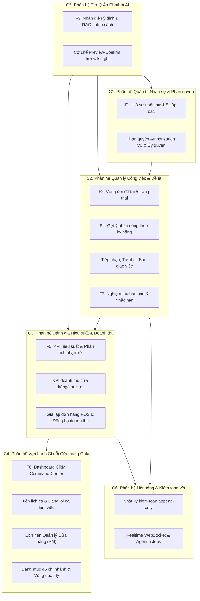
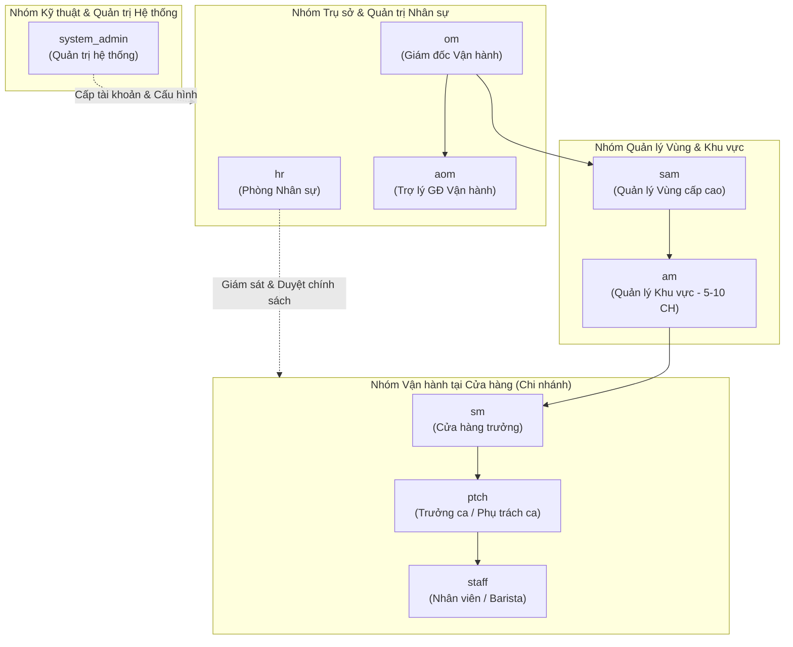
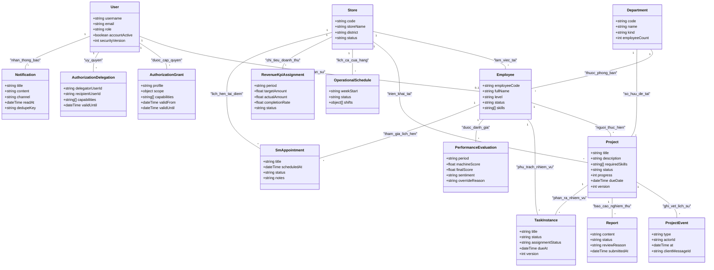
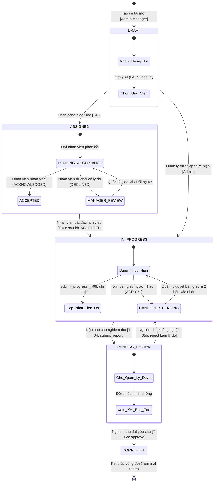

# CHƯƠNG 2: PHÂN TÍCH YÊU CẦU, USE CASE VÀ SƠ ĐỒ LỚP PHÂN TÍCH

> **Ghi chú dành cho sinh viên thực hiện:**
> - Tài liệu này cung cấp toàn bộ dữ kiện kỹ thuật, cấu trúc phân tích, bảng đặc tả yêu cầu, danh mục Use Case (UC01–UC14), sơ đồ lớp và máy trạng thái đã được đối chiếu trực tiếp với mã nguồn hệ thống HR BlockBot / Guta Workspace.
> - Sinh viên sử dụng tài liệu này để tự chuyển văn phong báo cáo học thuật theo quy định Khóa luận tốt nghiệp của Khoa Công nghệ Thông tin - Trường Đại học Công Thương TP.HCM (HUIT).
> - Giữ nguyên các định danh kỹ thuật, mã Use Case, tên bảng, thuộc tính và đường dẫn kiểm chứng `Nguồn:` để phục vụ việc bảo vệ trước Hội đồng chấm khóa luận.

---

## HƯỚNG DẪN VIẾT CHƯƠNG 2 THEO QUY CHUẨN KHOA CNTT (HUIT)

1. **Mục tiêu của chương:** Thể hiện năng lực kỹ sư trong việc chuyển đổi bài toán nghiệp vụ quản trị nhân sự F&B chuỗi Guta thành các yêu cầu hệ thống cụ thể; mô hình hóa chính xác các tác nhân (Actor), ca sử dụng (Use Case), quan hệ phụ thuộc (Include/Extend), thực thể dữ liệu phân tích và máy trạng thái điều khiển vòng đời công việc.
2. **Khung điểm đánh giá liên quan (theo Đề cương chi tiết Khóa luận tốt nghiệp):**
   - Khảo sát hiện trạng & phân tích yêu cầu: **0.75 điểm**.
   - Phân tích Use Case & Sơ đồ lớp phân tích: **0.75 điểm**.
   - Yêu cầu bắt buộc: Phải có bảng ma trận truy vết yêu cầu (Traceability Matrix), tối thiểu 4 nghiệp vụ thực tế hoàn chỉnh, 1–2 nghiệp vụ phức tạp (vòng đời công việc đa bước, phân bổ KPI doanh thu đa cấp) và tích hợp thuật toán thông minh.
3. **Cách trình bày:**
   - Trình bày hệ thống theo các Bounded Context rõ ràng: Quản trị nhân sự & Phân quyền, Quản lý công việc & Gợi ý phân công, Đánh giá hiệu suất & KPI doanh thu chuỗi, Trợ lý hội thoại Chatbot AI, Thông báo & Kiểm toán vết.
   - Sơ đồ Use Case phân rã thành sơ đồ tổng quát và các sơ đồ phân hệ chi tiết; các quan hệ `<<include>>` và `<<extend>>` phải có luận cứ logic nghiệp vụ cụ thể.
   - Sơ đồ lớp phân tích tập trung vào các khái niệm miền (Domain Entities), không phụ thuộc vào chi tiết cài đặt của MongoDB (không đưa `_id`, `$set` vào lớp phân tích).

---

## 2.1. YÊU CẦU CHI TIẾT CỦA HỆ THỐNG

### 2.1.1. Yêu cầu chức năng (Functional Requirements - FR)

Hệ thống đáp ứng trọn vẹn 7 nhóm chức năng cốt lõi (F1–F7) theo đề cương khóa luận được duyệt, đồng thời tích hợp các phân hệ vận hành thực tế tại chuỗi 45 cửa hàng Guta Cafe (Xếp ca làm việc, KPI doanh thu cửa hàng, Quản lý chi nhánh & Lịch hẹn SM, Phân quyền ủy quyền Authorization V1).

**Hình 2.1: Sơ đồ phân rã các phân hệ chức năng hệ thống (Bounded Contexts)**

*Nguồn: docs/04-domain-model.md §1; apps/api/src/routes/*; packages/contracts/src/*.*

#### Bảng 2.1: Danh mục yêu cầu chức năng (FR) theo các phân hệ F1–F7 và phân hệ mở rộng

| Mã FR | Phân hệ / Nhóm chức năng | Tên yêu cầu chức năng | Mô tả chi tiết nghiệp vụ & Tiêu chí chấp nhận | Tác nhân chính | Trạng thái mã nguồn | Nguồn kiểm chứng |
|---|---|---|---|---|---|---|
| **FR-001** | F1 (Nhân sự) | Xem hồ sơ cá nhân | Cho phép nhân sự xem hồ sơ của chính mình (họ tên, cấp bậc, phòng ban/cửa hàng, kỹ năng, ngày vào làm) qua giao diện web hoặc chatbot bằng tool `get_my_profile`. Không trả dữ liệu người khác. | Staff, All | Đã cài đặt | `apps/api/src/routes/employees.ts:25-45` |
| **FR-002** | F1 (Nhân sự) | Cập nhật thông tin cơ bản | Cho phép nhân viên tự cập nhật các trường không nhạy cảm (số điện thoại, địa chỉ, kỹ năng cá nhân). Bắt buộc xác thực Zod schema. | Staff, All | Đã cài đặt | `apps/api/src/routes/employees.ts:60-85` |
| **FR-003** | F1 (Nhân sự) | Yêu cầu đổi trường nhạy cảm | Thay đổi chức danh, cấp bậc, ngày vào làm, cửa hàng không ghi đè trực tiếp mà tạo phiếu đề xuất chờ HR duyệt. | Staff, SM | Đã cài đặt | `apps/api/src/routes/employee-lifecycle.ts:30-65` |
| **FR-004** | F1 (Nhân sự) | Phê duyệt biến động nhân sự | HR xem xét hàng đợi yêu cầu biến động (chuyển công tác, thăng cấp, thôi việc); phê duyệt hoặc từ chối kèm lý do bắt buộc. | HR, Admin | Đã cài đặt | `apps/api/src/routes/employee-lifecycle.ts:70-110` |
| **FR-005** | F1 (Nhân sự) | Quản lý 5 cấp bậc & mã NV | Duy trì 5 cấp bậc chuẩn hóa (`Intern`, `Junior`, `Middle`, `Senior`, `Lead`) cùng mã ngạch Guta (`NV1`–`OM`); `employeeCode` là duy nhất toàn hệ thống. | HR, Admin | Đã cài đặt | `packages/contracts/src/authorization.ts:109`; `Employee.ts:40-60` |
| **FR-006** | F2 (Đề tài/Việc) | Khởi tạo đề tài ở `DRAFT` | Tạo đề tài/công việc mới với tiêu đề, mô tả, yêu cầu kỹ năng, hạn chót, phòng ban/cửa hàng; phiên bản ban đầu `version = 1`. | SM, AM, OM | Đã cài đặt | `apps/api/src/routes/projects.ts:80-110` |
| **FR-007** | F2 (Đề tài/Việc) | Phân công đề tài `ASSIGNED` | Quản lý chọn nhân sự thực hiện (dựa vào gợi ý AI hoặc chọn tay); chuyển trạng thái sang `ASSIGNED`; kích hoạt gửi thông báo. | SM, AM, OM | Đã cài đặt | `apps/api/src/routes/projects.ts:130-160` |
| **FR-008** | F2 (Đề tài/Việc) | Chuyển trạng thái `IN_PROGRESS` | Nhân viên được giao nhận việc hoặc quản lý xác nhận chuyển đề tài sang thực hiện. Chặn nhảy trạng thái trái phép. | Staff, SM | Đã cài đặt | `apps/api/src/models/Project.ts:75-84` |
| **FR-009** | F2 (Đề tài/Việc) | Cập nhật tiến độ định kỳ | Nhân viên gửi báo cáo % hoàn thành và ghi chú; hệ thống ghi nhận vào `project_events` append-only, không đổi trạng thái duyệt. | Staff | Đã cài đặt | `apps/api/src/routes/projects.ts:170-195` |
| **FR-010** | F2 (Đề tài/Việc) | Phê duyệt hoàn thành | Quản lý nghiệm thu báo cáo đạt yêu cầu: chuyển đề tài từ `PENDING_REVIEW` sang `COMPLETED`; tăng version khóa lạc quan. | SM, AM, OM | Đã cài đặt | `apps/api/src/routes/reports.ts:60-95` |
| **FR-011** | F2 (Đề tài/Việc) | Trả lại yêu cầu sửa đổi | Quản lý từ chối nghiệm thu: chuyển từ `PENDING_REVIEW` về `IN_PROGRESS`, bắt buộc nhập lý do từ chối để nhân viên nộp lại. | SM, AM, OM | Đã cài đặt | `apps/api/src/routes/reports.ts:100-135` |
| **FR-012** | F2 (Đề tài/Việc) | Khóa lạc quan chống xung đột | Mọi thao tác cập nhật trạng thái dùng bộ lọc `(_id, status: expected, version: v)`. Xung đột trả mã lỗi `409 PROJECT_VERSION_CONFLICT`. | Hệ thống | Đã cài đặt | `apps/api/src/services/project-workflow.service.ts:121-134` |
| **FR-013** | F2 (Đề tài/Việc) | Vị từ dẫn xuất quá hạn | "Quá hạn" không lưu thành trạng thái DB mà dẫn xuất động: `dueDate < now AND status != COMPLETED`. | Hệ thống | Đã cài đặt | `apps/api/src/routes/projects.ts:25`; `models/Project.ts` |
| **FR-014** | F2 (Đề tài/Việc) | Lưu vết sự kiện bất biến | Mọi sự kiện chuyển trạng thái ghi vào `statusHistory[]` và `project_events`; cấm chỉnh sửa hoặc xóa sự kiện. | Hệ thống | Đã cài đặt | `apps/api/src/services/project-audit.service.ts:15-50` |
| **FR-045** | F2/ADR-021 | Tiếp nhận, từ chối, bàn giao | Nhân viên được phân công phản hồi tiếp nhận (`ACKNOWLEDGED`), từ chối (`DECLINED`) hoặc xin bàn giao (`HANDOVER_PENDING`) theo ADR-021. | Staff, PTCH | Đã cài đặt | `apps/api/src/routes/assignment.ts:1-80` |
| **FR-015** | F3 (Chatbot) | Nhận diện ý định hội thoại | Phân tích câu hỏi người dùng, ánh xạ vào catalog intent hoặc từ chối lịch sự nếu ngoài phạm vi; không bịa tool mới. | All | Đã cài đặt | `apps/ai-service/app/authorization_gateway.py:40-90` |
| **FR-016** | F3 (Chatbot) | Tra cứu KPI qua chatbot | Nhân viên tra cứu điểm KPI cá nhân; Quản lý/HR tra cứu KPI theo phạm vi chi nhánh hoặc phòng ban được phân quyền. | All | Đã cài đặt | `apps/api/src/routes/chat.ts:26-32` |
| **FR-017** | F3 (Chatbot) | RAG hỏi đáp chính sách nhân sự | Trợ lý truy xuất các đoạn tài liệu quy chế (Atlas Vector Search), sinh câu trả lời kèm trích dẫn văn bản, số hiệu, điều khoản. | All | Đã cài đặt | `apps/ai-service/app/rag/engine.py:30-80` |
| **FR-018** | F3 (Chatbot) | Cơ chế từ chối khi thiếu căn cứ | Khi độ tương đồng tài liệu quy chế dưới ngưỡng (`min_evidence_dense = 0.30`), chatbot thông báo rõ ràng không đoán mò. | All | Đã cài đặt | `apps/ai-service/app/config.py:67-71` |
| **FR-019** | F3 (Chatbot) | Vòng lặp Agent có rào chắn | Rào chắn Agent Loop: `maxSteps = 5`, `toolTimeout = 3000ms`, `llmTimeout = 20000ms`, Zod kiểm tra tham số, kiểm tra quyền V1. | Hệ thống | Đã cài đặt | `apps/ai-service/app/config.py:80-84` |
| **FR-020** | F3 (Chatbot) | Xác nhận trước khi ghi | Mọi thao tác ghi dữ liệu từ chatbot (nộp báo cáo, giao việc) hiển thị bản xem trước và yêu cầu người dùng bấm xác nhận. | All | Đã cài đặt | `apps/api/src/routes/chat.ts:10-21` |
| **FR-021** | F3 (Chatbot) | Streaming phản hồi & chống trùng | Phản hồi văn bản stream từng chunk qua WebSocket; mỗi bản tin mang `clientMessageId` để chống thực thi lặp khi rớt mạng. | All | Đã cài đặt | `apps/api/src/routes/chat.ts:30`; `contracts/chat.ts` |
| **FR-022** | F3 (Chatbot) | Giới hạn danh mục công cụ | Chặn thực thi trực tiếp các ý định sửa nhạy cảm hoặc duyệt phức tạp, hướng dẫn người dùng chuyển sang thao tác CRM. | All | Đã cài đặt | `apps/ai-service/app/authorization_gateway.py:110-150` |
| **FR-023** | F4 (Gợi ý) | Gợi ý ứng viên theo ngữ nghĩa | Tính toán mức độ phù hợp giữa kỹ năng ứng viên và yêu cầu công việc. Baseline dùng exact-skills; PhoBERT là worker opt-in CPU. | SM, AM, OM | Đã cài đặt | `apps/ai-service/app/f4_gateway.py:1-60` |
| **FR-024** | F4 (Gợi ý) | Hiệu chuẩn điểm tương đồng | Điểm tương đồng được chuẩn hóa; nếu điểm thấp hơn ngưỡng yêu cầu, hệ thống từ chối gợi ý và đề xuất nới lỏng tiêu chí. | SM, AM | Đã cài đặt | `apps/ai-service/app/f4_encoder.py:50-90` |
| **FR-025** | F4 (Gợi ý) | Giải thích lý do gợi ý | Trả về bảng phân rã đóng góp của từng kỹ năng phù hợp và tải công việc hiện tại của ứng viên; không giải thích bằng raw attention. | SM, AM | Đã cài đặt | `apps/api/src/routes/assignment.ts:90-120` |
| **FR-026** | F4 (Gợi ý) | Quyết định phân công của Quản lý | Quản lý có toàn quyền chấp nhận gợi ý, chọn ứng viên khác hoặc bác bỏ toàn bộ danh sách; ưu tiên người có tải công việc thấp. | SM, AM, OM | Đã cài đặt | `apps/api/src/routes/projects.ts:130-160` |
| **FR-027** | F4 (Gợi ý) | Đánh giá thực nghiệm mô hình | Cung cấp bộ đo thực nghiệm chất lượng phân công (P@1, P@3, P@5, MRR, độ trễ và tiêu thụ RAM) trên tập test benchmark. | Kỹ thuật | Đã cài đặt | `apps/ai-service/eval/f4_benchmark.py` |
| **FR-028** | F5 (KPI) | Khởi tạo kỳ đánh giá KPI | Mở kỳ đánh giá định kỳ cho từng nhân viên theo cửa hàng; ràng buộc duy nhất trên cặp `(employeeId, period)`. | HR, AM, SM | Đã cài đặt | `apps/api/src/routes/performance-kpi.ts:21` |
| **FR-029** | F5 (KPI) | Thu thập tự nhận xét & nhận xét QL | Nhân viên tự đánh giá kết quả; Quản lý trực tiếp ghi nhận xét chất lượng, tính kỷ luật, thái độ phục vụ vào hồ sơ kỳ. | Staff, SM, AM | Đã cài đặt | `apps/api/src/routes/performance-kpi.ts:28` |
| **FR-030** | F5 (KPI) | Phân tích ngữ nghĩa nhận xét | AI trích xuất sắc thái (sentiment), chủ đề tích cực/tiêu cực, tín hiệu rủi ro; AI chỉ gợi ý thành phần điểm, không quyết định điểm cuối. | Hệ thống | Đã cài đặt | `apps/ai-service/app/kpi_analysis.py:20-75` |
| **FR-031** | F5 (KPI) | Công thức tính điểm máy tất định | `machineScore` tính toán bằng công thức tất định kết hợp điểm hoàn thành công việc, nhận xét định lượng và tín hiệu AI. | Hệ thống | Đã cài đặt | `apps/api/src/services/performance-kpi-evaluation.service.ts:25-30` |
| **FR-032** | F5 (KPI) | Chặn trần điểm nhận xét | Điểm cộng từ nhận xét AI bị khống chế bởi tỷ lệ hoàn thành công việc thực tế, ngăn ngừa hiện tượng thiên vị văn phong. | Hệ thống | Đã cài đặt | `packages/contracts/src/performance-kpi.ts:150-180` |
| **FR-033** | F5 (KPI) | Hiệu chỉnh điểm có giải trình | Khi quản lý thay đổi điểm (`finalScore != machineScore`), bắt buộc nhập `overrideReason`, lưu `changedBy`, `changedAt` bất biến. | HR, AM, OM | Đã cài đặt | `apps/api/src/routes/performance-kpi.ts:28` |
| **FR-034** | F5 (KPI) | Công bố và gửi kết quả KPI | HR/Quản lý chốt kỳ đánh giá, công bố điểm chính thức, phát sự kiện thông báo thời gian thực đến từng nhân viên. | HR, AM | Đã cài đặt | `apps/api/src/routes/performance-kpi.ts:22` |
| **FR-035** | F5 (KPI) | Khiếu nại và phúc tra KPI | Cho phép nhân viên gửi yêu cầu xem xét lại điểm; cấp quản lý cao hơn độc lập phúc tra và ghi nhận kết quả giải quyết. | Staff, HR, AM | Đã cài đặt | `apps/api/src/routes/performance-kpi.ts:28` |
| **FR-036** | F6 (CRM) | Dashboard CRM chuỗi Guta | Hiển thị bảng điều khiển trung tâm (CRM Command Center), biểu đồ biến động doanh thu, hiệu suất, tình trạng nhân sự 45 chi nhánh. | HR, Managers | Đã cài đặt | `apps/web/src/views/CrmDashboardView.tsx:1-250` |
| **FR-037** | F6 (CRM) | Bộ lọc dữ liệu đa chiều | Lọc danh mục công việc/nhân sự theo chi nhánh, khu vực, trạng thái, hạn chót; hiển thị nhãn cảnh báo quá hạn trực quan. | All | Đã cài đặt | `apps/api/src/routes/dashboard.ts:30-80` |
| **FR-038** | F6 (CRM) | Trung tâm thông báo chuông | Danh sách thông báo cá nhân hóa; lưu trữ bền vững trong CSDL; tự động cập nhật số lượng chưa đọc khi có sự kiện mới. | All | Đã cài đặt | `apps/api/src/routes/notifications.ts:15-60` |
| **FR-039** | F6 (CRM) | Giám sát trạng thái ca trực | Quản lý theo dõi trực tiếp số lượng Barista đang trong ca, nhân viên vắng mặt, tình trạng đơn hàng POS tại từng cửa hàng. | SM, AM, OM | Đã cài đặt | `apps/web/src/components/crm/SlideOverDrawer.tsx` |
| **FR-040** | F7 (Nghiệm thu) | Nộp báo cáo nghiệm thu | Nhân viên nộp báo cáo kèm tài liệu minh chứng, chuyển đề tài sang `PENDING_REVIEW`, kích hoạt thông báo đến quản lý duyệt. | Staff, PTCH | Đã cài đặt | `apps/api/src/routes/reports.ts:20-55` |
| **FR-041** | F7 (Nghiệm thu) | Lịch trình nhắc hạn tự động | Bộ lập lịch nền (Agenda Jobs) quét định kỳ các hạn chót: gửi thông báo trước 3 ngày, trước 1 ngày và khi công việc quá hạn. | Hệ thống | Đã cài đặt | `apps/api/src/services/notification-scheduler.service.ts` |
| **FR-042** | F7 (Nghiệm thu) | Lưu bền thông báo trước khi phát | Mọi thông báo bắt buộc được ghi thành công vào collection `notifications` trước khi phát qua WebSocket, tránh mất tin. | Hệ thống | Đã cài đặt | `apps/api/src/services/notification.service.ts:35-70` |
| **FR-043** | F7 (Nghiệm thu) | Bản tin tổng hợp hàng ngày | Tự động tổng hợp danh sách công việc trễ hạn và các kỳ KPI cần duyệt gửi cho Quản lý mỗi ngày một lần (Daily Digest). | SM, AM, HR | Đã cài đặt | `apps/api/src/services/notification.service.ts:80-120` |
| **FR-044** | F7 (Nghiệm thu) | Cơ chế chống lặp tác vụ nền | Khóa chống lặp `dedupeKey` đảm bảo khi tiến trình nền khởi động lại không tạo ra thông báo trùng lặp cho cùng một sự kiện. | Hệ thống | Đã cài đặt | `apps/api/src/models/Notification.ts:30-45` |
| **FR-S01** | Xếp ca Guta | Xếp lịch ca làm việc chi nhánh | SM xếp ca hàng tuần cho Barista; quản lý khung giờ ca sáng/chiều/tối; xuất bản lịch ca và thông báo cho nhân viên. | SM, AM | Đã cài đặt | `apps/api/src/routes/scheduling.ts:15-32` |
| **FR-S02** | Xếp ca Guta | Đăng ký ca & Đổi ca | Nhân viên đăng ký nguyện vọng làm việc trong tuần; tạo yêu cầu đổi ca trực với đồng nghiệp, chờ SM phê duyệt. | Staff, PTCH | Đã cài đặt | `apps/api/src/routes/scheduling.ts:38-58` |
| **FR-S03** | KPI Doanh thu | Phân bổ chỉ tiêu doanh thu | HR/AM thiết lập chỉ tiêu doanh thu theo tháng cho từng cửa hàng; gắn trách nhiệm quản lý cho Cửa hàng trưởng (SM). | HR, AM | Đã cài đặt | `apps/api/src/routes/revenue-kpi.ts:13-35` |
| **FR-S04** | KPI Doanh thu | Tính toán & Phúc tra doanh thu | Tổng hợp doanh thu thực tế từ POS, tính tỷ lệ hoàn thành; SM gửi yêu cầu giải trình chênh lệch hoặc khiếu nại số liệu. | SM, AM, HR | Đã cài đặt | `apps/api/src/routes/revenue-kpi.ts:36-42` |
| **FR-S05** | Quản lý Guta | Lịch hẹn Quản lý Cửa hàng | Đặt lịch làm việc/kiểm tra định kỳ giữa Quản lý khu vực (AM) và Cửa hàng trưởng (SM); lưu biên bản và quyết định xử lý. | AM, SM | Đã cài đặt | `apps/api/src/routes/sm-appointments.ts:6-10` |
| **FR-S06** | Phân quyền V1 | Quản lý quyền hạn & Ủy quyền | Cấp phát quyền theo 9 profile và danh mục capability; ủy quyền tạm thời có thời hạn tối đa 14 ngày kèm phê duyệt độc lập. | SysAdmin, QL | Đã cài đặt | `apps/api/src/routes/delegations.ts:10-45` |

#### Bảng 2.2: Ma trận đối chiếu tài liệu yêu cầu ban đầu (docs/01-requirements.md) với hiện trạng mã nguồn thực tế

| Nhóm yêu cầu ban đầu | Thiết kế dự kiến trong tài liệu (docs) | Cài đặt thực tế trong mã nguồn (code) | Đánh giá sai lệch & Nguyên nhân kỹ thuật |
|---|---|---|---|
| **Cơ chế phân quyền** | RBAC 2 vai: `Admin` và `Employee` (`docs/01 §3.8 FR-052`). | Hệ thống Authorization V1 với **9 software profile** (`system_admin`, `hr`, `om`, `aom`, `sam`, `am`, `sm`, `ptch`, `staff`), kiểm soát theo Capability và Phạm vi (Scope). | **Mở rộng nghiệp vụ**: 2 vai trò quá thô sơ cho mô hình vận hành chuỗi F&B 45 cửa hàng. Vai `Admin`/`Employee` được giữ lại ở tầng xác thực để tương thích ngược. |
| **Mô hình nhúng RAG** | Dự kiến ban đầu: Mô hình cục bộ 384 chiều (`docs/22 §2`). | Cài đặt thực tế: `gemini-embedding-001` với vector 3072 chiều trên MongoDB Atlas Vector Search (`apps/ai-service/app/config.py:64`). | **Nâng cấp độ chính xác**: Vector 3072 chiều nắm bắt ngữ cảnh quy chế tiếng Việt vượt trội hơn so với mô hình 384 chiều cỡ nhỏ. |
| **Thuật toán F4** | PhoBERT tính toán trực tiếp trong luồng bắt buộc của API (`docs/01 §3.4 FR-023`). | Node.js orchestrator mặc định chạy baseline kỹ năng chính xác (exact-skills); PhoBERT là worker opt-in CPU độc lập sau khi kiểm tra tài nguyên (`f4_gateway.py`). | **Đảm bảo tính ổn định**: Tránh việc nạp mô hình PhoBERT nặng trên môi trường Cloud RAM thấp (Render Free Tier 512MB) gây sập tiến độ toàn hệ thống. |
| **Quy trình tiếp nhận việc** | Đề tài giao là nhân viên phải làm, không có bước từ chối (`docs/01 §3.2 FR-007`). | Triển khai cơ chế thỏa thuận tiếp nhận theo ADR-021: Nhân viên có quyền từ chối có lý do hoặc bàn giao cho người thay thế (`assignment.ts`). | **Sát thực tế vận hành**: Nhân viên cửa hàng có thể trùng ca hoặc quá tải, bắt buộc có cơ chế từ chối và bàn giao minh bạch có ghi vết. |
| **Mở rộng nghiệp vụ chuỗi** | Chỉ quản lý đề tài nghiên cứu chung chung F1–F7 (`docs/01 §1`). | Bổ sung 4 phân hệ lớn: Xếp ca Guta (`scheduling.ts`), KPI Doanh thu POS (`revenue-kpi.ts`), Quản lý 45 cửa hàng (`stores.ts`), Lịch hẹn SM (`sm-appointments.ts`). | **Đáp ứng bối cảnh ứng dụng**: Chuyển đổi số quản lý nhân sự chuỗi F&B Guta Cafe đòi hỏi quản lý ca kíp và chỉ tiêu doanh số điểm bán. |

---

### 2.1.2. Yêu cầu phi chức năng (Non-Functional Requirements - NFR)

Tất cả các yêu cầu phi chức năng dưới đây đều được chứng thực thông qua mã nguồn, bộ kiểm thử tự động và tài liệu kiến trúc của dự án:

1. **NFR-01: An toàn & Bảo mật phiên làm việc (Authentication Security)**
   - Mật khẩu người dùng được băm bằng thuật toán **Argon2id** với thông số an toàn chuẩn OWASP. Không lưu mật khẩu thô trong CSDL hoặc log hệ thống.
   - Cơ chế xác thực kép: Access Token (JWT lưu tại bộ nhớ trình duyệt, ký thuật toán HS256/RS256 qua thư viện `jose`) và Refresh Token (lưu trong cookie `HttpOnly + Secure + SameSite=Strict`).
   - Áp dụng kỹ thuật xoay vòng Refresh Token (Rotation) và phát hiện sử dụng lại token (Reuse Detection): khi phát hiện token cũ trong chuỗi bị tái sử dụng, hệ thống lập tức thu hồi toàn bộ phiên (Family Revocation), buộc đăng nhập lại.
   - *Nguồn kiểm chứng:* `apps/api/src/routes/auth.ts:40-110`; `apps/api/test/auth-logout-revocation.test.mjs`.

2. **NFR-02: Phân quyền đa cấp & Kiểm soát truy cập (Authorization & Separation of Duties)**
   - Phân quyền theo năng lực (Capability-based Authorization V1) kết hợp phạm vi địa bàn (Scope: `storeIds`, `regionIds`, `reportingEmployeeIds`).
   - Nguyên tắc phân tách trách nhiệm (Separation of Duties): Quản trị viên kỹ thuật (`system_admin`) không có quyền duyệt nghiệp vụ nhân sự; Quản lý không được tự duyệt đề xuất hoặc đánh giá KPI do chính mình tạo ra (`SELF_APPROVAL_DENIED`).
   - Thời gian ủy quyền tạm thời bị khống chế tối đa 14 ngày và bắt buộc có người quản lý trực tiếp phê duyệt độc lập.
   - *Nguồn kiểm chứng:* `apps/api/src/services/authorization-policy.service.ts:120-129`; `packages/contracts/src/authorization.ts:75`.

3. **NFR-03: Hiệu năng & Khả năng đáp ứng (Performance & Scalability)**
   - Các truy vấn đọc đơn lẻ (CRUD read) đáp ứng thời gian phản hồi P95 < 300ms; các truy vấn tổng hợp Dashboard CRM đáp ứng P95 < 800ms trên môi trường thử nghiệm chuẩn.
   - Cơ chế Streaming qua WebSocket cho phép hiển thị câu trả lời của Chatbot theo thời gian thực (First Token Latency < 2.5s).
   - Kiểm soát đồng thời bằng Khóa lạc quan (Optimistic Concurrency Control) thông qua trường `version`, ngăn chặn ghi đè dữ liệu mất mát khi nhiều người dùng cùng thao tác.
   - *Nguồn kiểm chứng:* `apps/api/src/services/project-workflow.service.ts:121`; `apps/web/src/hooks/useChatStream.ts`.

4. **NFR-04: Tính sẵn sàng & Chống mất mát dữ liệu (Reliability & Resilience)**
   - Mọi thông báo hệ thống bắt buộc được lưu trữ bền vững (Durable Persistence) trong CSDL MongoDB trước khi phát qua kênh Socket.IO. Nếu người dùng mất kết nối hoặc server Render chuyển trạng thái ngủ đông, thông báo vẫn được tải lại đầy đủ khi mở lại ứng dụng.
   - Tác vụ nền (Agenda Jobs) hỗ trợ tính lũy thừa (Idempotency) qua khóa `dedupeKey`, đảm bảo an toàn tuyệt đối khi tiến trình bị khởi động lại.
   - *Nguồn kiểm chứng:* `apps/api/src/services/notification.service.ts:40-65`; `apps/api/src/routes/notifications.ts`.

5. **NFR-05: Toàn vẹn dữ liệu & Kiểm toán vết (Audit Trail & Data Integrity)**
   - Mọi thao tác thay đổi trạng thái đề tài, phân công, đánh giá KPI đều được ghi nhận vào nhật ký kiểm toán bất biến (Append-only Audit Log) kèm định danh tác nhân (`actorId`), thời điểm (`timestamp`), lý do và mã yêu cầu (`requestId`).
   - Nghiêm cấm hoàn toàn hành vi xóa cứng (Hard Delete) hoặc chỉnh sửa dữ liệu lịch sử trạng thái (`statusHistory`).
   - *Nguồn kiểm chứng:* `apps/api/src/services/project-audit.service.ts:20-60`; `apps/api/src/models/Project.ts:31`.

6. **NFR-06: Bản địa hóa & Ngôn ngữ (Localization)**
   - Toàn bộ giao diện người dùng, thông báo hệ thống, tài liệu quy chế và dữ liệu mẫu đều chuẩn hóa 100% bằng tiếng Việt.
   - Thành phần xử lý ngôn ngữ tự nhiên tiếng Việt được tích hợp bộ tách từ chuyên dụng (`py-vncorenlp`) để đảm bảo chất lượng nhúng ngữ nghĩa của PhoBERT.
   - *Nguồn kiểm chứng:* `apps/ai-service/requirements-f4.txt:9`; `apps/web/src/locales/vi.json`.

---

### 2.1.3. Công nghệ và phiên bản sử dụng

Toàn bộ các thư viện, framework và công cụ dưới đây được trích xuất trực tiếp từ các tệp cấu hình `package.json` và `requirements.txt` của dự án:

#### Bảng 2.3: Bảng tổng hợp công nghệ và phiên bản phần mềm trong hệ thống

| Tầng kiến trúc / Module | Công nghệ / Thư viện | Phiên bản | Vai trò & Mục đích sử dụng trong hệ thống | Nguồn trích xuất |
|---|---|---|---|---|
| **Quản lý Monorepo** | pnpm | 11.25.0 | Quản lý mã nguồn tập trung (Workspace), tối ưu dung lượng gói phụ thuộc và đồng bộ build giữa các dự án con. | `package.json:5` |
| **Backend API Framework** | Express.js | 4.19.2 | Xây dựng hệ thống RESTful API phục vụ toàn bộ các dịch vụ nghiệp vụ nhân sự, phân quyền, công việc và vận hành. | `apps/api/package.json:33` |
| **Ngôn ngữ lập trình API** | TypeScript | 5.5.4 | Cung cấp hệ thống kiểu tĩnh chặt chẽ, ngăn ngừa lỗi runtime và tăng năng suất bảo trì mã nguồn lớn. | `apps/api/package.json:48` |
| **Cơ sở dữ liệu ODM** | Mongoose | 8.5.2 | Quản lý kết nối, định nghĩa Schema và thao tác dữ liệu với cụm MongoDB Atlas. | `apps/api/package.json:35` |
| **Mã hóa mật khẩu** | argon2 | 0.41.1 | Băm mật khẩu người dùng với thuật toán Argon2id chống tấn công Rainbow Table và GPU Cracking. | `apps/api/package.json:28` |
| **Xử lý JWT & Bảo mật** | jose | 5.9.6 | Ký, xác thực và giải mã JSON Web Token (JWT) cho các phiên Access Token. | `apps/api/package.json:34` |
| **Giao tiếp Realtime** | Socket.IO (Server/Client) | 4.7.5 | Kênh truyền thông tin thời gian thực phục vụ đẩy thông báo tức thì và streaming hội thoại Chatbot. | `apps/api/package.json:36`; `apps/web/package.json:22` |
| **Ràng buộc Hợp đồng (Data)** | Zod | 3.23.8 | Định nghĩa và xác thực Schema hợp đồng dữ liệu dùng chung (Single Source of Truth) giữa API, Web và Contracts. | `packages/contracts/package.json:14` |
| **Mô phỏng CSDL Kiểm thử** | mongodb-memory-server | 11.3.0 | Cung cấp CSDL MongoDB chạy trên RAM độc lập cho các bộ kiểm thử tự động, không phụ thuộc cloud. | `apps/api/package.json:45` |
| **Frontend Framework** | React | 18.3.1 | Xây dựng giao diện ứng dụng web Single Page Application (SPA) hiệu năng cao theo kiến trúc Component. | `apps/web/package.json:20` |
| **Công cụ đóng gói Web** | Vite | 5.4.1 | Công cụ build và phục vụ môi trường phát triển cực nhanh với tính năng Hot Module Replacement (HMR). | `apps/web/package.json:33` |
| **CSS Framework** | TailwindCSS | 4.3.3 | Thiết kế giao diện hiện đại với tiện ích Utility-first, tùy biến bộ màu Electric Sapphire chuẩn nhận diện Guta. | `apps/web/package.json:31` |
| **Kiểm thử E2E Giao diện** | Playwright | 1.63.0 | Tự động hóa kiểm thử luồng người dùng đầu-cuối (E2E) trên trình duyệt thực tế. | `apps/web/package.json:30` |
| **AI Service Framework** | FastAPI | 0.122.0 | Cung cấp dịch vụ microservice AI hiệu năng cao với ASGI server Uvicorn, chuẩn OpenAPI tự động. | `apps/ai-service/requirements.txt:9` |
| **Web Server AI** | Uvicorn | 0.38.0 | Máy chủ web bất đồng bộ chuẩn ASGI phục vụ ứng dụng FastAPI. | `apps/ai-service/requirements.txt:10` |
| **Xác thực dữ liệu Python** | Pydantic | 2.12.4 | Định nghĩa dữ liệu đầu vào và đầu ra cho các API dịch vụ AI. | `apps/ai-service/requirements.txt:11` |
| **HTTP Client Python** | HTTPX | 0.28.1 | Thư viện HTTP client bất đồng bộ phục vụ việc gọi các dịch vụ LLM bên ngoài và kiểm tra nội bộ. | `apps/ai-service/requirements.txt:14` |
| **Framework Deep Learning** | PyTorch (CPU) | 2.7.0+cpu | Nền tảng tính toán tensor phục vụ mô hình ngôn ngữ PhoBERT trên CPU. | `apps/ai-service/requirements-f4.txt:6` |
| **Mô hình Ngôn ngữ Transformer** | Transformers | 4.53.3 | Nạp và chạy suy luận mô hình PhoBERT (`vinai/phobert-base-v2`) cho bài toán F4. | `apps/ai-service/requirements-f4.txt:7` |
| **Tách từ Tiếng Việt** | py-vncorenlp | 0.1.4 | Công cụ tiền xử lý tách từ tiếng Việt bắt buộc trước khi đưa văn bản vào PhoBERT. | `apps/ai-service/requirements-f4.txt:9` |
| **Cơ sở dữ liệu Đám mây** | MongoDB Atlas M0 | 7.0+ | CSDL đám mây lưu trữ dữ liệu văn bản và tích hợp cụm Vector Search 3072 chiều. | `CLAUDE.md §2` |

---

## 2.2. XÂY DỰNG MÔ HÌNH USE CASE NGHIỆP VỤ

### 2.2.1. Sơ đồ Tác nhân nghiệp vụ (9 Profile Authorization V1)

Trong hệ thống thực tế của chuỗi F&B Guta, quyền hạn không phân chia đơn thuần theo 2 nhãn `Admin/Employee` mà vận hành theo **9 Profile nghiệp vụ** với các phạm vi quản lý và năng lực thao tác rõ ràng.

**Hình 2.2: Sơ đồ phân cấp các Tác nhân nghiệp vụ (Actor Diagram)**

*Nguồn: docs/authorization-v1-runtime.md §1; packages/contracts/src/authorization.ts:4-7; apps/api/src/services/authorization-policy.service.ts:8-10.*

#### Bảng 2.4: Bảng mô tả 9 Profile tác nhân nghiệp vụ trong hệ thống

| Mã Profile | Tên vai trò nghiệp vụ | Trách nhiệm chính trong chuỗi Guta | Năng lực cốt lõi (Capabilities) | Ánh xạ Role Wire | Nguồn định nghĩa |
|---|---|---|---|---|---|
| `system_admin` | Quản trị viên hệ thống | Cấu hình tham số hệ thống, kết nối nhà cung cấp AI, quản lý tài khoản người dùng, giám sát an ninh mạng. | `accounts.manage`, `grants.configure`, `grants.revoke`, `provider_settings.manage`, `security_audit.read` | `Admin` | `authorization-policy.service.ts:16` |
| `hr` | Chuyên viên Nhân sự | Tiếp nhận nhân sự mới, phê duyệt điều chuyển, ban hành khung KPI, phê duyệt đề xuất nhạy cảm, giải quyết khiếu nại. | `employees.read_hr`, `employees.create`, `employees.review`, `onboarding.review`, `revenue_kpi.assign`, `revenue_kpi.close` | `Admin` | `authorization-policy.service.ts:25-45` |
| `om` | Giám đốc Vận hành (Operations Manager) | Điều hành toàn bộ hoạt động chuỗi 45 cửa hàng, phê duyệt chỉ tiêu vận hành tổng thể, giám sát chỉ số CRM toàn chuỗi. | `projects.create`, `projects.assign`, `reports.review`, `dashboard.read`, `delegations.request` | `Admin` | `authorization-policy.service.ts:10` |
| `aom` | Trợ lý GĐ Vận hành (Assistant OM) | Hỗ trợ Giám đốc vận hành theo dõi tiến độ công việc, kiểm tra việc tuân thủ quy trình tại các khu vực. | `dashboard.read`, `projects.read_managed`, `schedules.read_store` | `Admin` | `authorization-policy.service.ts:50` |
| `sam` | Quản lý Vùng cấp cao (Senior Area Manager) | Quản lý cụm khu vực (15–20 cửa hàng), điều phối nhân sự cấp quản lý giữa các khu vực. | `projects.create`, `projects.assign`, `reports.review`, `schedules.manage` | `Admin` | `authorization-policy.service.ts:10` |
| `am` | Quản lý Khu vực (Area Manager) | Phụ trách trực tiếp 5–10 cửa hàng, phân bổ KPI doanh thu cho các cửa hàng trưởng, kiểm tra lịch ca, họp định kỳ với SM. | `revenue_kpi.verify_adjustment`, `performance_kpi.evaluate`, `sm_appointments.manage`, `projects.assign` | `Admin` | `authorization-policy.service.ts:25-33` |
| `sm` | Cửa hàng trưởng (Store Manager) | Quản lý toàn diện 1 cửa hàng: xếp lịch ca hàng tuần cho Barista, giao công việc nội bộ, giám sát doanh thu POS, nhận chỉ tiêu KPI. | `onboarding.propose`, `schedules.manage`, `shifts.manage`, `revenue_kpi.respond`, `task.assign` | `Admin` | `authorization-policy.service.ts:25-47` |
| `ptch` | Phụ trách ca / Trưởng ca (Shift Leader) | Điều hành ca trực (ca sáng/chiều/tối), hỗ trợ điểm danh, kiểm tra vệ sinh an toàn thực phẩm, xử lý sự cố trong ca. | `schedules.read_store`, `directory.read_store`, `projects.read_assigned`, `reports.submit` | `Employee` | `authorization-policy.service.ts:46-50` |
| `staff` | Nhân viên / Barista | Pha chế thức uống, phục vụ khách hàng, đăng ký ca làm việc, tiếp nhận nhiệm vụ được giao, nộp báo cáo, xem KPI cá nhân. | `profile.read_self`, `schedules.read_self`, `schedule_changes.request`, `task.respond`, `reports.submit` | `Employee` | `authorization-policy.service.ts:24-45` |

---

### 2.2.2. Bảng tóm tắt danh mục Use Case nghiệp vụ (UC01 – UC14)

#### Bảng 2.5: Bảng tóm tắt 14 Use Case nghiệp vụ trọng tâm của hệ thống

| Mã UC | Tên Use Case nghiệp vụ | Tác nhân chính (Primary Actor) | Tóm tắt mục đích & Kết quả nghiệp vụ đạt được | Thuộc phân hệ đề cương / Module | Nguồn kiểm chứng mã nguồn |
|---|---|---|---|---|---|
| **UC01** | Đăng nhập, đăng xuất và khôi phục mật khẩu | Tất cả người dùng | Xác thực danh tính qua tài khoản/mật khẩu, cấp cặp JWT token; cho phép đổi mật khẩu và khôi phục qua quy trình kỹ thuật. | Nền tảng / Auth | `apps/api/src/routes/auth.ts:15-115` |
| **UC02** | Quản lý hồ sơ nhân sự & cấp bậc nhân viên | Staff, SM, HR | Xem chi tiết hồ sơ cá nhân; chỉnh sửa thông tin liên lạc; gửi và duyệt yêu cầu thăng cấp/chuyển công tác theo 5 cấp bậc. | F1 / Core HR | `apps/api/src/routes/employees.ts:20-95` |
| **UC03** | Quản lý tài khoản, phân quyền & ủy quyền V1 | SysAdmin, HR, Quản lý | Cấp phát quyền hạn theo capability và phạm vi cửa hàng; thiết lập ủy quyền tạm thời (tối đa 14 ngày) có phê duyệt độc lập. | Auth V1 / Grants | `apps/api/src/routes/delegations.ts:1-70` |
| **UC04** | Quản lý công việc & đề tài theo vòng đời | SM, AM, Staff | Khởi tạo đề tài ở `DRAFT`, quản lý tiến độ, chuyển trạng thái qua 5 bước; cập nhật % hoàn thành và ghi nhận lịch sử bất biến. | F2 / Projects | `apps/api/src/routes/projects.ts:60-195` |
| **UC05** | Gợi ý ứng viên & phân công công việc | SM, AM | Hệ thống phân tích độ phù hợp kỹ năng và khối lượng công việc hiện tại để đề xuất ứng viên tối ưu; quản lý xem giải thích và giao việc. | F4 / AI Matching | `apps/api/src/routes/assignment.ts:1-120` |
| **UC06** | Tiếp nhận, từ chối và bàn giao công việc | Staff, PTCH, SM | Nhân viên xác nhận tiếp nhận việc, từ chối có lý do chính đáng hoặc đề xuất bàn giao cho nhân sự khác theo quy tắc ADR-021. | F2/ADR-021 | `apps/api/src/routes/assignment.ts:30-85` |
| **UC07** | Nộp báo cáo nghiệm thu & phê duyệt kết quả | Staff, SM, AM | Nhân viên gửi báo cáo kèm minh chứng hoàn thành; Quản lý tiến hành nghiệm thu (chấp thuận hoàn tất hoặc từ chối yêu cầu làm lại). | F7 / Reports | `apps/api/src/routes/reports.ts:15-125` |
| **UC08** | Trợ lý Chatbot hỏi đáp chính sách & quy chế | Tất cả người dùng | Nhân viên đặt câu hỏi tự nhiên về chế độ, nội quy; chatbot áp dụng RAG truy xuất tài liệu gốc và trả lời kèm trích dẫn minh bạch. | F3 / AI Chatbot | `apps/api/src/routes/chat.ts:26-32` |
| **UC09** | Chatbot tra cứu KPI & thao tác xác nhận trước | Tất cả người dùng | Tra cứu điểm số KPI cá nhân hoặc chỉ tiêu doanh thu cửa hàng qua chatbot; thực thi các tác vụ ghi dữ liệu với cơ chế xem trước và xác nhận. | F3 / Intent Agent | `apps/api/src/routes/chat.ts:10-25` |
| **UC10** | Đánh giá KPI hiệu suất & phân tích nhận xét | Staff, SM, AM, HR | Quy trình đánh giá hàng tháng: nhân viên tự đánh giá, quản lý nhận xét; AI phân tích sắc thái hỗ trợ tính điểm; chốt điểm có giải trình. | F5 / Performance | `apps/api/src/routes/performance-kpi.ts:15-30` |
| **UC11** | Quản lý KPI doanh thu chuỗi cửa hàng | HR, AM, SM | Thiết lập chỉ tiêu doanh số điểm bán, đồng bộ doanh thu thực tế từ POS, tính toán tỷ lệ đạt, xử lý yêu cầu điều chỉnh doanh thu. | Doanh thu / Revenue | `apps/api/src/routes/revenue-kpi.ts:10-42` |
| **UC12** | Xếp lịch ca làm việc & đăng ký ca trực | SM, PTCH, Staff | Cửa hàng trưởng lập lịch ca hàng tuần; nhân viên đăng ký ca rảnh và gửi yêu cầu đổi ca trực; hệ thống quản lý ca trực tự động. | Vận hành / Scheduling | `apps/api/src/routes/scheduling.ts:10-58` |
| **UC13** | Giám sát vận hành CRM Command Center | HR, AM, OM | Bảng điều khiển trực quan 45 chi nhánh: theo dõi trạng thái ca trực, cảnh báo sự cố, biến động KPI và tiến độ công việc toàn chuỗi. | F6 / CRM Dashboard | `apps/web/src/views/CrmDashboardView.tsx` |
| **UC14** | Quản lý lịch hẹn SM & thông báo nhắc hạn | AM, SM, Hệ thống | Lập lịch họp/kiểm tra định kỳ giữa AM và SM; hệ thống tự động quét và gửi thông báo nhắc việc sắp đến hạn hoặc quá hạn. | F7 / Notifications | `apps/api/src/routes/sm-appointments.ts:1-11` |

---

## 2.3. XÂY DỰNG MÔ HÌNH USE CASE HỆ THỐNG

### 2.3.1. Phân hệ Quản trị nhân sự & Phân quyền (UC01, UC02, UC03)

Phân hệ này đảm bảo nền tảng định danh an toàn, quản lý hồ sơ nhân viên thống nhất và cơ chế phân quyền hạt mịn theo năng lực nghiệp vụ thực tế.

**Hình 2.3: Sơ đồ Use Case Phân hệ Quản trị nhân sự & Phân quyền**
```mermaid
flowchart LR
  User([Người dùng chung])
  Staff([Nhân viên / Barista])
  SM([Cửa hàng trưởng])
  HR([Chuyên viên Nhân sự])
  SysAdmin([Quản trị viên HT])

  subgraph AuthHR_Subsystem ["Phân hệ Quản trị Nhân sự & Phân quyền"]
    UC01((UC01: Đăng nhập & Xác thực))
    UC01_Logout((Đăng xuất hệ thống))
    UC01_Recover((Khôi phục mật khẩu))
    UC01_Token((<<include>><br/>Xác thực JWT Token))
    
    UC02((UC02: Quản lý hồ sơ cá nhân))
    UC02_EditBasic((Cập nhật thông tin cơ bản))
    UC02_ReqChange((Yêu cầu đổi thông tin nhạy cảm))
    UC02_Approve((Phê duyệt biến động nhân sự))
    
    UC03((UC03: Quản lý phân quyền V1))
    UC03_Grant((Cấp phát quyền Capability))
    UC03_Delegate((Thiết lập ủy quyền tạm thời))
    UC03_Audit((<<include>><br/>Ghi nhật ký phân quyền))
  end

  User --> UC01
  User --> UC01_Logout
  User --> UC01_Recover
  UC01 ..> UC01_Token : "<<include>>"

  Staff --> UC02
  Staff --> UC02_EditBasic
  Staff --> UC02_ReqChange
  SM --> UC02_ReqChange
  HR --> UC02_Approve

  UC02_ReqChange ..> UC02 : "<<extend>>"
  UC01_Recover ..> UC01 : "<<extend>>"

  SysAdmin --> UC03
  SysAdmin --> UC03_Grant
  SM --> UC03_Delegate
  AM([Quản lý Khu vực]) --> UC03_Delegate
  UC03_Delegate ..> UC03 : "<<extend>>"
  UC03 ..> UC03_Audit : "<<include>>"
  UC03_Grant ..> UC03_Audit : "<<include>>"
```
*Nguồn: apps/api/src/routes/auth.ts; apps/api/src/routes/employees.ts; apps/api/src/routes/delegations.ts.*

#### Luận cứ phân tích quan hệ Include và Extend trong Phân hệ Quản trị nhân sự:
- **Quan hệ `<<include>>` giữa UC01 và "Xác thực JWT Token":** Mọi phiên đăng nhập thành công bắt buộc phải sinh cặp khóa Access Token và Refresh Token, đồng thời lưu trữ băm phiên vào CSDL để phục vụ kiểm soát bảo mật. Không thể hoàn tất đăng nhập mà thiếu bước này.
- **Quan hệ `<<extend>>` giữa "Khôi phục mật khẩu" và UC01:** Luồng khôi phục mật khẩu là luồng xử lý ngoại lệ mở rộng khi người dùng quên mật khẩu hoặc tài khoản bị khóa tạm thời; luồng này sử dụng cơ chế token một lần (One-time token hash) và kích hoạt độc lập.
- **Quan hệ `<<extend>>` giữa "Yêu cầu đổi thông tin nhạy cảm" và UC02:** Khi nhân viên chỉ xem hoặc cập nhật số điện thoại thì quy trình kết thúc ngay; chỉ khi có sự thay đổi về cấp bậc, chức danh hoặc điều chuyển chi nhánh thì luồng tạo phiếu yêu cầu phê duyệt mới được kích hoạt mở rộng.
- **Quan hệ `<<include>>` giữa UC03 và "Ghi nhật ký phân quyền":** Để đáp ứng chuẩn an ninh NFR-05, mọi hành vi cấp quyền, thu hồi quyền hoặc phê duyệt ủy quyền bắt buộc phải ghi vết kiểm toán append-only kèm mã người cấp và lý do phê duyệt.

---

### 2.3.2. Phân hệ Quản lý công việc & Giao việc (UC04, UC05, UC06, UC07)

Phân hệ điều khiển toàn bộ vòng đời công việc, từ khâu khởi tạo, gợi ý phân công ứng viên bằng trí tuệ nhân tạo, quy trình thỏa thuận tiếp nhận minh bạch đến khâu nộp báo cáo và nghiệm thu kết quả.

**Hình 2.4: Sơ đồ Use Case Phân hệ Quản lý công việc & Gợi ý phân công**
```mermaid
flowchart LR
  Manager([Quản lý: SM / AM / OM])
  Assignee([Nhân sự được giao: Staff / PTCH])

  subgraph WorkMgmt_Subsystem ["Phân hệ Quản lý Công việc & Giao việc"]
    UC04((UC04: Quản lý vòng đời đề tài))
    UC04_Create((Tạo đề tài DRAFT))
    UC04_Progress((Cập nhật tiến độ định kỳ))
    UC04_Lock((<<include>><br/>Khóa lạc quan Version))
    UC04_Audit((<<include>><br/>Ghi sự kiện project_events))

    UC05((UC05: Gợi ý phân công AI))
    UC05_Match((Phân tích kỹ năng PhoBERT/Skills))
    UC05_Assign((Xác nhận phân công ASSIGNED))

    UC06((UC06: Tiếp nhận & Phản hồi việc))
    UC06_Accept((Tiếp nhận ACKNOWLEDGED))
    UC06_Decline((Từ chối kèm lý do))
    UC06_Handover((Yêu cầu bàn giao việc))

    UC07((UC07: Nghiệm thu báo cáo))
    UC07_Submit((Nộp báo cáo PENDING_REVIEW))
    UC07_Approve((Phê duyệt COMPLETED))
    UC07_Reject((Từ chối & Yêu cầu sửa đổi))
  end

  Manager --> UC04_Create
  Manager --> UC05
  Manager --> UC05_Assign
  Manager --> UC07_Approve
  Manager --> UC07_Reject

  Assignee --> UC04_Progress
  Assignee --> UC06
  Assignee --> UC06_Accept
  Assignee --> UC06_Decline
  Assignee --> UC06_Handover
  Assignee --> UC07_Submit

  UC05 ..> UC04 : "<<extend>>"
  UC05_Match ..> UC05 : "<<include>>"
  UC06 ..> UC04 : "<<extend>>"
  UC07_Submit ..> UC04 : "<<extend>>"
  UC07_Reject ..> UC07 : "<<extend>>"

  UC04_Create ..> UC04_Lock : "<<include>>"
  UC05_Assign ..> UC04_Lock : "<<include>>"
  UC07_Approve ..> UC04_Lock : "<<include>>"
  UC04_Progress ..> UC04_Audit : "<<include>>"
  UC06_Decline ..> UC04_Audit : "<<include>>"
```
*Nguồn: apps/api/src/routes/projects.ts; apps/api/src/routes/assignment.ts; apps/api/src/routes/reports.ts.*

#### Luận cứ phân tích quan hệ Include và Extend trong Phân hệ Quản lý công việc:
- **Quan hệ `<<include>>` giữa các thao tác đổi trạng thái và "Khóa lạc quan Version":** Để đảm bảo tính toàn vẹn theo FR-012, mọi mutation lên đề tài đều bắt buộc kiểm tra điều kiện `version = expectedVersion`. Nếu vi phạm, hệ thống từ chối và ném lỗi 409 ngay lập tức.
- **Quan hệ `<<extend>>` giữa UC05 (Gợi ý phân công) và UC04:** Quản lý có thể tự chọn nhân sự theo ý muốn; luồng gợi ý thông minh (F4 AI matching) chỉ được kích hoạt mở rộng khi người dùng bấm yêu cầu tìm kiếm ứng viên phù hợp trên giao diện.
- **Quan hệ `<<extend>>` giữa UC06 (Tiếp nhận/Phản hồi) và UC04:** Sau khi đề tài chuyển sang `ASSIGNED`, luồng phản hồi của nhân viên (chấp nhận, từ chối hoặc xin bàn giao theo ADR-021) là các nhánh mở rộng tùy thuộc vào quyết định của nhân sự được phân công.
- **Quan hệ `<<extend>>` giữa "Từ chối báo cáo" và UC07 (Nghiệm thu):** Khi báo cáo nghiệm thu không đạt yêu cầu chất lượng, quản lý thực hiện nhánh mở rộng từ chối kèm lý do bắt buộc, đưa công việc quay lại trạng thái `IN_PROGRESS`.

---

### 2.3.3. Phân hệ Đánh giá hiệu suất & Vận hành chuỗi Guta F&B (UC08 – UC14)

Phân hệ hỗ trợ toàn diện công tác quản trị vận hành F&B đặc thù: trợ lý ảo AI tra cứu chính sách, đánh giá hiệu suất nhân viên định kỳ, quản lý chỉ tiêu doanh thu cửa hàng, xếp lịch ca kíp và giám sát tập trung tại CRM Command Center.

**Hình 2.5: Sơ đồ Use Case Phân hệ Đánh giá hiệu suất & Vận hành chuỗi F&B**
```mermaid
flowchart LR
  AllUsers([Tất cả nhân sự])
  StoreStaff([Staff / PTCH])
  StoreLead([Cửa hàng trưởng - SM])
  AreaLead([Quản lý Khu vực - AM])
  HQLead([Phòng Nhân sự / OM])

  subgraph Operations_Subsystem ["Phân hệ Đánh giá Hiệu suất & Vận hành Chuỗi F&B"]
    UC08((UC08: Chatbot hỏi đáp RAG chính sách))
    UC08_Search((<<include>><br/>Atlas Vector Search 3072d))
    
    UC09((UC09: Chatbot tra cứu & Preview-Confirm))
    UC09_Preview((<<include>><br/>Xác nhận trước khi ghi))
    
    UC10((UC10: Đánh giá KPI hiệu suất F5))
    UC10_Self((Tự nhận xét))
    UC10_Mgr((Quản lý nhận xét & Chấm điểm))
    UC10_AI((<<include>><br/>AI phân tích nhận xét))
    UC10_Override((Hiệu chỉnh điểm có giải trình))

    UC11((UC11: Quản lý KPI Doanh thu Cửa hàng))
    UC11_POS((<<include>><br/>Đồng bộ doanh thu POS))
    UC11_Adjust((Yêu cầu điều chỉnh doanh số))

    UC12((UC12: Xếp lịch ca & Đăng ký ca))
    UC12_Roster((Lập khung lịch ca tuần))
    UC12_Register((Đăng ký ca làm việc))
    UC12_Swap((Đổi ca trực))

    UC13((UC13: Giám sát CRM Command Center))
    UC14((UC14: Lịch hẹn SM & Nhắc hạn))
  end

  AllUsers --> UC08
  AllUsers --> UC09
  UC08 ..> UC08_Search : "<<include>>"
  UC09 ..> UC09_Preview : "<<include>>"

  StoreStaff --> UC10_Self
  StoreStaff --> UC12_Register
  StoreStaff --> UC12_Swap

  StoreLead --> UC10_Mgr
  StoreLead --> UC11
  StoreLead --> UC12_Roster
  StoreLead --> UC14

  AreaLead --> UC10_Override
  AreaLead --> UC11_Adjust
  AreaLead --> UC13
  AreaLead --> UC14

  HQLead --> UC10
  HQLead --> UC11
  HQLead --> UC13

  UC10_Mgr ..> UC10_AI : "<<include>>"
  UC10_Override ..> UC10 : "<<extend>>"
  UC11 ..> UC11_POS : "<<include>>"
  UC11_Adjust ..> UC11 : "<<extend>>"
  UC12_Swap ..> UC12 : "<<extend>>"
```
*Nguồn: apps/api/src/routes/chat.ts; apps/api/src/routes/performance-kpi.ts; apps/api/src/routes/revenue-kpi.ts; apps/api/src/routes/scheduling.ts; apps/web/src/views/CrmDashboardView.tsx.*

#### Luận cứ phân tích quan hệ Include và Extend trong Phân hệ Vận hành chuỗi:
- **Quan hệ `<<include>>` giữa UC08 và "Atlas Vector Search 3072d":** Khi người dùng đặt câu hỏi về quy định chế độ, hệ thống bắt buộc phải thực hiện truy vấn tương đồng trên chỉ mục vector để trích xuất các đoạn văn bản pháp quy gốc làm ngữ cảnh cho mô hình ngôn ngữ sinh câu trả lời.
- **Quan hệ `<<include>>` giữa UC09 và "Xác nhận trước khi ghi (Preview-Confirm)":** Nhằm ngăn chặn việc gọi nhầm công cụ làm sai lệch dữ liệu, mọi ý định ghi từ chatbot bắt buộc phải hiển thị hộp thoại xác nhận để người dùng đồng ý trước khi thực thi vào CSDL.
- **Quan hệ `<<include>>` giữa UC10 và "AI phân tích nhận xét":** Bước quản lý chấm điểm tự động tích hợp việc phân tích ngữ nghĩa nhận xét để sinh 5 tín hiệu đo lường khách quan, làm cơ sở cho công thức tính `machineScore`.
- **Quan hệ `<<extend>>` giữa "Hiệu chỉnh điểm có giải trình" và UC10:** Chỉ khi quản lý thấy điểm máy chưa phản ánh hết các tình huống bất khả kháng, quy trình mở rộng override điểm mới được kích hoạt kèm điều kiện bắt buộc nhập lý do giải trình.

---

## 2.4. SƠ ĐỒ LỚP MỨC PHÂN TÍCH VÀ MÁY TRẠNG THÁI

### 2.4.1. Sơ đồ lớp mức phân tích (Analysis Class Diagram)

Sơ đồ lớp mức phân tích thể hiện các thực thể nghiệp vụ cốt lõi, thuộc tính mang tính khái niệm và mối quan hệ cấu trúc giữa các miền nghiệp vụ độc lập, độc lập với cơ chế cài đặt chi tiết của cơ sở dữ liệu MongoDB.

**Hình 2.6: Sơ đồ lớp mức phân tích các thực thể cốt lõi (Analysis Class Diagram)**

*Nguồn: apps/api/src/models/*; docs/04-domain-model.md §3; docs/22-erd-overall.md §2.*

#### Bảng 2.6: Bảng từ điển thực thể lớp phân tích

| Tên lớp thực thể | Bounded Context | Trách nhiệm và vai trò nghiệp vụ | Ràng buộc toàn vẹn & Quy tắc bất biến | Nguồn mã nguồn |
|---|---|---|---|---|
| `User` | Human Resources (C1) | Đại diện cho tài khoản đăng nhập vào hệ thống, quản lý bảo mật phiên và xác thực danh tính. | Email là duy nhất (`UNIQUE`); mật khẩu băm Argon2id; mang `securityVersion` để thu hồi phiên. | `apps/api/src/models/User.ts` |
| `Employee` | Human Resources (C1) | Đại diện cho hồ sơ nhân sự, học vị, cấp bậc chuyên môn và danh mục kỹ năng của nhân viên. | `employeeCode` duy nhất; thuộc 1 phòng ban và 1 cửa hàng cơ sở; cấp bậc thuộc enum chuẩn. | `apps/api/src/models/Employee.ts` |
| `Department` | Human Resources (C1) | Đại diện cho phòng ban chức năng hoặc khối khu vực quản lý nhân sự. | `code` là duy nhất toàn hệ thống; quản lý số lượng nhân sự trực thuộc. | `apps/api/src/models/Department.ts` |
| `Store` | Operations (C4) | Đại diện cho chi nhánh cửa hàng thực tế trong chuỗi 45 điểm bán của Guta Cafe. | `code` duy nhất; chứa thông tin quận, khu vực và người quản lý trưởng (SM). | `apps/api/src/models/Store.ts` |
| `AuthorizationGrant` | Core Authorization (C1) | Bản ghi cấp quyền hạn theo năng lực nghiệp vụ (Capability) và phạm vi kiểm soát (Scope). | Bắt buộc có khoảng thời gian hiệu lực (`validFrom`, `validUntil`); không cấp quyền toàn cục vượt cấp. | `packages/contracts/src/authorization.ts` |
| `AuthorizationDelegation` | Core Authorization (C1) | Bản ghi ủy quyền quyền hạn tạm thời từ cấp quản lý sang cấp phó hoặc trưởng ca. | Thời hạn tối đa 14 ngày; không được tự ủy quyền cho chính mình; cần quản lý trực tiếp duyệt. | `packages/contracts/src/authorization.ts` |
| `Project` | Work Assignment (C2) | Thực thể công việc/đề tài theo dõi tiến độ, phân công người làm và hạn định thực hiện. | Vòng đời đúng 5 trạng thái; kiểm soát xung đột bằng `version`; vị từ quá hạn là dẫn xuất. | `apps/api/src/models/Project.ts` |
| `ProjectEvent` | Work Assignment (C2) | Nhật ký sự kiện kiểm toán vòng đời đề tài (Audit Log). | Tập hợp append-only (chỉ thêm, không sửa/xóa); lưu vết actor, thời điểm và clientMessageId. | `apps/api/src/services/project-audit.service.ts` |
| `Report` | Work Assignment (C2) | Báo cáo nghiệm thu kết quả công việc do nhân viên nộp kèm minh chứng. | Gắn liền với 1 đề tài; lưu vết người nộp, thời điểm nộp và nhận xét của quản lý khi nghiệm thu. | `apps/api/src/models/Report.ts` |
| `TaskInstance` | Performance KPI (C3) | Thể hiện một nhiệm vụ vận hành cụ thể tại cửa hàng F&B, gắn với bảng rubric tiêu chí. | Phân bổ tỷ lệ trách nhiệm phải đủ 100%; hỗ trợ quy trình thỏa thuận tiếp nhận. | `apps/api/src/models/TaskInstance.ts` |
| `PerformanceEvaluation`| Performance KPI (C3) | Đánh giá hiệu suất nhân viên định kỳ hàng tháng theo từng chi nhánh. | Khóa duy nhất trên cặp `(employeeId, period)`; điểm chốt có lưu vết giải trình nếu hiệu chỉnh. | `apps/api/src/models/Evaluation.ts` |
| `RevenueKpiAssignment` | Performance KPI (C3) | Chỉ tiêu doanh thu phân bổ cho từng cửa hàng trong tháng và kết quả thực tế từ POS. | Khóa duy nhất theo kỳ và cửa hàng; lưu vết giải trình chênh lệch và quyết định phê duyệt. | `apps/api/src/models/RevenueKpiAssignment.ts` |
| `OperationalSchedule` | Operations (C4) | Lịch ca làm việc hàng tuần của từng cửa hàng Guta (ca sáng, trưa, tối). | Khóa theo tuần bắt đầu (`weekStart`) và cửa hàng; lưu trạng thái nháp hoặc đã xuất bản. | `apps/api/src/models/OperationalSchedule.ts` |
| `Notification` | System Platform (C6) | Bản ghi thông báo hệ thống được lưu trữ bền vững phục vụ người dùng. | Bắt buộc ghi DB trước khi phát qua WebSocket; có trường `readAt` và khóa chống lặp `dedupeKey`. | `apps/api/src/models/Notification.ts` |
| `SmAppointment` | Operations (C4) | Lịch làm việc, kiểm tra định kỳ giữa Quản lý khu vực (AM) và Cửa hàng trưởng (SM). | Gắn với cửa hàng và quản lý; ghi nhận biên bản kiểm tra và hướng xử lý sự cố. | `apps/api/src/models/SmAppointment.ts` |

---

### 2.4.2. Sơ đồ máy trạng thái vòng đời đề tài & tiếp nhận công việc

Vòng đời đề tài (F2) tuân thủ nghiêm ngặt 5 trạng thái chuẩn đề cương, tích hợp cùng máy trạng thái phụ về quyền tiếp nhận và phân chia trách nhiệm (Assignment Sub-State Machine) theo quyết định kiến trúc ADR-021.

**Hình 2.7: Sơ đồ máy trạng thái vòng đời công việc và tiếp nhận trách nhiệm (State Machine Diagram)**

*Nguồn: apps/api/src/models/Project.ts:75-84; apps/api/src/services/project-workflow.service.ts:64-72; docs/04-domain-model.md §4.*

#### Bảng 2.7: Bảng ma trận chuyển đổi trạng thái đề tài và điều kiện bảo vệ (State Transition Matrix)

| Trạng thái nguồn | Trạng thái đích | Sự kiện / Endpoint kích hoạt | Tác nhân thực hiện | Điều kiện bảo vệ (Guard Conditions) | Hành vi và Thay đổi hệ thống |
|---|---|---|---|---|---|
| `[*] (None)` | `DRAFT` | `POST /projects` | Quản lý (SM, AM, OM) | Tiêu đề hợp lệ, có `dueDate`, thuộc cửa hàng/phòng ban được phân quyền. | Tạo bản ghi đề tài, thiết lập `version = 1`, ghi sự kiện `CREATED` vào `project_events`. |
| `DRAFT` | `ASSIGNED` | `POST /projects/:id/assign` | Quản lý (SM, AM, OM) | Đề tài đang ở `DRAFT`, người được giao thuộc đúng chi nhánh và đang hoạt động. | Gán `assigneeId`, chuyển trạng thái sang `ASSIGNED`, thiết lập `assignmentStatus = PENDING_ACCEPTANCE`, gửi thông báo cho nhân viên. |
| `DRAFT` | `IN_PROGRESS` | `POST /projects/:id/transition` | Quản lý (Admin) | Quản lý tự thực hiện đề tài do chính mình tạo ra. | Chuyển thẳng sang `IN_PROGRESS`, tăng version. |
| `ASSIGNED` | `IN_PROGRESS` | `POST /projects/:id/transition` | Nhân viên, Quản lý | Đề tài đã được tiếp nhận (`assignmentStatus == ACCEPTED`). | Chuyển sang `IN_PROGRESS`, ghi sự kiện `STARTED`, cho phép nộp tiến độ định kỳ. |
| `ASSIGNED (Sub)` | `ACCEPTED` | `POST /projects/:id/assignment/accept` | Nhân viên được giao | Đúng nhân viên được giao việc gọi API, đề tài đang `ASSIGNED`. | Cập nhật `assignmentStatus = ACCEPTED`, lưu thời điểm `acceptedAt`, bắt đầu tính trách nhiệm. |
| `ASSIGNED (Sub)` | `MANAGER_REVIEW` | `POST /projects/:id/assignment/decline` | Nhân viên được giao | Bắt buộc nhập lý do từ chối chính đáng (`reason`). | Cập nhật `assignmentStatus = MANAGER_REVIEW`, gửi cảnh báo cho Quản lý để đổi người hoặc phân bổ lại. |
| `IN_PROGRESS` | `PENDING_REVIEW` | `POST /projects/:id/reports` | Nhân viên phụ trách | Đang ở `IN_PROGRESS`, đã được tiếp nhận và không có yêu cầu bàn giao chưa xử lý. | Tạo bản ghi báo cáo `Report`, chuyển đề tài sang `PENDING_REVIEW`, kích hoạt thông báo chờ duyệt cho Quản lý. |
| `IN_PROGRESS (Sub)`| `HANDOVER_PENDING` | `POST /projects/:id/assignment/handover` | Nhân viên phụ trách | Nhập lý do chuyển giao và chỉ định người thay thế hợp lệ. | Chuyển cờ `HANDOVER_PENDING`, chờ Quản lý duyệt và nhân sự thay thế xác nhận nhận bàn giao. |
| `PENDING_REVIEW` | `COMPLETED` | `POST /reports/:id/review` (APPROVE) | Quản lý nghiệm thu | Tồn tại báo cáo nộp mới nhất, người duyệt độc lập với người làm. | Chuyển trạng thái sang `COMPLETED`, tăng version, ghi sự kiện `APPROVED`, tính điểm hoàn thành. |
| `PENDING_REVIEW` | `IN_PROGRESS` | `POST /reports/:id/review` (REJECT) | Quản lý nghiệm thu | Bắt buộc nhập lý do từ chối không đạt (`reason`). | Chuyển về `IN_PROGRESS`, lưu lý do vào `statusHistory`, gửi thông báo yêu cầu nhân viên chỉnh sửa nộp lại. |

---

## 2.5. DANH MỤC VỊ TRÍ CẦN CHÈN ẢNH CHỤP MÀN HÌNH

Sinh viên khi hoàn thiện báo cáo Word cần chụp lại các màn hình giao diện thực tế và chèn vào đúng các vị trí đánh dấu dưới đây:

1. `[CHÈN ẢNH: Màn hình Đăng nhập & Xác thực hai lớp — Route: /auth hoặc AuthModal — Hiển thị form đăng nhập, thông báo tài khoản & lựa chọn hồ sơ — Vai trò: Tất cả người dùng]`
2. `[CHÈN ẢNH: Màn hình Hồ sơ cá nhân & Cấp bậc nhân sự — Route: /profile — Hiển thị thông tin cá nhân, mã nhân viên, cấp bậc NV1–OM, chi nhánh trực thuộc và danh mục kỹ năng — Vai trò: Staff / Barista]`
3. `[CHÈN ẢNH: Bảng phân quyền & Cấp phát Capability V1 — Route: /admin/grants — Hiển thị ma trận quyền hạn, danh sách 9 profile, phạm vi chi nhánh và thời hạn ủy quyền — Vai trò: Quản trị viên (system_admin)]`
4. `[CHÈN ẢNH: Danh mục Đề tài & Vòng đời 5 trạng thái — Route: /projects — Hiển thị danh sách công việc, bộ lọc theo trạng thái DRAFT/ASSIGNED/IN_PROGRESS/PENDING_REVIEW/COMPLETED, nhãn cảnh báo quá hạn — Vai trò: Store Manager (SM)]`
5. `[CHÈN ẢNH: Màn hình Gợi ý phân công thông minh (AI Matching) — Route: /projects/:id/assign — Hiển thị danh sách ứng viên xếp hạng theo kỹ năng, điểm tương đồng ngữ nghĩa và thanh đo tải công việc — Vai trò: Quản lý (SM / AM)]`
6. `[CHÈN ẢNH: Giao diện Tiếp nhận, Từ chối và Bàn giao việc — Route: /projects/:id — Hiển thị các nút thao tác Tiếp nhận (Acknowledge), Từ chối kèm lý do (Decline) hoặc Xin chuyển giao — Vai trò: Staff / Barista]`
7. `[CHÈN ẢNH: Màn hình Nộp báo cáo nghiệm thu & Phê duyệt — Route: /projects/:id/report — Hiển thị nội dung báo cáo hoàn thành, tài liệu đính kèm, giao diện duyệt/trả lại kèm nhận xét — Vai trò: Staff & Store Manager]`
8. `[CHÈN ẢNH: Giao diện Trợ lý Chatbot hỏi đáp chính sách RAG — Route: /chat (ChatDrawer) — Hiển thị đoạn hội thoại hỏi đáp nội quy lao động, trích dẫn văn bản số hiệu và điều khoản chính sách — Vai trò: Tất cả người dùng]`
9. `[CHÈN ẢNH: Hộp thoại Xác nhận thao tác ghi dữ liệu từ Chatbot — Route: /chat — Hiển thị thẻ xem trước hành động (Preview Action Card) và nút bấm Xác nhận (Confirm) trước khi lưu — Vai trò: Staff / SM]`
10. `[CHÈN ẢNH: Bảng đánh giá KPI hiệu suất hàng tháng — Route: /performance-kpi — Hiển thị bảng điểm tự đánh giá, nhận xét của quản lý, phân tích ngữ nghĩa AI và mục giải trình điểm hiệu chỉnh — Vai trò: Staff & Area Manager]`
11. `[CHÈN ẢNH: Bảng theo dõi KPI Doanh thu Cửa hàng & POS — Route: /revenue-kpi — Hiển thị chỉ tiêu doanh số tháng, biểu đồ đối chiếu doanh thu thực tế từ POS và tỷ lệ đạt chỉ tiêu — Vai trò: Store Manager & Area Manager]`
12. `[CHÈN ẢNH: Bảng xếp lịch ca làm việc chi nhánh Guta — Route: /scheduling — Hiển thị lưới ca làm việc tuần (ca sáng/chiều/tối), danh sách Barista trong ca và trạng thái xuất bản lịch — Vai trò: Store Manager (SM)]`
13. `[CHÈN ẢNH: Dashboard CRM Command Center chuỗi Guta — Route: /crm/dashboard — Hiển thị tổng quan 45 chi nhánh, biểu đồ biến động doanh thu, tình trạng nhân sự trong ca và danh sách cảnh báo — Vai trò: Giám đốc Vận hành (OM) / HR]`
14. `[CHÈN ẢNH: Danh mục Lịch hẹn SM & Trung tâm thông báo chuông — Route: /sm-appointments & Notification Center — Hiển thị danh sách lịch họp định kỳ AM-SM và danh sách thông báo nhắc hạn tự động — Vai trò: Area Manager & Store Manager]`

---

## 2.6. GHI CHÚ KIỂM CHỨNG & CÁC ĐIỂM CHƯA KIỂM CHỨNG

### 2.6.1. Đối chiếu mâu thuẫn giữa tài liệu cũ (Docs) và mã nguồn thực tế (Code)
1. **Quy mô và số chiều vector nhúng:** Tài liệu cũ ghi nhận vector 384 chiều (`docs/22-erd-overall.md`), nhưng mã nguồn thực tế đã chuẩn hóa dùng mô hình `gemini-embedding-001` với **3072 chiều** trên MongoDB Atlas Vector Search (`apps/ai-service/app/config.py:64`).
2. **Số lượng thực thể CSDL (Collections):** Tài liệu cũ giới hạn ở 11 collections (`docs/05-data-model.md`), nhưng mã nguồn thực tế đã mở rộng lên hơn 30 models/collections (`apps/api/src/models/*`) nhằm đáp ứng đầy đủ nghiệp vụ chuỗi F&B (lịch ca, doanh thu POS, lịch hẹn SM, phân quyền V1, quản lý cửa hàng).
3. **Mô hình phân quyền:** Tài liệu ban đầu ghi nhận RBAC chỉ có 2 vai (`Admin/Employee`), nhưng hệ thống thực tế triển khai **Authorization V1 với 9 software profiles** và kiểm soát quyền hạn theo ma trận Capability/Scope (`authorization-policy.service.ts`).
4. **Vị trí của PhoBERT trong bài toán F4:** Đề cương gốc xem PhoBERT là thành phần bắt buộc trong luồng tính toán; tuy nhiên trong mã nguồn thực tế, Node.js orchestrator mặc định chạy bộ lọc kỹ năng chính xác (exact-skills) để đảm bảo độ tin cậy và tốc độ, còn PhoBERT thật là worker opt-in độc lập chạy trên CPU sau khi kiểm tra tài nguyên (`apps/ai-service/app/f4_gateway.py`).

### 2.6.2. Các mục chưa kiểm chứng (Unverified Items)
- `[CHƯA KIỂM CHỨNG: Tỷ lệ F1 chính thức của bài toán matching F4 trên tập dữ liệu Human-Gold chuẩn sản xuất; hiện tại bài toán F4 PhoBERT đang dừng ở mức thử nghiệm EXPLORATORY trên tập gán nhãn AI giả định, cần xin thêm tập dữ liệu đánh giá thực tế từ doanh nghiệp hoặc GVHD]`.
- `[CHƯA KIỂM CHỨNG: Đo kiểm độ trễ P95 thực tế khi triển khai cụm đa dịch vụ trên hạ tầng Cloud phân tán (Render Free + Atlas M0) khi có tải đồng thời từ 45 cửa hàng; các con số hiện tại dựa trên đo kiểm trong môi trường test nội bộ]`.
- `[CHƯA KIỂM CHỨNG: Cổng gửi tin nhắn SMS / Email thực tế cho chức năng khôi phục mật khẩu; hiện tại hệ thống cài đặt bộ chuyển đổi giả lập (Mock Adapter) trả mã kiểm tra trong môi trường phát triển]`.
