# 2.5 ĐẶC TẢ CHI TIẾT USE CASE NGHIỆP VỤ (UC01 - UC07)

Tài liệu này cung cấp toàn bộ dữ liệu nguồn kỹ thuật đã được kiểm chứng trực tiếp từ mã nguồn thực tế của hệ thống HR BlockBot / Guta Workspace. Tài liệu phục vụ sinh viên biên soạn Chương 2 của báo cáo Khóa luận tốt nghiệp theo quy chuẩn Khoa Công nghệ Thông tin - Trường Đại học Công Thương TP.HCM (HUIT).

---

## 2.5.1 Đặc tả Use Case UC01: Đăng nhập, đăng xuất, đổi và khôi phục mật khẩu

### 2.5.1.1 Hướng dẫn viết theo yêu cầu của Khoa
- Mục tiêu & Trình bày: Trình bày cơ chế xác thực danh tính người dùng an toàn, bảo mật phiên làm việc qua JWT (Access Token) và HTTP-only Cookie (Refresh Token), cơ chế xoay vòng token (Token Rotation), phòng chống tấn công brute-force và timing oracle, cùng quy trình bắt buộc đổi mật khẩu tạm trong lần đăng nhập đầu tiên. 01 bảng đặc tả Use Case đầy đủ các mục chuẩn, 01 sơ đồ tuần tự thể hiện tương tác giữa các thành phần kiến trúc, 01 sơ đồ hoạt động thể hiện rẽ nhánh quyết định xác thực, vị trí chèn ảnh chụp màn hình thực tế, và ghi chú kiểm chứng.

### 2.5.1.2 Bảng đặc tả Use Case UC01

**Bảng 2.40: Đặc tả Use Case UC01 – Đăng nhập, đăng xuất, đổi và khôi phục mật khẩu**

| Thuộc tính | Nội dung chi tiết |
|---|---|
| Mã Use Case | UC01 |
| Tên Use Case | Đăng nhập, đăng xuất, đổi và khôi phục mật khẩu |
| Tác nhân | Tất cả người dùng hệ thống (Nhân viên cửa hàng, Quản lý các cấp, Quản trị viên hệ thống) |
| Mô tả tóm tắt | Xác thực người dùng bằng tên đăng nhập và mật khẩu; cấp phát Access Token trong bộ nhớ và Refresh Token qua HTTP-only cookie; thực hiện xoay vòng Refresh Token; bắt buộc đổi mật khẩu tạm ở lần đăng nhập đầu tiên; hỗ trợ khôi phục mật khẩu an toàn theo yêu cầu quản trị. |
| Điều kiện tiên quyết | 1. Người dùng đã có tài khoản trong hệ thống (`users` collection) ở trạng thái hoạt động (`status !== "disabled"`). 2. Cặp (IP, username) chưa vượt ngưỡng giới hạn đăng nhập sai (tối đa 5 lần trong 5 phút). |
| Điều kiện sau | 1. Đăng nhập thành công: Client nhận Access Token (hạn 15 phút), cookie `refreshToken` được thiết lập (hạn 7 ngày), phiên `RefreshSession` được lưu trữ. 2. Đăng xuất: Cookie `refreshToken` bị xóa, phiên tương ứng bị đánh dấu `revokedAt`. 3. Đổi mật khẩu: Mật khẩu mới được băm bcrypt, `securityVersion` tăng 1, toàn bộ Refresh Token cũ bị thu hồi, `mustChangePassword` chuyển về `false`. |
| Luồng sự kiện chính | 1. Người dùng mở màn hình đăng nhập (`AccountLoginModal` hoặc `LoginModal`), nhập `username` và `password`. 2. Client gửi yêu cầu HTTP POST tới `/api/auth/login` kèm payload `LoginRequest`. 3. Server kiểm tra giới hạn tần suất qua `registerLoginAttempt(attemptKey)` (`login-attempt-limiter.ts`). 4. Server tìm kiếm người dùng trong cơ sở dữ liệu (`UserModel.findOne({ username })`). 5. Server đối chiếu mật khẩu băm qua `verifyPassword(user.passwordHash, password)` và kiểm tra trạng thái khả dụng của tài khoản qua `loadAccount(user._id)`. 6. Server xóa bộ đếm vi phạm đăng nhập qua `clearLoginAttempts(attemptKey)`. 7. Server gọi `createLoginSession(user, sessionCtx)`: sinh Access Token JWT, sinh `rawRefreshToken` ngẫu nhiên và lưu băm SHA-256 vào `RefreshSessionModel`. 8. Server đặt cookie `refreshToken` và trả về mã HTTP 200 kèm `LoginResponse` (chứa `accessToken`, thông tin người dùng và `authorizationSummary`). 9. Nếu tài khoản có cờ `mustChangePassword === true`, giao diện hiển thị `ChangePasswordModal` chặn các thao tác khác. 10. Người dùng nhập mật khẩu hiện tại và mật khẩu mới (tối thiểu 8 ký tự), client gửi HTTP POST `/api/auth/change-password` để hoàn tất kích hoạt. |
| Luồng thay thế và ngoại lệ | - 3a. Quá 5 lần thử sai trong 5 phút: Server trả HTTP 429 `TOO_MANY_ATTEMPTS`. Người dùng phải chờ hết thời gian khóa. - 4a. Tên đăng nhập không tồn tại: Server thực hiện băm mật khẩu giả lập `dummyHash()` để tiêu tốn CPU tương đương, sau đó trả HTTP 401 `UNAUTHENTICATED` ("Invalid username or password") nhằm triệt tiêu lỗ hổng dò quét tài khoản (timing oracle). - 5a. Mật khẩu không chính xác hoặc tài khoản bị vô hiệu hóa: Server trả HTTP 401 `UNAUTHENTICATED`. - 8a. Làm mới token định kỳ: Client gửi HTTP POST `/api/auth/refresh`. Server kiểm tra token trong cookie, thực hiện xoay vòng token (Token Rotation). Nếu phát hiện token đã bị thu hồi hoặc tái sử dụng (reuse detection), toàn bộ họ token (token family) của người dùng sẽ bị vô hiệu hóa. - 10a. Mật khẩu mới trùng mật khẩu cũ hoặc không đủ 8 ký tự: Client và Server từ chối, trả lỗi HTTP 400 `VALIDATION_FAILED`. - 10b. Xung đột phiên bản tài khoản khi đổi mật khẩu: Server trả HTTP 409 `ACCOUNT_VERSION_CONFLICT`. - 11. Khôi phục mật khẩu kỹ thuật: Quản trị viên có quyền `accounts.manage` gọi POST `/api/admin/users/:id/reset-password` để phát hành token SHA-256 (hạn 24 giờ). Người dùng gửi token và mật khẩu mới qua POST `/api/auth/recover-password`. |
| Quy tắc nghiệp vụ | - BR-AUTH-01: Giới hạn 5 lần đăng nhập sai trong 5 phút theo cặp `(IP, username)`. Bộ nhớ đệm lưu tối đa 10.000 khóa, tự động quét dọn (sweep) mỗi 60 giây (`login-attempt-limiter.ts:11-44`). - BR-AUTH-02: Phòng chống Timing Oracle: Bắt buộc gọi `dummyHash()` khi không tìm thấy tài khoản để thời gian phản hồi đồng nhất giữa tài khoản tồn tại và không tồn tại (`routes/auth.ts:41-48, 81-84`). - BR-AUTH-03: Mật khẩu tạm chỉ dùng một lần: Khi `mustChangePassword === true`, modal đổi mật khẩu không có nút đóng, người dùng bắt buộc đổi mật khẩu hoặc đăng xuất (`ChangePasswordModal.tsx:9-12`). - BR-AUTH-04: Đổi mật khẩu làm tăng `securityVersion` (+1) và lập tức vô hiệu hóa mọi phiên Refresh Token đang hoạt động (`routes/auth.ts:259-275`). - BR-AUTH-05: Khôi phục mật khẩu không gửi trực tiếp mật khẩu rõ; bắt buộc có adapter chuyển phát an toàn ngoài luồng (`password-recovery.service.ts:26`). |
| Màn hình, route và API | - Màn hình UI: Modal đăng nhập `AccountLoginModal.tsx` / `LoginModal.tsx`, Modal đổi mật khẩu `ChangePasswordModal.tsx`. - API Endpoints: `POST /api/auth/login`, `POST /api/auth/refresh`, `POST /api/auth/logout`, `GET /api/auth/me`, `POST /api/auth/change-password`, `POST /api/admin/users/:id/reset-password`, `POST /api/auth/recover-password`. |

*Nguồn kiểm chứng code: apps/api/src/routes/auth.ts (dòng 51-290), apps/api/src/services/auth.service.ts, apps/api/src/services/login-attempt-limiter.ts, apps/api/src/services/password-recovery.service.ts, apps/web/src/components/AccountLoginModal.tsx, apps/web/src/components/ChangePasswordModal.tsx.*

### 2.5.1.3 Sơ đồ nguồn tuần tự (Sequence Diagram) UC01

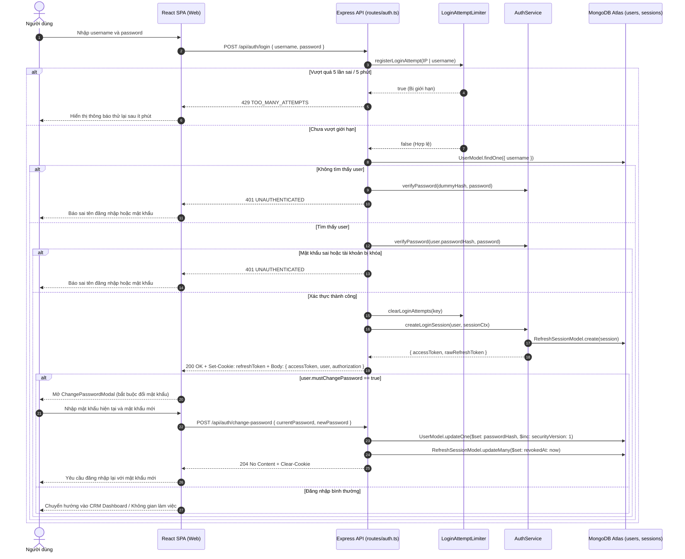

**Hình 2.40: Sơ đồ tuần tự UC01 – Đăng nhập hệ thống và đổi mật khẩu tạm**

### 2.5.1.4 Sơ đồ nguồn hoạt động (Activity Diagram) UC01

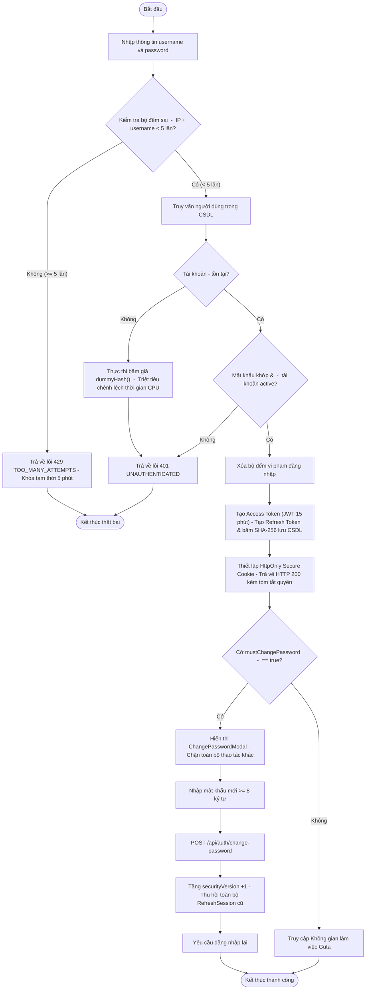

**Hình 2.41: Sơ đồ hoạt động UC01 – Luồng xác thực đăng nhập và giới hạn tần suất**

### 2.5.1.5 Vị trí cần ảnh chụp màn hình minh chứng
- `[CHÈN ẢNH: Hộp thoại đăng nhập hệ thống — Giao diện Modal AccountLoginModal — Dữ liệu: Form nhập tên đăng nhập, mật khẩu, nút Đăng nhập — Vai trò: Khách / Người dùng chưa đăng nhập]`
- `[CHÈN ẢNH: Hộp thoại bắt buộc đổi mật khẩu tạm — Giao diện Modal ChangePasswordModal — Dữ liệu: Form nhập mật khẩu hiện tại, mật khẩu mới, xác nhận mật khẩu, không có nút tắt — Vai trò: Tài khoản mới được cấp]`

### 2.5.1.6 Ghi chú kiểm chứng & Mục chưa kiểm chứng
- Đã kiểm chứng: Thuật toán O(1) chống tràn bộ nhớ trong `login-attempt-limiter.ts` giới hạn tối đa 10.000 key; `dummyHash()` bảo vệ timing oracle; JWT payload chứa `securityVersion`; đổi mật khẩu thu hồi mọi Refresh Token cũ qua `RefreshSessionModel.updateMany`.
- `[CHƯA KIỂM CHỨNG: Kênh gửi email/SMS thật cho khôi phục mật khẩu — Lý do: Môi trường cục bộ chưa cấu hình dịch vụ gửi thư SMTP/SMS của doanh nghiệp, API trả về 503 SECURE_RECOVERY_DELIVERY_REQUIRED nếu thiếu adapter.]`

---

## 2.5.2 Đặc tả Use Case UC02: Hồ sơ nhân sự & cấp bậc (F1)

### 2.5.2.1 Hướng dẫn viết theo yêu cầu của Khoa
- Mục tiêu & Trình bày: Mô tả tính năng quản lý vòng đời hồ sơ nhân viên (F1), phân cấp bậc 13 bậc chuẩn Guta, quy trình cập nhật thông tin thường trực tiếp có kiểm soát phiên bản (CAS), quy trình đề xuất thay đổi thông tin nhạy cảm qua hàng đợi xét duyệt độc lập (Independent Approval Queue), và thuật toán sinh mã nhân viên chuẩn hóa `GT-CH{YYMM}{SEQ}`. 01 bảng đặc tả Use Case đầy đủ các mục chuẩn, 01 sơ đồ tuần tự xét duyệt hồ sơ, 01 sơ đồ hoạt động có rẽ nhánh điều kiện duyệt, vị trí chèn ảnh chụp màn hình, và ghi chú kiểm chứng.

### 2.5.2.2 Bảng đặc tả Use Case UC02

**Bảng 2.41: Đặc tả Use Case UC02 – Quản lý hồ sơ nhân sự và cấp bậc (F1)**

| Thuộc tính | Nội dung chi tiết |
|---|---|
| Mã Use Case | UC02 |
| Tên Use Case | Quản lý hồ sơ nhân sự và cấp bậc (F1) |
| Tác nhân | Nhân viên (`staff`, `ptch`), Quản lý cửa hàng (`sm`), Quản trị Nhân sự (`hr`) |
| Mô tả tóm tắt | Xem thông tin hồ sơ nhân sự; tự cập nhật thông tin liên hệ và kỹ năng cá nhân; gửi yêu cầu điều chỉnh các trường dữ liệu nhạy cảm (ngày vào làm `hiredAt`, cấp bậc `level`, chức danh `jobTitle`); xét duyệt hoặc từ chối yêu cầu qua hàng đợi phê duyệt độc lập; tự động cấp mã nhân viên duy nhất theo quy tắc `GT-CH{YYMM}{SEQ}`. |
| Điều kiện tiên quyết | 1. Người dùng đã đăng nhập và tài khoản đã được liên kết với một hồ sơ nhân sự (`employeeId`). 2. Người dùng có các năng lực tương ứng: `profile.read_self`, `profile.update_self_basic`, `profile.request_self`, hoặc `employees.review`. |
| Điều kiện sau | 1. Cập nhật thông tin thường: Dữ liệu số điện thoại/kỹ năng được cập nhật, `profileRevision` tăng 1, ghi sự kiện `PROFILE_EDITED` vào `profileHistory`. 2. Gửi yêu cầu thay đổi: Bản ghi yêu cầu mới được thêm vào mảng `profileChangeRequests` của hồ sơ với trạng thái `PENDING`. 3. Duyệt yêu cầu: Dữ liệu hồ sơ chính thức thay đổi, trạng thái yêu cầu chuyển thành `APPROVED`, ghi vết `PROFILE_CHANGE_APPROVED`. |
| Luồng sự kiện chính | 1. Nhân viên truy cập trang Hồ sơ cá nhân (`EmployeeProfileView.tsx`). Client gọi GET `/api/employees/:id` (hoặc `/api/auth/me`). 2. Giao diện hiển thị: Mã nhân viên, Họ tên, Chức danh, Cấp bậc, Cửa hàng, Ngày vào làm, Số điện thoại, Kỹ năng và danh sách yêu cầu đang chờ. 3. Nhân viên chỉnh sửa số điện thoại hoặc kỹ năng, nhấn "Lưu hồ sơ". 4. Client gửi HTTP PATCH tới `/api/employees/:id` kèm `{ phone, skills, expectedVersion }`. 5. Server kiểm tra quyền `profile.update_self_basic`, kiểm tra phiên bản `expectedVersion === employee.profileRevision`. 6. Server cập nhật dữ liệu, tăng `profileRevision`, ghi sự kiện `PROFILE_EDITED` vào `profileHistory`, trả về hồ sơ mới. 7. Khi cần đổi ngày vào làm, nhân viên chọn ngày mới và nhấn "Gửi yêu cầu thay đổi". 8. Client gửi HTTP POST tới `/api/employees/:id/change-requests` kèm `{ targetFields: { hiredAt }, clientMessageId }`. 9. Server kiểm tra không có yêu cầu nào đang `PENDING` và tổng số yêu cầu < 100; lưu bản chụp gốc `previousSnapshot`, ghi yêu cầu vào `profileChangeRequests` và ghi log `PROFILE_CHANGE_REQUESTED`. 10. HR/Quản lý có quyền `employees.review` mở hàng đợi xét duyệt (`ProfileApprovalQueue.tsx` gọi GET `/api/change-requests?status=PENDING`). 11. Quản lý xem chi tiết đối chiếu giữa `previousSnapshot` và `targetFields`, chọn Phê duyệt (APPROVE) hoặc Từ chối (REJECT kèm lý do). 12. Client gửi HTTP POST tới `/api/employees/:id/change-requests/:requestId/review`. 13. Server kiểm tra cấm tự duyệt (self-approval), kiểm tra tính toàn vẹn của snapshot gốc, cập nhật trường dữ liệu mới (nếu APPROVE), chuyển trạng thái yêu cầu thành `APPROVED`/`REJECTED`, ghi log `PROFILE_CHANGE_APPROVED`/`PROFILE_CHANGE_REJECTED`. |
| Luồng thay thế và ngoại lệ | - 5a. Xung đột phiên bản khi sửa thông tin: `expectedVersion !== profileRevision` -> Server trả lỗi HTTP 409 `PROFILE_VERSION_CONFLICT`. - 9a. Đã có yêu cầu đang chờ duyệt: Server trả HTTP 409 `PROFILE_REQUEST_PENDING` ("Hồ sơ đã có yêu cầu chờ duyệt"). - 9b. Vượt quá giới hạn 100 yêu cầu: Server trả HTTP 409 `PROFILE_STORAGE_LIMIT`. - 13a. Quản lý tự duyệt yêu cầu của chính mình: Server trả HTTP 403 `SELF_APPROVAL` ("Không được tự duyệt thay đổi hồ sơ của mình"). - 13b. Yêu cầu đổi cấp bậc/chức danh khi chính sách chưa phê duyệt: Server trả HTTP 403 `POLICY_PENDING`. - 13c. Dữ liệu gốc đã bị thay đổi trong lúc chờ duyệt: Server trả HTTP 409 `PROFILE_SNAPSHOT_CONFLICT`. |
| Quy tắc nghiệp vụ | - BR-EMP-01: Thuật toán cấp mã nhân viên `GT-CH{YYMM}{SEQ}`: Tiền tố cố định `GT-CH`, 4 ký tự kỳ tuyển dụng gồm 2 số cuối của năm và 2 số tháng (`YYMM`), 4 số thứ tự tăng dần từ `0001` đến `9999` (`employee-code.service.ts:4-58`). - BR-EMP-02: Phân tách trách nhiệm (Separation of Duties): Tuyệt đối không cho phép người yêu cầu tự duyệt yêu cầu của chính mình (`routes/employees.ts:174`). - BR-EMP-03: Giới hạn yêu cầu chờ: Mỗi hồ sơ chỉ được có tối đa 01 yêu cầu ở trạng thái `PENDING` tại một thời điểm (`routes/employees.ts:131`). - BR-EMP-04: Thang cấp bậc 13 bậc chuẩn Guta: `NV1, NV2, NV3, PTCH, SM1, SM2, SM3, AM1, AM2, AM3, SAM, AOM, OM` (`packages/contracts/src/authorization.ts:109`). - BR-EMP-05: Lịch sử thay đổi append-only: Toàn bộ biến động thông tin được lưu trữ bất biến trong `profileHistory`, bảo đảm tính toàn vẹn cục bộ không xóa/sửa (`personnel-admin.ts:43-52`). |
| Màn hình, route và API | - Màn hình UI: Trang hồ sơ nhân viên `EmployeeProfileView.tsx`, Quản trị nhân sự `PersonnelAdmin.tsx`, Hàng đợi xét duyệt hồ sơ `ProfileApprovalQueue.tsx`. - API Endpoints: `GET /api/employees/:id`, `PATCH /api/employees/:id`, `POST /api/employees/:id/change-requests`, `GET /api/employees/:id/change-requests`, `GET /api/change-requests`, `POST /api/employees/:id/change-requests/:requestId/review`, `GET /api/employees/:id/profile-history`, `GET /api/directory`. |

*Nguồn kiểm chứng code: apps/api/src/routes/employees.ts (dòng 29-239), apps/api/src/routes/personnel-admin.ts, apps/api/src/services/employee-profile.service.ts, apps/api/src/services/employee-code.service.ts, apps/web/src/components/EmployeeProfileView.tsx, apps/web/src/components/ProfileApprovalQueue.tsx.*

### 2.5.2.3 Sơ đồ nguồn tuần tự (Sequence Diagram) UC02

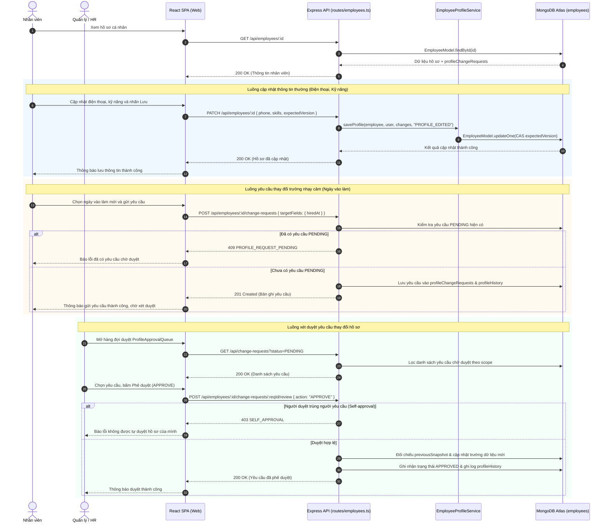

**Hình 2.42: Sơ đồ tuần tự UC02 – Cập nhật thông tin và xét duyệt thay đổi hồ sơ**

### 2.5.2.4 Sơ đồ nguồn hoạt động (Activity Diagram) UC02

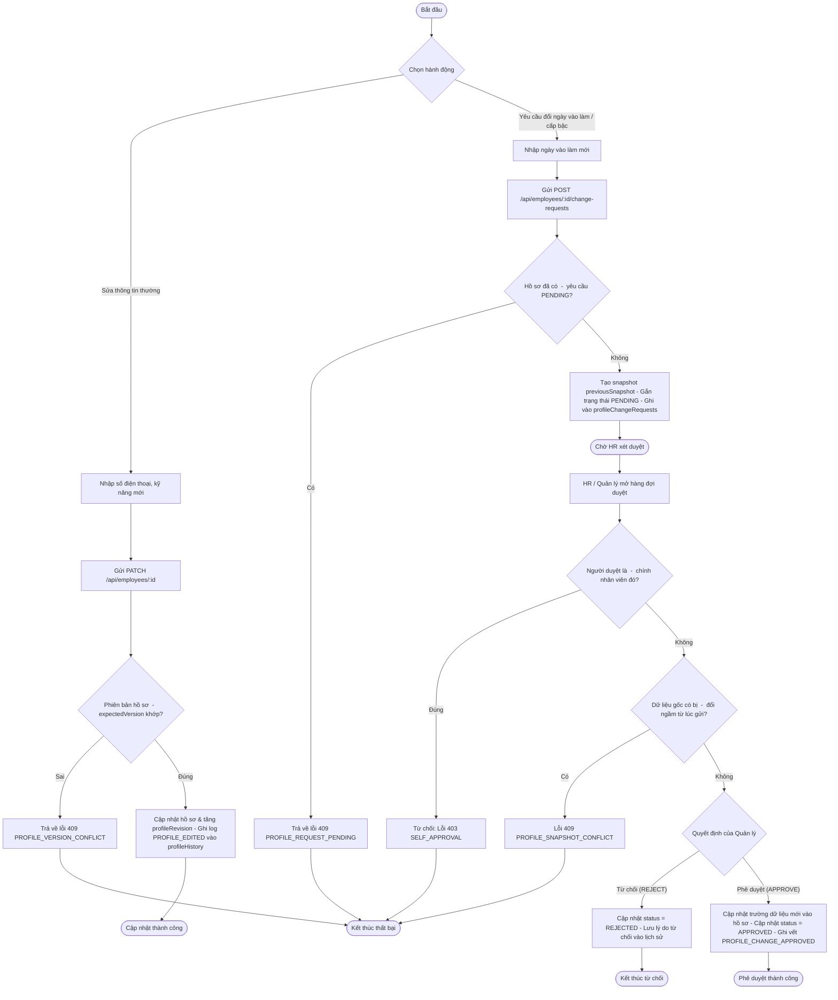

**Hình 2.43: Sơ đồ hoạt động UC02 – Quy trình gửi và phê duyệt thay đổi hồ sơ nhân sự**

### 2.5.2.5 Vị trí cần ảnh chụp màn hình minh chứng
- `[CHÈN ẢNH: Giao diện hồ sơ nhân sự — Component EmployeeProfileView — Dữ liệu: Thông tin cá nhân, ngày vào làm, cấp bậc, danh sách kỹ năng, nút gửi yêu cầu — Vai trò: Nhân viên]`
- `[CHÈN ẢNH: Hàng đợi xét duyệt hồ sơ — Component ProfileApprovalQueue — Dữ liệu: Danh sách yêu cầu thay đổi, trường thông tin cũ và mới, nút Duyệt / Từ chối — Vai trò: HR / Quản lý]`

### 2.5.2.6 Ghi chú kiểm chứng & Mục chưa kiểm chứng
- Đã kiểm chứng: Thuật toán cấp mã `reserveEmployeeCode` sinh chuẩn `GT-CH{YYMM}{SEQ}` với sequence 4 chữ số từ counter Mongo (`employee-code.service.ts:4-58`); toàn bộ yêu cầu thay đổi nhúng trong document nhân viên theo ADR-018; cấm self-approval tại dòng 174 `routes/employees.ts`.
- `[CHƯA KIỂM CHỨNG: Tự động thăng cấp bậc theo đánh giá KPI — Lý do: Hiện tại luồng đổi cấp bậc (level) đang bị chặn tại dòng 178 routes/employees.ts với mã lỗi POLICY_PENDING do chính sách thăng chức tự động chưa được ban lãnh đạo phê duyệt.]`

---

## 2.5.3 Đặc tả Use Case UC03: Tài khoản, phân quyền & ủy quyền (Authorization V1)

### 2.5.3.1 Hướng dẫn viết theo yêu cầu của Khoa
- Mục tiêu & Trình bày: Phân tích kiến trúc phân quyền dựa trên năng lực (CapBAC - Capability-based Access Control), cơ cấu 9 Software Profiles, phạm vi ủy quyền tổ chức (`AuthorizationScope`), quy trình ủy quyền tạm thời (Delegation) có giới hạn thời gian (tối đa 14 ngày) cho 3 quyền nghiệp vụ được phép, và kiểm soát bảo mật bằng chuỗi băm (hash-chain audit). 01 bảng đặc tả Use Case đầy đủ các mục chuẩn, 01 sơ đồ tuần tự tạo và phê duyệt ủy quyền, 01 sơ đồ hoạt động kiểm tra tính hợp lệ của ủy quyền, vị trí chèn ảnh chụp màn hình, và ghi chú kiểm chứng.

### 2.5.3.2 Bảng đặc tả Use Case UC03

**Bảng 2.42: Đặc tả Use Case UC03 – Quản trị tài khoản, phân quyền và ủy quyền (Authorization V1)**

| Thuộc tính | Nội dung chi tiết |
|---|---|
| Mã Use Case | UC03 |
| Tên Use Case | Quản trị tài khoản, phân quyền và ủy quyền (Authorization V1) |
| Tác nhân | Quản trị viên hệ thống (`system_admin`), Quản lý ủy quyền (`sm`, `om`), Người nhận ủy quyền (`ptch`, `aom`), Quản lý cấp trên phê duyệt |
| Mô tả tóm tắt | Quản lý tài khoản người dùng; cấp phát năng lực cụ thể (`AuthorizationGrant`) gắn với phạm vi cửa hàng canonical; thực hiện quy trình ủy quyền tạm thời quyền hạn quản lý (tối đa 14 ngày) cho nhân sự cấp phó đủ điều kiện; xét duyệt ủy quyền độc lập từ quản lý trực tiếp; thu hồi quyền hạn và lưu vết kiểm toán bất biến chuỗi băm. |
| Điều kiện tiên quyết | 1. Người thực hiện có năng lực `accounts.manage`, `grants.manage`, `delegations.request` hoặc `delegations.review`. 2. Người ủy quyền và người nhận ủy quyền đều là nhân viên đang hoạt động (`status: active`). |
| Điều kiện sau | 1. Cấp quyền: Bản ghi `AuthorizationGrant` được lưu trữ với mốc thời gian rõ ràng, tăng `securityVersion` của tài khoản. 2. Ủy quyền: Bản ghi `AuthorizationDelegation` được tạo với mã băm các điều khoản `termsHash` và chuỗi sự kiện kiểm toán. 3. Duyệt ủy quyền: Bản ghi chuyển sang `APPROVED`, người nhận có thêm quyền tương ứng trong phạm vi cửa hàng trong thời hạn hiệu lực. |
| Luồng sự kiện chính | 1. Quản lý cửa hàng (`sm`) truy cập giao diện Quản lý ủy quyền khi có nhu cầu bàn giao ca/nghỉ phép. 2. Client gọi GET `/api/delegations/recipients?storeId={storeId}` để lấy danh sách nhân sự đủ điều kiện tiếp nhận (ví dụ `ptch` được quản lý trực tiếp tại cửa hàng). 3. Quản lý chọn người nhận, chọn quyền ủy quyền (chỉ trong 3 quyền được phép: `projects.create`, `projects.assign`, `reports.review`), chọn khoảng thời gian (`validFrom` đến `validUntil`, tối đa 14 ngày), nhập lý do và bấm "Tạo đề xuất ủy quyền". 4. Client gửi HTTP POST tới `/api/delegations` kèm payload `DelegationCreateSchema`. 5. Server kiểm tra quyền gốc của người ủy quyền (`sourceGrantId`), kiểm tra profile tương thích (`sm` chỉ ủy quyền cho `ptch`, `om` cho `aom`), kiểm tra phạm vi cửa hàng (`storeIds`), kiểm tra thời hạn <= 14 ngày. 6. Server tạo bản ghi ủy quyền với trạng thái `PENDING`, tính toán `termsHash` và băm chuỗi sự kiện đầu tiên vào `history`, lưu vào `AuthorizationDelegationModel`. 7. Quản lý trực tiếp cấp trên (có quan hệ quản lý trong `management_relations` và có quyền `delegations.review`) mở hàng duyệt ủy quyền (GET `/api/delegations?status=PENDING`). 8. Quản lý cấp trên đối chiếu các điều khoản, kiểm tra tính toàn vẹn chuỗi băm qua `verifyTerms(row)`, chọn Phê duyệt (APPROVE) hoặc Từ chối (REJECT) kèm lý do. 9. Client gửi HTTP POST tới `/api/delegations/:id/review` kèm `DelegationDecisionSchema`. 10. Server xác nhận phê duyệt độc lập, gắn `approvedByUserId`, chuyển trạng thái sang `APPROVED`. Trong thời gian hiệu lực, người nhận được bổ sung quyền ủy quyền khi thực hiện các tác vụ trên phạm vi cửa hàng được chỉ định. 11. Khi cần thu hồi trước hạn, người ủy quyền hoặc quản lý gửi POST `/api/delegations/:id/revoke` kèm lý do và `expectedVersion` để lập tức chuyển trạng thái sang `REVOKED`. |
| Luồng thay thế và ngoại lệ | - 5a. Ủy quyền vượt quá 14 ngày: Server trả lỗi HTTP 400 `INVALID_DELEGATION_WINDOW`. - 5b. Chọn quyền nằm ngoài danh mục 3 quyền cho phép: Server trả HTTP 403 `CAPABILITY_NOT_DELEGABLE`. - 5c. Ủy quyền sai cặp profile (ví dụ SM ủy quyền cho Staff thông thường): Server trả HTTP 403 `DELEGATION_PROFILE_DENIED`. - 5d. Tự ủy quyền cho chính bản thân: Server trả HTTP 400 "Cannot delegate to self". - 8a. Phát hiện lịch sử ủy quyền bị can thiệp/sai lệch mã băm: Server trả HTTP 403 `DELEGATION_TERMS_TAMPERED` hoặc `DELEGATION_AUDIT_INVALID`. - 8b. Người duyệt không có quan hệ quản lý trực tiếp trong CSDL: Server trả HTTP 403 `DIRECT_APPROVER_MAPPING_REQUIRED`. |
| Quy tắc nghiệp vụ | - BR-AUTHZ-01: Hệ thống 9 Software Profiles: `system_admin, hr, om, aom, sam, am, sm, ptch, staff`. Profile chỉ thể hiện tư cách hợp lệ (eligibility), không đại diện cho quyền hạn tự động (`authorization-v1-runtime.md:10-14`). - BR-AUTHZ-02: Phân quyền dựa trên Năng lực (CapBAC): Quyền hạn gắn với từng capability và phạm vi cụ thể; không có tài khoản "Super Admin" vượt qua logic kiểm soát nghiệp vụ (`authorization-v1-runtime.md:11-12`). - BR-AUTHZ-03: Ba quyền duy nhất được phép ủy quyền: `projects.create`, `projects.assign`, `reports.review`. Mọi quyền về nhân sự, tài chính, phê duyệt ủy quyền đều bị cấm ủy quyền (`delegation.service.ts:113`). - BR-AUTHZ-04: Thời hạn ủy quyền tối đa 14 ngày (`<= 14 * 86400000`), bắt buộc có phê duyệt độc lập từ quản lý trực tiếp có quan hệ trong `management_relations` (`delegation.service.ts:80-86`). - BR-AUTHZ-05: Khóa bảo mật tài khoản (Account Security Maintenance Lock): Các biến động quyền hạn được tuần tự hóa và lưu vết chuỗi băm chống sửa đổi (`account-security.service.ts`). |
| Màn hình, route và API | - Màn hình UI: Quản trị tài khoản `AccountAdminView`, Trạng thái quyền `AuthorizationStatus.tsx`. - API Endpoints: `GET /api/delegations`, `GET /api/delegations/recipients`, `POST /api/delegations`, `GET /api/delegations/:id`, `POST /api/delegations/:id/review`, `POST /api/delegations/:id/revoke`, `GET /api/admin/users`, `POST /api/admin/users/:id/grants`. |

*Nguồn kiểm chứng code: apps/api/src/routes/delegations.ts (dòng 1-22), apps/api/src/services/delegation.service.ts (dòng 15-123), apps/api/src/services/authorization-policy.service.ts, apps/api/src/services/authorization-scope.service.ts, packages/contracts/src/authorization.ts (dòng 1-131).*

### 2.5.3.3 Sơ đồ nguồn tuần tự (Sequence Diagram) UC03

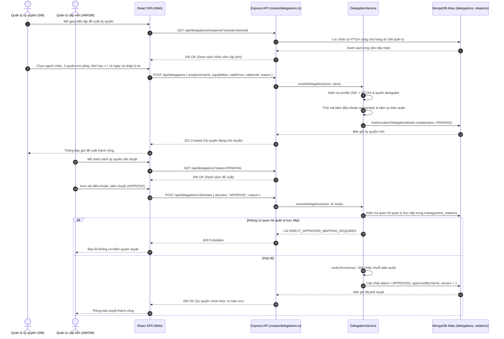

**Hình 2.44: Sơ đồ tuần tự UC03 – Tạo và phê duyệt ủy quyền quyền hạn (Delegation)**

### 2.5.3.4 Sơ đồ nguồn hoạt động (Activity Diagram) UC03

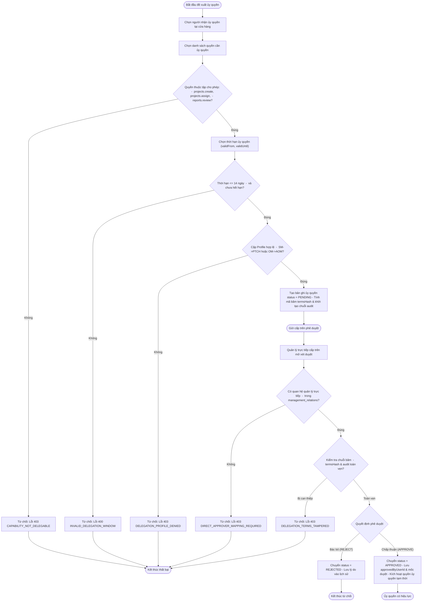

**Hình 2.45: Sơ đồ hoạt động UC03 – Quy trình cấp phát và xác minh ủy quyền tạm thời**

### 2.5.3.5 Vị trí cần ảnh chụp màn hình minh chứng
- `[CHÈN ẢNH: Giao diện trạng thái năng lực và ủy quyền — Component AuthorizationStatus — Dữ liệu: Danh sách capability đang sở hữu, phạm vi cửa hàng, các ủy quyền đang hiệu lực — Vai trò: Quản lý SM]`
- `[CHÈN ẢNH: Giao diện danh sách tài khoản và phân quyền quản trị — Component AccountAdminView — Dữ liệu: Bảng người dùng, gán Software Profile, danh sách grant năng lực — Vai trò: Quản trị viên hệ thống]`

### 2.5.3.6 Ghi chú kiểm chứng & Mục chưa kiểm chứng
- Đã kiểm chứng: Ràng buộc 14 ngày tối đa tại dòng 75 `packages/contracts/src/authorization.ts`; danh mục 3 quyền được ủy quyền duy nhất tại dòng 113 `delegation.service.ts`; kiểm tra quan hệ quản lý trực tiếp từ collection `management_relations` tại dòng 81-83 `delegation.service.ts`.
- `[CHƯA KIỂM CHỨNG: Triển khai trên môi trường Production Render Cloud — Lý do: Tài liệu docs/authorization-v1-runtime.md ghi rõ trạng thái kiểm toán hiện tại là MIGRATING, chưa hoàn tất chứng nhận production-ready trên cloud.]`

---

## 2.5.4 Đặc tả Use Case UC04: Đề tài/công việc theo vòng đời (F2)

### 2.5.4.1 Hướng dẫn viết theo yêu cầu của Khoa
- Mục tiêu & Trình bày: Trình bày quy trình quản lý đề tài và nhiệm vụ theo đúng 5 trạng thái vòng đời chuẩn: `DRAFT -> ASSIGNED -> IN_PROGRESS -> PENDING_REVIEW -> COMPLETED`; ma trận chuyển trạng thái hợp lệ (`PROJECT_TRANSITIONS`); cập nhật tiến độ (0-100%) có kiểm soát khóa lạc quan (CAS) và toàn vẹn chuỗi băm kiểm toán (`assignmentAudit`). 01 bảng đặc tả Use Case đầy đủ các mục chuẩn, 01 sơ đồ tuần tự quản lý tiến độ, 01 sơ đồ hoạt động chuyển trạng thái vòng đời, vị trí chèn ảnh chụp màn hình, và ghi chú kiểm chứng.

### 2.5.4.2 Bảng đặc tả Use Case UC04

**Bảng 2.43: Đặc tả Use Case UC04 – Quản lý đề tài và công việc theo vòng đời (F2)**

| Thuộc tính | Nội dung chi tiết |
|---|---|
| Mã Use Case | UC04 |
| Tên Use Case | Quản lý đề tài và công việc theo vòng đời (F2) |
| Tác nhân | Quản lý cửa hàng (`sm`, `am`, `om`), Nhân viên thực hiện (`staff`, `ptch`) |
| Mô tả tóm tắt | Khởi tạo công việc ở trạng thái nháp (`DRAFT`); phân công nhiệm vụ cho nhân viên (`ASSIGNED`); chuyển sang đang thực hiện (`IN_PROGRESS`); cập nhật tiến độ phần trăm (0-100%); kiểm soát chuyển trạng thái nghiêm ngặt theo ma trận chuyển tiếp; lưu vết kiểm toán bất biến chuỗi băm (hash-chain audit). |
| Điều kiện tiên quyết | 1. Quản lý có quyền `projects.create` hoặc `projects.assign` trên cửa hàng canonical. 2. Cửa hàng trực thuộc phải là cửa hàng hợp lệ trong danh mục đối chiếu (`storeMappingRef`). 3. Nhân viên thực hiện phải có quyền `projects.execute` và thuộc đúng cửa hàng của công việc. |
| Điều kiện sau | 1. Công việc được khởi tạo hoặc chuyển trạng thái đúng theo ma trận quy định. 2. Lịch sử trạng thái (`statusHistory`) và nhật ký kiểm toán (`assignmentAudit`) được ghi nhận append-only với mã băm nối tiếp. 3. Tiến độ phần trăm được cập nhật chính xác và an toàn trước xung đột đồng thời. |
| Luồng sự kiện chính | 1. Quản lý mở màn hình Danh sách công việc (`ProjectListView.tsx`), nhấn "Tạo công việc mới". 2. Quản lý nhập thông tin: Tiêu đề (`title`), Mô tả (`description`), Kỹ năng yêu cầu (`requiredSkills`), Đơn vị (`departmentId`), Cửa hàng (`storeId`), Hạn hoàn thành (`dueDate`), có thể chọn người thực hiện ban đầu (`assigneeId`). 3. Client gửi HTTP POST tới `/api/projects` kèm `ProjectCreateSchema`. 4. Server kiểm tra quyền `projects.create` tại cửa hàng chỉ định, kiểm tra tính hợp lệ của cửa hàng và phòng ban canonical. Nếu có `assigneeId`, kiểm tra nhân sự thuộc đúng cửa hàng và đang active. 5. Server tạo bản ghi `ProjectModel` với trạng thái ban đầu `DRAFT`, tiến độ `0%`, phiên bản `version = 1`, ghi log khởi tạo vào `statusHistory` và `assignmentAudit`. Trả về HTTP 201 `{ id, status, version }`. 6. Quản lý giao việc: gửi HTTP POST tới `/api/projects/:id/assign` kèm `{ assigneeId, expectedVersion }`. 7. Server kiểm tra chuyển trạng thái hợp lệ (`DRAFT -> ASSIGNED`), cập nhật `assignmentStatus = "PENDING_ACCEPTANCE"`, tăng `assignmentRound`, gửi thông báo `assignmentNotices` cho nhân viên. 8. Sau khi nhân viên tiếp nhận nhiệm vụ (UC06), nhân viên bắt đầu thực hiện: nhấn "Bắt đầu làm". 9. Client gửi HTTP POST tới `/api/projects/:id/transition` kèm `{ targetStatus: "IN_PROGRESS", expectedVersion }`. 10. Server kiểm tra người thực hiện (`ownAssignment`), kiểm tra ma trận chuyển trạng thái hợp lệ, cập nhật trạng thái `IN_PROGRESS`. 11. Trong quá trình làm, nhân viên cập nhật tiến độ: nhập số phần trăm (0-100%) và nhấn "Cập nhật". 12. Client gửi HTTP POST tới `/api/projects/:id/progress` kèm `{ progress, expectedVersion, clientMessageId }`. 13. Server kiểm tra tính toàn vẹn chuỗi băm `verifyProjectAudit(project)`, kiểm tra xung đột phiên bản CAS `expectedVersion === project.version`, cập nhật `progress`, ghi nhật ký `PROGRESS_UPDATED`, tăng `version` và trả về tiến độ mới. |
| Luồng thay thế và ngoại lệ | - 4a. Cửa hàng không thuộc danh mục canonical đã xác minh: Server trả lỗi HTTP 400 `CANONICAL_STORE_REQUIRED` hoặc 409 `STORE_DEPARTMENT_MAPPING_REQUIRED`. - 6a. Chuyển trạng thái trái phép (ví dụ chuyển thẳng từ DRAFT sang COMPLETED): Server ném `IllegalTransitionError` (HTTP 409). - 9a. Người không phải người được giao cố tình bắt đầu công việc: Server trả lỗi HTTP 403 `NOT_ASSIGNED_EMPLOYEE`. - 13a. Xung đột phiên bản (dữ liệu đã bị người khác sửa): Server trả lỗi HTTP 409 `PROJECT_VERSION_CONFLICT`. - 13b. Phát hiện gãy chuỗi băm kiểm toán (tampered audit): Server trả lỗi HTTP 409 `AUDIT_INTEGRITY_FAILED`. - 13c. Gửi lặp request cùng clientMessageId: Server phát hiện trùng lặp, trả về tiến độ hiện tại một cách idempotent mà không ghi trùng lặp audit. |
| Quy tắc nghiệp vụ | - BR-PROJ-01: Đúng 5 trạng thái vòng đời duy nhất: `DRAFT`, `ASSIGNED`, `IN_PROGRESS`, `PENDING_REVIEW`, `COMPLETED`. Không tự ý bổ sung trạng thái ngoài danh mục (`models/Project.ts:3-8`). - BR-PROJ-02: Ma trận chuyển trạng thái nghiêm ngặt (`PROJECT_TRANSITIONS`):   * `DRAFT -> ASSIGNED` hoặc `IN_PROGRESS` (Quản lý thực hiện)   * `ASSIGNED -> IN_PROGRESS` (Quản lý hoặc Nhân viên sau khi đã tiếp nhận)   * `IN_PROGRESS -> PENDING_REVIEW` (chỉ thông qua luồng nộp báo cáo nghiệm thu F7)   * `PENDING_REVIEW -> COMPLETED` (chỉ thông qua luồng duyệt nghiệm thu F7) hoặc quay về `IN_PROGRESS` (từ chối nghiệm thu)   * `COMPLETED`: Trạng thái kết thúc, cấm chuyển đi bất kỳ trạng thái nào khác (`models/Project.ts:75-84`). - BR-PROJ-03: Cấm nhảy cóc nghiệm thu: Không thể chuyển trạng thái sang `COMPLETED` qua API `/transition`; bắt buộc phải thông qua luồng nộp và duyệt báo cáo (`routes/projects.ts:179-181`). - BR-PROJ-04: Đóng băng sửa đổi khi chuyển giao: Nếu `assignmentStatus === "HANDOVER_PENDING"`, nội dung nhiệm vụ không được phép chỉnh sửa (`routes/projects.ts:143`). - BR-PROJ-05: Toàn vẹn chuỗi băm (Hash-chain Audit): Mỗi thao tác thay đổi vòng đời đều tạo một audit block có chứa băm của sự kiện trước đó; bất kỳ sửa đổi trực tiếp vào DB đều làm gãy chuỗi băm và bị hệ thống từ chối cập nhật tiếp theo (`services/project-audit.service.ts`). |
| Màn hình, route và API | - Màn hình UI: Danh sách công việc `ProjectListView.tsx`, Hộp thoại tạo công việc, Khung cập nhật tiến độ. - API Endpoints: `GET /api/projects`, `POST /api/projects`, `GET /api/projects/:id`, `PATCH /api/projects/:id`, `POST /api/projects/:id/assign`, `POST /api/projects/:id/transition`, `POST /api/projects/:id/progress`, `GET /api/projects/:id/eligible-assignees`. |

*Nguồn kiểm chứng code: apps/api/src/routes/projects.ts (dòng 60-222), apps/api/src/models/Project.ts (dòng 1-127), apps/api/src/services/project-workflow.service.ts, apps/api/src/services/project-audit.service.ts, apps/web/src/components/ProjectListView.tsx.*

### 2.5.4.3 Sơ đồ nguồn tuần tự (Sequence Diagram) UC04

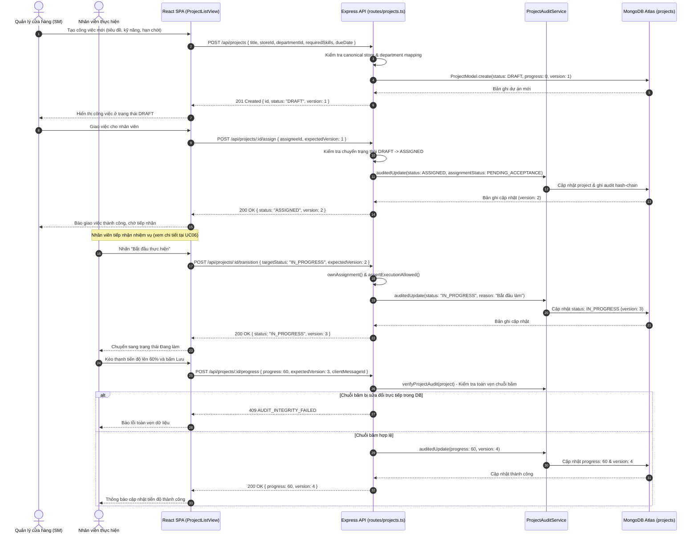

**Hình 2.46: Sơ đồ tuần tự UC04 – Quản lý vòng đời công việc và cập nhật tiến độ**

### 2.5.4.4 Sơ đồ nguồn hoạt động (Activity Diagram) UC04

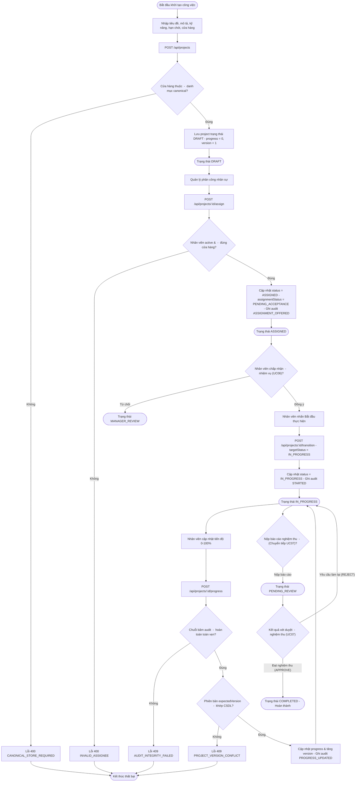

**Hình 2.47: Sơ đồ hoạt động UC04 – Vòng đời trạng thái công việc từ DRAFT đến COMPLETED**

### 2.5.4.5 Vị trí cần ảnh chụp màn hình minh chứng
- `[CHÈN ẢNH: Danh sách công việc theo bộ lọc trạng thái — Component ProjectListView — Dữ liệu: Bảng danh sách công việc, bộ lọc trạng thái DRAFT/ASSIGNED/IN_PROGRESS, thanh tiến độ — Vai trò: Quản lý SM / Nhân viên]`
- `[CHÈN ẢNH: Chi tiết công việc và khung cập nhật tiến độ — Component ProjectListView — Dữ liệu: Tiêu đề công việc, mô tả, thanh trượt tiến độ 0-100%, lịch sử thay đổi trạng thái — Vai trò: Nhân viên được giao việc]`

### 2.5.4.6 Ghi chú kiểm chứng & Mục chưa kiểm chứng
- Đã kiểm chứng: Ma trận `PROJECT_TRANSITIONS` cố định tại dòng 75-84 `apps/api/src/models/Project.ts`; cấm nhảy trạng thái nghiệm thu tại dòng 180 `routes/projects.ts`; kiểm tra toàn vẹn băm bằng SHA-256 trong `verifyProjectAudit`.
- `[CHƯA KIỂM CHỨNG: Tự động phạt trễ hạn khi quá dueDate — Lý do: Không có background worker hay cron job nào tự động đổi trạng thái phạt điểm khi quá hạn; dueDate chỉ dùng cho truy vấn lọc overdue=true trên UI.]`

---

## 2.5.5 Đặc tả Use Case UC05: Gợi ý ứng viên & phân công (F4)

### 2.5.5.1 Hướng dẫn viết theo yêu cầu của Khoa
- Mục tiêu & Trình bày: Mô tả tính năng tích hợp thuật toán gợi ý và xếp hạng ứng viên phân công (F4), cơ chế so khớp kỹ năng chuẩn hóa (`BASELINE_EXACT`), tùy chọn mở rộng mô hình ngôn ngữ ngữ nghĩa tiếng Việt (`PHOBERT`), tiêu chí phá hòa điểm bằng tải công việc (`activeLoad`), và nguyên tắc Human-in-the-loop (chỉ mang tính tư vấn advisory-only). 01 bảng đặc tả Use Case đầy đủ các mục chuẩn, 01 sơ đồ tuần tự phân tích gợi ý, 01 sơ đồ hoạt động xếp hạng ứng viên, vị trí chèn ảnh chụp màn hình, và ghi chú kiểm chứng.

### 2.5.5.2 Bảng đặc tả Use Case UC05

**Bảng 2.44: Đặc tả Use Case UC05 – Gợi ý ứng viên và hỗ trợ phân công (F4)**

| Thuộc tính | Nội dung chi tiết |
|---|---|
| Mã Use Case | UC05 |
| Tên Use Case | Gợi ý ứng viên và hỗ trợ phân công (F4) |
| Tác nhân | Quản lý phân công (`sm`, `am`, `om`), Quản trị viên hệ thống |
| Mô tả tóm tắt | Hỗ trợ người quản lý tự động tìm kiếm, phân tích và xếp hạng Top 10 ứng viên phù hợp nhất trong cửa hàng để giao việc hoặc thay thế bàn giao; tính điểm dựa trên độ khớp kỹ năng chính xác (`exact match`) và ngữ nghĩa PhoBERT (`semantic match`); sử dụng tải công việc hiện tại làm tiêu chí phá hòa điểm; quyết định cuối cùng hoàn toàn do con người định đoạt. |
| Điều kiện tiên quyết | 1. Quản lý có quyền `projects.assign` trên cửa hàng của công việc. 2. Công việc đang ở trạng thái cần phân công/bàn giao: `DRAFT`, `ASSIGNED` hoặc `IN_PROGRESS`. |
| Điều kiện sau | 1. Trả về danh sách tối đa 10 ứng viên kèm điểm phù hợp (`suitabilityScore`), danh sách kỹ năng đáp ứng/còn thiếu, và lời giải thích minh bạch (`explanation`). 2. Thao tác xem gợi ý là Read-only (không ghi bất kỳ dữ liệu nào vào CSDL, không ghi điểm KPI hay đánh giá nhân viên). |
| Luồng sự kiện chính | 1. Quản lý mở giao diện phân công hoặc bàn giao công việc trên màn hình quản lý (`CandidateSuggestions.tsx`). 2. Client gửi yêu cầu HTTP GET tới `/api/projects/:id/assignment/candidates`. 3. Server xác thực quyền `projects.assign`, kiểm tra trạng thái công việc (`DRAFT`, `ASSIGNED`, `IN_PROGRESS`). 4. Server chụp snapshot danh sách nhân sự đang hoạt động trong cùng cửa hàng (`snapshot`), đếm số lượng công việc đang chịu trách nhiệm (`activeLoad`) và số lượng đặt trước bàn giao (`incomingReservations`). 5. Server kiểm tra cấu hình biến môi trường `F4_MODE`:     - Nếu `F4_MODE === "OFF"` (mặc định baseline): Tính điểm khớp kỹ năng chuẩn hóa NFC: `exact = matchedSkills.length / requiredSkills.length`. Điểm phù hợp: `suitabilityScore = Math.round(exact * 10000) / 100`.    - Nếu `F4_MODE === "PHOBERT"`: Thực hiện preflight kiểm tra quyền và loại bỏ dữ liệu nhạy cảm (PII redaction). Gửi yêu cầu tới worker Python FastAPI (`POST /api/f4/candidates`). Nhận điểm ngữ nghĩa `semanticScore`. Tính điểm tổng hợp: `score = alpha * semanticScore + (1 - alpha) * exact` (với `alpha` từ `F4_SEMANTIC_WEIGHT`). 6. Server sắp xếp ứng viên theo thứ tự ưu tiên: `suitabilityScore` giảm dần -> `activeLoad` tăng dần (ưu tiên người ít việc) -> `employeeId` tăng dần (thứ tự từ điển). 7. Server chọn Top 10 ứng viên, gắn cờ `advisoryOnly: true` và cảnh báo: "Quản lý quyết định cuối cùng. Không sử dụng KPI...". 8. Client hiển thị danh sách ứng viên, điểm số, kỹ năng đáp ứng và giải thích chi tiết. 9. Quản lý xem xét gợi ý, có toàn quyền chọn bất kỳ ứng viên nào và bấm "Giao việc". 10. Client gọi API `/api/projects/:id/assign` để hoàn tất phân công. |
| Luồng thay thế và ngoại lệ | - 3a. Công việc đã ở trạng thái PENDING_REVIEW hoặc COMPLETED: Server trả lỗi HTTP 409 `F4_PROJECT_STATE`. - 4a. Không có kỹ năng yêu cầu hoặc danh sách nhân sự trống: Trả về trạng thái `status: "INSUFFICIENT_DATA"` và nguồn `MANUAL`. - 5a. Khi bật PhoBERT nhưng mô hình AI lỗi hoặc timeout: Hệ thống tự động fallback về `BASELINE_FALLBACK` (chạy thuật toán khớp chính xác, bảo đảm tính sẵn sàng cao). - 5b. Dữ liệu ngữ cảnh bị thay đổi trong lúc mô hình đang tính toán: Server phát hiện qua digest hash và trả lỗi HTTP 409 `F4_CONTEXT_CHANGED`. |
| Quy tắc nghiệp vụ | - BR-F4-01: Tính chất tư vấn thuần túy (Advisory-only): AI chỉ đưa ra gợi ý xếp hạng, tuyệt đối không tự động phân công, không tự động phạt hay trừ điểm (`f4-orchestrator.service.ts:67-69`). - BR-F4-02: Tách biệt hoàn toàn với KPI: Điểm gợi ý F4 không đọc dữ liệu đánh giá KPI, không ghi vào hồ sơ nhân sự, không dùng làm thước đo đánh giá nhân viên (`f4-orchestrator.service.ts:31, 64`). - BR-F4-03: Workload chỉ là tiêu chí phá hòa điểm (Tie-breaker): Số lượng việc đang phụ trách chỉ dùng để xếp thứ tự khi hai ứng viên trùng điểm kỹ năng, không cấu thành điểm năng lực (`f4-orchestrator.service.ts:66`). - BR-F4-04: Mặc định an toàn (Fail-safe Baseline): F4 mặc định hoạt động ở chế độ `OFF/BASELINE_EXACT`. PhoBERT chỉ là worker mở rộng tùy chọn khi đủ tài nguyên (`CLAUDE.md §2`, `f4-orchestrator.service.ts:36-43`). - BR-F4-05: Bảo vệ quyền riêng tư (Privacy Redaction): Cấm gửi thông tin định danh cá nhân (CCCD/CMND, số điện thoại, lương, email) vào worker mô hình AI (`f4-orchestrator.service.ts:51`). |
| Màn hình, route và API | - Màn hình UI: Thành phần gợi ý ứng viên `CandidateSuggestions.tsx`, Modal phân công nhiệm vụ trong `ProjectListView.tsx`. - API Endpoints: `GET /api/projects/:id/assignment/candidates`, `POST /api/f4/candidates` (worker FastAPI nội bộ khi bật PhoBERT), `POST /api/projects/:id/assign`. |

*Nguồn kiểm chứng code: apps/api/src/services/f4-orchestrator.service.ts (dòng 1-69), apps/api/src/services/f4-client.service.ts, apps/api/src/routes/assignment.ts (dòng 42-46), apps/web/src/components/CandidateSuggestions.tsx.*

### 2.5.5.3 Sơ đồ nguồn tuần tự (Sequence Diagram) UC05

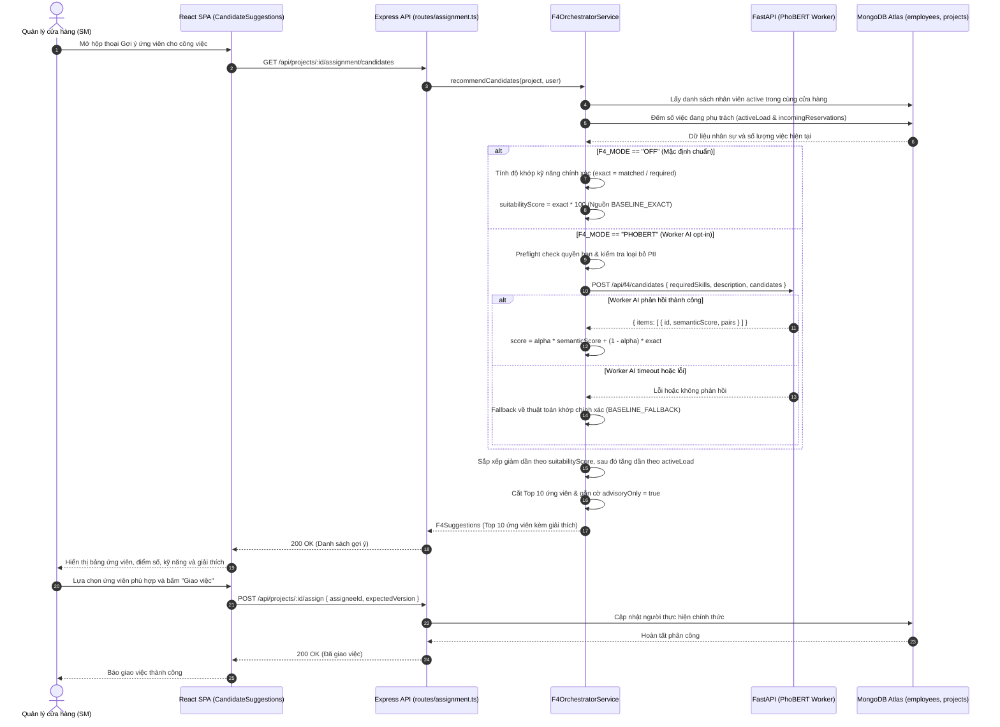

**Hình 2.48: Sơ đồ tuần tự UC05 – Gợi ý ứng viên phân công qua F4 Orchestrator**

### 2.5.5.4 Sơ đồ nguồn hoạt động (Activity Diagram) UC05

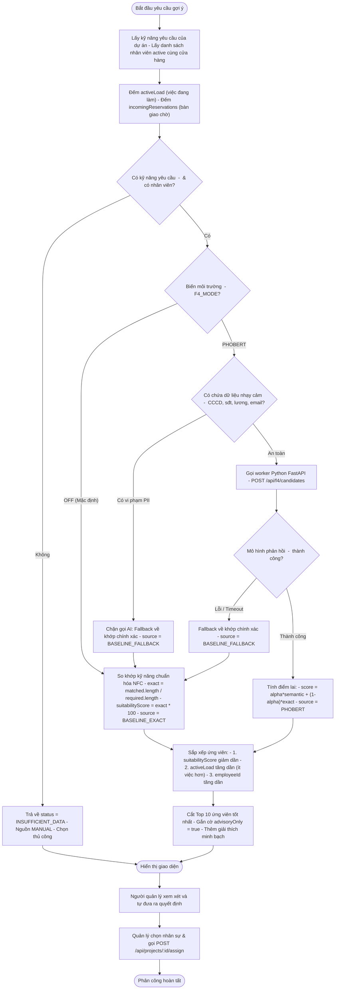

**Hình 2.49: Sơ đồ hoạt động UC05 – Quy trình xếp hạng ứng viên và hỗ trợ ra quyết định**

### 2.5.5.5 Vị trí cần ảnh chụp màn hình minh chứng
- `[CHÈN ẢNH: Thành phần gợi ý ứng viên — Component CandidateSuggestions — Dữ liệu: Danh sách Top 10 ứng viên, điểm số suitabilityScore, số việc đang phụ trách, kỹ năng khớp/thiếu — Vai trò: Quản lý SM]`

### 2.5.5.6 Ghi chú kiểm chứng & Mục chưa kiểm chứng
- Đã kiểm chứng: Logic xếp hạng độc quyền nằm tại `apps/api/src/services/f4-orchestrator.service.ts`; mặc định `F4_MODE` là `OFF` dùng thuật toán khớp chính xác; workload chỉ đóng vai trò phá hòa điểm tại dòng 66; không đọc hay ghi KPI.
- `[CHƯA KIỂM CHỨNG: Độ chính xác / KPI điểm số của mô hình PhoBERT — Lý do: CLAUDE.md §2 và rubric đề tài xác định F4 PhoBERT chỉ là benchmark EXPLORATORY trên môi trường riêng, dự án chưa có human-gold acceptance hay đánh giá trên môi trường production thực tế.]`

---

## 2.5.6 Đặc tả Use Case UC06: Tiếp nhận/từ chối/bàn giao công việc (ADR-021)

### 2.5.6.1 Hướng dẫn viết theo yêu cầu của Khoa
- Mục tiêu & Trình bày: Phân tích quy trình tiếp nhận nhiệm vụ tự nguyện và chuyển giao trách nhiệm theo Quyết định Kiến trúc ADR-021; hỗ trợ nhân viên chấp nhận (`ACCEPT`), từ chối trước tiếp nhận (`DECLINE`), hoặc xin chuyển giao (`REQUEST_CHANGE`); quy trình bàn giao hai bên bắt buộc (`Two-party Handover`); cơ chế kiểm soát tiến độ snapshot và neo bằng chứng lên Smart Contract Solidity (`AssignmentDecisionRegistry.sol`). 01 bảng đặc tả Use Case đầy đủ các mục chuẩn, 01 sơ đồ tuần tự quy trình bàn giao 2 bên, 01 sơ đồ hoạt động xử lý phản hồi và chuyển giao, vị trí chèn ảnh chụp màn hình, và ghi chú kiểm chứng.

### 2.5.6.2 Bảng đặc tả Use Case UC06

**Bảng 2.45: Đặc tả Use Case UC06 – Tiếp nhận, từ chối và bàn giao công việc (ADR-021)**

| Thuộc tính | Nội dung chi tiết |
|---|---|
| Mã Use Case | UC06 |
| Tên Use Case | Tiếp nhận, từ chối và bàn giao công việc (ADR-021) |
| Tác nhân | Nhân viên được phân công (`staff`, `ptch`), Quản lý phân công (`sm`, `am`, `om`), Người nhận bàn giao |
| Mô tả tóm tắt | Thực hiện tiếp nhận nhiệm vụ tự nguyện; nhân viên có quyền chấp nhận, từ chối trước khi tiếp nhận, hoặc xin đổi người/chuyển giao công việc; quy trình bàn giao hai bên độc lập (Two-party Handover) bảo đảm trách nhiệm chỉ chuyển khi cả hai bên cùng xác nhận; lưu vết chuỗi băm cục bộ và hỗ trợ neo bằng chứng không chứa PII lên Smart Contract Ethereum. |
| Điều kiện tiên quyết | 1. Công việc đang ở trạng thái `ASSIGNED` (chờ tiếp nhận) hoặc `IN_PROGRESS` (khi xin chuyển giao). 2. Người thao tác là nhân viên được phân công hoặc quản lý có thẩm quyền. |
| Điều kiện sau | 1. Khi chấp nhận: `assignmentStatus` chuyển sang `ACCEPTED`, `responsibleEmployeeId` được xác lập mốc bắt đầu trách nhiệm. 2. Khi từ chối trước tiếp nhận: `assignmentStatus` chuyển sang `MANAGER_REVIEW`, không phát sinh trách nhiệm cho nhân viên, quản lý nhận thông báo để phân công lại. 3. Khi hoàn tất bàn giao: Mở vòng phân công mới `assignmentRound + 1`, người mới nhận trách nhiệm từ đúng thời điểm chốt bàn giao; người cũ kết thúc khoảng trách nhiệm. |
| Luồng sự kiện chính | 1. Nhân viên nhận thông báo giao việc mới trong danh sách `assignmentNotices`. 2. Nhân viên mở chi tiết công việc trong `AssignmentPanel.tsx`. 3. Nhân viên đưa ra phản hồi:    - Trường hợp A (Chấp nhận): Bấm "Tiếp nhận công việc". Client gửi POST `/api/projects/:id/assignment/respond` kèm `{ decision: "ACCEPT", expectedVersion }`. Server cập nhật `assignmentStatus = "ACCEPTED"`, lưu mốc `acceptedAt`, gán `responsibleEmployeeId = employeeId`, ghi log `ASSIGNMENT_ACCEPTED`.    - Trường hợp B (Từ chối trước tiếp nhận): Bấm "Từ chối", nhập lý do bắt buộc. Client gửi POST `/.../respond` kèm `{ decision: "DECLINE", reason, expectedVersion }`. Server cập nhật `assignmentStatus = "MANAGER_REVIEW"`, không phát sinh trách nhiệm cho nhân viên, thông báo quản lý phân công lại.    - Trường hợp C (Xin chuyển giao khi đang làm): Chọn "Xin chuyển giao", nhập lý do, tiến độ hiện tại. Server tạo yêu cầu `assignmentRequests` với trạng thái `PENDING`. 4. Quản lý xem xét yêu cầu chuyển giao (`assignmentView=PENDING_REQUESTS`), chọn người thay thế từ F4 gợi ý, bấm Phê duyệt phương án bàn giao. 5. Client gửi POST `/api/projects/:id/assignment/requests/:requestId/review` kèm `{ action: "APPROVE", replacementId, expectedVersion }`. 6. Server chuyển `assignmentStatus = "HANDOVER_PENDING"`, tạm khóa cập nhật tiến độ và nộp báo cáo để đóng băng snapshot. 7. Quy trình Bàn giao hai bên (Two-party Handover):    - Bên giao (người đang làm) kiểm tra nội dung, nhấn "Xác nhận đã bàn giao".    - Bên nhận (người thay thế) kiểm tra nội dung, nhấn "Xác nhận đã nhận bàn giao".    - Cả hai bên gửi POST `/api/projects/:id/assignment/requests/:requestId/handover` kèm `{ action: "CONFIRM" }`. 8. Khi nhận đủ xác nhận của cả 2 bên, Server chuyển giao trách nhiệm: đóng khoảng trách nhiệm người cũ, mở khoảng trách nhiệm người mới cùng timestamp, cập nhật `assigneeId = replacementId`, tăng `assignmentRound`, mở khóa tiến độ cho người mới. 9. Neo bằng chứng Blockchain (tùy chọn): Quản lý bấm "Neo Blockchain", client gọi POST `/.../prepare` để nhận calldata SHA-256 digest, gửi giao dịch lên `AssignmentDecisionRegistry.sol`, và gọi POST `/.../verify` để lưu proof ID. |
| Luồng thay thế và ngoại lệ | - 3a. Từ chối nhưng không nhập lý do: Client và Server chặn ngay, trả lỗi HTTP 400 `VALIDATION_FAILED`. - 6a. Quản lý hủy phương án bàn giao trước khi hoàn tất: Quản lý gọi API với `action: "CANCEL_HANDOVER"`. Công việc quay về cho người đang làm tiếp tục. - 7a. Bên nhận từ chối nhận bàn giao: Bên nhận chọn `action: "DECLINE"`. Phương án bị hủy, trả về cho quản lý giải quyết. - 8a. Người thay thế bị vô hiệu hóa tài khoản trước khi hoàn tất: Server chặn và trả lỗi HTTP 400 `INVALID_ASSIGNEE`. - 9a. Chưa cấu hình RPC/Smart Contract: Server trả lỗi `BLOCKCHAIN_NOT_CONFIGURED` nhưng không làm ảnh hưởng đến quyết định phân công HR đã lưu. |
| Quy tắc nghiệp vụ | - BR-ADR21-01: Tiếp nhận tự nguyện: Giao việc là đề xuất; nhân viên không phải chịu trách nhiệm nếu từ chối trước khi tiếp nhận (`ADR-021 §1`). - BR-ADR21-02: Bàn giao hai bên bắt buộc (Two-party Handover): Trách nhiệm công việc chỉ chính thức chuyển giao khi cả người giao và người nhận cùng xác nhận (`ADR-021 §2`). - BR-ADR21-03: Đóng băng công việc khi chờ bàn giao: Trong trạng thái `HANDOVER_PENDING`, cấm cập nhật tiến độ, cấm nộp báo cáo, cấm sửa mô tả nhiệm vụ để tránh sai lệch snapshot (`ADR-021 §2, routes/projects.ts:143`). - BR-ADR21-04: Giới hạn dung lượng an toàn: Tối đa 100 requests phân công, 100 trao đổi/request, 1.000 audit blocks/dự án, kích thước tối đa 8 MiB/document BSON (`ADR-021 §3`). - BR-ADR21-05: Smart Contract không lưu PII: Hợp đồng `AssignmentDecisionRegistry.sol` chỉ lưu `bytes32 ID` và `bytes32 digest` (SHA-256 kèm nonce). Tuyệt đối không đưa thông tin cá nhân hay nội dung công việc lên chuỗi (`ADR-021 §5`). |
| Màn hình, route và API | - Màn hình UI: Khung thao tác tiếp nhận và bàn giao `AssignmentPanel.tsx`, Hộp thoại thông báo `assignmentNotices`. - API Endpoints: `POST /api/projects/:id/assignment/respond`, `POST /api/projects/:id/assignment/requests/:requestId/review`, `POST /api/projects/:id/assignment/requests/:requestId/handover`, `POST /api/projects/:id/assignment/requests/:requestId/comments`, `POST /api/projects/:id/assignment/requests/:requestId/escalate`, `GET /api/projects/:id/assignment/audit`, `POST /api/projects/:id/assignment/audit/:eventId/prepare`, `POST /api/projects/:id/assignment/audit/:eventId/verify`. |

*Nguồn kiểm chứng code: docs/03-decision-records/ADR-021-assignment-consent-handover-hash-proof.md, apps/api/src/services/assignment.service.ts, apps/api/src/routes/assignment.ts (dòng 26-68), packages/contracts/solidity/AssignmentDecisionRegistry.sol, apps/web/src/components/AssignmentPanel.tsx.*

### 2.5.6.3 Sơ đồ nguồn tuần tự (Sequence Diagram) UC06

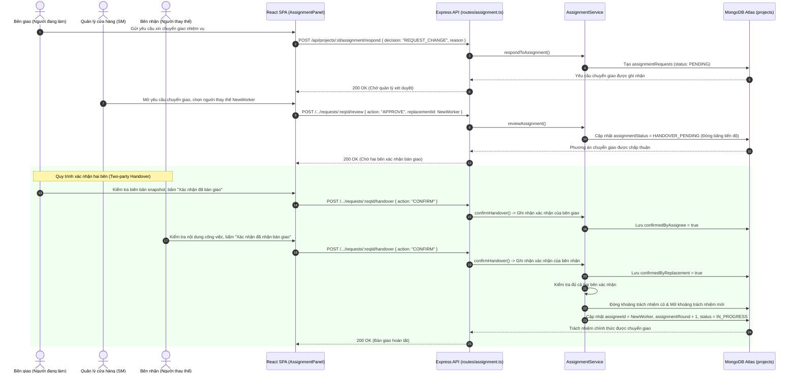

**Hình 2.50: Sơ đồ tuần tự UC06 – Tiếp nhận nhiệm vụ và quy trình bàn giao hai bên (Two-party Handover)**

### 2.5.6.4 Sơ đồ nguồn hoạt động (Activity Diagram) UC06

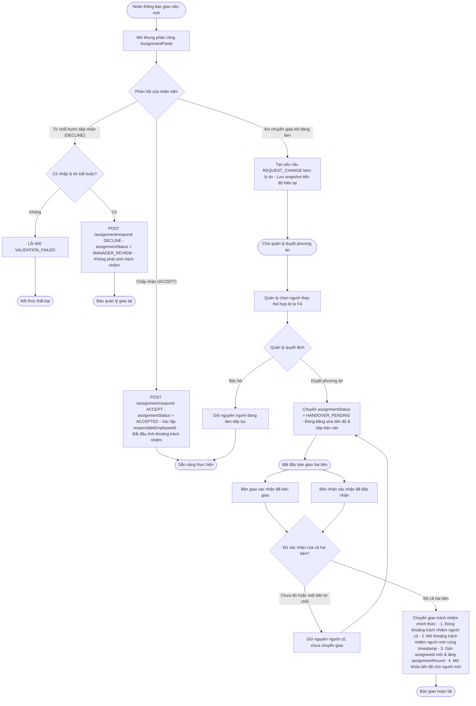

**Hình 2.51: Sơ đồ hoạt động UC06 – Xử lý phản hồi phân công và chuyển giao trách nhiệm**

### 2.5.6.5 Vị trí cần ảnh chụp màn hình minh chứng
- `[CHÈN ẢNH: Khung tiếp nhận nhiệm vụ và phản hồi phân công — Component AssignmentPanel — Dữ liệu: Nút Tiếp nhận, Từ chối kèm ô nhập lý do, trạng thái PENDING_ACCEPTANCE — Vai trò: Nhân viên được giao việc]`
- `[CHÈN ẢNH: Giao diện xác nhận bàn giao hai bên — Component AssignmentPanel — Dữ liệu: Nút xác nhận của bên giao, nút xác nhận của bên nhận, thông tin tiến độ bàn giao — Vai trò: Nhân viên bàn giao / Nhân viên nhận bàn giao]`

### 2.5.6.6 Ghi chú kiểm chứng & Mục chưa kiểm chứng
- Đã kiểm chứng: Logic ADR-021 tại `apps/api/src/services/assignment.service.ts`; smart contract Solidity `AssignmentDecisionRegistry.sol` (phiên bản 0.8.30) chỉ lưu `bytes32 ID` và `bytes32 digest`, không chứa PII; đóng băng tiến độ tại dòng 143 `routes/projects.ts`.
- `[CHƯA KIỂM CHỨNG: Triển khai Smart Contract trên mạng Public Ethereum Testnet/Mainnet — Lý do: Hiện tại việc kiểm thử hợp đồng thông minh mới chỉ chạy trên mạng EVM cục bộ mô phỏng (Hardhat loopback testnet); chưa nạp phí gas hay cấp khóa registrar trên mạng công khai.]`

---

## 2.5.7 Đặc tả Use Case UC07: Nộp báo cáo & nghiệm thu (F7)

### 2.5.7.1 Hướng dẫn viết theo yêu cầu của Khoa
- Mục tiêu & Trình bày: Phân tích quy trình nghiệm thu công việc (F7), nhân viên nộp báo cáo kết quả kèm tối đa 10 liên kết/minh chứng, chuyển trạng thái công việc sang `PENDING_REVIEW`; Quản lý độc lập thực hiện xét duyệt (APPROVE) chuyển sang `COMPLETED` (ghi nhận tiến độ 100% và kết thúc khoảng trách nhiệm) hoặc từ chối (REJECT) yêu cầu làm lại; nguyên tắc cấm tự nghiệm thu (Self-approval prohibition). 01 bảng đặc tả Use Case đầy đủ các mục chuẩn, 01 sơ đồ tuần tự nộp và nghiệm thu, 01 sơ đồ hoạt động phân nhánh xét duyệt, vị trí chèn ảnh chụp màn hình, và ghi chú kiểm chứng.

### 2.5.7.2 Bảng đặc tả Use Case UC07

**Bảng 2.46: Đặc tả Use Case UC07 – Nộp báo cáo và duyệt nghiệm thu công việc (F7)**

| Thuộc tính | Nội dung chi tiết |
|---|---|
| Mã Use Case | UC07 |
| Tên Use Case | Nộp báo cáo và duyệt nghiệm thu công việc (F7) |
| Tác nhân | Nhân viên thực hiện (`staff`, `ptch`), Quản lý nghiệm thu (`sm`, `am`, `om`) |
| Mô tả tóm tắt | Nhân viên hoàn thành công việc nộp báo cáo kết quả kèm minh chứng tài liệu/hình ảnh; hệ thống chuyển trạng thái công việc sang chờ nghiệm thu (`PENDING_REVIEW`); Quản lý có thẩm quyền kiểm tra kết quả, ra quyết định Phê duyệt (hoàn thành 100%, kết thúc trách nhiệm) hoặc Từ chối (yêu cầu bổ sung); kiểm soát cấm người thực hiện tự nghiệm thu. |
| Điều kiện tiên quyết | 1. Công việc đang ở trạng thái `IN_PROGRESS`. 2. Người nộp báo cáo là nhân viên chịu trách nhiệm thực hiện (`assigneeId === user.employeeId`). 3. Quản lý xét duyệt có quyền `reports.review` và quản lý cửa hàng của công việc. |
| Điều kiện sau | 1. Nộp báo cáo: Báo cáo được lưu vào mảng `reports` của công việc với trạng thái `PENDING`, trạng thái công việc chuyển sang `PENDING_REVIEW`. 2. Phê duyệt (APPROVE): Trạng thái báo cáo thành `APPROVED`, công việc chuyển sang `COMPLETED`, tiến độ đạt 100%, kết thúc trách nhiệm nhân sự (`responsibilities[].endAt = now`). 3. Từ chối (REJECT): Báo cáo chuyển sang `REJECTED`, công việc quay lại `IN_PROGRESS` để tiếp tục thực hiện. |
| Luồng sự kiện chính | 1. Sau khi hoàn tất công việc, nhân viên mở chi tiết công việc trong `ProjectListView.tsx`, bấm "Nộp báo cáo nghiệm thu". 2. Giao diện mở Modal nộp báo cáo. Nhân viên nhập: Nội dung tóm tắt kết quả (`content`), danh sách liên kết tài liệu/ảnh minh chứng (`attachments`, tối đa 10 URL). 3. Client gửi HTTP POST tới `/api/reports` kèm `{ projectId, content, attachments, expectedVersion }`. 4. Server kiểm tra quyền `reports.submit`, kiểm tra người gửi là người thực hiện (`assertExecutionAllowed`), kiểm tra trạng thái công việc phải là `IN_PROGRESS`. 5. Server tạo bản ghi báo cáo mới với ID duy nhất, trạng thái `PENDING`. 6. Server cập nhật công việc: chuyển trạng thái sang `PENDING_REVIEW`, thêm báo cáo vào mảng `reports`, ghi log `REPORT_SUBMITTED` vào `statusHistory` và `assignmentAudit`, tạo thông báo `assignmentNotices` cho quản lý. Đồng thời cập nhật bản ghi tương thích vào `ReportModel` legacy. 7. Quản lý nhận thông báo, mở chi tiết công việc và xem danh sách báo cáo nộp qua GET `/api/reports?projectId={id}`. 8. Quản lý kiểm tra nội dung và liên kết minh chứng đính kèm (truy xuất tệp nội bộ qua `/api/attachments/:category/:filename` với kiểm soát quyền). 9. Quản lý đưa ra quyết định:    - Phê duyệt (APPROVE): Nhập nhận xét đánh giá.    - Từ chối (REJECT): Nhập lý do từ chối bắt buộc. 10. Client gửi HTTP POST tới `/api/reports/:id/review` kèm `{ action: "APPROVE"|"REJECT", reason, expectedVersion }`. 11. Server kiểm tra cấm tự nghiệm thu (`user.employeeId === project.assigneeId` hoặc `user.userId === report.submittedBy`). Kiểm tra công việc đang ở `PENDING_REVIEW` và báo cáo là `PENDING`. 12. Nếu APPROVE: Server cập nhật báo cáo `APPROVED`, chuyển công việc sang `COMPLETED`, gán `progress = 100%`, chốt thời điểm kết thúc cho các khoảng trách nhiệm (`responsibilities[].endAt = now, progressEnd = 100`), gửi thông báo nghiệm thu thành công cho nhân viên. 13. Nếu REJECT: Server cập nhật báo cáo `REJECTED`, chuyển công việc về `IN_PROGRESS`, giữ nguyên tiến độ cũ, gửi thông báo kèm lý do yêu cầu bổ sung cho nhân viên. |
| Luồng thay thế và ngoại lệ | - 4a. Nộp báo cáo khi công việc chưa ở trạng thái IN_PROGRESS: Server trả lỗi HTTP 409 `ILLEGAL_STATE_TRANSITION`. - 4b. Người không phải người được giao cố tình nộp báo cáo: Server trả lỗi HTTP 403 `NOT_ASSIGNED_EMPLOYEE`. - 4c. Quá 100 lần nộp báo cáo trên một công việc: Server trả lỗi HTTP 409 `REPORT_LIMIT_REACHED`. - 11a. Quản lý tự duyệt báo cáo do chính mình nộp: Server trả lỗi HTTP 403 `SELF_APPROVAL` ("Người thực hiện không được tự nghiệm thu" / "Không được tự duyệt báo cáo do chính mình nộp"). - 11b. Báo cáo đã được xử lý bởi người khác hoặc có báo cáo mới hơn đè lên: Server trả HTTP 409 `REPORT_ALREADY_REVIEWED` hoặc `REPORT_SUPERSEDED`. - 11c. Xung đột phiên bản CAS: Server trả HTTP 409 `PROJECT_VERSION_CONFLICT`. |
| Quy tắc nghiệp vụ | - BR-REP-01: Nghiêm cấm tự nghiệm thu (Self-Approval Prohibition): Người thực hiện nhiệm vụ hoặc người nộp báo cáo tuyệt đối không được tự duyệt nghiệm thu công việc của chính mình (`routes/reports.ts:107-110`). - BR-REP-02: Chốt trách nhiệm và tiến độ khi nghiệm thu: Chỉ khi báo cáo được duyệt APPROVE thì trạng thái mới chuyển sang `COMPLETED`, tiến độ mới đạt 100% và khoảng trách nhiệm nhân sự mới chính thức khép lại (`routes/reports.ts:133-136`). - BR-REP-03: Tính duy nhất của báo cáo chờ duyệt: Tại một thời điểm, chỉ có báo cáo gửi sau cùng mới có quyền được duyệt; nếu có báo cáo mới hơn thì báo cáo cũ bị coi là `REPORT_SUPERSEDED` (`routes/reports.ts:116-124`). - BR-REP-04: Giới hạn tập tin và liên kết: Tối đa 10 liên kết minh chứng; truy cập tệp nội bộ qua `/api/attachments/:category/:filename` bắt buộc phải qua middleware xác thực và kiểm soát danh mục tài liệu (`routes/attachments.ts:11-24, 61-75`). - BR-REP-05: Lưu trữ kép tương thích ngược (Dual Storage): Nguồn chân lý duy nhất (Single Source of Truth) là mảng `reports` nhúng trong `ProjectModel`; collection `reports` (`ReportModel`) chỉ đóng vai trò bảng chiếu tương thích (`routes/reports.ts:18-31`). |
| Màn hình, route và API | - Màn hình UI: Hộp thoại nộp báo cáo và Danh sách báo cáo nghiệm thu trong `ProjectListView.tsx`. - API Endpoints: `GET /api/reports?projectId={id}`, `POST /api/reports`, `GET /api/reports/:id`, `POST /api/reports/:id/review`, `GET /api/attachments/:category/:filename`. |

*Nguồn kiểm chứng code: apps/api/src/routes/reports.ts (dòng 49-143), apps/api/src/routes/attachments.ts, apps/api/src/services/project-workflow.service.ts, apps/web/src/components/ProjectListView.tsx.*

### 2.5.7.3 Sơ đồ nguồn tuần tự (Sequence Diagram) UC07

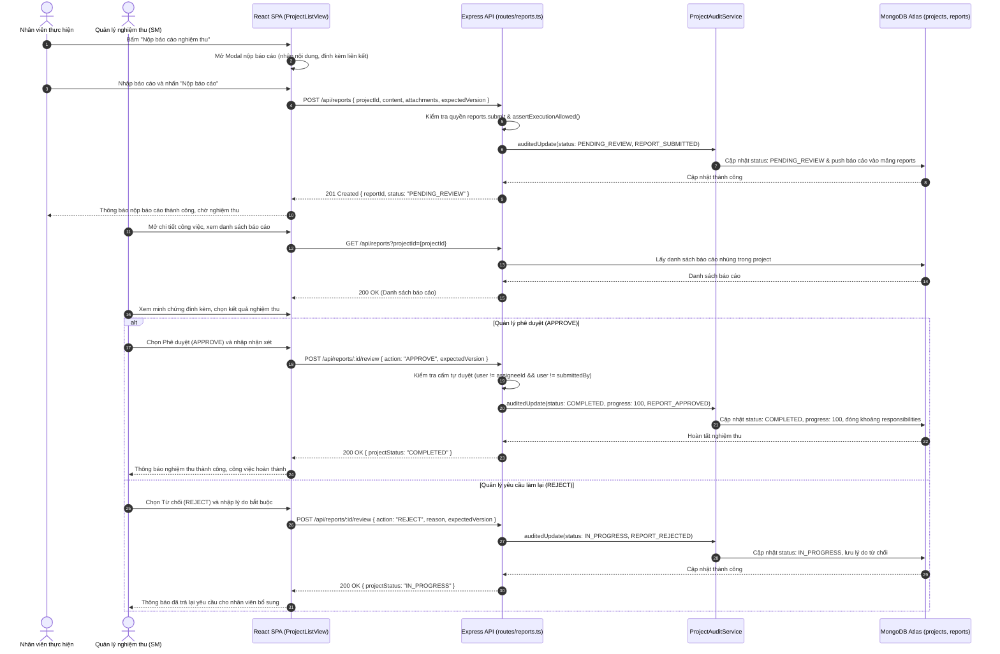

**Hình 2.52: Sơ đồ tuần tự UC07 – Nộp báo cáo và phê duyệt nghiệm thu công việc**

### 2.5.7.4 Sơ đồ nguồn hoạt động (Activity Diagram) UC07

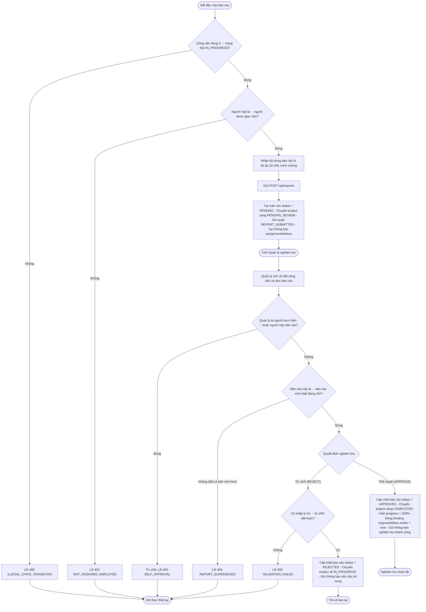

**Hình 2.53: Sơ đồ hoạt động UC07 – Quy trình nộp và xét duyệt nghiệm thu báo cáo**

### 2.5.7.5 Vị trí cần ảnh chụp màn hình minh chứng
- `[CHÈN ẢNH: Hộp thoại nộp báo cáo nghiệm thu — Component ProjectListView (Modal nộp báo cáo) — Dữ liệu: Ô nhập nội dung báo cáo, ô nhập danh sách liên kết minh chứng, nút Nộp báo cáo — Vai trò: Nhân viên được giao việc]`
- `[CHÈN ẢNH: Giao diện xét duyệt nghiệm thu báo cáo của Quản lý — Component ProjectListView — Dữ liệu: Danh sách báo cáo chờ duyệt, nút Phê duyệt (APPROVE), nút Từ chối (REJECT) kèm ô nhập lý do — Vai trò: Quản lý SM]`

### 2.5.7.6 Ghi chú kiểm chứng & Mục chưa kiểm chứng
- Đã kiểm chứng: Cấm người thực hiện tự nghiệm thu tại dòng 107-110 `apps/api/src/routes/reports.ts`; đóng khoảng trách nhiệm và chốt tiến độ 100% khi APPROVE tại dòng 135-136; bảo vệ tính mới nhất qua `REPORT_SUPERSEDED` tại dòng 118-124.
- `[CHƯA KIỂM CHỨNG: Tải lên tệp nhị phân trực tiếp multipart/form-data qua API /reports — Lý do: Hiện tại API /reports chỉ nhận danh sách URL liên kết (attachments: string[]) và URL tệp tĩnh có sẵn qua GET /api/attachments; chưa có endpoint upload file nhị phân qua Multer/S3 trong route báo cáo này.]`
