# TÀI LIỆU NGUỒN KHÓA LUẬN TỐT NGHIỆP: CHƯƠNG 2 — PHÂN TÍCH HỆ THỐNG
## PHẦN 2.5 (TIẾP THEO): ĐẶC TẢ CHI TIẾT USE CASE UC08 ĐẾN UC14

- **Mã đề tài:** KLCN133
- **Tên đề tài:** Xây dựng Chatbot chuyển đổi số quản lý nhân sự
- **Đơn vị đào tạo:** Khoa Công nghệ Thông tin — Trường Đại học Công Thương TP.HCM (HUIT)
- **Giảng viên hướng dẫn:** ThS. Trần Việt Hùng (Email: `hungtv@huit.edu.vn`, SĐT: `0387510900`)
- **Nhóm sinh viên thực hiện:**
  1. Phạm Việt Hoàng — MSSV: 2001230265 — Lớp: 14DHTH09
  2. Nguyễn Thái Hòa — MSSV: 2001230252 — Lớp: 14DHTH09
  3. Nguyễn Ngọc Phi — MSSV: 2001230659 — Lớp: 14DHTH10
- **Thời gian thực hiện:** 12 tuần (24/08/2026 – 16/11/2026)
- **Tệp bàn giao:** `docs/word-handoff/02c-chuong-2-dac-ta-usecase-uc08-uc14.md`

---

### Hướng dẫn sinh viên biên soạn vào Báo cáo Word
1. **Mục đích:** Tài liệu này cung cấp bảng đặc tả chuẩn hóa (theo cấu trúc mẫu Đồ án chuyên ngành / Khóa luận tốt nghiệp Khoa CNTT HUIT) và cặp sơ đồ (Sơ đồ tuần tự - Sequence Diagram + Sơ đồ hoạt động - Activity Diagram) cho 7 Use Case từ UC08 đến UC14.
2. **Quy tắc thể hiện trong Word:**
   - Mỗi Use Case bao gồm: 01 Bảng đặc tả chi tiết (Mã, Tên, Tác nhân, Mô tả, Điều kiện trước, Điều kiện sau, Luồng chính, Luồng thay thế/ngoại lệ, Quy tắc nghiệp vụ, Giao diện/API), 01 Sơ đồ tuần tự và 01 Sơ đồ hoạt động.
   - Bảng được định dạng dạng lưới, căn chỉnh gọn gàng, có tiêu đề bảng phía trên theo định dạng `**Bảng 2.x: Bảng đặc tả use case...**`.
   - Sơ đồ tuần tự và sơ đồ hoạt động được vẽ lại từ khối mã Mermaid (có thể render thành ảnh SVG/PNG hoặc vẽ lại trên Draw.io/Rational Rose), có chú thích hình phía dưới theo định dạng `**Hình 2.x: Sơ đồ...**`.
   - Sinh viên không tự ý bịa thêm số liệu thực nghiệm (chính xác, độ trễ, số lượng ca) ngoài các dữ liệu đã được xác minh từ mã nguồn dự án.

---

### 2.5.8. Use Case UC08 — Chatbot hỏi đáp chính sách RAG (F3)

**Bảng 2.80: Bảng đặc tả use case UC08 — Chatbot hỏi đáp chính sách RAG**

| Thuộc tính | Nội dung chi tiết |
|---|---|
| **Mã Use Case** | UC08 |
| **Tên Use Case** | Chatbot hỏi đáp chính sách nhân sự (RAG Policy Q&A) |
| **Tác nhân (Actor)** | Nhân viên (Employee), Quản lý cửa hàng (SM), Quản lý khu vực (AM), Quản trị viên (Admin) — người dùng có quyền `chatbot.data_read` |
| **Mô tả** | Cho phép người dùng đặt câu hỏi tự nhiên bằng tiếng Việt về quy chế, nội quy lao động, chính sách lương thưởng, chế độ nghỉ phép; hệ thống sử dụng mô hình RAG kết hợp mô hình ngôn ngữ lớn để trả lời chính xác, đính kèm trích dẫn văn bản chính sách hợp lệ. |
| **Điều kiện trước** | Người dùng đã đăng nhập hệ thống, sở hữu JWT hợp lệ và tài khoản có capability `chatbot.data_read`. |
| **Điều kiện sau** | Trả lời câu hỏi hiển thị trên khung chat; danh sách văn bản trích dẫn (`citations`) được xác thực toàn vẹn; hội thoại được lưu vào collection `chat_conversations` (nếu có `conversationId`). |
| **Luồng chính (Main Flow)** | 1. Người dùng mở giao diện Chatbot Drawer/Panel và nhập câu hỏi chính sách (ví dụ: "Quy định về thời gian thử việc và số ngày nghỉ phép"). 2. Giao diện Web gửi yêu cầu `POST /chat` tới API Express kèm `message`, `conversationId`, `clientMessageId`. 3. API Gateway (`routes/chat.ts`) xác thực JWT, kiểm tra capability `chatbot.data_read`. 4. API khởi tạo phiên ủy quyền hội thoại (`beginAuthorizedChat`): sinh UUID `requestId`, lưu biên lai vào collection `chat_authorization_requests` (TTL 90 giây), ký JWT Scoped Delegation Token (thời hạn 90 giây, audience `hr-blockbot-scoped-tools`, thuật toán HS256). 5. API gọi sang AI Service (`POST /api/v1/authorized-chat` tại FastAPI `authorization_gateway.py`) kèm `delegationToken`, `requestId`, và thời hạn `deadlineAtMs` (ngân sách 15 giây). 6. AI Service xác thực mã `x-ai-service-key`, phân tích ý định; nhận diện nhu cầu tra cứu chính sách và gọi ngược lại API Express qua cổng công cụ bảo mật `POST /api/internal/authorization/tools` với tool `query_policy` và `delegationToken`. 7. API Express (`executeGatewayTool`) kiểm tra tính hợp lệ của token ủy quyền và ngữ cảnh quyền hạn (`contextHash`), truy vấn collection `policies` lấy các văn bản được duyệt (`approvedDocuments`), trả về danh sách trích đoạn tài liệu và lưu mã biên lai `documentReceipt` vào phiên chat. 8. AI Service nạp ngữ cảnh vào mô hình LLM, tổng hợp câu trả lời tiếng Việt ngắn gọn, khách quan, dẫn nguồn chính sách cụ thể. 9. AI Service trả lời về API Express. 10. API Express đối chiếu danh sách trích dẫn: kiểm tra quyền truy cập tài liệu (`documentAllowed`) và mã băm toàn vẹn (`digest`). Đảm bảo mô hình AI không tự bịa trích dẫn (zero hallucinated citations). 11. API Express cập nhật lịch sử chat, đóng biên lai ủy quyền (`status: CLOSED`), và trả kết quả JSON (hoặc SSE stream) về Web client. 12. Web client hiển thị câu trả lời kèm các thẻ trích dẫn chính sách có thể bấm xem chi tiết. |
| **Luồng thay thế / Ngoại lệ** | - **3a. Chưa xác thực hoặc thiếu quyền:** API trả mã lỗi 401 Unauthorized hoặc 403 Forbidden (`RBAC_DENIED`); giao diện thông báo người dùng không đủ quyền tra cứu. - **5a. AI Service quá tải hoặc vượt thời hạn:** Cơ chế monotonic budget trong `deadline.py` kích hoạt `TimeoutError` (503 Service Unavailable); hệ thống trả về thông báo lỗi quá hạn và đề nghị thử lại. - **8a. Không tìm thấy tài liệu phù hợp (Low confidence):** Điểm tương đồng thấp hơn ngưỡng cho phép, mô hình chủ động từ chối trả lời bịa đặt (`abstain: true`), đề nghị nhân viên liên hệ phòng Nhân sự. - **10a. Quyền tài liệu bị thay đổi trong lúc sinh câu trả lời:** API phát hiện sai lệch băm tài liệu, trả lỗi 403 `DOCUMENT_ACCESS_CHANGED`, chặn hoàn toàn việc hiển thị nội dung tài liệu bị thu hồi. |
| **Quy tắc nghiệp vụ** | - **BR-UC08.1:** Chỉ trích dẫn các tài liệu chính sách ở trạng thái đã ban hành (`APPROVED`) và nằm trong phạm vi được phép đọc của tài khoản. - **BR-UC08.2:** Dịch vụ AI (FastAPI) không giữ kết nối trực tiếp đến cơ sở dữ liệu MongoDB Atlas của hệ thống chính. Mọi truy vấn đọc phải thông qua cơ chế Scoped Delegation Token 90s qua Express API Gateway. - **BR-UC08.3:** Mô hình nhúng dùng cho tìm kiếm văn bản quy chế chính sách là `gemini-embedding-001` (Atlas Vector Search 3072 chiều) kết hợp BM25 (Hybrid Retriever); không sử dụng PhoBERT cho tầng RAG dense này. |
| **Giao diện & API** | - Giao diện: `apps/web/src/components/ChatPanel.tsx`, `ChatDrawer.tsx`. - API công khai: `POST /chat`, `GET /chat/conversations/:id/messages`. - API nội bộ: `POST /api/v1/authorized-chat` (FastAPI), `POST /api/internal/authorization/tools` (Express). |

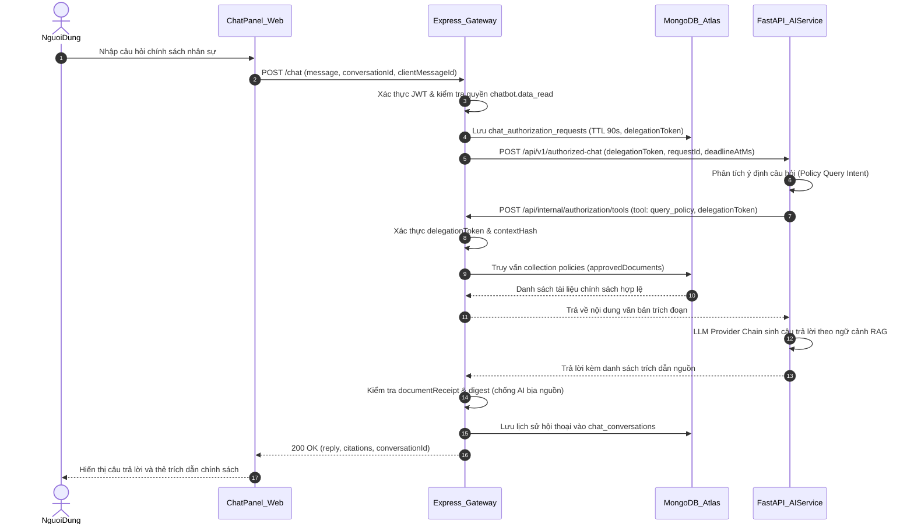
**Hình 2.80: Sơ đồ tuần tự UC08 — Chatbot hỏi đáp chính sách RAG**

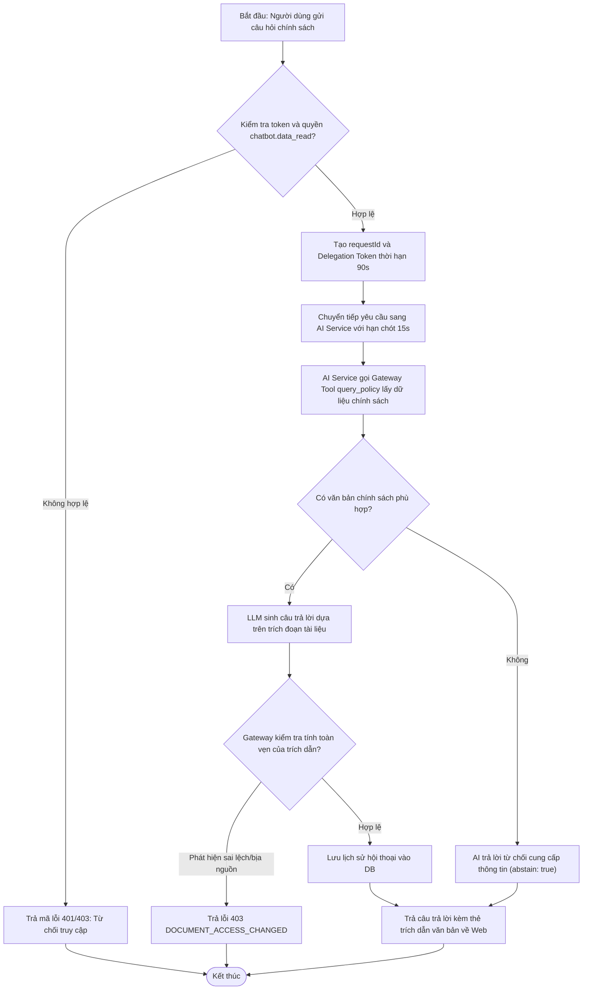
**Hình 2.81: Sơ đồ hoạt động UC08 — Chatbot hỏi đáp chính sách RAG**

- **Ghi chú kiểm chứng mã nguồn:**
  - Logic ủy quyền và kiểm tra biên lai trích dẫn: `apps/api/src/services/chat-authorization.service.ts` (dòng 33-145 và 156-194).
  - FastAPI Gateway điều phối công cụ: `apps/ai-service/app/authorization_gateway.py` (dòng 127-260).
  - Tầng tìm kiếm RAG Hybrid: `apps/ai-service/app/rag/retrieval.py` và `corpus.py`.
  - Mâu thuẫn tài liệu đã phát hiện: Tài liệu ban đầu `docs/21-chatbot-architecture.md` đề xuất AI Service kết nối đọc trực tiếp MongoDB; tuy nhiên mã nguồn triển khai thực tế tuân thủ nghiêm ngặt mô hình Authorization V1, trong đó AI Service hoàn toàn không có thông tin kết nối DB mà phải gọi ngược qua Scoped Gateway Tool.

---

### 2.5.9. Use Case UC09 — Chatbot tra cứu KPI/doanh thu & xác nhận ghi (preview-confirm)

**Bảng 2.81: Bảng đặc tả use case UC09 — Chatbot tra cứu KPI/doanh thu & xác nhận ghi (preview-confirm)**

| Thuộc tính | Nội dung chi tiết |
|---|---|
| **Mã Use Case** | UC09 |
| **Tên Use Case** | Chatbot tra cứu KPI/doanh thu & xác nhận ghi (Server-Owned Preview-Confirm) |
| **Tác nhân (Actor)** | Quản trị nhân sự (HR), Quản lý khu vực (AM), Cửa hàng trưởng (SM) có quyền tương ứng |
| **Mô tả** | Cho phép người dùng thông qua hội thoại Chatbot tra cứu số liệu KPI, tiến độ doanh thu của bản thân/cửa hàng; đối với các thao tác thay đổi dữ liệu (ví dụ: mở kỳ KPI doanh thu chuỗi), Chatbot chỉ tạo bản xem trước (preview), máy chủ quản lý vòng đời hành động và chỉ thực thi khi người dùng bấm xác nhận rõ ràng trên giao diện. |
| **Điều kiện trước** | Người dùng đã đăng nhập, có quyền đọc KPI (`kpi.read_self`, `revenue_kpi.read_scope`) hoặc quyền quản lý mở kỳ (`revenue_kpi.manage`). |
| **Điều kiện sau** | Nếu tra cứu: hiển thị số liệu KPI/doanh thu chuẩn xác. Nếu mở kỳ: tạo bản ghi `revenue_kpi_actions` ở trạng thái `PENDING`, và sau khi xác nhận sẽ tạo hàng loạt KPI doanh thu cho các cửa hàng. |
| **Luồng chính (Main Flow)** | 1. Người dùng gửi lệnh trên Chatbot (ví dụ: "Mở kỳ KPI doanh thu tháng 11/2026" hoặc "Cho xem điểm KPI tháng này của tôi"). 2. API Gateway nhận diện ý định mở kỳ (`revenueOpenIntent`) hoặc gọi công cụ tra cứu (`get_my_kpi`, `preview_revenue_period_open`). 3. Đối với yêu cầu mở kỳ, API tạo phiên ủy quyền chat gắn với kỳ được chọn và chuyển yêu cầu sang AI Service. 4. AI Service gọi công cụ `preview_revenue_period_open` về Express Gateway kèm token ủy quyền. 5. API Gateway thực thi `proposeRevenueKpiPeriodOpen`: kiểm tra danh sách 45 cửa hàng, phân loại thành `CREATE` (tạo mới), `SKIP_ALREADY_EXISTS` (đã có), hoặc `BLOCKED` (bị khóa), tính mã băm kế hoạch `planDigest` và phiên bản dữ liệu `version`. 6. Máy chủ lưu bản ghi đề xuất vào collection `revenue_kpi_actions` với `actionId` (UUID duy nhất), gán trạng thái `PENDING` (hết hạn sau 10 phút, khóa thực thi 60 giây). 7. API trả kết quả đề xuất về cho AI Service; AI trả lời câu thoại kèm đối tượng `proposedAction`. 8. Khung Chatbot Web render thẻ tương tác `RevenueKpiOpenCard.tsx` hiển thị bảng tóm tắt danh sách cửa hàng kèm nút [Xác nhận thực hiện] và [Hủy bỏ]. 9. Người dùng kiểm tra các thông số và bấm nút [Xác nhận thực hiện]. 10. Giao diện Web gửi yêu cầu `POST /chat/actions/:id/decision` kèm `{ approve: true, clientRequestId, expectedVersion, planDigest }`. 11. API Express xác thực quyền sở hữu đề xuất, kiểm tra mã băm `planDigest` và phiên bản `expectedVersion` qua cơ chế CAS (Compare-And-Swap). 12. API thực thi mở kỳ hàng loạt một cách nguyên tử (atomic batch write), cập nhật trạng thái `action` sang `EXECUTED`, và trả kết quả thành công về giao diện. 13. Giao diện thẻ `RevenueKpiOpenCard` chuyển sang trạng thái đã hoàn thành (`Đã tạo`). |
| **Luồng thay thế / Ngoại lệ** | - **5a. Tra cứu KPI cá nhân/phòng ban:** API gọi công cụ `get_my_kpi` hoặc `get_department_kpi`; nếu kỳ đánh giá chưa công bố (`PUBLISHED`), hệ thống chỉ trả thông báo "Kỳ đánh giá chưa được công bố; chỉ xem chi tiết sau khi quản lý chốt", không lộ điểm mật. - **9a. Người dùng bấm [Hủy bỏ]:** Web gửi `{ approve: false }`, API cập nhật trạng thái action thành `REJECTED`, không có bản ghi KPI nào được tạo mới. - **11a. Dữ liệu cửa hàng bị thay đổi trong lúc chờ xác nhận (Xung đột kế hoạch):** Mã băm `planDigest` không khớp, API trả lỗi 409 Conflict `REVENUE_KPI_PLAN_CHANGED` kèm bản preview mới cập nhật. Giao diện hiển thị cảnh báo và yêu cầu người dùng kiểm tra lại. - **11b. Hành động đã được thực hiện ở tab khác hoặc hết hạn 10 phút:** API trả 409 `REVENUE_KPI_ACTION_DECIDED` hoặc `REVENUE_KPI_ACTION_EXPIRED`. Web tự động tải lại trạng thái lưu trữ cuối cùng để cập nhật nút bấm. |
| **Quy tắc nghiệp vụ** | - **BR-UC09.1 (Server-Owned Preview-Confirm):** Mô hình AI tuyệt đối không bao giờ được cấp quyền trực tiếp sửa đổi hoặc ghi dữ liệu vào cơ sở dữ liệu. Mọi hành động ghi phải đi qua đề xuất có chữ ký máy chủ (`proposalOnly: true, executed: false`) và có sự xác nhận của người dùng. - **BR-UC09.2:** Hành động đề xuất gắn chặt với định danh người tạo (`owner`), phiên bản bảo mật (`securityVersion`), mã băm quyền hạn, thời hạn sống tối đa 10 phút và khóa thực thi duy nhất 60 giây. - **BR-UC09.3:** Bảo vệ tính toàn vẹn dữ liệu bằng cơ chế CAS trên `planDigest` để ngăn chặn việc áp dụng một kế hoạch cũ khi hiện trạng cửa hàng đã thay đổi. |
| **Giao diện & API** | - Giao diện: `apps/web/src/components/RevenueKpiOpenCard.tsx`, `ChatPanel.tsx`. - API: `GET /chat/actions/:id`, `POST /chat/actions/:id/decision`, `POST /revenue-kpi/periods/:period/open-proposal`. - Nguồn kiểm chứng: Commit `4a05252` ("server-owned preview-confirm for revenue KPI open period"). |

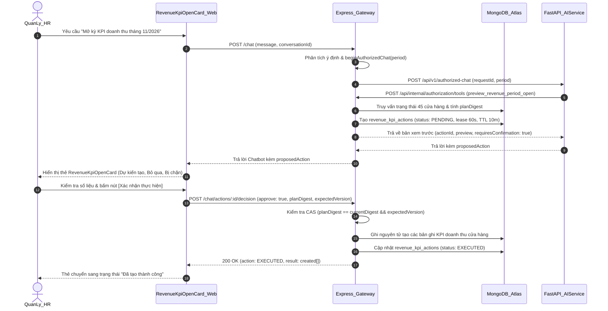
**Hình 2.82: Sơ đồ tuần tự UC09 — Chatbot tra cứu KPI/doanh thu & xác nhận ghi (preview-confirm)**

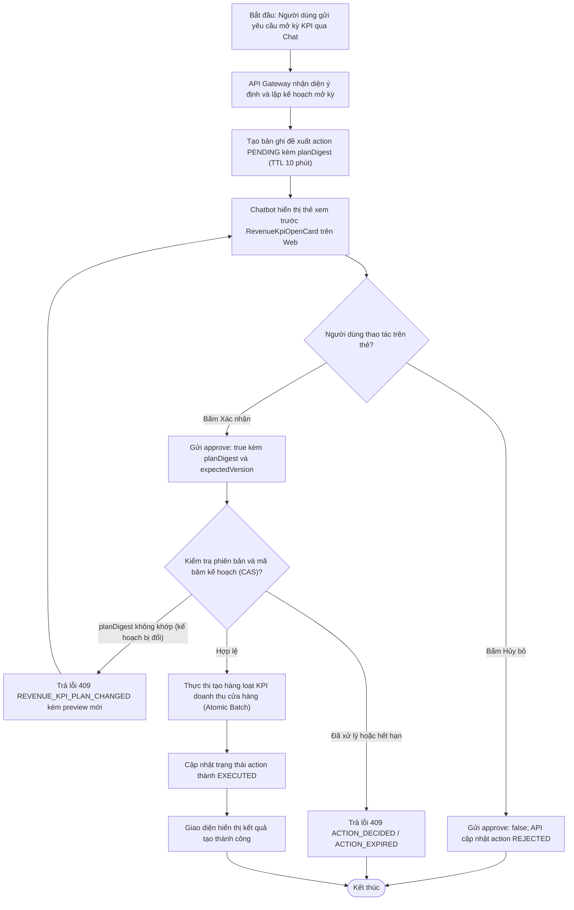
**Hình 2.83: Sơ đồ hoạt động UC09 — Chatbot tra cứu KPI/doanh thu & xác nhận ghi**

- **Ghi chú kiểm chứng mã nguồn:**
  - Triển khai máy chủ quản lý bản đề xuất: `apps/api/src/services/revenue-kpi.service.ts` (hàm `proposeRevenueKpiPeriodOpen`, `decideRevenueKpiOpenAction`).
  - Giao diện thẻ xác nhận: `apps/web/src/components/RevenueKpiOpenCard.tsx`.
  - Kiểm thử tích hợp tự động: `apps/api/test/revenue-kpi-open-chat.test.mjs` và `revenue-kpi-open.test.mjs`.

---

### 2.5.10. Use Case UC10 — Đánh giá KPI hiệu suất & phân tích nhận xét (F5)

**Bảng 2.82: Bảng đặc tả use case UC10 — Đánh giá KPI hiệu suất & phân tích nhận xét (F5)**

| Thuộc tính | Nội dung chi tiết |
|---|---|
| **Mã Use Case** | UC10 |
| **Tên Use Case** | Đánh giá KPI hiệu suất & phân tích nhận xét (Performance KPI & Review Analysis) |
| **Tác nhân (Actor)** | Nhân viên (Staff/Barista), Quản lý cửa hàng (SM), Quản lý khu vực (AM), Quản lý nhân sự (HR) |
| **Mô tả** | Thực hiện chu trình đánh giá hiệu suất định kỳ theo khung chuẩn: Nhân viên tự đánh giá kèm minh chứng, Cấp trên trực tiếp chấm điểm, Trí tuệ nhân tạo hỗ trợ phân tích sắc thái nhận xét, Hệ thống tính toán điểm máy theo công thức tất định, Chốt điểm tạm thời, Mở cửa sổ kiến nghị/khiếu nại độc lập và ban hành kết quả chính thức. |
| **Điều kiện trước** | Kỳ KPI hiệu suất đã được mở (`POST /performance-kpi/periods/:period/open`), có khung tiêu chí (`frameworkVersion >= 2`) và hồ sơ nhân sự hợp lệ. |
| **Điều kiện sau** | Bản ghi đánh giá được cập nhật trạng thái tương ứng (`MANAGER_REVIEW` $\to$ `PROVISIONAL` $\to$ `FINAL`/`CORRECTED`), toàn bộ lịch sử điểm số và thay đổi được lưu vết chuỗi băm kiểm toán (hash-chain). |
| **Luồng chính (Main Flow)** | 1. Nhân viên mở màn hình "KPI hiệu suất" (`PerformanceKpiView.tsx`), chọn kỳ đánh giá. 2. Nhân viên thực hiện tự đánh giá (`POST /performance-kpi/evaluations/:id/self-review`) gồm điểm tự chấm, giải trình và đính kèm danh sách tài liệu minh chứng (`evidenceRefs`). 3. Quản lý trực tiếp (SM đối với nhân viên cửa hàng, AM đối với SM) mở danh sách đánh giá của đơn vị mình. 4. Quản lý nhập điểm các tiêu chí và nhận xét chi tiết (`POST /performance-kpi/evaluations/:id/manager-score`). 5. Quản lý có thể yêu cầu AI hỗ trợ tóm tắt và phân tích nhận xét (`POST /performance-kpi/evaluations/:id/ai-summary`). 6. API gọi sang AI Service (`POST /api/v1/kpi/analyze-review` trong `apps/ai-service/app/kpi_analysis.py`). AI phân tích sắc thái ngữ nghĩa (sentiment), các chủ đề chính (themes), và các tín hiệu rủi ro (risk signals). 7. API tính toán điểm máy (`machineScore`) dựa trên CÔNG THỨC TẤT ĐỊNH (ADR-013): tổng hợp tỷ lệ hoàn thành nhiệm vụ thực tế (`task_instances`), tín hiệu ngữ nghĩa từ AI, và điểm số của quản lý. 8. Quản lý nhấn chốt điểm tạm thời (`POST /performance-kpi/evaluations/:id/finalize`). Trạng thái chuyển sang `PROVISIONAL`, hệ thống thiết lập hạn chót tiếp nhận kiến nghị (`reconsiderationDeadlineAt` tính theo ngày làm việc). 9. Khi hết thời hạn kiến nghị mà không có khiếu nại (hoặc sau khi khiếu nại đã giải quyết xong), quản trị viên hoặc hệ thống chốt kết quả chính thức (`FINAL`). |
| **Luồng thay thế / Ngoại lệ** | - **8a. Nhân viên kiến nghị xem xét lại (Reconsideration):** Trong hạn chót, nhân viên gửi kiến nghị (`action: reconsideration`) chỉ rõ mã tiêu chí hoặc nhiệm vụ cần xem xét. Trạng thái chuyển sang `PENDING_DISPUTE`. Người chấm trực tiếp xem xét và đưa ra quyết định điều chỉnh (`ADJUSTED`) hoặc giữ nguyên (`reconsideration-response`). - **8b. Nhân viên khiếu nại lên cấp cao hơn (Appeal):** Nếu không đồng ý với phản hồi xem xét lại, nhân viên gửi đơn khiếu nại (`action: appeal`). AM độc lập (với nhân viên) hoặc HR (với SM) thụ lý và ban hành phán quyết độc lập (`appeal-decision`). - **4a. Dữ liệu không đủ độ phủ (Incomplete Data):** Nếu độ phủ nhiệm vụ được xác minh dưới 70% hoặc thiếu tiêu chí cốt lõi, hệ thống chặn việc chốt điểm và báo lỗi `DATA_INSUFFICIENT` theo quy định tại ADR-023. - **7a. Quản lý điều chỉnh điểm sau chốt (Correction):** Chỉ HR mới có quyền điều chỉnh điểm sau khi đã chốt (`action: correct`), bắt buộc phải ghi rõ lý do pháp lý (`overrideReason`) và lưu vết kiểm toán. |
| **Quy tắc nghiệp vụ** | - **BR-UC10.1 (Quy chuẩn ADR-013):** Mô hình ngôn ngữ lớn (LLM) tuyệt đối KHÔNG được quyền sinh ra điểm KPI cuối cùng. Điểm số là kết quả của công thức tất định; AI chỉ cung cấp các tín hiệu thành phần đầu vào (sentiment, themes, risk signals). - **BR-UC10.2 (Quy chuẩn ADR-023):** Đánh giá dựa trên bằng chứng và trách nhiệm; người chấm phải có quan hệ quản lý trực tiếp (`management_relations`) còn hiệu lực; người bị khiếu nại không được tự giải quyết khiếu nại của chính mình. - **BR-UC10.3:** Dữ liệu đánh giá V2 (`frameworkVersion >= 2`) được lưu trữ cách ly, không ghi đè hoặc làm hỏng dữ liệu đánh giá F5 V1 trước đây. |
| **Giao diện & API** | - Giao diện: `apps/web/src/components/PerformanceKpiView.tsx`. - Tuyến API: `apps/api/src/routes/performance-kpi.ts`. - Các endpoint: `GET /performance-kpi/dashboard`, `GET /performance-kpi/evaluations/:id/explain`, `POST /performance-kpi/evaluations/:id/:action` (`self-review`, `manager-score`, `finalize`, `reconsideration`, `reconsideration-response`, `appeal`, `appeal-decision`, `correct`). |

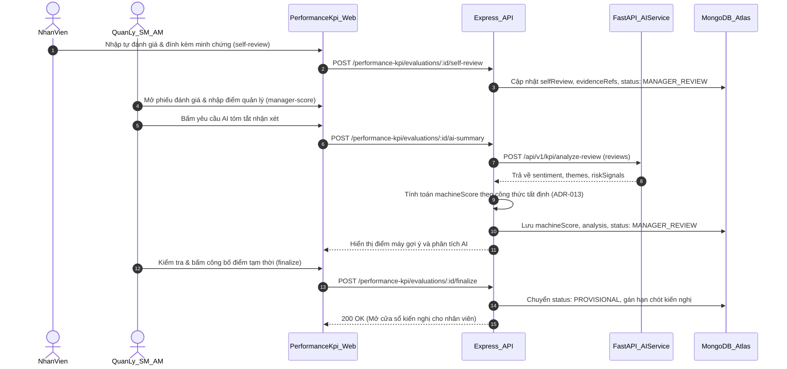
**Hình 2.84: Sơ đồ tuần tự UC10 — Đánh giá KPI hiệu suất & phân tích nhận xét (F5)**

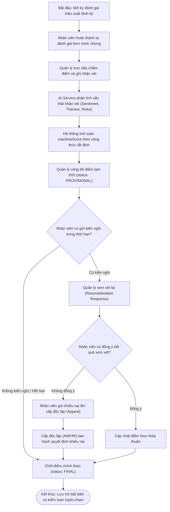
**Hình 2.85: Sơ đồ hoạt động UC10 — Đánh giá KPI hiệu suất & phân tích nhận xét**

- **Ghi chú kiểm chứng mã nguồn:**
  - Bộ điều khiển và các tuyến nghiệp vụ: `apps/api/src/routes/performance-kpi.ts`.
  - Xử lý nghiệp vụ đánh giá và giải quyết tranh chấp: `apps/api/src/services/performance-kpi-evaluation.service.ts` và `performance-kpi-scoring.service.ts`.
  - Phân tích ngữ nghĩa nhận xét phía AI Service: `apps/ai-service/app/kpi_analysis.py` và `performance_kpi.py`.
  - Quyết định kiến trúc bắt buộc: `docs/03-decision-records/ADR-013-kpi-cuoi-dinh-cong-thuc-tat-dinh.md` và `ADR-023-performance-kpi-evidence.md`.

---

### 2.5.11. Use Case UC11 — KPI doanh thu cửa hàng/khu vực

**Bảng 2.83: Bảng đặc tả use case UC11 — KPI doanh thu cửa hàng/khu vực**

| Thuộc tính | Nội dung chi tiết |
|---|---|
| **Mã Use Case** | UC11 |
| **Tên Use Case** | Quản lý KPI doanh thu cửa hàng và khu vực (Monthly Store & Area Revenue KPI) |
| **Tác nhân (Actor)** | Quản lý nhân sự (HR), Quản lý khu vực (AM), Cửa hàng trưởng (SM) |
| **Mô tả** | Thiết lập chỉ tiêu doanh thu hằng tháng cho từng cửa hàng và khu vực, theo dõi tiến độ doanh thu thực tế từ hệ thống POS, hỗ trợ AI gợi ý chỉ tiêu dựa trên lịch sử 3 tháng, tiếp nhận phản hồi/chấp nhận chỉ tiêu của SM, đối soát và tự động tính toán kết quả hoàn thành khi kết thúc kỳ. |
| **Điều kiện trước** | Đã cấu hình module KPI doanh thu (`REVENUE_KPI_ENABLED=true`), cửa hàng có Cửa hàng trưởng (SM) được phân công hợp lệ. |
| **Điều kiện sau** | Mục tiêu doanh thu được kích hoạt (`ACTIVE`), kết quả thực hiện được đối soát và chốt doanh thu (`CONFIRMED`) khi kết thúc tháng. |
| **Luồng chính (Main Flow)** | 1. Quản lý Nhân sự (HR) mở màn hình "KPI doanh thu" (`RevenueKpiView.tsx`). 2. HR tạo kỳ đánh giá doanh thu mới (`POST /revenue-kpi/periods`). 3. HR tạo các bản chỉ tiêu nháp (DRAFT) cho các cửa hàng và khu vực. 4. HR có thể yêu cầu AI gợi ý chỉ tiêu doanh thu (`POST /revenue-kpi/assignments/:id/ai-proposal`). AI Service (`propose_target` trong `kpi_analysis.py`) phân tích chuỗi doanh thu 3 tháng gần nhất từ hệ thống POS và đề xuất khoảng mục tiêu hợp lý. 5. HR xem xét, chỉnh sửa chỉ tiêu và ban hành (`POST /revenue-kpi/assignments/:id/publish`). Bản phân công chuyển sang trạng thái `PENDING_ACCEPTANCE` với thời hạn xác nhận (`deadlineAt`). 6. SM của cửa hàng nhận thông báo, truy cập giao diện để xem chỉ tiêu và nhấn [Chấp nhận] (`POST /revenue-kpi/assignments/:id/accept`). Trạng thái chuyển sang `ACTIVE`. 7. Trong suốt kỳ, hệ thống tự động ghi nhận doanh thu thực tế từ máy bán hàng POS thông qua `pos-reporting.service.ts`. 8. Khi kết thúc tháng dương lịch, HR kích hoạt lệnh tính toán kết quả (`POST /revenue-kpi/periods/:period/compute`). Hệ thống so khớp tổng doanh thu thực tế và chỉ tiêu, tính tỷ lệ hoàn thành (`attainment = actual / target`). 9. HR thực hiện đóng kỳ KPI (`POST /revenue-kpi/periods/:period/close`), kết quả được lưu trữ ở trạng thái `CONFIRMED` theo cơ chế lưu trữ chỉ thêm (append-only ledger). |
| **Luồng thay thế / Ngoại lệ** | - **6a. SM từ chối hoặc đề nghị điều chỉnh chỉ tiêu:** SM gửi yêu cầu điều chỉnh (`adjustment-request`) kèm văn bản giải trình. AM khu vực tiến hành xác minh độc lập (`adjustment-verify`), sau đó HR đưa ra quyết định chấp thuận hoặc giữ nguyên (`adjustment-decision`). - **6b. Quá hạn xác nhận chỉ tiêu:** Hệ thống scheduler nền (`runRevenueKpiReminders`) tự động quét và đánh dấu `overdue: true`, gửi thông báo nhắc nhở; HR có quyền quyết định giữ nguyên chỉ tiêu (`KEEP`) có kiểm toán. - **8a. Cửa hàng thiếu dữ liệu POS hoặc dữ liệu bị trộn lẫn:** Khu vực sẽ ở trạng thái chờ (`PENDING`) cho đến khi dữ liệu được làm sạch, không ước lượng số liệu giả (ADR-022). |
| **Quy tắc nghiệp vụ** | - **BR-UC11.1 (Quy chuẩn ADR-022):** Dữ liệu KPI doanh thu được lưu trữ tại các bảng riêng biệt (`revenue_kpi_periods`, `revenue_kpi_assignments`, `revenue_kpi_results`), hoàn toàn độc lập với bảng đánh giá hiệu suất cá nhân để đảm bảo an toàn dữ liệu. - **BR-UC11.2:** Tỷ lệ đạt của khu vực được tính bằng tổng doanh thu thực tế của các cửa hàng chia cho tổng mục tiêu, đồng thời tỷ lệ cửa hàng không đạt doanh thu không được vượt quá ngưỡng quy định (mặc định 30%). - **BR-UC11.3:** Tuyệt đối không nhận số liệu doanh thu thực tế từ phía máy khách (client); doanh thu thực tế bắt buộc phải được tính toán từ các hóa đơn bán hàng POS đã được xác thực trên máy chủ. |
| **Giao diện & API** | - Giao diện: `apps/web/src/components/RevenueKpiView.tsx`. - Tuyến API: `apps/api/src/routes/revenue-kpi.ts`. - Các endpoint chính: `GET /revenue-kpi/periods`, `POST /revenue-kpi/periods`, `POST /revenue-kpi/assignments/:id/publish`, `POST /revenue-kpi/assignments/:id/accept`, `POST /revenue-kpi/periods/:period/compute`, `POST /revenue-kpi/periods/:period/close`. |

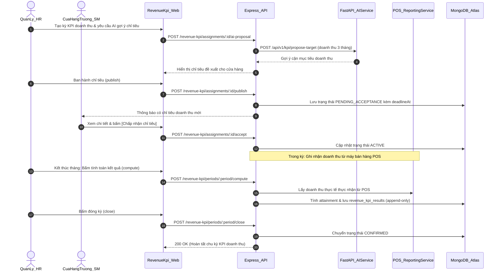
**Hình 2.86: Sơ đồ tuần tự UC11 — KPI doanh thu cửa hàng/khu vực**

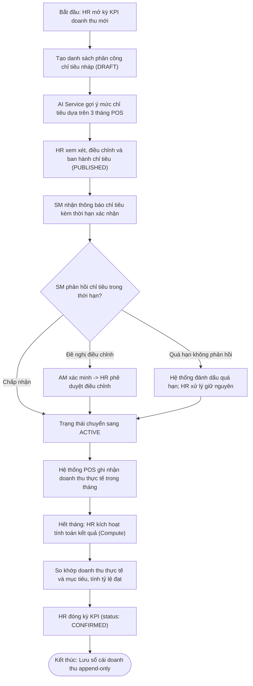
**Hình 2.87: Sơ đồ hoạt động UC11 — KPI doanh thu cửa hàng/khu vực**

- **Ghi chú kiểm chứng mã nguồn:**
  - Tuyến API và điều phối: `apps/api/src/routes/revenue-kpi.ts`.
  - Tầng dịch vụ tính toán và lưu trữ: `apps/api/src/services/revenue-kpi.service.ts` và `revenue-kpi-storage.service.ts`.
  - Dữ liệu bán hàng thực tế: `apps/api/src/services/pos-reporting.service.ts`.
  - Thuật toán AI gợi ý chỉ tiêu: `apps/ai-service/app/kpi_analysis.py` (hàm `propose_target`).

---

### 2.5.12. Use Case UC12 — Xếp lịch ca & đăng ký ca

**Bảng 2.84: Bảng đặc tả use case UC12 — Xếp lịch ca & đăng ký ca**

| Thuộc tính | Nội dung chi tiết |
|---|---|
| **Mã Use Case** | UC12 |
| **Tên Use Case** | Xếp lịch ca làm việc & đăng ký đổi ca (Operational Scheduling & Registration) |
| **Tác nhân (Actor)** | Nhân viên (Barista/Staff), Cửa hàng trưởng (SM), Quản trị viên hệ thống |
| **Mô tả** | Cung cấp công cụ lập lịch ca làm việc tuần cho chuỗi cửa hàng F&B: Cấu hình danh mục ca làm, Nhân viên đăng ký nguyện vọng ca làm việc, Cửa hàng trưởng xếp ca trên lưới ma trận trực quan, Lưu nháp và Công bố lịch chính thức; hỗ trợ quy trình đổi ca (Swap) và nhờ làm thay (Cover) có quản lý phê duyệt. |
| **Điều kiện trước** | Đã định nghĩa các ca làm việc tại cửa hàng (`operational_shift_definitions`), nhân viên có tài khoản và thuộc danh sách biên chế của cửa hàng. |
| **Điều kiện sau** | Lịch tuần được công bố (`published`), nhân viên nhận được thông báo ca làm, các ca làm được lưu vào `operational_schedule_weeks`. |
| **Luồng chính (Main Flow)** | 1. Nhân viên truy cập phân hệ "Lịch làm & phân ca" (`SchedulingView.tsx`), mở tab "Bảng đăng ký ca" (`ScheduleRegistrationPanel.tsx`). 2. Nhân viên đăng ký nguyện vọng ca làm trong tuần (`POST /scheduling/registrations`) gồm ngày, ca mong muốn và lý do. 3. Cửa hàng trưởng (SM) mở tab "Lịch tuần" (`tab: 'week'`), hệ thống nạp danh sách nhân sự biên chế và danh sách đăng ký ca (`GET /scheduling/stores/:storeId/week?weekStart=...`). 4. SM phân bổ các nhân viên vào các ca trên bảng ma trận 7 ngày trong tuần. 5. SM lưu bản nháp xếp ca (`POST /scheduling/weeks/:weekId/draft`). 6. SM kiểm tra độ phủ nhân sự, không có xung đột ca, và thực hiện công bố lịch (`POST /scheduling/weeks/:weekId/publish`) kèm phiên bản dự kiến (`expectedVersion`) và lý do công bố. 7. Hệ thống chuyển trạng thái tuần sang `published`, ghi nhận thời gian `publishedAt`, và tự động kích hoạt tiến trình gửi thông báo/sự kiện realtime cho toàn bộ nhân viên có ca trong tuần. 8. Nhân viên xem lịch cá nhân đã công bố tại tab "Lịch của tôi" (`GET /scheduling/me?from=...&to=...`). |
| **Luồng thay thế / Ngoại lệ** | - **8a. Nhân viên có nhu cầu đổi ca (Swap) hoặc nhờ làm thay (Cover):** Nhân viên chọn một ca của mình trong "Lịch của tôi", chọn đồng nghiệp muốn đổi và gửi yêu cầu (`POST /scheduling/weeks/:weekId/changes`). Trạng thái chuyển sang `PENDING_RECEIVER`. Sau khi đồng nghiệp bấm đồng ý, yêu cầu chuyển sang `READY_FOR_REVIEW` để SM duyệt (`actScheduleChange`). Khi SM duyệt (`APPROVED`), hệ thống tự động hoán đổi phân ca trên tuần công bố. - **6a. Xung đột phiên bản khi công bố lịch:** Có quản lý khác đang chỉnh sửa đồng thời, `expectedVersion` không khớp, API trả về lỗi 409 Conflict. Giao diện cảnh báo và yêu cầu tải lại dữ liệu mới nhất. - **3a. Tra cứu lịch qua Chatbot:** Nhân viên có thể hỏi Chatbot ("Lịch làm việc tuần này của tôi"); API gọi công cụ `get_my_schedule` để trả về danh sách ca đã công bố chính thức, không trả lịch nháp. |
| **Quy tắc nghiệp vụ** | - **BR-UC12.1:** Phân biệt rõ giữa dữ liệu lịch cũ (`ScheduleEntryModel` nhập từ file Excel) và hệ thống xếp lịch vận hành V1 (`OperationalWeekModel`, `OperationalShiftModel`). Chỉ có lịch vận hành V1 đã công bố mới được xem là lịch chính thức. - **BR-UC12.2:** Sau khi lịch tuần đã công bố, mọi thay đổi phân ca đều bắt buộc phải đi qua quy trình yêu cầu đổi ca (`ScheduleChange`) có sự đồng thuận của nhân viên nhận ca và sự phê duyệt của Cửa hàng trưởng. - **BR-UC12.3:** Không được xếp 1 nhân viên vào 2 ca có khoảng thời gian làm việc đè lên nhau trong cùng một ngày. |
| **Giao diện & API** | - Giao diện: `apps/web/src/components/SchedulingView.tsx`, `ScheduleRegistrationPanel.tsx`. - Tuyến API: `apps/api/src/routes/scheduling.ts`. - Các endpoint: `GET /scheduling/me`, `GET /scheduling/stores/:storeId/week`, `POST /scheduling/weeks/:weekId/draft`, `POST /scheduling/weeks/:weekId/publish`, `POST /scheduling/weeks/:weekId/changes`, `POST /scheduling/registrations`. |

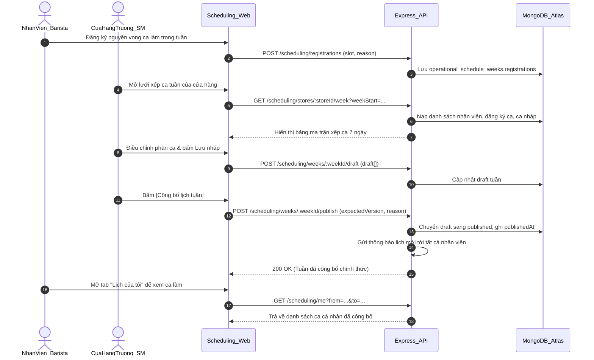
**Hình 2.88: Sơ đồ tuần tự UC12 — Xếp lịch ca & đăng ký ca**

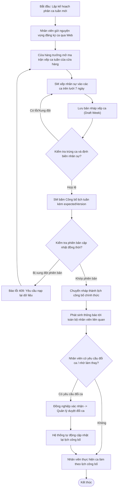
**Hình 2.89: Sơ đồ hoạt động UC12 — Xếp lịch ca & đăng ký ca**

- **Ghi chú kiểm chứng mã nguồn:**
  - Bộ điều khiển định tuyến: `apps/api/src/routes/scheduling.ts`.
  - Tầng logic lập lịch và đổi ca: `apps/api/src/services/scheduling.service.ts`.
  - Lược đồ lưu trữ: `apps/api/src/models/OperationalSchedule.ts` (`OperationalWeekModel`, `OperationalShiftModel`).
  - Giao diện người dùng: `apps/web/src/components/SchedulingView.tsx` và `ScheduleRegistrationPanel.tsx`.

---

### 2.5.13. Use Case UC13 — Dashboard CRM chuỗi GUTA (F6)

**Bảng 2.85: Bảng đặc tả use case UC13 — Dashboard CRM chuỗi GUTA (F6)**

| Thuộc tính | Nội dung chi tiết |
|---|---|
| **Mã Use Case** | UC13 |
| **Tên Use Case** | Bảng điều khiển trung tâm CRM chuỗi Guta (Guta CRM Command Center Dashboard) |
| **Tác nhân (Actor)** | Quản trị viên (Admin), Ban lãnh đạo/Nhân sự (HR), Quản lý khu vực (AM), Cửa hàng trưởng (SM) có quyền `dashboard.read` |
| **Mô tả** | Cung cấp giao diện trung tâm trực quan hóa toàn bộ hoạt động vận hành của chuỗi 45 cửa hàng Guta Cafe: Số lượng nhân sự theo trạng thái, Số lượng điểm bán, Doanh thu chuỗi theo thời gian thực từ POS, Danh sách cửa hàng kèm thanh trượt (Slide-over Drawer) chi tiết nhân sự trong ca làm việc. |
| **Điều kiện trước** | Người dùng đã đăng nhập thành công vào hệ thống CRM, sở hữu quyền `dashboard.read`. |
| **Điều kiện sau** | Hiển thị các thẻ chỉ số KPI tổng quan, biểu đồ trực quan hóa dữ liệu và danh sách cửa hàng được phân quyền quản lý. |
| **Luồng chính (Main Flow)** | 1. Người dùng đăng nhập thành công và truy cập trang chủ CRM (`CrmDashboardView.tsx`). 2. Giao diện Web gửi yêu cầu `GET /dashboard/overview` tới API Express. 3. API Gateway áp dụng phạm vi phân quyền (`employeeScopeQuery` và `allowedStoreIds` theo capability `dashboard.read`). 4. API đếm số lượng nhân sự (tổng số, đang hoạt động, ngưng hoạt động) từ `EmployeeModel`, đếm số lượng cửa hàng được phép quản lý từ `StoreModel`. 5. API gọi dịch vụ `scopedRevenueMetric` (`pos-reporting.service.ts`) để tổng hợp số liệu doanh thu thực tế từ máy bán lẻ POS. 6. Đối với các chỉ số chưa có nguồn xác minh chuẩn (tỷ lệ hoàn tất hồ sơ, tỷ lệ đúng giờ), API trả về `value: null` kèm lý do minh bạch theo quy định tại ADR-020, không tự bịa số liệu. 7. Giao diện Web render các thẻ KPI tổng quan (Cards), biểu đồ doanh thu chuỗi (Recharts), và danh sách lưới các cửa hàng. 8. Người dùng nhấn vào một thẻ cửa hàng bất kỳ để mở Slide-over Drawer. 9. Giao diện gửi yêu cầu lấy doanh thu riêng của cửa hàng (`GET /dashboard/revenue?storeId=...`) và danh sách nhân sự barista trong ca để hiển thị chi tiết cho người quản lý. |
| **Luồng thay thế / Ngoại lệ** | - **3a. Tài khoản không có quyền truy cập cửa hàng nào:** API trả về danh sách cửa hàng rỗng và các chỉ số thống kê bằng 0; giao diện thông báo tài khoản chưa được gán phạm vi quản lý. - **5a. Cửa hàng chưa có dữ liệu bán hàng POS:** Chỉ số doanh thu hiển thị trạng thái đang cập nhật mà không gây lỗi giao diện. - **9a. Người dùng muốn xem báo cáo bán hàng chuyên sâu:** Chuyển sang phân hệ Báo cáo bán hàng (`GET /dashboard/sales`) với bộ lọc khoảng ngày. |
| **Quy tắc nghiệp vụ** | - **BR-UC13.1 (Quy chuẩn ADR-020):** Nguyên tắc trung thực dữ liệu: Dữ liệu trên Dashboard CRM bắt buộc phải lấy từ nguồn thật đã kiểm chứng. Chỉ số nào chưa có dữ liệu xác minh (như tỷ lệ chấm công đúng giờ hay độ phủ quản lý) bắt buộc phải trả về `value: null` kèm thông báo lý do rõ ràng, tuyệt đối không tạo số liệu ngẫu nhiên để làm đẹp màn hình. - **BR-UC13.2:** Phân định phạm vi hiển thị: SM chỉ xem dữ liệu cửa hàng mình phụ trách; AM xem các cửa hàng trong khu vực được phân công; HR và Admin được xem dữ liệu toàn chuỗi. - **BR-UC13.3 (Zero-Yellow UI Policy):** Thiết kế giao diện tuân thủ quy chuẩn thương hiệu, sử dụng bảng màu Electric Sapphire (`#2563eb`), không dùng màu vàng chói. |
| **Giao diện & API** | - Giao diện: `apps/web/src/components/CrmDashboardView.tsx`. - Tuyến API: `apps/api/src/routes/dashboard.ts`, `apps/api/src/routes/stores.ts`. - Các endpoint: `GET /dashboard/overview`, `GET /dashboard/revenue`, `GET /dashboard/sales`, `GET /stores`. |

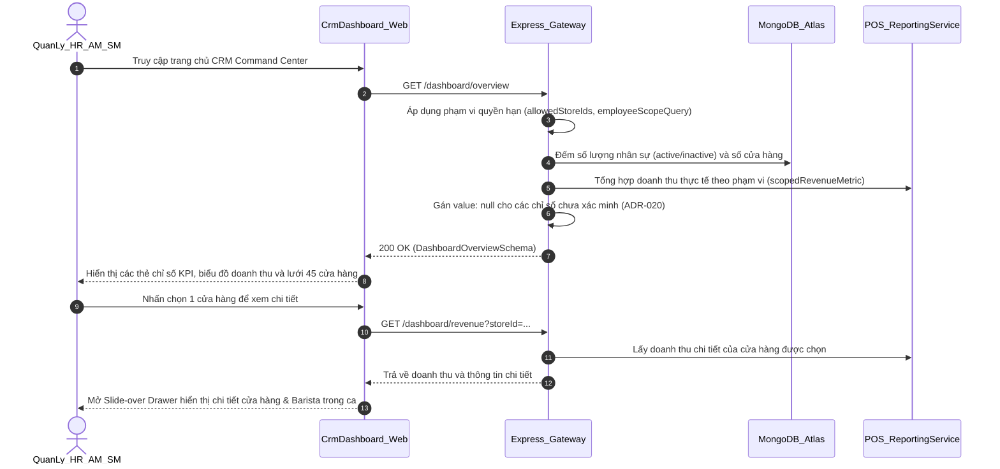
**Hình 2.90: Sơ đồ tuần tự UC13 — Dashboard CRM chuỗi GUTA (F6)**

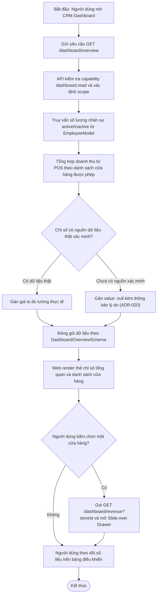
**Hình 2.91: Sơ đồ hoạt động UC13 — Dashboard CRM chuỗi GUTA**

- **Ghi chú kiểm chứng mã nguồn:**
  - Bộ điều khiển Dashboard: `apps/api/src/routes/dashboard.ts`.
  - Dịch vụ tổng hợp doanh thu chuỗi: `apps/api/src/services/pos-reporting.service.ts`.
  - Giao diện Dashboard và Slide-over Drawer: `apps/web/src/components/CrmDashboardView.tsx`.
  - Quyết định kiến trúc bắt buộc: `docs/03-decision-records/ADR-020-crm-real-data-kpi-null-thay-vi-uoc-luong.md`.

---

### 2.5.14. Use Case UC14 — Lịch hẹn SM & thông báo/nhắc hạn

**Bảng 2.86: Bảng đặc tả use case UC14 — Lịch hẹn SM & thông báo/nhắc hạn**

| Thuộc tính | Nội dung chi tiết |
|---|---|
| **Mã Use Case** | UC14 |
| **Tên Use Case** | Quản lý phân công bổ nhiệm SM & Hệ thống thông báo nhắc hạn (SM Appointments & Deadline Reminders) |
| **Tác nhân (Actor)** | Quản lý nhân sự (HR), Quản lý khu vực (AM), Cửa hàng trưởng (SM), Nhân viên, Hệ thống Scheduler nền (System Scheduler) |
| **Mô tả** | Bao gồm hai cơ chế cốt lõi hỗ trợ vận hành: (1) Quản lý hồ sơ bổ nhiệm/phân công Cửa hàng trưởng (SM Appointment) theo nguyên tắc kiểm soát chéo 4 mắt (4-eyes principle) và lưu vết chuỗi băm; (2) Hệ thống thông báo thời gian thực và tự động quét nhắc nhở hạn chót (nhiệm vụ, ca làm việc, quá hạn xác nhận chỉ tiêu KPI). |
| **Điều kiện trước** | Người dùng đã đăng nhập hoặc hệ thống Background Scheduler đang hoạt động; có quyền quản lý nhân sự (`employees.update_other`, `employees.review`) hoặc có nhiệm vụ/ca làm liên quan. |
| **Điều kiện sau** | Hồ sơ phân công SM được phê duyệt/thu hồi có kiểm toán; các thông báo nhắc hạn được phát sinh không trùng lặp và gửi tới đúng đối tượng qua WebSocket hoặc Web UI. |
| **Luồng chính (Main Flow - Phần A: Phân công SM)** | 1. Người dùng có quyền nhân sự mở phân hệ hồ sơ nhân viên, chọn mục "Vị trí và phân công SM" (`SmAppointments.tsx`). 2. Người dùng nhập đề nghị phân công: loại vị trí (`PRIMARY`, `ADDITIONAL`, `SUPERVISORY`, `TEMPORARY`), cửa hàng, ngày hiệu lực, căn cứ văn bản quyết định (`evidenceRef`) và lý do. 3. Giao diện gửi `POST /employees/:id/sm-appointments` kèm `clientRequestId`. 4. API Express lưu hồ sơ ở trạng thái `PENDING`. 5. Cán bộ nhân sự độc lập khác (người duyệt khác người tạo: `requestedBy !== user.id`) kiểm tra hồ sơ và thực hiện phê duyệt (`POST /employees/:id/sm-appointments/:appointmentId/decision` với `action: APPROVE`). 6. Hệ thống chuyển trạng thái sang `EFFECTIVE` (hoặc `SCHEDULED` nếu chưa đến ngày), cập nhật chuỗi băm kiểm toán `history`. |
| **Luồng chính (Main Flow - Phần B: Thông báo & Nhắc hạn tự động)** | 1. Background Scheduler (`scheduler.service.ts`, `revenue-kpi-notification.service.ts`, `performance-kpi-notification.service.ts`) định kỳ chạy các tác vụ quét tự động (mỗi 15 phút). 2. Scheduler quét các công việc/nhiệm vụ sắp đến hạn: còn 3 ngày (`deadline_3d`), còn 1 ngày (`deadline_1d`), hoặc quá hạn (`deadline_overdue`). 3. Đối với nhiệm vụ quá hạn, hệ thống tạo thông báo gửi cho nhân viên phụ trách và gửi cảnh báo quá hạn cho cấp quản lý trực tiếp. 4. Hệ thống tạo bản ghi thông báo trong collection `notifications` với khóa chống trùng lặp duy nhất `dedupeKey` (ví dụ: `deadline_overdue_manager:{projectId}:{date}`). 5. Hệ thống phát sự kiện thông báo thời gian thực qua kênh Socket.IO (`apps/api/src/socket.ts`). 6. Web client nhận sự kiện, hiển thị badge thông báo chưa đọc; người dùng nhấn xem và đánh dấu đã đọc (`POST /notifications/:id/read`). |
| **Luồng thay thế / Ngoại lệ** | - **A.5a. Người duyệt là chính người tạo đề nghị:** Hệ thống từ chối với lỗi bảo mật 403 Forbidden; bắt buộc phải có cán bộ nhân sự thứ hai xác nhận độc lập. - **A.5b. Hồ sơ bị phát hiện sai lệch chuỗi băm:** Hệ thống báo lỗi `auditIntegrity !== 'VALID_LOCAL_CHAIN'`, khóa các nút phê duyệt và yêu cầu kiểm toán viên kiểm tra. - **B.5a. Người dùng không trực tuyến khi phát sinh thông báo:** Thông báo vẫn được lưu trữ bền vững trong cơ sở dữ liệu MongoDB; khi người dùng đăng nhập lại, giao diện gọi `GET /notifications` để hiển thị đầy đủ. |
| **Quy tắc nghiệp vụ** | - **BR-UC14.1 (Nguyên tắc 4 mắt - 4-Eyes Principle):** Việc bổ nhiệm, điều động hoặc thu hồi vị trí Cửa hàng trưởng (SM) bắt buộc phải qua 2 người khác nhau thực hiện (1 người lập đề nghị, 1 người phê duyệt độc lập) nhằm chống lạm quyền. - **BR-UC14.2 (Idempotency & Deduplication):** Mọi tác vụ nhắc hạn tự động bắt buộc phải gắn khóa `dedupeKey` duy nhất theo ngày/thực thể để ngăn chặn việc gửi lặp lại nhiều thông báo gây quá tải (notification storm) khi máy chủ khởi động lại. - **BR-UC14.3 (Monotonic Budget):** Các cuộc gọi liên quan đến dịch vụ AI được kiểm soát thời hạn nghiêm ngặt bằng ngân sách đơn điệu (`deadline.py`) 15 giây, ngăn chặn việc treo tiến trình của người dùng. |
| **Giao diện & API** | - Giao diện: `apps/web/src/components/SmAppointments.tsx`, thanh thông báo chuông trên giao diện CRM. - Tuyến API: `apps/api/src/routes/sm-appointments.ts`, `apps/api/src/routes/notifications.ts`. - Các endpoint: `POST /employees/:id/sm-appointments`, `POST /employees/:id/sm-appointments/:id/decision`, `GET /notifications`, `POST /notifications/:id/read`. |

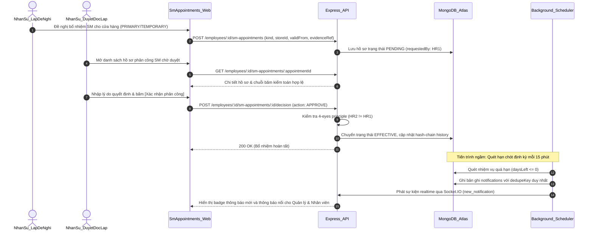
**Hình 2.92: Sơ đồ tuần tự UC14 — Lịch hẹn SM & thông báo/nhắc hạn**

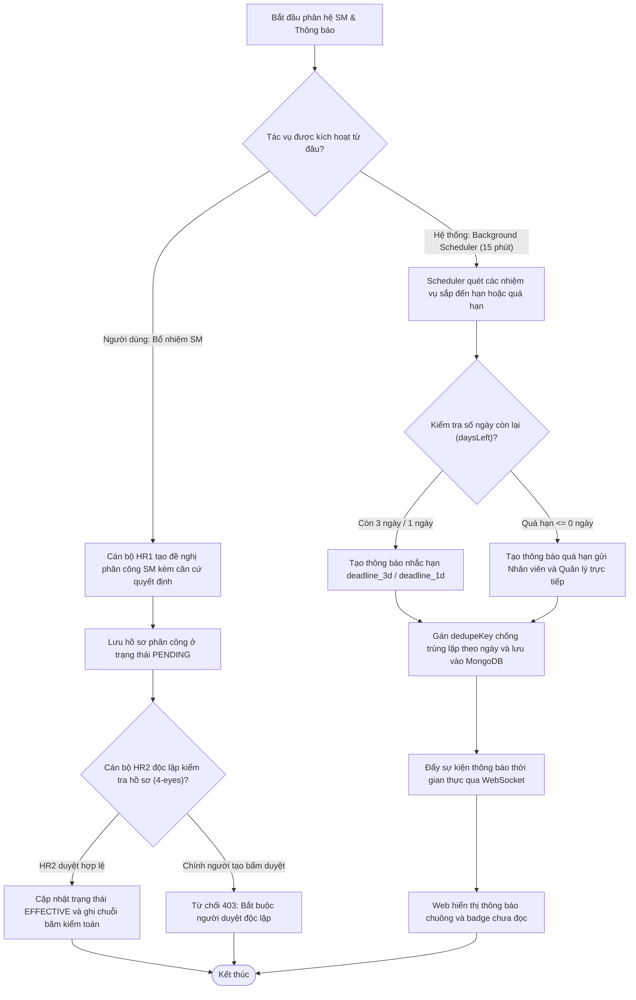
**Hình 2.93: Sơ đồ hoạt động UC14 — Lịch hẹn SM & thông báo/nhắc hạn**

- **Ghi chú kiểm chứng mã nguồn:**
  - Quản lý phân công bổ nhiệm SM: `apps/api/src/routes/sm-appointments.ts` và `apps/web/src/components/SmAppointments.tsx`.
  - Bộ định thời quét hạn chót và thông báo: `apps/api/src/services/scheduler.service.ts` (hàm `runDeadlineReminders`, `runReminderCycle`).
  - Dịch vụ thông báo và chống trùng lặp: `apps/api/src/services/notification.service.ts` và `routes/notifications.ts`.
  - Ngân sách thời gian thực thi AI: `apps/ai-service/app/deadline.py`.

---

### 2.6. DANH SÁCH CHỖ CẦN ẢNH CHỤP MINH HỌA TRONG BÁO CÁO (TỪ UC08 ĐẾN UC14)

Sinh viên chụp màn hình thực tế từ ứng dụng Web đang chạy tại môi trường kiểm thử cục bộ (`http://localhost:5173`) hoặc bản triển khai Cloud Render (`https://hr-blockbot-web.onrender.com`), sau đó chèn vào các vị trí tương ứng trong báo cáo Word:

1. `[CHÈN ẢNH: Khung hội thoại Chatbot hỏi đáp chính sách RAG — UI ChatDrawer/ChatPanel — Dữ liệu: Câu hỏi về thời gian thử việc, câu trả lời kèm thẻ trích dẫn văn bản chính sách — Vai trò: Nhân viên / Quản lý]`
2. `[CHÈN ẢNH: Thẻ xem trước mở kỳ KPI doanh thu — UI RevenueKpiOpenCard trong khung chat — Dữ liệu: Bảng dự kiến 45 cửa hàng với các trạng thái Dự kiến tạo, Đã có, Bị chặn kèm 2 nút Xác nhận và Hủy — Vai trò: Quản lý HR]`
3. `[CHÈN ẢNH: Màn hình đánh giá KPI hiệu suất — Route /crm (tab 'performanceKpi') — Dữ liệu: Bảng danh sách tiêu chí, điểm tự đánh giá, điểm quản lý và tóm tắt phân tích nhận xét của AI — Vai trò: Cửa hàng trưởng (SM) / Quản lý khu vực (AM)]`
4. `[CHÈN ẢNH: Màn hình quản lý KPI doanh thu chuỗi — Route /crm (tab 'revenueKpi') — Dữ liệu: Danh sách chỉ tiêu doanh thu các cửa hàng, tiến độ đạt doanh thu thực tế từ POS và tỷ lệ đạt — Vai trò: Quản lý HR / AM]`
5. `[CHÈN ẢNH: Ma trận xếp lịch ca làm việc tuần — Route /crm (tab 'schedules', tab con 'Lịch tuần') — Dữ liệu: Lưới ma trận 7 ngày với các ca làm của nhân viên cửa hàng, nút Lưu nháp và Công bố lịch — Vai trò: Cửa hàng trưởng (SM)]`
6. `[CHÈN ẢNH: Giao diện Bảng đăng ký ca và Lịch của tôi — Route /crm (tab 'schedules', tab con 'Bảng đăng ký ca' & 'Lịch của tôi') — Dữ liệu: Danh sách ca làm cá nhân đã công bố và form đăng ký đổi ca — Vai trò: Nhân viên Barista]`
7. `[CHÈN 8NH: Bảng điều khiển trung tâm CRM Command Center — Route /crm (tab 'stores') — Dữ liệu: Các thẻ chỉ số tổng quan chuỗi 45 cửa hàng, biểu đồ doanh thu Recharts và Slide-over Drawer thông tin chi tiết Barista trong ca — Vai trò: Quản trị viên / HR]`
8. `[CHÈN ẢNH: Màn hình phân công bổ nhiệm SM & Danh sách thông báo — Route /crm (mục Vị trí và phân công SM trong hồ sơ nhân viên, và popup Thông báo chuông) — Dữ liệu: Lịch sử phân công SM có chuỗi băm kiểm toán và các thông báo nhắc hạn chót — Vai trò: Quản trị Nhân sự (HR)]`

---

### 2.7. TỔNG HỢP CÁC MỤC CHƯA KIỂM CHỨNG & CÂU HỎI MỞ (UC08 ĐẾN UC14)

1. `[CHƯA KIỂM CHỨNG: Số lượng giao dịch và doanh thu POS thời gian thực trên môi trường sản xuất thực tế]`: Hiện tại hệ thống đang sử dụng dữ liệu trích xuất từ 115 bản ghi chấm công mẫu và các file báo cáo doanh thu bán hàng mẫu của chuỗi Guta Cafe; chưa có kết nối API trực tiếp theo thời gian thực (live stream) vào máy chủ POS trung tâm của toàn bộ 45 cửa hàng ngoài đời thực.
2. `[CHƯA KIỂM CHỨNG: Tỷ lệ nhân viên chấp nhận / từ chối chỉ tiêu KPI doanh thu trong môi trường thực tế]`: Module KPI doanh thu đã được cài đặt đầy đủ theo chuẩn ADR-022 với kiểm thử tự động, nhưng chưa có dữ liệu khảo sát người dùng thực tế tại chuỗi để đo lường tỷ lệ SM kiến nghị điều chỉnh chỉ tiêu.
3. `[CHƯA KIỂM CHỨNG: Độ chính xác của mô hình phân tích sắc thái nhận xét tiếng Việt trong các tình huống nhận xét ẩn ý/châm biếm]`: Bộ phân tích nhận xét F5 (`kpi_analysis.py`) sử dụng LLM với cấu hình nhiệt độ thấp và prompt chuẩn hóa; chưa có bộ dữ liệu kiểm thử vàng (human-gold benchmark) quy mô lớn được chuyên gia nhân sự gán nhãn thủ công độc lập để đánh giá chỉ số F1/Accuracy chính thức.
4. **Câu hỏi mở dành cho nhóm sinh viên khi bảo vệ khóa luận:**
   - Tại sao trong UC08 và UC09, hệ thống không cho phép Chatbot ghi trực tiếp vào cơ sở dữ liệu mà phải qua cơ chế biên lai ủy quyền và Server-Owned Preview-Confirm? *(Trả lời: Tuân thủ nguyên tắc Zero-Trust, ngăn chặn LLM hallucination tự ý cập nhật dữ liệu, đảm bảo tính giải trình và khả năng kiểm toán).*
   - Trong UC10, việc kết hợp giữa AI và công thức tất định giải quyết vấn đề gì của các hệ thống chấm điểm tự động truyền thống? *(Trả lời: Khắc phục nhược điểm không thể tái lập và không thể giải thích của mô hình AI hộp đen; điểm số cuối cùng hoàn toàn minh bạch, có thể kiểm chứng lại bằng máy tính mà không phụ thuộc vào trạng thái ngẫu nhiên của LLM).*
