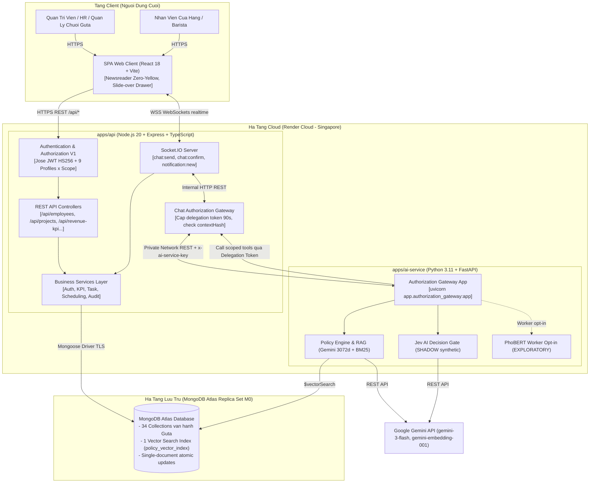
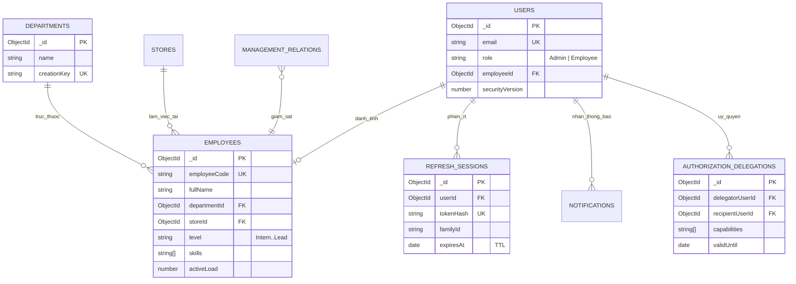
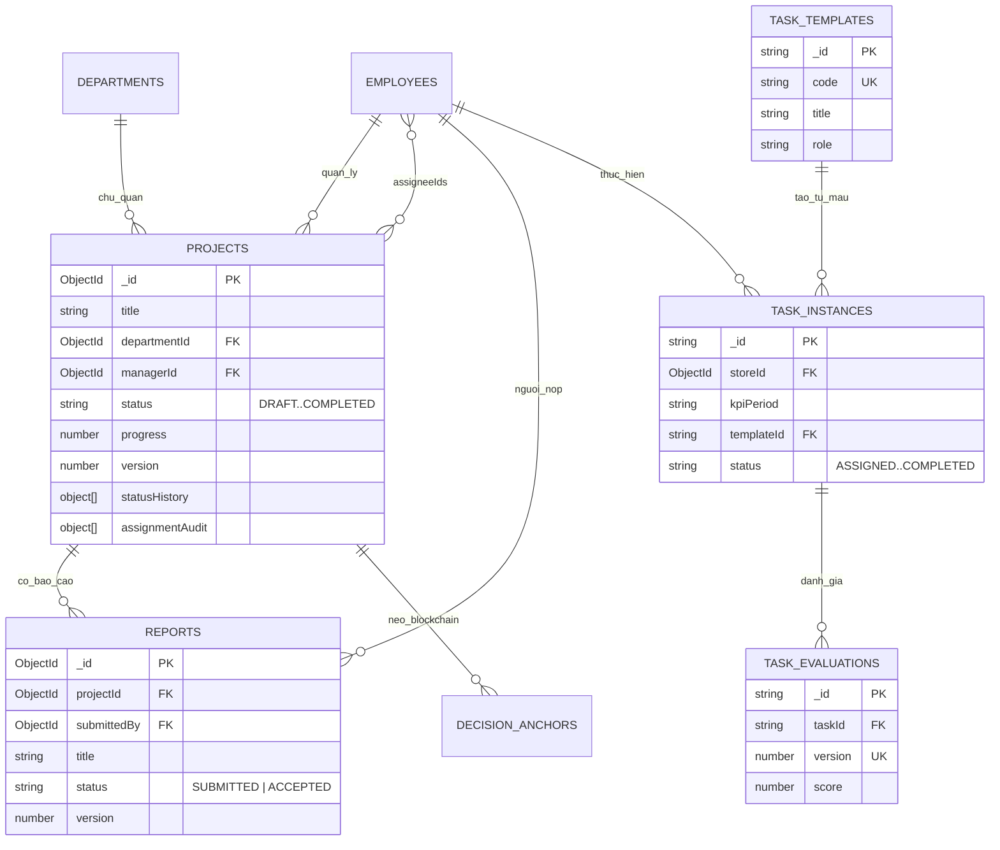
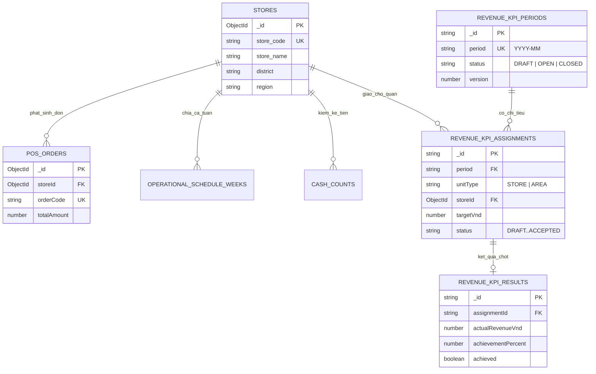
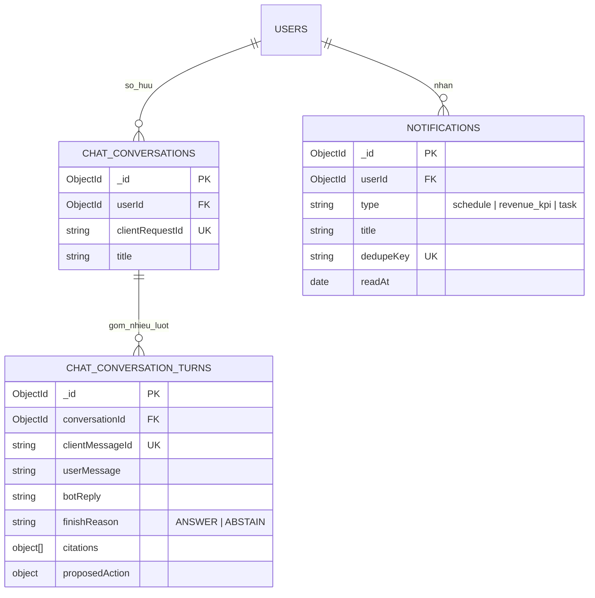
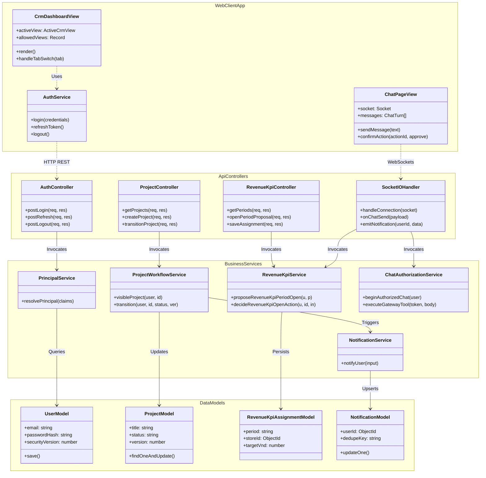
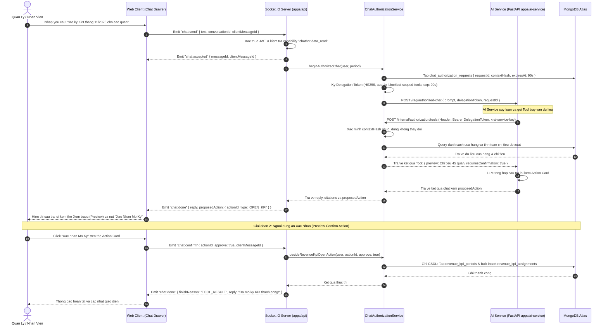
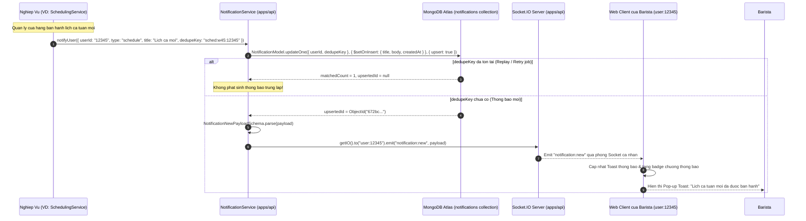

# TAI LIEU NGUON CHUONG 3: THIET KE HE THONG

> **Muc dich tai lieu:** Cung cap toan bo du kien ky thuat da kiem chung tu ma nguon (codebase `hr-blockbot-f4`), cac quyet dinh kien truc (ADR), mo hinh du lieu tu 31 file models thuc te, dac ta API va so do Mermaid de nhom sinh vien tu viet Chuong 3 trong bao cao khoa luan KLCN133.
> **Quy uoc kiem chung:** Moi du kien deu co dan nguon file ro rang. Cac phan doan chua duoc chay thuc te tren moi truong production/Render duoc danh dau ro `[CHUA KIEM CHUNG]`.

---

## 3.1 THIET KE KIEN TRUC TONG THE HE THONG

### 3.1.1 Huong dan viet muc 3.1 theo yeu cau Khoa
- Mo ta kien truc tong the he thong theo phong cach Microservices/Sidecar hoac Monorepo da tang (Multi-tier Architecture).
- Lam ro vai tro: Client SPA (React), API & Business Engine (Express + TypeScript), AI Copilot Sidecar (FastAPI + Python), Co so du lieu (MongoDB Atlas M0), va Kenh giao tiep thoi gian thuc (Socket.IO).
- Trinh bay so do C4 Container va giai thich ro giao thuc truyen thong (REST HTTPS, WebSockets WSS, internal REST kem token).
- Neu ro ly do lua chon cong nghe thong qua cac Bien ban Quyet dinh Kien truc (ADR).

### 3.1.2 Du kien kiem chung kien truc va ly do quyet dinh (ADR)
*Nguon file:* `docs/02-architecture.md`, `docs/03-decision-records/`, `render.yaml`, `package.json`, `apps/api/package.json`, `apps/web/package.json`, `apps/ai-service/requirements.txt`.

**Bang 3.1: Cac thanh phan cong nghe cot loi va ly do kien truc**

| Thanh phan | Cong nghe thuc te | Ly do kien truc (ADR) & Ranh gioi kiem chung | Nguon kiem chung |
|---|---|---|---|
| Frontend Web | React 18.3 + Vite 5 (SPA, Tailwind CSS) | Single Page Application doc lap, giao dien Newsreader Zero-Yellow, toc do render nhanh, dong goi static CDN. CAM doi sang Next.js. | `apps/web/package.json`, `CLAUDE.md` muc 2 |
| Backend API | Node.js 20 + Express 4.19 + TypeScript 5.4 | **ADR-002:** Giu Express thay vi NestJS de toi uu toc do khoi dong, giam overhead dependency injection, de kiem soat transaction va middleware phan quyen. | `docs/03-decision-records/ADR-002-giu-express-thay-vi-nestjs.md`, `apps/api/src/app.ts` |
| AI Service | Python 3.11 + FastAPI 0.111 + Uvicorn | **ADR-003:** Tach rieng AI Service thanh Python sidecar de khai thac he sinh thai ML/NLP (NumPy, SciPy, PhoBERT, Gemini SDK), khong nghen Event Loop cua Node.js. | `docs/03-decision-records/ADR-003-tach-fastapi-ai-sidecar.md`, `apps/ai-service/app/authorization_gateway.py` |
| Shared Contracts | Zod 3.23 (Package `@hr-blockbot/contracts`) | Single Source of Truth giua Frontend, Backend va AI Service. Validate du lieu chat che tai bien he thong (Trust Boundaries) truoc khi ghi DB hoac goi API. | `packages/contracts/src/index.ts`, `CLAUDE.md` muc 2 |
| Database | MongoDB Atlas (Replica Set M0) | **ADR-004:** Khong dung multi-document transaction; dung atomic conditional update (`findOneAndUpdate`, `$setOnInsert`) kem embedded `statusHistory[]`. **ADR-005:** 1 Atlas Vector Search index duy nhat cho Policy RAG. | `docs/03-decision-records/ADR-004-khong-multi-document-transaction.md`, `ADR-005-mot-atlas-vector-index-khong-qdrant.md` |
| Realtime | Socket.IO 4.7 | **ADR-010:** Dung Socket.IO single instance chay cung tien trinh voi Express API de giam chi phi ha tang (khong can Redis Adapter o baseline M0/Starter). | `docs/03-decision-records/ADR-010-socket-io-single-instance.md`, `apps/api/src/socket.ts` |
| Xac thuc & Mat ma | Argon2id + Jose (HS256) + AES-256-GCM | **ADR-006:** Argon2id cho password (19 MiB RAM, 2 iter, 1 thread). **ADR-007:** Jose cho JWT (HS256). **ADR-008:** Refresh Token Rotation (RTR) kem phat hien token replay. **ADR-017:** Ma hoa key LLM bang AES-256-GCM. | `docs/03-decision-records/ADR-006-argon2id-cho-password.md`, `ADR-007-jose-cho-jwt.md`, `ADR-008-refresh-token-rotation.md`, `ADR-017-runtime-llm-provider-settings.md` |
| Monorepo PM | pnpm Workspace (lockfile v9) | **ADR-001:** Dung pnpm workspace quan ly da du an, khong dung Turborepo nham tranh phuc tap build pipeline tren Render. | `docs/03-decision-records/ADR-001-pnpm-workspace-khong-turborepo.md`, `pnpm-workspace.yaml` |

### 3.1.3 Thiet ke trien khai tren Render Cloud va Ranh gioi kiem chung
- **Mo hinh 3 Service tren Render Blueprint (`render.yaml`):**
  1. `hr-blockbot-web`: Static Site (Render Free CDN), build command: pnpm build ra `apps/web/dist`, rewrite `/* -> /index.html` cho React Router.
  2. `hr-blockbot-api`: Web Service (Plan Starter 0.5 CPU / 512 MB, Node runtime), Healthcheck path: `/api/health`. Ket noi MongoDB Atlas qua `MONGODB_URI`.
  3. `hr-blockbot-ai`: Web Service (Plan Starter 0.5 CPU / 512 MB, Python runtime), chay `uvicorn app.authorization_gateway:app`. Ket noi noi bo voi API qua `AI_SERVICE_API_KEY`.
- **Ghi chu kiem chung ve trien khai:**
  `[CHUA KIEM CHUNG: render.yaml ghi ro chua chay lenh "render blueprints validate" va chua tung thuc hien deploy tu dong tren tai khoan Render ca nhan. Hien tai can tai khoan Render that de validate cu phap blueprint, xac minh tinh nang chia se bien moi truong tu dong (fromService) giua API va AI Service, va danh gia nguy co OOM RAM 512MB khi AI Service tai mo hinh].`

### 3.1.4 So do kien truc C4 Container (Mermaid)


**Hinh 3.1: So do kien truc C4 Container cua he thong HR BlockBot**

---

## 3.2 THIET KE CO SO DU LIEU (MO HINH DU LIEU)

### 3.2.1 Huong dan viet muc 3.2 theo yeu cau Khoa
- Trinh bay ro nguon goc CSDL: Du lieu thiet ke dua tren mo hinh doanh nghiep chuoi F&B Guta Cafe gom 45 chi nhanh thuc te.
- Bang tong hop toan bo cac collection, chi tiet cac truong (field), kieu du lieu, rang buoc toan ven, index toi uu truy van.
- Phan chia ERD thanh 4 so do con theo phan he chuc nang de nguoi doc de theo doi.
- Trinh bay co che dam bao toan ven du lieu (Transaction Invariants) khi khong dung multi-document transaction.
- Neu ro su khac biet va tien hoa giua tai lieu thiet ke so khai va ma nguon trien khai thuc te.

### 3.2.2 Doi chieu tai lieu cu (`05-data-model.md`, `22-erd-overall.md`) voi code that
*Nguon file:* `docs/05-data-model.md`, `docs/22-erd-overall.md`, `docs/03-decision-records/ADR-018-bo-gioi-han-11-collection.md`, `apps/api/src/models/*.ts`.

**Bang 3.2: Doi chieu mau thuan giua tai lieu cu va code thuc te**

| Tieu chi | Tai lieu thiet ke cu (`docs/05`, `docs/22`) | Ma nguon thuc te (`apps/api/src/models/*.ts`) | Nguyen nhan ky thuat & Quyet dinh |
|---|---|---|---|
| So luong Collection | Gioi han cung 11 collection baseline (sau do de xuat 13 collection o `docs/22`). | **34 collections** duoc quan ly boi **31 file model** trong `apps/api/src/models/*.ts`. | **ADR-018:** Bo gioi han 11 collection de dap ung nghiep vu van hanh ca kip, cham cong, phan quyen V1, audit blockchain, va KPI da tang. |
| Embedding Dimension (RAG) | Ghi chu TBD 384 chieu (du kien multilingual-e5-small hoac MiniLM). | Vector **3072 chieu** sinh boi model `gemini-embedding-001` cua Google tren index `policy_vector_index`. | Quy chuat Atlas Vector Search cho tieng Viet va mo hinh RAG hybrid (BM25 + Dense Gemini 3072d). |
| Phan quyen du lieu | Chi co 2 role co ban: `Admin` va `Employee`. | **Authorization V1:** 9 Software Profiles (`system_admin`..`staff`) ket hop Scope 3 cap (`self`, `system`, `organization`). | Tranh suy dien quyen han tu nhan chuc vu, tach rieng giua capability va chuc danh thuc te. |
| Co che Luu lich su | Ghi nhan y tuong embed `statusHistory[]`. | Ap dung triet de: embedded array `history[]` + `version` counter de Optimistic Locking cho Project, Task, Revenue KPI, Lifecycle. | **ADR-004:** Single-document atomic update thay cho multi-document transactions. |

### 3.2.3 Danh muc 34 Collections trong CSDL MongoDB Atlas
*Nguon file:* `apps/api/src/models/*.ts` (31 files).

**Bang 3.3: Tong hop 34 collection duoc phan nhom theo nghiep vu**

| Nhom nghiep vu | Danh sach Collection trong MongoDB | File Model dinh nghia | Vai tro va Muc dich luu tru |
|---|---|---|---|
| **Dinh danh & Xac thuc** | `users`, `refresh_sessions` | `User.ts`, `RefreshSession.ts` | Tai khoan dang nhap, email UK, hash Argon2id, phien lam viec TTL va RTR |
| **Ho so & Co cau** | `employees`, `departments` | `Employee.ts`, `Department.ts` | Ho so nhan su F1 (employeeCode UK, skills, cap bac, cua hang), phong ban |
| **Vong doi De tai & Bao cao** | `projects`, `reports`, `decision_anchors` | `Project.ts`, `Report.ts`, `DecisionAnchor.ts` | Vong doi de tai F2, statusHistory[], nghiem thu F7, hash-chain audit, anchor blockchain |
| **Nhiem vu van hanh (Tasks)** | `task_templates`, `task_instances`, `task_evaluations` | `TaskTemplate.ts`, `TaskInstance.ts`, `TaskEvaluation.ts` | Mau nhiem vu tieu chuan, nhiem vu duoc giao tai cua hang, danh gia nhiem vu |
| **KPI Doanh thu (F6)** | `revenue_kpi_periods`, `revenue_kpi_assignments`, `revenue_kpi_results` | `RevenueKpiPeriod.ts`, `RevenueKpiAssignment.ts`, `RevenueKpiResult.ts` | Ky KPI doanh thu, chi tieu giao cho cua hang/khu vuc, ket qua bat bien (append-only) |
| **KPI Hieu suat (F5)** | `performance_kpi_frameworks`, `performance_kpi_policies`, `evaluations` | `PerformanceKpiFramework.ts`, `PerformanceKpiPolicy.ts`, `Evaluation.ts` | Khung tieu chi danh gia, chinh sach KPI theo ky, bang danh gia kem AI sentiment |
| **Tro ly Chatbot & Thong bao** | `chat_conversations`, `chat_conversation_turns`, `notifications` | `ChatConversation.ts`, `Notification.ts` | Cuoc hoi thoai, luot chat, citations, proposedAction, thong bao dedupeKey in-app & WS |
| **Cua hang & Don hang POS** | `stores`, `pos_orders` | `Store.ts`, `PosOrder.ts` | Danh sach 45 cua hang Guta, du lieu don hang POS thuc te tinh doanh thu |
| **Lich ca & Cham cong** | `operational_shift_definitions`, `operational_schedule_weeks`, `schedule_entries`, `attendance_corrections` | `OperationalSchedule.ts`, `ScheduleEntry.ts`, `AttendanceCorrection.ts` | Ca chuan (Sang/Chieu/Dem), bang phan ca tuan, du lieu ca thuc te, don giai trinh cham cong |
| **Phan quyen Authorization V1** | `authorization_delegations`, `authorization_regions`, `management_relations` | `AuthorizationDelegation.ts`, `AuthorizationMapping.ts` | Uy quyen co thoi han (validFrom, validUntil), vung quan ly khu vuc, quan he giam sat |
| **Vong doi nhan su & Kiem ke** | `onboarding_requests`, `employee_lifecycle_requests`, `cash_counts`, `cash_denominations`, `cash_summary` | `OnboardingRequest.ts`, `EmployeeLifecycleRequest.ts`, `Cash.ts` | De nghi tiep nhan nhan su moi, yeu cau chuyen quan/nghi viec, bien ban kiem ke tien mat |
| **Cau hinh he thong** | `settings` | `Settings.ts` | Cau hinh LLM Provider (Gemini/OpenAI), API keys ma hoa AES-256-GCM |

*Luu y:* Bang `policies` (RAG Policy documents) chua embedded chunks va vector 3072 chieu duoc luu tren MongoDB Atlas va quan ly boi `apps/ai-service`.

### 3.2.4 Chi tiet cac Collection cot loi va Rang buoc bat bien
*Nguon file:* `apps/api/src/models/User.ts`, `Employee.ts`, `Project.ts`, `RefreshSession.ts`, `RevenueKpiResult.ts`.

**Bang 3.4: Dac ta chi tiet cac truong cot loi trong cac collection chinh**

| Collection | Truong (Field) | Kieu | Rang buoc & Index | Y nghia & Muc dich nghiep vu |
|---|---|---|---|---|
| `users` | `_id` / `email` | ObjectId / String | PK / UK, Lowercase | Khoa chinh / Email dang nhap duy nhat |
| | `passwordHash` | String | Required | Hash mat khau bang Argon2id (OWASP 19 MiB RAM) |
| | `role` / `securityVersion` | String / Number | Enum: `Admin`,`Employee` / Min: 0 | Vai tro goc / Phien ban bao mat de thu hoi token tuc thi |
| | `mustChangePassword` | Boolean | Default: `false` | Buoc doi mat khau khi nhan mat khau tam tu quan ly |
| `refresh_sessions` | `tokenHash` / `familyId` | String / String | UK / Required | SHA-256 hash cua token / Dinh danh chuoi session |
| | `expiresAt` / `revokedAt` | Date / Date | TTL Index (`expireAfterSeconds:0`) | Thoi diem het han (MongoDB tu xoa) / Thoi diem bi thu hoi |
| `employees` | `employeeCode` / `fullName`| String / String | UK / Required, Trim | Ma nhan vien duy nhat (VD: `GT-01234`) / Ho ten day du |
| | `departmentId` / `storeId` | ObjectId / ObjectId | Ref `departments` / Ref `stores` | Phong ban truc thuoc / Chi nhanh lam viec co dinh |
| | `level` / `skills` | String / Array[Str]| Enum: `Intern`..`Lead` / Index | Cap bac nang luc / Tap ky nang chuyen mon phuc vu F4 |
| | `activeLoad` / `version` | Number / Number | Min: 0 / Min: 1 | So luong de tai dang ganh / Optimistic locking version |
| `projects` | `title` / `status` | String / String | Required / Enum: `DRAFT`..`COMPLETED`| Ten de tai / Trang thai vong doi 5 buoc (ADR-004) |
| | `managerId` / `assigneeIds`| ObjectId / Array[Id]| Ref `employees` / Index | Quan ly giao viec / Danh sach nhan vien thuc hien |
| | `progress` / `deadlineAt` | Number / Date | 0..100 / Required | Tien do hoan thanh (%) / Han chot nghiem thu |
| | `version` / `statusHistory`| Number / Array[Obj]| Min: 1 / Embedded | Optimistic locking counter / Nhat ky chuyen trang thai |
| | `assignmentAudit` | Array[Obj] | Embedded | Chuoi hash-chain nhat ky tiep nhan/ban giao (ADR-021) |
| `revenue_kpi_results`| `assignmentId` / `period` | String / String | Ref assignment / UK(assignId,ver) | Khoa ngoai chi tieu / Ky doanh thu YYYY-MM |
| | `actualRevenueVnd` | Number | Required | Doanh thu thuc te tinh tu hoa don POS Guta |
| | `achievementPercent` | Number | Required | Ty le dat chi tieu doanh thu (%) |

*Rang buoc bat bien (Transaction Invariants - ADR-004 & ADR-021):*
1. **Single-document atomic update:** Toan bo transition trang thai cua `projects` duoc thuc hien bang mot lenh `findOneAndUpdate` kem dieu kien version:
   `{ _id: id, status: expectedStatus, version: currentVersion }, { $set: { status: nextStatus, version: currentVersion + 1 }, $push: { statusHistory: newEntry } }`.
2. **Schema Pre-hooks Append-only:** File `RevenueKpiResult.ts` cai dat chan cap nhat va xoa:
   `for (const m of ['updateOne','updateMany','findOneAndUpdate','deleteOne','deleteMany','findOneAndDelete','replaceOne']) schema.pre(m, () => { throw new Error('Revenue KPI results are append-only'); });`

### 3.2.5 Cac so do Quan he Thuc the (ERD) theo tung phan he

#### So do 1: Phan he Nhan su, Dinh danh & Phan quyen


**Hinh 3.2: So do ERD phan he Nhan su, Dinh danh va Phan quyen**

#### So do 2: Phan he Vong doi De tai, Nhiem vu & Nghiem thu (F2, F7)


**Hinh 3.3: So do ERD phan he Vong doi De tai va Nhiem vu**

#### So do 3: Phan he KPI Doanh thu & Van hanh Cua hang Guta (F6)


**Hinh 3.4: So do ERD phan he KPI Doanh thu va Van hanh Cua hang Guta**

#### So do 4: Phan he Tro ly Chatbot & Thong bao Realtime (F3)


**Hinh 3.5: So do ERD phan he Tro ly Chatbot va Thong bao Realtime**

---

## 3.3 SO DO LOP THIET KE (DESIGN CLASS DIAGRAM)

### 3.3.1 Huong dan viet muc 3.3 theo yeu cau Khoa
- Xay dung so do lop the hien kien truc phan tang cua he thong: Client View/Service -> API Route Handler -> Service Layer (Nghiep vu) -> Model Data Access & Shared Contracts.
- Lam ro moi quan he ke thua, phu thuoc (dependency), va ket hop (association) giua cac lop xu ly.

### 3.3.2 So do Class Diagram kien truc phan tang


**Hinh 3.6: So do lop thiet ke tong the kien truc he thong**

---

## 3.4 THIET KE GIAO DIEN NGUOI DUNG (UI/UX)

### 3.4.1 Huong dan viet muc 3.4 theo yeu cau Khoa
- Mo ta triet ly thiet ke UI/UX: Giao dien dong nhat giua Landing Page mang tinh truyen thong bien tap (Editorial Typography) va Command Center van hanh chuyen nghiep (Swiss International / Linear Minimalist Shell).
- Trinh bay ma mau chu dao (Design Tokens), phong chu, khoang cach, quy tac Zero-Yellow (khong dung mau vang choi, dung Electric Sapphire lam mau chu dao).
- Lap bang danh muc man hinh theo vai tro nguoi dung va chi ro vi tri can chen anh chup.

### 3.4.2 Triet ly thiet ke va He thong Design Tokens 3 tang
*Nguon file:* `docs/DESIGN.md`, `docs/10-ui-ux-spec.md`, `apps/web/src/App.tsx`.
- **Triet ly thiet ke:**
  - *Swiss International Grid:* Luoi 12 cot ky luat, vien 1px sieu manh, triet tieu do bong dam va hieu ung trang tri phuc tap, uu tien mat do du lieu cao (Tremor Data Density).
  - *Linear Minimalist Shell:* Thanh ben (Sidebar) gon gang, dieu huong theo phan cap vien quyen, Slide-Over Drawer cho thao tac chi tiet ma khong lam mat ngu canh lam viec.
  - *Zero-Yellow Token System:* 90% Obsidian Charcoal Neutral (`#090A0F` den `#121214`), 10% Electric Sapphire (`#2563EB`) cho hanh dong chinh va focus; Emerald (`#10B981`) cho trang thai hoat dong dung han; Rose (`#F43F5E`) cho canh bao, tre han hoac loi.
  - *Typography:* Newsreader Display Serif cho Landing Page; Geist Sans / Inter va ui-monospace cho CRM Command Center va Chatbot.

### 3.4.3 Danh muc man hinh theo vai tro nguoi dung
*Nguon file:* `apps/web/src/App.tsx`, `apps/web/src/components/CrmDashboardView.tsx`, `Sidebar.tsx`.

**Bang 3.5: Danh muc man hinh giao dien theo vai tro nguoi dung**

| Ma Man Hinh | Ten Man Hinh | Component Code Web | Vai tro truy cap | Muc dich & Tinh nang chinh |
|---|---|---|---|---|
| SCR-01 | Trang chu Landing Page | `FolioLandingView.tsx` | Khach / Cong cong | Gioi thieu he thong HR BlockBot, phong cach bao chi Newsreader, nut Dang nhap |
| SCR-02 | Modal Dang nhap | `AccountLoginModal.tsx` | Khach / User | Form nhap Email va Mat khau, thong bao loi, chuyen huong vao CRM |
| SCR-03 | Doi mat khau lan dau | `ChangePasswordModal.tsx` | Nguoi dung can doi mk | Bat buoc khi co `mustChangePassword: true` truoc khi vao du lieu nghiep vu |
| SCR-04 | Kich hoat tai khoan | `ActivationView.tsx` | Nhan vien moi | Kich hoat tai khoan tu link email onboarding hoac khoi phuc mat khau |
| SCR-05 | Command Center 45 Chi nhanh | `StoreDirectoryView.tsx` | Admin, OM, AM, SM | Ban do & luoi 45 chi nhanh Guta, loc theo Quan, Slide-over Drawer xem Barista |
| SCR-06 | Quan ly De tai & Cong viec | `ProjectListView.tsx` | Admin, HR, Manager, Staff | Danh sach de tai F2, trang thai, tien do, loc theo de tai cua toi |
| SCR-07 | Chi tiet cong viec & Nghiem thu | `TaskDetailView.tsx` | Admin, HR, Assignee | Xem chi tiet de tai, nhat ky hash-chain, nop bao cao F7, duyet nghiem thu |
| SCR-08 | Tro ly Chatbot Chinh sach | `ChatPageView.tsx` | Co quyen `chatbot.data_read` | Khung chat Socket.IO, hoi dap chinh sach RAG, the xem truoc hanh dong (card) |
| SCR-09 | Danh gia KPI Hieu suat (F5) | `PerformanceKpiView.tsx` | Admin, HR, Manager, Staff | Danh gia KPI dinh ky, tu nhan xet, quan ly cham diem, AI phan tich sentiment |
| SCR-10 | Quan ly KPI Doanh thu (F6) | `RevenueKpiView.tsx` | Admin, HR, OM, AM, SM | Bang chi tieu doanh thu chi nhanh/khu vuc, xac nhan nhan chi tieu, chot ket qua |
| SCR-11 | Bao cao Doanh thu POS | `SalesReportView.tsx` | Admin, OM, AM, SM | Bieu do doanh thu thuc te tu he thong POS 45 cua hang Guta Cafe |
| SCR-12 | Ho so Nhan su (F1) | `EmployeeListView.tsx` | Admin, HR, OM, AM | Danh sach nhan su chuoi Guta, tim kiem, xem cap bac, ky nang, cua hang |
| SCR-13 | Ho so Ca nhan & Thong tin | `EmployeeProfileView.tsx` | Moi nhan vien | Xem thong tin ca nhan, don vi, gui yeu cau thay doi chuc danh/cap bac |
| SCR-14 | Xep lich ca & Dang ky ca | `SchedulingView.tsx` | SM, Shift Leader, Barista | Bang xep ca tuan cua quan, dang ky ca ranh, duyet doi ca, lich ca nhan |
| SCR-15 | Quy trinh Onboarding | `OnboardingView.tsx` | HR, SM | Lap de nghi tiep nhan nhan vien moi, gui email link kich hoat |
| SCR-16 | Uy quyen Nghiep vu (Delegation) | `DelegationView.tsx` | Admin, OM, AM, SM | Thiet lap uy quyen phe duyet co thoi han cho cap pho hoac quan ly khac |
| SCR-17 | Cau hinh LLM Provider | `AdminSettingsView.tsx` | System Admin | Cau hinh API Key Gemini/OpenAI, chon model, ma hoa AES-256-GCM |
| SCR-18 | Quan tri Tai khoan & Phan quyen | `UserAccountsView.tsx` | System Admin | Quan ly danh sach tai khoan, cap profile Authorization V1, thu hoi quyen |

### 3.4.4 Danh sach diem chen anh chup man hinh minh hoa
1. `[CHEN ANH: Man hinh Landing Page — Route: / — Giao dien Newsreader Zero-Yellow voi tieu de va gioi thieu he thong — Vai tro: Khach va ng vang]`
2. `[CHEN ANH: Modal Dang nhap he thong — Route: / (Modal popup) — Form nhap email, mat khau va nut dang nhap — Vai tro: Khach va ng vang]`
3. `[CHEN ANH: Dashboard CRM Tong quan 45 Chi nhanh — Route: /crm (View: stores) — Luoi 45 chi nhanh Guta kem bo loc Quan va trang thai van hanh — Vai tro: Admin / Operations Manager]`
4. `[CHEN ANH: Slide-over Drawer thong tin Barista — Route: /crm (View: stores -> click cua hang) — Drawer mo tu le phai hien danh sach Barista trong ca va thong tin chi tiet — Vai tro: Store Manager]`
5. `[CHEN ANH: Tro ly Chatbot Chinh sach & Action Card — Route: /chat — Khung chat co tin nhan hoi dap chinh sach RAG kem trich dan va the xac nhan Preview-Confirm mo ky KPI — Vai tro: Admin / HR]`
6. `[CHEN ANH: Man hinh Danh gia KPI Hieu suat — Route: /crm (View: performanceKpi) — Bang danh gia hieu suat nhan vien, thanh diem va nhan xet AI sentiment — Vai tro: Manager / Employee]`
7. `[CHEN ANH: Man hinh Quan ly KPI Doanh thu — Route: /crm (View: revenueKpi) — Bang chi tieu doanh thu tung quan va ty le hoan thanh % — Vai tro: Area Manager / SM]`
8. `[CHEN ANH: Man hinh Xep lich ca lam viec — Route: /crm (View: schedules) — Ma tran phan ca tuan cua chi nhanh kem trang thai duyet — Vai tro: Store Manager / Barista]`
9. `[CHEN ANH: Man hinh Cau hinh LLM Provider — Route: /crm (View: settings) — Form nhap API key Gemini/DeepSeek voi co che che ma hoa — Vai tro: System Admin]`

---

## 3.5 THIET KE API (RESTFUL SERVICES)

### 3.5.1 Huong dan viet muc 3.5 theo yeu cau Khoa
- Tong hop danh sach cac endpoint RESTful API duoc cung cap boi Backend API Express.
- Phan loai endpoint theo phan he: Xac thuc & Tai khoan, Ho so Nhan su, Vong doi De tai, KPI, Van hanh Cua hang, Chatbot & Cau hinh.
- Trinh bay ro: HTTP Method, Endpoint Path, Controller xu ly, Capability / Vai tro yeu cau, va Mo ta nghiep vu.

### 3.5.2 Danh muc Endpoint API tieu bieu theo tung phan he
*Nguon file:* `apps/api/src/routes/*.ts` (29 route files).

**Bang 3.6: Danh muc cac Endpoint RESTful API tieu bieu cua he thong**

| Phan he | Method | Endpoint Path | Controller / Route | Quyen yeu cau (Capability / Role) | Mo ta chuc nang nghiep vu |
|---|---|---|---|---|---|
| **Xac thuc** | `POST` | `/api/auth/login` | `auth.ts` | Public | Dang nhap he thong bang Email va Password, cap JWT & Refresh Cookie |
| | `POST` | `/api/auth/refresh` | `auth.ts` | Public (Co Cookie) | Rotate Refresh Token cap Access Token moi, phat hien Replay Attack |
| | `POST` | `/api/auth/logout` | `auth.ts` | Authenticated | Thu hoi Refresh Token hien tai va xoa cookie |
| | `GET` | `/api/auth/me` | `auth.ts` | Authenticated | Tra ve thong tin dinh danh va tom tat quyen han Authorization V1 |
| | `POST` | `/api/auth/change-password` | `auth.ts` | Authenticated | Doi mat khau ca nhan (bat buoc cho mat khau tam) |
| **Nhan su** | `GET` | `/api/employees` | `employees.ts` | `employees.read_operational` | Danh sach ho so nhan su theo pham vi quan ly (Store / Department) |
| | `GET` | `/api/employees/:id` | `employees.ts` | `profile.read_self` hoac scope | Xem chi tiet ho so mot nhan vien |
| | `PATCH` | `/api/employees/:id` | `employees.ts` | `employees.update_other` | Cap nhat thong tin thuong cua nhan su kem optimistic version |
| | `POST` | `/api/employees/:id/change-requests` | `employees.ts` | `profile.request_self` | Nhan vien tao yeu cau dieu chinh cap bac, chuc danh, ngay vao lam |
| | `POST` | `/api/employees/:id/change-requests/:reqId/review` | `employees.ts` | `employees.review` | HR phe duyet hoac tu choi yeu cau thay doi ho so |
| **De tai** | `GET` | `/api/projects` | `projects.ts` | `projects.read` (theo scope) | Danh sach de tai cong viec trong pham vi duoc phep |
| | `POST` | `/api/projects` | `projects.ts` | `projects.create` | Tao de tai moi kem phong ban, quan ly va thoi han |
| | `POST` | `/api/projects/:id/transition` | `projects.ts` | `projects.transition` | Chuyen doi trang thai vong doi de tai (DRAFT -> ASSIGNED -> IN_PROGRESS...) |
| | `POST` | `/api/projects/:id/assign` | `projects.ts` | `projects.assign` | Phan cong nhan su thuc hien de tai (kem goi y F4 Matching) |
| | `POST` | `/api/projects/:id/assignment/respond` | `assignment.ts` | Assignee | Nhan vien tiep nhan hoac tu choi de tai duoc giao |
| | `POST` | `/api/projects/:id/assignment/requests/:reqId/handover` | `assignment.ts` | Assignee | Xac nhan ban giao de tai kem chuoi hash proof |
| **Bao cao** | `GET` | `/api/reports` | `reports.ts` | `projects.read` | Danh sach bao cao nghiem thu cua de tai |
| | `POST` | `/api/reports` | `reports.ts` | Assignee | Nop bao cao ket qua de tai kem tai lieu dinh kem |
| | `POST` | `/api/reports/:id/review` | `reports.ts` | Manager / HR | Phe duyet nghiem thu hoac yeu cau sua doi bao cao |
| **KPI** | `GET` | `/api/revenue-kpi/periods` | `revenue-kpi.ts` | `revenue_kpi.read` | Danh sach cac ky KPI doanh thu thang |
| | `POST` | `/api/revenue-kpi/periods/:period/open-proposal` | `revenue-kpi.ts` | `revenue_kpi.manage` | De xuat mo ky KPI doanh thu (tra ve preview can xac nhan) |
| | `POST` | `/api/revenue-kpi/assignments/:id/accept` | `revenue-kpi.ts` | Assignee SM/AM | Cua hang truong xac nhan dong y chi tieu doanh thu duoc giao |
| | `POST` | `/api/revenue-kpi/periods/:period/compute` | `revenue-kpi.ts` | `revenue_kpi.manage` | Tinh toan ty le dat chi tieu doanh thu tu du lieu hoa don POS |
| | `GET` | `/api/performance-kpi/dashboard` | `performance-kpi.ts` | `performance_kpi.read_scope` | Dashboard theo doi KPI hieu suat cua nhan vien |
| | `POST` | `/api/performance-kpi/evaluations/:id/self-review` | `performance-kpi.ts` | Self | Nhan vien tu cham diem va ghi nhan xet ca nhan |
| | `POST` | `/api/performance-kpi/evaluations/:id/ai-summary` | `performance-kpi.ts` | `performance_kpi.evaluate` | Goi AI phan tich sentiment va tong hop nhan xet danh gia |
| **Lich ca** | `GET` | `/api/scheduling/stores/:storeId/week` | `scheduling.ts` | `schedule.read` | Xem bang chia ca tuan cua cua hang |
| | `POST` | `/api/scheduling/weeks/:weekId/publish` | `scheduling.ts` | `schedule.manage` | Ban hanh lich ca tuan va kich hoat thong bao den nhan vien |
| | `POST` | `/api/scheduling/registrations` | `scheduling.ts` | Staff | Nhan vien dang ky ca lam viec mong muon trong tuan |
| **Chatbot** | `POST` | `/api/chat` | `chat.ts` | `chatbot.data_read` | Gui tin nhan chat REST (du phong cho Socket.IO) |
| | `POST` | `/internal/authorization/tools` | `authorization-gateway.ts` | `x-ai-service-key` + Scoped JWT | Endpoint noi bo cho AI Service goi tool truy van du lieu |
| **Admin** | `GET` | `/api/admin/llm-providers` | `admin-settings.ts` | Admin Role | Danh sach LLM Provider (cac API key da duoc che dau) |
| | `PUT` | `/api/admin/llm-providers` | `admin-settings.ts` | Admin Role | Cap nhat API key LLM (ma hoa AES-256-GCM truoc khi luu DB) |
| | `POST` | `/api/admin/users/:id/grants` | `admin-users.ts` | `grants.configure` | Cap profile va capability Authorization V1 cho tai khoan |

---

## 3.6 SO DO TUAN TU CAC LUONG NGHIEP VU CHINH (SEQUENCE DIAGRAMS)

### 3.6.1 Huong dan viet muc 3.6 theo yeu cau Khoa
- Xay dung so do tuan tu cho 3 luong tuong tac tieu bieu cua he thong:
  1. Luong Xac thuc: Dang nhap va Co che Xoay vong Refresh Token (RTR) kem phat hien tan cong phat lai.
  2. Luong Tro ly Chatbot: Hoi dap chinh sach, goi tool du lieu noi bo qua Scoped Delegation Token, va co che Xac nhan truoc khi ghi (Preview-Confirm).
  3. Luong Thong bao Realtime qua Socket.IO: Phat sinh su kien, ghi nhan bat bien vao CSDL va ban tin thoi gian thuc ve dung phong nguoi dung.

### 3.6.2 So do 1: Dang nhap va Co che Xoay vong Refresh Token (RTR)
*Nguon file:* `apps/api/src/services/auth.service.ts`, `apps/api/src/routes/auth.ts`, `docs/03-decision-records/ADR-008-refresh-token-rotation.md`.

```mermaid
sequenceDiagram
  autonumber
  actor User as Nguoi Dung
  participant Web as Web Client (React SPA)
  participant AuthRoute as Express API (/api/auth)
  participant AuthService as AuthService (Node.js)
  participant Mongo as MongoDB Atlas (users & refresh_sessions)

  Note over User,Mongo: Giai doan 1: Dang nhap ban dau
  User->>Web: Nhap email va password
  Web->>AuthRoute: POST /api/auth/login { email, password }
  AuthRoute->>AuthService: authenticateUser(email, password)
  AuthService->>Mongo: UserModel.findOne({ email, status: 'active' })
  Mongo-->>AuthService: Tra ve user doc (kem passwordHash Argon2id)
  AuthService->>AuthService: argon2.verify(passwordHash, password)
  alt Sai mat khau
    AuthService-->>AuthRoute: Tra ve loi 401 UNAUTHENTICATED
    AuthRoute-->>Web: 401 Invalid credentials
  else Dung mat khau
    AuthService->>AuthService: Tao session familyId, hash refresh token
    AuthService->>Mongo: RefreshSessionModel.create({ userId, tokenHash, familyId, expiresAt })
    AuthService->>AuthService: SignJWT(claims) bang jose -> Access Token (15m)
    AuthService-->>AuthRoute: { accessToken, rawRefreshToken, userDto }
    AuthRoute-->>Web: Set HTTP-only Cookie refreshToken; Tra body { accessToken, user }
    Web-->>User: Chuyen huong vao CRM Dashboard
  end

  Note over User,Mongo: Giai doan 2: Refresh Token Rotation (RTR) sau khi Access Token het han
  Web->>AuthRoute: POST /api/auth/refresh (kem Cookie refreshToken)
  AuthRoute->>AuthService: rotateRefreshToken(rawToken)
  AuthService->>AuthService: tokenHash = SHA256(rawToken)
  AuthService->>Mongo: findOneAndUpdate({ tokenHash, revokedAt: null }, { revokedAt: now, replacedBy: nextHash })
  alt Token hop le (chua tung bi thu hoi)
    Mongo-->>AuthService: Cap nhat thanh cong session cu
    AuthService->>Mongo: RefreshSessionModel.create({ userId, tokenHash: nextHash, familyId })
    AuthService->>AuthService: SignJWT(claims) -> New Access Token
    AuthService-->>AuthRoute: { accessToken, newRefreshToken }
    AuthRoute-->>Web: Set Cookie refreshToken moi; Tra body { accessToken }
  else Phat hien Replay Attack (Token da ton tai va revokedAt != null)
    AuthService->>Mongo: updateMany({ userId, familyId, revokedAt: null }, { revokedAt: now, reusedDetectedAt: now })
    Note over AuthService,Mongo: Thu hoi TOAN BO Session Family ngay lap tuc!
    AuthService-->>AuthRoute: Loi 401 TOKEN_REUSED
    AuthRoute-->>Web: 401 Token Reused. Session Revoked.
    Web->>Web: Xoa toan bo local state, buoc dang xuat
    Web-->>User: Thong bao phien bi thu hoi do nguy co bao mat
  end
```
**Hinh 3.7: So do tuan tu Luong Dang nhap va Xoay vong Refresh Token (RTR)**

### 3.6.3 So do 2: Tro ly Chatbot, Scoped Tool Calling va Preview-Confirm
*Nguon file:* `apps/api/src/socket.ts`, `apps/api/src/services/chat-authorization.service.ts`, `apps/ai-service/app/authorization_gateway.py`.


**Hinh 3.8: So do tuan tu Luong Chatbot hoi dap va Preview-Confirm Action**

### 3.6.4 So do 3: Luong Thong bao Realtime qua Socket.IO (Idempotent Push)
*Nguon file:* `apps/api/src/services/notification.service.ts`, `apps/api/src/socket.ts`, `apps/web/src/App.tsx`.


**Hinh 3.9: So do tuan tu Luong Thong bao Realtime Idempotent qua Socket.IO**

---

## 3.7 THIET KE AN TOAN & KIEM SOAT TRUY CAP (AUTHORIZATION V1)

### 3.7.1 Huong dan viet muc 3.7 theo yeu cau Khoa
- Mo ta kien truc an toan thong tin va phan quyen truy cap ung dung.
- Trinh bay chi tiet co che Phan quyen Chuyen sau (Authorization V1) dua tren ma tran 3 chieu: **Profile (Ho so phan mem) × Capability (Quyen han cu the) × Scope (Pham vi du lieu)**.
- Neu ro co che Uy quyen co thoi han (Delegation) va phong thu chieu sau (Defense-in-Depth).

### 3.7.2 Ma tran Profile x Capability x Scope trong Authorization V1
*Nguon file:* `packages/contracts/src/authorization.ts`, `apps/api/src/services/authorization-scope.service.ts`, `docs/03-decision-records/ADR-009-tach-role-khoi-level.md`.

- **Kien truc 3 chieu cua Authorization V1:**
  1. **9 Software Profiles:** `system_admin`, `hr`, `om` (Operations Manager), `aom` (Assistant OM), `sam` (Senior Area Manager), `am` (Area Manager), `sm` (Store Manager), `ptch` (Phu trach cua hang / Shift Leader), `staff` (Barista / Thu ngan).
  2. **3 Cap Pham vi Du lieu (Scope):**
     - `self`: Chi truy cap du lieu ca nhan cua chinh minh (ho so, lich ca cua toi, KPI cua toi).
     - `system`: Pham vi toan he thong (chi danh cho System Admin va HR).
     - `organization`: Pham vi phan cap ro rang, bao gom `storeIds[]` (cac quan duoc phan cong), `regionIds[]` (khu vuc quan ly), hoac `reportingEmployeeIds[]` (danh sach cap duoi truc tiep). Khong cho phep organization scope rong.
  3. **Hon 30 Capabilities doc lap:** Vi du: `employees.read_operational`, `projects.create`, `projects.assign`, `revenue_kpi.manage`, `performance_kpi.evaluate`, `chatbot.data_read`, `provider_settings.manage`.

**Bang 3.7: Ma tran phan bo Capability theo Profile trong he thong**

| Nhom Quyen Han (Capability Group) | System Admin | HR | OM / AOM | SAM / AM | SM | PTCH | Staff |
|---|:---:|:---:|:---:|:---:|:---:|:---:|:---:|
| Quan tri Tai khoan (`accounts.manage`, `grants.manage`) | Co | Khong | Khong | Khong | Khong | Khong | Khong |
| Cau hinh LLM (`provider_settings.manage`) | Co | Khong | Khong | Khong | Khong | Khong | Khong |
| Ho so Nhan su (`employees.read_operational`) | System | System | Org | Org | Org (Quan) | Org (Quan) | Self |
| Phe duyet Ho so (`employees.review`) | Khong | Co | Khong | Khong | Khong | Khong | Khong |
| Tao & Giao De tai (`projects.create`, `projects.assign`) | Co | Co | Co | Co | Co (Noi bo) | Khong | Khong |
| Tiep nhan De tai (`task.respond`, `task.handover`) | Khong | Khong | Co | Co | Co | Co | Co |
| Mo & Chot KPI Doanh thu (`revenue_kpi.manage`) | Khong | Co | Co | Khong | Khong | Khong | Khong |
| Nhan Chi tieu Doanh thu (`revenue_kpi.accept`) | Khong | Khong | Khong | Co (Vung) | Co (Quan) | Khong | Khong |
| Xep lich & Ban hanh ca (`schedule.manage`) | Khong | Khong | Khong | Org | Co (Quan) | Co (Draft) | Khong |
| Dang ky ca lam viec (`schedule.register`) | Khong | Khong | Khong | Khong | Khong | Co | Co |
| Tro ly Chatbot (`chatbot.data_read`) | Co | Co | Co | Co | Co | Co | Co |

### 3.7.3 Co che Uy quyen Nghiep vu (Authorization Delegation)
*Nguon file:* `apps/api/src/models/AuthorizationDelegation.ts`, `apps/api/src/services/delegation.service.ts`.
- Khi quan ly chi nhanh (SM) hoac quan ly khu vuc (AM) nghi phep hoac di cong tac, ho co the lap giay Uy quyen cho cap pho hoac quan ly khac.
- Cac rang buoc bat bien cua uy quyen:
  1. Chi duoc uy quyen tap con (subset) cac capabilities ma nguoi uy quyen dang thuc su so huu.
  2. Bat buoc co thoi han hieu luc ro rang (`validFrom` va `validUntil`).
  3. Co ma phe duyet tham chieu (`approvalRef`).
  4. He thong tu dong thu hoi quyen ngay khi cham nguong `validUntil` ma khong can thao tac thu cong.

### 3.7.4 Kien truc Phong thu Chieu sau (Defense-in-Depth)
1. **Mat khau:** Ma hoa mot chieu bang thuat toan **Argon2id** voi thong so chuan OWASP (19 MiB RAM, 2 iterations, 1 parallelism thread) de triet tieu nguy co bi tan cong brute-force bang GPU/ASIC.
2. **Access Token:** JWT ky bang thuat toan HS256 thong qua thu vien `jose`, thoi gian song ngan (15 phut), chua thong tin `securityVersion` de thu hoi tuc thi khi doi mat khau.
3. **Refresh Token Rotation (RTR):** Refresh token chi duoc su dung mot lan duy nhat. Neu phat hien token da bi tieu thu duoc gui lai, he thong xem do la dau hieu bi lo token va thu hoi toan bo Token Family cua phien do ngay lap tuc.
4. **Bao mat Key AI:** API Key cua cac nha cung cap LLM (Gemini, DeepSeek) duoc nhap tren giao dien Admin va ma hoa **AES-256-GCM** bang khoa bi mat `SETTINGS_ENCRYPTION_KEY` truoc khi luu vao collection `settings`. Key that khong bao gio tra ve Frontend (Frontend chi nhan masked `keyHint`).
5. **Zero-Trust AI Gateway:** AI Service khong co ket noi truc tiep vao MongoDB. Khi can du lieu van hanh de tra loi nguoi dung, AI Service bat buoc phai goi nguoc lai Node.js API thong qua Scoped Delegation Token co han song 90 giay va kiem tra tinh toan ven `contextHash`.

---

## 3.8 TONG HOP MUC CHUA KIEM CHUNG VA CAU HOI CON MO

**Bang 3.8: Danh sach cac hang muc chua kiem chung trong Chuong 3**

| STT | Hang muc | Vi tri | Ly do chua kiem chung tren moi truong that | Viec can thuc hien de kiem chung |
|---|---|---|---|---|
| 1 | Validate file `render.yaml` | Muc 3.1 | Trong phien phat trien hien tai chua co tai khoan Render de chay lenh CLI `render blueprints validate`. | Chay lenh `render blueprints validate` tren may co dang nhap Render CLI; deploy thu nghiem tren Render Starter de do thoi gian cold start va tai nguyen RAM. |
| 2 | Do tai RAM cua AI Service | Muc 3.1 | AI Service duoc cau hinh chay tren goi Starter 512MB RAM. Neu opt-in worker PhoBERT hoac load nhieu thu vien NLP co the vuot nguong 512MB. | Theo doi metrics tren Render Dashboard khi goi route F4 matching; kiem tra co bi Render OOM Killer ngat tien trinh hay khong. |
| 3 | Index Vector thuc te tren Atlas | Muc 3.2 | Code tham chieu den Atlas Vector Search index ten `policy_vector_index` tren path `chunks.embedding`. | Dung MongoDB Atlas UI kiem tra xem Search Index ten `policy_vector_index` da duoc build hoan tat 100% tren cluster M0 hay chua. |
| 4 | Ket noi Smart Contract Blockchain | Muc 3.2 | Model `DecisionAnchor.ts` luu `transactionHash` va `blockNumber` cho de tai nghiem thu. Code hien tai moi sinh hash proof noi bo. | Xac minh dia chi Smart Contract va mang Blockchain (Polygon/Sepolia) da duoc deploy va ket noi thanh cong hay chua. |
