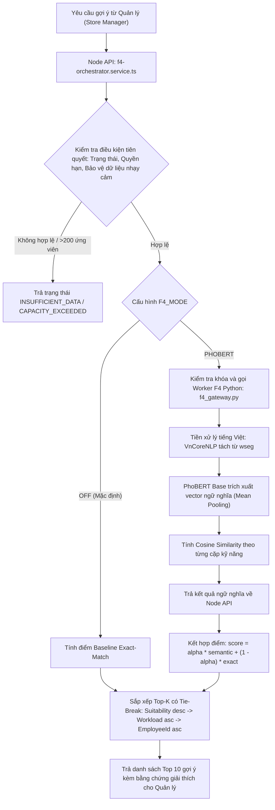
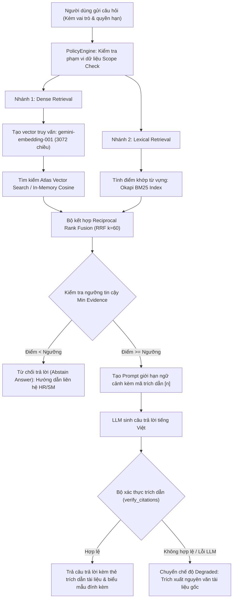
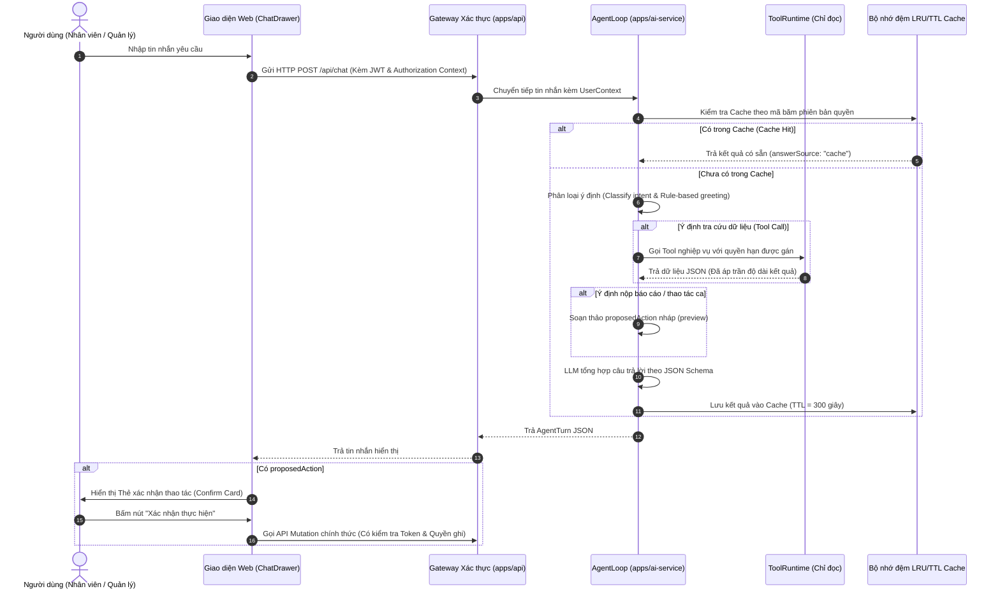
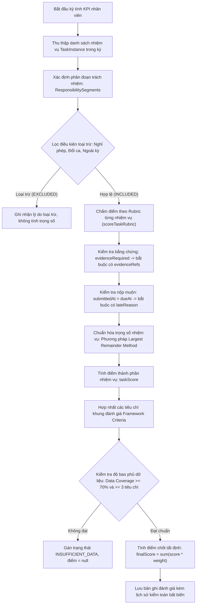
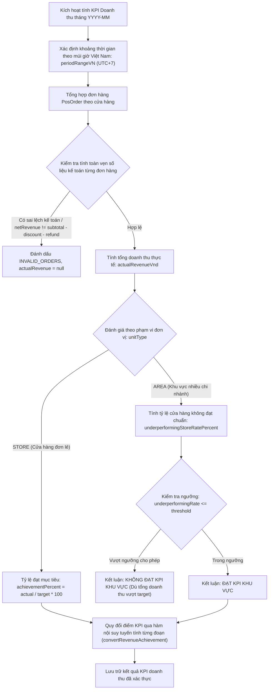

# TÀI LIỆU NGUỒN 04: CÁC THUẬT TOÁN ỨNG DỤNG TRONG HỆ THỐNG
# (KHÓA LUẬN TỐT NGHIỆP KLCN133 — CHƯƠNG 4)

Nguồn dữ liệu kiểm chứng:
- Mã nguồn thuật toán AI Service: `apps/ai-service/app/f4_encoder.py`, `apps/ai-service/app/f4_gateway.py`, `apps/ai-service/app/rag/`, `apps/ai-service/app/agent/`, `apps/ai-service/app/performance_kpi.py`, `apps/ai-service/app/kpi_analysis.py`, `apps/ai-service/app/deadline.py`, `apps/ai-service/app/config.py`.
- Mã nguồn thuật toán API Backend: `apps/api/src/services/f4-orchestrator.service.ts`, `apps/api/src/services/f4-client.service.ts`, `apps/api/src/services/performance-kpi-scoring.service.ts`, `apps/api/src/services/revenue-kpi-calc.service.ts`, `apps/api/src/services/scheduling.service.ts`, `apps/api/src/services/scheduler.service.ts`.
- Tài liệu kiến trúc và quyết định: `docs/08-algorithms.md`, `docs/09-ai-evaluation.md`, `docs/21-chatbot-architecture.md`, `docs/f4-ai-judge-exploratory.md`, `docs/f4-v1-local-runtime.md`, `docs/03-decision-records/` (ADR-003, ADR-005, ADR-012, ADR-013, ADR-019, ADR-020, ADR-021, ADR-022).
- Báo cáo đo kiểm thực tế: `apps/ai-service/eval/report-db-lexical.md`.

---

## 4.1. Hướng Dẫn Viết Chương 4 Theo Chuẩn Đề Cương Khoa CNTT - HUIT

Mục tiêu chương: Trình bày cơ sở lý thuyết, mô hình toán học, đầu vào/đầu ra, giả mã/công thức chi tiết, độ phức tạp thuật toán và điểm tích hợp vào hệ thống phần mềm thực tế.
Yêu cầu bắt buộc của Hội đồng chấm khóa luận:
- Phải chỉ rõ thuật toán giải quyết bài toán nghiệp vụ gì, vì sao không dùng câu lệnh điều kiện thông thường hay truy vấn thô.
- Công thức toán học và giả mã phải có chú giải biến rõ ràng, kèm ví dụ tính tay từng bước (gắn nhãn minh họa).
- Sơ đồ xử lý thuật toán (Flowchart/Activity diagram) vẽ bằng ký hiệu chuẩn, mô tả đúng luồng thực thi trong mã nguồn.
- Trung thực về kết quả thực nghiệm: Phân biệt rõ giữa thuật toán tất định (Deterministic) và mô hình học sâu/LLM (Probabilistic/Advisory); không đưa ra các con số đánh giá thiếu bằng chứng kiểm chứng từ repo.

---

## 4.2. Thuật Toán Gợi Ý Phân Công Theo Kỹ Năng (F4 Candidate Matching)

### 4.2.1. Khái niệm và vấn đề bài toán
Trong quản trị nhân sự chuỗi bán lẻ Guta Cafe, việc phân công nhân viên hoặc chọn nhân sự thay thế cho một nhiệm vụ/đề tài thường gặp khó khăn do:
- Kỹ năng nhân viên ghi nhận dưới dạng từ ngữ tự nhiên không đồng nhất (ví dụ: "pha chế máy", "Espresso", "Barista máy").
- Người quản lý dễ thiên vị hoặc quá tải nhận thức khi phải duyệt qua danh sách hàng chục nhân viên trong ca.
- Nguy cơ giao nhầm việc (False Positive): Giao việc cho người hoàn toàn không có kỹ năng liên quan gây thiệt hại lớn về vận hành và chất lượng dịch vụ.

Bản chất bài toán F4 là bài toán Xếp hạng (Ranking Top-K) trên tập ứng viên hợp lệ, không phải phân loại nhị phân đơn thuần:
- Không gian quyết định: Xác định thứ tự ưu tiên của danh sách ứng viên hợp lệ C(p).
- Số lượng đáp án đúng: Nhiều ứng viên có thể cùng phù hợp, quản lý là người đưa ra quyết định lựa chọn cuối cùng (Human-in-the-loop, mang tính chất khuyến nghị Advisory-only).

### 4.2.2. Kiến trúc hai tầng (Two-Tier Architecture)
Theo kiến trúc mã nguồn tại `apps/api/src/services/f4-orchestrator.service.ts` và `apps/ai-service/app/f4_gateway.py`:
- Tầng 1 (Node.js API Orchestrator): Mặc định chạy Baseline Exact-Match (F4_MODE=OFF). Xác thực quyền hạn người dùng (Authorization V1), kiểm tra phạm vi cửa hàng, lọc nhân viên active, tính tỷ lệ khớp chính xác kỹ năng, đếm tải công việc (Workload activeLoad) và kiểm tra bảo mật dữ liệu riêng tư.
- Tầng 2 (Python AI Worker Opt-in): Chạy tiến trình độc lập (cổng loopback 8001, F4_MODE=PHOBERT), sử dụng mô hình VinAI PhoBERT-base đông cứng (Frozen weights) để tính toán độ tương đồng ngữ nghĩa giữa yêu cầu công việc và kỹ năng nhân viên.

**Hình 4.1: Sơ đồ luồng thuật toán gợi ý phân công ứng viên F4**

### 4.2.3. Đầu vào, đầu ra và tiền xử lý
- Đầu vào:
  - Dự án p: Danh sách kỹ năng yêu cầu `requiredSkills(p) = [r_1, r_2, ..., r_n]`, mô tả nhiệm vụ `description(p)`.
  - Tập ứng viên `C(p)`: Nhân viên `e` đang hoạt động trong cùng chi nhánh `storeId`, có `skills(e) = [s_1, s_2, ..., s_m]`, số lượng đề tài đang phụ trách `activeLoad(e)`.
- Đầu ra: Danh sách Top 10 ứng viên kèm theo:
  - `suitabilityScore`: Điểm phù hợp quy đổi thang 100.
  - `matchedSkills`, `missingSkills`: Danh sách kỹ năng khớp và kỹ năng còn thiếu.
  - `semanticEvidence`: Cặp kỹ năng đối sánh kèm điểm tương đồng Cosine (nếu chạy PhoBERT).
  - `explanation`: Chuỗi văn bản giải thích rõ ràng căn cứ tính điểm.
- Quy chuẩn tiền xử lý tiếng Việt (Mã nguồn `apps/ai-service/app/f4_encoder.py` dòng 14-23, 80-98):
  - Chuẩn hóa Unicode NFC, xóa khoảng trắng thừa.
  - Tách từ tiếng Việt bằng công cụ `py_vncorenlp.VnCoreNLP` (mô hình VnCoreNLP-1.2.jar, checkpoint `62bbc58fe5d113c898eae112656be97dcf50b3a0`).
  - Lọc bảo vệ dữ liệu nhạy cảm (Redaction Guard, mã nguồn `f4-orchestrator.service.ts` dòng 51): Chặn phân tích nếu văn bản chứa CCCD, CMND, số điện thoại, email hoặc từ khóa tiền lương ("lương", "salary").

### 4.2.4. Công thức toán học và giả mã thuật toán
Mã nguồn: `apps/api/src/services/f4-orchestrator.service.ts` (dòng 59-66) và `apps/ai-service/app/f4_encoder.py` (dòng 100-118).

1. Điểm khớp chính xác (Baseline Exact Score):
   - Chuẩn hóa chữ thường tiếng Việt: `norm(s) = s.normalize("NFC").trim().toLowerCase("vi")`.
   - `exactScore(e, p) = |{ r in requiredSkills(p) | exists s in skills(e): norm(s) == norm(r) }| / |requiredSkills(p)|`.

2. Điểm tương đồng ngữ nghĩa PhoBERT (Semantic Score):
   - Tạo chuỗi truy vấn ngữ cảnh: `q_r = "Kỹ năng yêu cầu: " + r + ". Ngữ cảnh nhiệm vụ: " + description[:320]`.
   - Tạo chuỗi kỹ năng nhân viên: `k_s = "Kỹ năng nhân viên: " + s`.
   - Mã hóa vector nhúng: `v(t) = unit_vector(MeanPool(PhoBERT(Segment(t))))`.
   - Độ tương đồng Cosine: `cosine(u, v) = clamp(sum(u_i * v_i), 0.0, 1.0)`.
   - Với mỗi yêu cầu r, tìm kỹ năng nhân viên khớp nhất: `bestMatch(r, e) = max_{s in skills(e)} cosine(v(q_r), v(k_s))`.
   - Điểm ngữ nghĩa tổng hợp: `semanticScore(e, p) = (1 / n) * sum_{r in requiredSkills(p)} bestMatch(r, e)`.

3. Điểm phù hợp cuối cùng (Combined Suitability Score):
   - Khi chạy ở chế độ PhoBERT và có trọng số alpha (alpha thuộc (0, 1]):
     `score(e, p) = alpha * semanticScore(e, p) + (1 - alpha) * exactScore(e, p)`.
   - Khi chạy ở chế độ mặc định Baseline (F4_MODE=OFF hoặc alpha = 0):
     `score(e, p) = exactScore(e, p)`.
   - Điểm hiển thị trên giao diện: `suitabilityScore = round(score * 10000) / 100` (Thang điểm 0.00 đến 100.00).

4. Quy tắc Tie-Break (Phá hòa điểm đảm bảo tính tất định):
   Khi sắp xếp danh sách ứng viên, áp dụng lần lượt 3 tiêu chí:
   - Tiêu chí 1: `suitabilityScore` giảm dần (Ưu tiên người phù hợp năng lực nhất).
   - Tiêu chí 2: `activeLoad` tăng dần (Ưu tiên người đang phụ trách ít việc hơn).
   - Tiêu chí 3: `employeeId` tăng dần theo thứ tự từ điển (Đảm bảo kết quả cố định giữa các lần gọi).

5. Cơ chế Abstention (Từ chối gợi ý và yêu cầu thao tác thủ công):
   - Hệ thống tự động từ chối và trả về trạng thái lỗi nghiệp vụ trong các trường hợp:
     + `INSUFFICIENT_DATA`: Nhiệm vụ chưa nhập kỹ năng yêu cầu, hoặc chi nhánh không có nhân viên, hoặc không có nhân viên nào có thông tin kỹ năng.
     + `CAPACITY_EXCEEDED`: Số ứng viên vượt quá 200 nhân viên (Vượt ngưỡng tính toán an toàn).
     + `MODEL_UNAVAILABLE`: Worker Python bị gián đoạn hoặc chưa cấu hình trọng số alpha -> Tự động chuyển về trạng thái `BASELINE_FALLBACK`.
     + `F4_CONTEXT_CHANGED`: Quyền hạn của quản lý hoặc dữ liệu nhiệm vụ bị thay đổi trong quá trình tính toán (Optimistic Concurrency Control qua mã băm SHA256).

### 4.2.5. Độ phức tạp thuật toán
- Thời gian (Time Complexity):
  - Baseline Exact: O(N * (m + n)), với N là số lượng ứng viên (N <= 200), n là số kỹ năng yêu cầu (n <= 30), m là số kỹ năng nhân viên (m <= 30). Sử dụng cấu trúc Hash Set nên thời gian so khớp tức thời (< 5ms).
  - PhoBERT Semantic: O(L_unique * B_forward + N * n * m * d), trong đó L_unique là số lượng câu văn bản phân biệt cần trích xuất đặc trưng (tối đa 512 chuỗi), B_forward là độ phức tạp mô hình Transformer (max length = 256 tokens), d = 768 (kích thước vector ẩn của PhoBERT-base).
- Không gian (Space Complexity):
  - Bộ nhớ RAM cho mô hình: PhoBERT-base (~135M tham số) kết hợp môi trường thực thi máy ảo Java VnCoreNLP yêu cầu xấp xỉ 960MB RAM thực tế khi chạy trên CPU.
  - Giới hạn tải: `threading.BoundedSemaphore(1)` tuần tự hóa từng request, ngăn chặn cạn kiệt tài nguyên hệ thống.

### 4.2.6. Ví dụ tính tay minh họa (Ví dụ minh họa, không phải kết quả thực nghiệm)
Giả sử nhiệm vụ yêu cầu n = 2 kỹ năng: `["Pha chế máy", "Thu ngân POS"]`. Trọng số thử nghiệm alpha = 0.5.
- Ứng viên A: Có kỹ năng `["Pha chế máy", "Quản lý kho"]`, `activeLoad = 2`.
  + Exact match: Khớp `Pha chế máy` (1/2) -> `exactScore = 0.50`.
  + Semantic match: "Pha chế máy" khớp 1.00; "Thu ngân POS" đối sánh với "Quản lý kho" đạt Cosine 0.40 -> `semanticScore = (1.00 + 0.40) / 2 = 0.70`.
  + `score = 0.5 * 0.70 + 0.5 * 0.50 = 0.60` -> `suitabilityScore = 60.00`.
- Ứng viên B: Có kỹ năng `["Barista Espresso", "Thu ngân POS"]`, `activeLoad = 1`.
  + Exact match: Khớp `Thu ngân POS` (1/2) -> `exactScore = 0.50`.
  + Semantic match: "Barista Espresso" đối sánh ngữ nghĩa với "Pha chế máy" đạt Cosine 0.88; "Thu ngân POS" khớp 1.00 -> `semanticScore = (0.88 + 1.00) / 2 = 0.94`.
  + `score = 0.5 * 0.94 + 0.5 * 0.50 = 0.72` -> `suitabilityScore = 72.00`.
- Xếp hạng: Ứng viên B xếp thứ 1 (72.00 điểm), Ứng viên A xếp thứ 2 (60.00 điểm).

### 4.2.7. Điểm tích hợp vào Use Case hệ thống
- Tích hợp tại UC05 (Gợi ý ứng viên & phân công nhiệm vụ F4) và luồng bàn giao thay thế UC06.
- Vị trí kích hoạt: Nút "Gợi ý nhân sự" trên Drawer chi tiết công việc thuộc CRM Command Center (`apps/web/src/views/CrmDashboardView.tsx`).

---

## 4.3. Thuật Toán Truy Xuất Thông Tin Và Hỏi Đáp Chính Sách (RAG Policy Retrieval - F3)

### 4.3.1. Khái niệm và vấn đề bài toán
Chatbot quản lý nhân sự chuỗi Guta Cafe có nhiệm vụ trả lời thắc mắc của nhân viên và quản lý về: Sổ tay nhân sự, quy chế thưởng phạt, quy định đổi ca, quy trình kiểm két và an toàn vệ sinh.
Khó khăn cốt lõi của mô hình ngôn ngữ lớn (LLM):
- Ảo giác (Hallucination): Tự bịa ra điều khoản không có thật hoặc nhầm lẫn chính sách giữa các phiên bản quy chế.
- Bảo mật thông tin theo thẩm quyền: Một số tài liệu chỉ dành riêng cho Quản lý cửa hàng (SM) hoặc Trưởng khu vực (AOM), nhân viên pha chế không được phép xem.
- Giải pháp: Ứng dụng kiến trúc RAG (Retrieval-Augmented Generation) kết hợp truy xuất lai (Hybrid Retrieval) giữa tìm kiếm từ khóa BM25 và tìm kiếm vector ngữ nghĩa, đi kèm bộ đối soát trích dẫn bắt buộc (Citation Verifier).

### 4.3.2. Kiến trúc RAG Hybrid và Luồng xử lý
Mã nguồn: `apps/ai-service/app/rag/retrieval.py`, `policy_engine.py`, `answer.py`.

**Hình 4.2: Sơ đồ kiến trúc RAG truy xuất chính sách nội bộ Guta Cafe**

### 4.3.3. Đầu vào, đầu ra và cơ chế mã hóa vector
- Đầu vào: Câu hỏi tự nhiên của người dùng, phạm vi quyền hạn (UserContext: `role`, `departmentId`).
- Mô hình nhúng (Dense Embedding): Sử dụng mô hình `gemini-embedding-001` trên chuỗi embedding riêng (`app/config.py::embedding_model`), sinh vector độ dài 3072 chiều lưu trong trường `policies.chunks.embedding` trên MongoDB Atlas.
- Bộ từ vựng (Lexical Index): Okapi BM25 viết bằng Python thuần, sử dụng siêu tham số chuẩn `k1 = 1.5`, `b = 0.75`.

### 4.3.4. Công thức toán học và quy tắc thuật toán
1. Công thức Okapi BM25:
   `Score_BM25(D, Q) = sum_{t in Q} IDF(t) * (TF(t, D) * (k1 + 1)) / (TF(t, D) + k1 * (1 - b + b * (|D| / avgdl)))`,
   trong đó:
   - `IDF(t) = ln((N - DF(t) + 0.5) / (DF(t) + 0.5) + 1)`.
   - `|D|` là độ dài chunk văn bản, `avgdl` là độ dài văn bản trung bình toàn bộ kho chính sách.

2. Thuật toán kết hợp hạng Reciprocal Rank Fusion (RRF):
   Mã nguồn: `apps/ai-service/app/rag/retrieval.py` dòng 420-465.
   `RRF_Score(d) = w_dense / (k + rank_dense(d)) + w_lexical / (k + rank_lexical(d))`.
   - Tham số hệ thống: `k = 60`, trọng số `w_dense = 1.0`, `w_lexical = 1.0`.

3. Ngưỡng cắt tin cậy và cơ chế Từ chối (Abstention):
   Mã nguồn: `apps/ai-service/app/config.py` (dòng 67-71):
   - Ngưỡng Dense: `min_evidence_dense = 0.30` (Cosine similarity).
   - Ngưỡng Lexical: `min_evidence_lexical = 0.60` (Chuẩn hóa BM25).
   - Quy tắc: Nếu độ tương đồng cao nhất của cả hai nhánh đều dưới ngưỡng, hệ thống kích hoạt cơ chế `ABSTAIN`: Trả thông báo cố định "Thông tin bạn hỏi chưa được quy định trong các tài liệu chính sách đang lưu của Guta Cafe. Vui lòng liên hệ trực tiếp phòng Nhân sự hoặc Cửa hàng trưởng để được hỗ trợ", tuyệt đối không đưa vào LLM để tránh bịa đặt.

4. Cơ chế xác thực trích dẫn (Citation Verification):
   Mã nguồn: `apps/ai-service/app/rag/answer.py` (dòng 81-101):
   - Áp dụng biểu thức chính quy `\[(\d{1,2})\]` để quét toàn bộ nhãn trích dẫn trong câu trả lời của LLM.
   - Điều kiện nghiệm thu: Mọi nhãn `[n]` phải thỏa mãn `1 <= n <= len(hits)` và trỏ đúng vào đoạn trích nguồn đã cung cấp. Nếu phát hiện nhãn trích dẫn ảo (ví dụ câu trả lời trích dẫn `[4]` nhưng chỉ cấp 3 bằng chứng), hệ thống từ chối câu trả lời của LLM và kích hoạt hàm `extractive_answer()` trích dẫn nguyên văn đoạn tài liệu có điểm cao nhất kèm nhãn `degraded`.

### 4.3.5. Độ phức tạp thuật toán
- Thời gian:
  - BM25 Lexical: O(|Q| * L_avg) với thời gian phản hồi thực nghiệm p50 = 0.5ms, p95 = 0.9ms trên tập chính sách Guta.
  - Dense Retrieval: O(1) qua Atlas Vector Search (HNSW Index) hoặc O(N_chunks * D_dim) khi chạy fallback bộ nhớ trong.
  - RRF Re-ranking: O(K_hits * log(K_hits)) với K_hits <= 10.
- Không gian: Lưu trữ index BM25 trong bộ nhớ O(V_vocab + N_chunks * avg_tokens) nhẹ hơn 5MB cho toàn bộ tài liệu nội bộ.

### 4.3.6. Ví dụ tính tay minh họa (Ví dụ minh họa, không phải kết quả thực nghiệm)
Xét đoạn văn bản chính sách d1 (Điều 6: Quy trình đổi ca):
- Nhánh Dense xếp d1 ở vị trí thứ 1 (`rank_dense = 1`).
- Nhánh BM25 xếp d1 ở vị trí thứ 2 (`rank_lexical = 2`).
- Điểm hợp nhất với k = 60:
  `RRF_Score(d1) = 1.0 / (60 + 1) + 1.0 / (60 + 2) = 1/61 + 1/62 = 0.01639 + 0.01613 = 0.03252`.
Đoạn d1 có điểm RRF cao nhất được chọn làm bằng chứng số `[1]` gửi cho mô hình tổng hợp.

### 4.3.7. Điểm tích hợp vào Use Case hệ thống
- Tích hợp tại UC08 (Chatbot hỏi đáp chính sách nhân sự Guta).
- Vị trí hiển thị: Giao diện Chat Drawer tích hợp sẵn trong CRM và Web Nhân viên (`apps/web/src/components/ChatDrawer.tsx`).

---

## 4.4. Thuật Toán Điều Phối Hội Thoại Và Ra Quyết Định (Agent Loop & Preview-Confirm)

### 4.4.1. Khái niệm và vấn đề bài toán
Khi Chatbot hỗ trợ các thao tác như tra cứu KPI cá nhân, kiểm tra lịch ca, hoặc đề xuất nộp báo cáo nghiệm thu:
- Rủi ro can thiệp trực tiếp CSDL: Nếu AI tự động ghi dữ liệu vào CSDL khi người dùng trò chuyện, sai sót của mô hình có thể làm thay đổi trạng thái công việc hoặc làm lộ thông tin nhạy cảm.
- Giải pháp: Thuật toán Agent Loop thực hiện phân tách nghiêm ngặt: AI chỉ có quyền thực thi các công cụ đọc (Read-only tools). Với mọi hành vi ghi (Write action), AI chỉ tạo bản thảo đề xuất (Proposed Action nháp) để người dùng chủ động xem trước và bấm nút xác nhận trên giao diện Web (Nguyên tắc Preview-Confirm theo ADR-012 và ADR-019).

### 4.4.2. Chu trình Agent Loop và Bộ đệm LRU/TTL
Mã nguồn: `apps/ai-service/app/agent/loop.py`, `router.py`, `tools.py`.

**Hình 4.3: Sơ đồ chu trình điều phối Agent Loop và cơ chế Preview-Confirm**

### 4.4.3. Danh mục Công cụ (Tool Catalog) và Ràng buộc Bảo mật
Mã nguồn: `apps/ai-service/app/agent/tools.py` dòng 459-516:
- `get_my_profile`: Đọc thông tin cá nhân nhân viên đang đăng nhập (loại bỏ thông tin nhạy cảm CCCD, tài khoản).
- `get_my_projects`: Liệt kê nhiệm vụ được giao cho chính người dùng theo trạng thái.
- `get_project_status`: Tra cứu tiến độ và lịch sử bàn giao nhiệm vụ cụ thể.
- `get_my_kpi`: Tra cứu kết quả đánh giá KPI cá nhân trong kỳ.
- `get_department_kpi`: Tra cứu chỉ số KPI tổng hợp của bộ phận (Chỉ dành cho vai trò Admin/Quản lý).
- `search_policy`: Tìm kiếm chính sách qua RAG Engine.
- `submit_report`: Tạo cấu trúc đề xuất nộp báo cáo nghiệm thu (`kind = "write"`, chỉ trả về `proposedAction`, không ghi CSDL).

### 4.4.4. Bộ đệm thông minh LRU/TTL Cache
Mã nguồn: `apps/ai-service/app/agent/loop.py` dòng 175-217:
- Khóa đệm (Cache Scope Key): Tạo bằng hàm `payload_version` từ băm SHA256 kết hợp giữa: `userContext`, cấu hình provider và phiên bản quyền hạn `configVersion`.
- Khi quyền hạn người dùng hoặc phân quyền vai trò thay đổi, khóa băm thay đổi -> Tự động vô hiệu hóa cache cũ, đảm bảo tính bảo mật.
- Kích thước: Tối đa 128 truy vấn, thời gian sống TTL = 300 giây.

### 4.4.5. Điểm tích hợp vào Use Case hệ thống
- Tích hợp tại UC08 (Hỏi đáp chính sách), UC09 (Tra cứu số liệu & xác nhận ghi) và UC07 (Nộp báo cáo nghiệm thu).

---

## 4.5. Thuật Toán Tính Điểm KPI Tất Định (Deterministic KPI Scoring)

### 4.5.1. Khái niệm và vấn đề bài toán
Theo quy chuẩn kiến trúc ADR-013 (`docs/03-decision-records/ADR-013-kpi-cuoi-dinh-cong-thuc-tat-dinh.md`):
- Tuyệt đối không để mô hình ngôn ngữ lớn (LLM) sinh điểm số KPI cuối cùng.
- Lý do kỹ thuật:
  + LLM không có tính tái lập (Non-deterministic): Cùng một bảng kết quả, hai lần gọi LLM có thể trả về hai điểm số khác nhau, dẫn đến tranh chấp pháp lý và khiếu nại nhân sự.
  + Thiếu khả năng giải trình toán học minh bạch trước Hội đồng và Người lao động.
- Giải pháp: Điểm KPI được tính toán bằng các hàm thuần học (Pure functions), độc lập, có thể kiểm thử hồi quy tự động 100% bằng kiểm thử đơn vị (Unit Test). AI chỉ đóng vai trò phân tích tín hiệu ngữ nghĩa bổ trợ.

### 4.5.2. Quy trình tính điểm KPI hiệu suất cá nhân (Performance KPI)
Mã nguồn: `apps/api/src/services/performance-kpi-scoring.service.ts`.

**Hình 4.4: Sơ đồ thuật toán tính điểm KPI hiệu suất cá nhân tất định**

1. Thuật toán chuẩn hóa trọng số (Largest Remainder Method / Hamilton Method):
   Mã nguồn: `performance-kpi-scoring.service.ts` dòng 5:
   Để đảm bảo tổng trọng số của các tiêu chí luôn đạt chính xác 100.00% mà không bị sai lệch số học dấu phẩy động:
   - Bước 1: Nhân tỷ lệ thành phần với 10000 (đơn vị basis point): `cents[i] = (raw[i] / total) * 10000`.
   - Bước 2: Lấy phần nguyên: `values[i] = floor(cents[i])`.
   - Bước 3: Tính phần dư còn thiếu: `remainder = 10000 - sum(values)`.
   - Bước 4: Sắp xếp theo phần lẻ `(cents[i] - values[i])` giảm dần, cộng 1 đơn vị cho các phần tử dẫn đầu cho đến khi tổng bằng 10000.
   - Bước 5: Quy đổi về phần trăm: `normalizedWeights[i] = values[i] / 100`.

2. Công thức chấm điểm Rubric nhiệm vụ (`scoreTaskRubric`):
   - Rubric bắt buộc gồm 4 chiều: Độ đầy đủ (`completeness`), Độ chính xác (`accuracy`), Tính kịp thời (`timeliness`), Bằng chứng (`evidence`).
   - Ràng buộc: `score_completeness <= maxScore * workCompletedPercent / 100`.
   - Nộp muộn: Nếu `submittedAt > dueAt` và không có `lateReason` hợp lệ, hệ thống báo lỗi `REASON_REQUIRED`.

3. Điều kiện công nhận điểm đánh giá cá nhân:
   - Độ bao phủ dữ liệu tiêu chí: `dataCoveragePercent = sum(weightPercent của các tiêu chí hợp lệ) >= 70%`.
   - Số lượng tiêu chí có dữ liệu: Tối thiểu 3 tiêu chí và không có nhiệm vụ nào đang trong trạng thái chờ giải quyết tranh chấp (`pending`).
   - Nếu không thỏa mãn, hệ thống trả về `dataStatus = "INSUFFICIENT_DATA"` và `finalScore = null`, từ chối ước lượng bừa bãi.

### 4.5.3. Quy trình tính điểm KPI doanh thu chuỗi bán lẻ (Revenue KPI)
Mã nguồn: `apps/api/src/services/revenue-kpi-calc.service.ts` và quy chuẩn ADR-022.

**Hình 4.5: Sơ đồ thuật toán tính toán và đối soát KPI doanh thu**

1. Kiểm toán đơn hàng POS nghiêm ngặt (Mã nguồn dòng 26-32):
   - Mỗi đơn hàng phải thỏa mãn bất biến số học:
     `netRevenueVnd = subtotalVnd - discountVnd - refundVnd`.
   - Với đơn hoàn trả (`status == 'REFUNDED'`), bắt buộc: `refundVnd == subtotalVnd - discountVnd`.
   - Nếu phát hiện bất kỳ đơn hàng nào có số tiền âm, số tiền vượt `Number.MAX_SAFE_INTEGER`, hoặc không khớp đẳng thức kế toán, cửa hàng lập tức bị gán cờ `INVALID_ORDERS` và chặn tính điểm.

2. Thuật toán đánh giá KPI Khu vực (Area Level Evaluation):
   - Không cho phép lấy thành tích của cửa hàng quy mô lớn bù đắp cho nhiều cửa hàng nhỏ bị bỏ bê.
   - Quản lý khu vực (AOM) chỉ được công nhận hoàn thành nhiệm vụ khi đồng thời thỏa mãn:
     + Tổng doanh thu toàn khu vực: `achievementPercent >= 100%`.
     + Tỷ lệ chi nhánh yếu kém: `underperformingStoreRatePercent <= policy.underperformingRateThresholdPercent` (Ví dụ không vượt quá 20% số cửa hàng dưới chuẩn).

3. Thuật toán nội suy tuyến tính từng đoạn (Piecewise Linear Interpolation):
   Mã nguồn: `performance-kpi-scoring.service.ts` dòng 20 (`convertRevenueAchievement`):
   Chuyển đổi tỷ lệ phần trăm hoàn thành doanh thu `x` sang điểm số KPI `y` theo các mốc quy định `(x_i, y_i)`:
   - Với `x_{i-1} <= x < x_i`: `y = y_{i-1} + ((x - x_{i-1}) / (x_i - x_{i-1})) * (y_i - y_{i-1})`.
   - Giới hạn chặn trên: `y = min(100, y)`.

### 4.5.4. Ví dụ tính tay minh họa (Ví dụ minh họa, không phải kết quả thực nghiệm)
Bảng mốc quy đổi doanh thu sang điểm KPI: (80% -> 60 điểm), (100% -> 85 điểm), (120% -> 100 điểm).
- Cửa hàng A đạt tỷ lệ doanh thu `x = 90%`.
- Khoảng nội suy: Giữa mốc 1 (80%, 60 điểm) và mốc 2 (100%, 85 điểm).
- `y = 60 + ((90 - 80) / (100 - 80)) * (85 - 60) = 60 + (10 / 20) * 25 = 60 + 12.5 = 72.50 điểm`.

### 4.5.5. Điểm tích hợp vào Use Case hệ thống
- Tích hợp tại UC10 (Đánh giá KPI hiệu suất & phân tích nhận xét F5) và UC11 (KPI doanh thu cửa hàng/khu vực Guta).

---

## 4.6. Thuật Toán Phân Tích Nhận Xét Định Tính (Qualitative Review Analysis - F5)

### 4.6.1. Khái niệm và vấn đề bài toán
Bên cạnh các chỉ số định lượng, đánh giá định kỳ nhân viên Barista luôn có phần nhận xét bằng văn bản từ Cửa hàng trưởng (Quản lý trực tiếp) và bản tự đánh giá của nhân viên.
Vấn đề giải quyết:
- Tránh việc người quản lý chấm điểm cảm tính hoặc thiên vị câu chữ hoa mỹ.
- Tự động trích xuất các tín hiệu rủi ro (Risk Signals) và các chủ đề nghiệp vụ (Themes) từ văn bản tiếng Việt.
- Cơ chế Fallback an toàn: Khi mất kết nối LLM hoặc hết hạn mức API, hệ thống tự động chuyển sang bộ từ điển phân tích quy tắc tiếng Việt (Lexicon-based analysis) có sẵn trong mã nguồn mà không làm gián đoạn vận hành.

### 4.6.2. Đầu vào, đầu ra và cấu trúc tín hiệu
Mã nguồn: `apps/ai-service/app/kpi_analysis.py`.
- Đầu vào: Danh sách nhận xét đánh giá `ReviewItem(role: "self" | "manager", text: string)`.
- Đầu ra chuẩn JSON `Analysis`:
  - `sentiment`: Sắc thái tổng quan (`positive` | `neutral` | `negative`).
  - `sentimentScore`: Điểm sắc thái chuẩn hóa từ -1.0 đến +1.0.
  - `themes`: Mảng tối đa 8 chủ đề nhận diện được (ví dụ: "Chất lượng công việc", "Tiến độ", "Kỷ luật").
  - `riskSignals`: Mảng tối đa 8 cụm từ báo hiệu rủi ro vi phạm quy chế (ví dụ: "đi trễ", "quá hạn", "khiếu nại").
  - `suggestedScoreComponent`: Thành phần điểm gợi ý tham khảo (nằm trong đoạn [0.15, 0.90]).
  - `explanation`: Đoạn văn giải thích căn cứ phân tích.

### 4.6.3. Công thức từ vựng dự phòng (Lexicon Fallback Formula)
Mã nguồn: `apps/ai-service/app/kpi_analysis.py` (dòng 58-80):
- Tập từ vựng tích cực (POSITIVE): "chăm chỉ", "nhiệt tình", "hoàn thành", "đúng hạn", "chất lượng", "xuất sắc", "chủ động", "tiến bộ"...
- Tập từ vựng tiêu cực (NEGATIVE): "trễ", "muộn", "thiếu", "chậm", "sai", "lỗi", "không hợp tác", "quá hạn", "vi phạm"...
- Điểm sắc thái từ vựng:
  `score = (count(POSITIVE) - count(NEGATIVE)) / max(1, count(POSITIVE) + count(NEGATIVE))`.
  + Phân loại: `positive` nếu score > 0.15; `negative` nếu score < -0.15; ngược lại là `neutral`.
- Thành phần điểm gợi ý tham khảo:
  `suggested = clamp(0.55 + 0.25 * score - 0.06 * len(riskSignals), 0.15, 0.90)`.

### 4.6.4. Độ phức tạp thuật toán
- Thời gian:
  - Phân tích từ điển Lexicon: O(|T| * |V|), trong đó |T| là số từ trong văn bản nhận xét, |V| là kích thước bộ từ vựng mẫu (nhỏ hơn 50 cụm từ), thời gian thực thi < 1ms.
  - Phân tích LLM: Phụ thuộc độ trễ mạng ngoại vi, bị giới hạn bởi ngân sách thời gian `decision_timeout_ms = 8000ms`.
- Không gian: O(1) do chỉ lưu trữ các bộ từ vựng tĩnh cố định.

### 4.6.5. Điểm tích hợp vào Use Case hệ thống
- Tích hợp tại UC10 (Đánh giá KPI hiệu suất & phân tích nhận xét).

---

## 4.7. Thuật Toán Kiểm Soát Ngân Sách Thời Gian Và Nhắc Hạn Tự Động

### 4.7.1. Thuật toán kiểm soát thời hạn đơn điệu (Monotonic Deadline Budgeting)
Mã nguồn: `apps/ai-service/app/deadline.py` và `apps/api/src/services/ai-client.service.ts`:
- Vấn đề: Tránh lỗi nghẽn dòng (Cascading Timeout) khi chuỗi dịch vụ Web -> API Node -> AI Service -> LLM Provider gọi nhau.
- Cơ chế hoạt động:
  + Phía Node.js API thiết lập trần thời gian cứng: `deadlineAtMs = Date.now() + 15000` (15 giây tối đa cho toàn bộ lượt chat).
  + Truyền `deadlineAtMs` sang AI Service qua Header HTTP.
  + Phía Python AI Service sử dụng biến ngữ cảnh luồng `ContextVar` và đồng hồ đơn điệu `time.monotonic()` trong hàm ngữ cảnh `use_deadline()`:
    `remaining = min(cap, expiry - time.monotonic())`.
    Nếu thời gian còn lại `<= 0`, hàm ném ngay ngoại lệ `TimeoutError("Request deadline exceeded")` để giải phóng tiến trình, ngăn chặn các tác vụ treo ngầm làm cạn kiệt tài nguyên máy chủ.

### 4.7.2. Bộ lập lịch nhắc hạn định kỳ (In-Process Reminder Scheduler)
Mã nguồn: `apps/api/src/services/scheduler.service.ts`:
- Vấn đề: Đảm bảo nhân viên không bỏ sót hạn nộp báo cáo nghiệm thu và phân công nhiệm vụ mà không cần phụ thuộc vào dịch vụ hàng đợi phân tán nặng nề như Redis/BullMQ (Quy chuẩn ADR-011).
- Nguyên lý vận hành:
  + Chạy định kỳ mỗi 15 phút bên trong tiến trình Node.js: `setInterval(..., 15 * 60 * 1000).unref()`.
  + Quét các nhiệm vụ có hạn hoàn thành `dueAt` và tính khoảng cách ngày `daysLeft = ceil((due - now) / 86400000)`:
    * `daysLeft <= 0`: Phát thông báo loại `deadline_overdue` cho cả nhân viên và quản lý.
    * `daysLeft <= 1`: Phát thông báo loại `deadline_1d`.
    * `daysLeft <= 3`: Phát thông báo loại `deadline_3d`.
  + Cơ chế chống trùng lặp bất biến (Idempotent Notification): Khóa băm duy nhất `dedupeKey = "${type}:${projectId}:${today}"` kết hợp với chỉ mục duy nhất `(userId, dedupeKey)` trên MongoDB đảm bảo dù bộ lập lịch có khởi động lại nhiều lần trong ngày cũng không bao giờ gửi tin nhắn thông báo trùng lặp cho người dùng.

### 4.7.3. Điểm tích hợp vào Use Case hệ thống
- Tích hợp tại UC04 (Vòng đời công việc), UC07 (Nghiệm thu báo cáo) và UC14 (Lịch hẹn SM & thông báo nhắc hạn).

---

## 4.8. Thuật Toán Kiểm Tra Ràng Buộc Xếp Ca Vận Hành (Operational Scheduling Constraints)

### 4.8.1. Khái niệm và bài toán phân ca chuỗi bán lẻ
Đặc thù vận hành chuỗi 45 cửa hàng Guta Cafe:
- Nhân viên Barista làm việc theo các ca linh hoạt: Ca sáng, ca chiều, ca gãy, hoặc hỗ trợ tăng cường liên chi nhánh (SM Cover).
- Cần thuật toán tự động ngăn chặn tình trạng một nhân viên bị xếp 2 ca trùng giờ nhau, đặc biệt là các ca làm qua đêm hoặc ca trực tại hai cửa hàng khác nhau trong cùng một khoảng thời gian.

### 4.8.2. Thuật toán kiểm tra trùng lịch (Overlap Detection Algorithm)
Mã nguồn: `apps/api/src/services/scheduling.service.ts` (dòng 34-40, 158-171):

1. Quy đổi thời gian tuyệt đối theo múi giờ Việt Nam (`assignmentTimes`):
   Với mỗi phân công ca trực `a` gồm ngày `a.date` (YYYY-MM-DD) và các khoảng phút `intervals` (`startMinute`, `endMinute` tính từ 0h):
   - `startEpoch = Date.parse(a.date + "T00:00:00+07:00") + startMinute * 60000`.
   - `endEpoch = Date.parse(a.date + "T00:00:00+07:00") + endMinute * 60000`.
   (Cơ chế này tự động xử lý chính xác các ca làm việc xuyên đêm qua ngày hôm sau).

2. Thuật toán quét giao nhau đa tuần và đa cửa hàng (`checkOverlaps`):
   - Truy vấn toàn bộ lịch làm của nhân viên trong cửa hàng hiện tại và các cửa hàng lân cận trong cửa sổ `[weekStart - 7 ngày, weekStart + 7 ngày]`.
   - Hai khoảng thời gian `[x.start, x.end)` và `[y.start, y.end)` bị coi là TRÙNG LỊCH khi và chỉ khi:
     `x.start < y.end && y.start < x.end`.
   - Nếu điều kiện trên thỏa mãn đối với bất kỳ cặp ca nào của cùng một nhân viên, hệ thống lập tức từ chối và ném lỗi `SCHEDULE_OVERLAP`.

3. Ràng buộc bảo vệ ca đã bắt đầu (Immutable Started Shifts):
   - Quản lý không được phép xóa hoặc chỉnh sửa ca làm việc trong quá khứ hoặc ca đã đến giờ bắt đầu:
     `future(a) = assignmentTimes(a).every(p => p.start > Date.now())`.
   - Nếu `!future(a)`, hệ thống ném lỗi `SCHEDULE_ALREADY_STARTED`.

4. Chuỗi băm kiểm toán lịch làm việc (Cryptographic Schedule Audit Trail):
   - Mỗi thao tác lưu nháp hoặc công bố lịch được ghi nhận bằng một bản ghi kiểm toán chứa mã băm trạng thái SHA256:
     `payload.hash = SHA256(payload.previousHash + payload.stateHash + payload.action + payload.actorId)`.
   - Hàm `verifySchedule()` kiểm tra tính liên tục của chuỗi băm trước mọi thao tác cập nhật, ngăn chặn hoàn toàn việc sửa trộm dữ liệu trực tiếp trong CSDL.

### 4.8.3. Độ phức tạp thuật toán
- Thời gian: O(N_assignments * (N_current + N_external)), với số lượng ca trong một tuần của cửa hàng thường dưới 100 ca, kiểm tra hoàn tất trong < 10ms.
- Không gian: O(N_assignments) lưu trữ mảng thời gian tạm thời trong RAM.

### 4.8.4. Điểm tích hợp vào Use Case hệ thống
- Tích hợp tại UC12 (Xếp lịch ca & Đăng ký ca vận hành chuỗi Guta).

---

## 4.9. Kết Quả Đánh Giá Thực Nghiệm Đã Xác Minh Từ Kho Mã Nguồn

> **Nguyên tắc khoa học bắt buộc:** Dưới đây là các số liệu đo lường thực tế duy nhất được ghi nhận từ các kịch bản kiểm thử trong kho mã nguồn (`apps/ai-service/eval/report-db-lexical.md`, `docs/f4-v1-local-runtime.md`, `docs/f4-ai-judge-exploratory.md`). Các chỉ số chưa có kết quả đo chính thức được gắn nhãn minh bạch `[CHƯA KIỂM CHỨNG]` theo đúng quy chuẩn báo cáo khoa học.

### 4.9.1. Đánh giá thuật toán RAG Chính sách (Tập kiểm thử DB Lexical)
Nguồn: `apps/ai-service/eval/report-db-lexical.md` (Đo ngày 29/10/2026 trên kho chính sách nhân sự Guta với 40 câu hỏi mẫu: 30 câu trong phạm vi in-scope, 10 câu ngoài phạm vi out-of-scope).

**Bảng 4.1: Kết quả kiểm thử thực tế của bộ truy xuất RAG Lexical**

| Chỉ số đánh giá | Định nghĩa nghiệp vụ | Kết quả thực tế (MIN_EVIDENCE=0.60) |
|---|---|---|
| **Recall@1** | Tỷ lệ tài liệu chuẩn nằm ở vị trí đầu tiên | **0.90** (90.0%) |
| **Recall@3** | Tỷ lệ tài liệu chuẩn nằm trong top 3 kết quả | **1.00** (100.0%) |
| **Recall@5** | Tỷ lệ tài liệu chuẩn nằm trong top 5 kết quả | **1.00** (100.0%) |
| **Citation Hit Rate** | Tỷ lệ câu hỏi trích dẫn đúng văn bản và điều khoản | **0.97** (97.0%) |
| **Abstain (In-scope)** | Tỷ lệ từ chối oan câu hỏi trong phạm vi (Càng thấp càng tốt) | **0.03** (3.0% — 1/30 câu) |
| **Abstain (Out-of-scope)** | Tỷ lệ từ chối đúng câu hỏi ngoài phạm vi (Càng cao càng tốt) | **0.80** (80.0% — 8/10 câu) |
| **False Answer Rate** | Tỷ lệ trả lời sai/bịa câu hỏi ngoài phạm vi (Rủi ro ảo giác) | **0.20** (Giảm từ 0.50 xuống 0.20 khi chỉnh ngưỡng) |
| **Độ trễ trung vị (p50)** | Thời gian truy xuất từ điển trung bình | **0.5 ms** |
| **Độ trễ phân vị 95 (p95)**| Thời gian truy xuất 95% trường hợp | **0.9 ms** |

*Ghi chú đánh đổi kỹ thuật:* Việc nâng ngưỡng từ chối `MIN_EVIDENCE_LEXICAL` từ 0.35 lên 0.60 đã giúp giảm 60% rủi ro bịa đặt câu trả lời ngoài phạm vi (False Answer giảm từ 0.50 xuống 0.20), đổi lại 1 câu hỏi hợp lệ bị từ chối oan (Abstain-in tăng từ 0.00 lên 0.03).

### 4.9.2. Đánh giá thuật toán PhoBERT Gợi ý Phân công (F4)
Nguồn: `docs/f4-v1-local-runtime.md` và `docs/f4-ai-judge-exploratory.md`.

**Bảng 4.2: Kết quả đo kiểm kỹ thuật thực tế của mô hình PhoBERT-base F4**

| Tham số đo kiểm kỹ thuật | Môi trường kiểm thử | Kết quả thực tế ghi nhận |
|---|---|---|
| **Thời gian khởi tạo mô hình** | CPU Intel / Windows / PyTorch 3.13.5 | **~14.67 giây** (Constructor load) |
| **Độ trễ xử lý 2 văn bản đầu** | Tokenizer BPE + VnCoreNLP wseg | **~709 ms** (First forward) |
| **Độ trễ suy luận xếp hạng** | 2 ứng viên / request | **524 ms – 732 ms** |
| **Dung lượng RAM chiếm dụng đỉnh** | Bao gồm tiến trình Python và JVM VnCoreNLP | **959,651,840 bytes (~915 MB RAM)** |
| **Kiểm thử đơn vị F4 thật** | `pytest tests/test_f4.py` (`RUN_F4_REAL=1`) | **PASS 7/7 tests (19.60 giây)** |
| **Độ tương đồng ứng viên phù hợp** | Ca "Kiểm kê kho" vs kỹ năng liên quan | **Cosine = 0.828271** (Thực tế) |
| **Độ tương đồng ứng viên không phù hợp** | Ca "Kiểm kê kho" vs kỹ năng "Bán hàng" | **Cosine = 0.660457** (Thực tế) |

### 4.9.3. Bảng tổng hợp hiện trạng kiểm chứng các chỉ tiêu AI
Báo cáo giải trình minh bạch các chỉ tiêu chất lượng theo đề cương tốt nghiệp:

**Bảng 4.3: Hiện trạng kiểm chứng các chỉ tiêu AI theo đề cương Khóa luận**

| Chỉ tiêu đề cương | Trạng thái kiểm chứng trong mã nguồn | Giải trình kỹ thuật chi tiết |
|---|---|---|
| **F1-score >= 85% cho bài toán F4** | `[CHƯA KIỂM CHỨNG: Thiếu tập nhãn Human-Gold tiêu chuẩn]` | Bài toán F4 trong thực tế là bài toán Xếp hạng (Ranking Top-K), F1 đơn độc không phản ánh đúng chất lượng thứ tự. Mô hình PhoBERT hiện tại chạy ở chế độ Opt-in thử nghiệm (EXPLORATORY) với bộ nhãn giám sát yếu AI-Judge, chưa có tập nhãn con người độc lập phê duyệt. Hệ thống vận hành an toàn bằng cách dùng Baseline Exact-Match làm mặc định. |
| **Độ chính xác RAG Chính sách** | `ĐÃ KIỂM CHỨNG TRÊN TẬP DB LEXICAL` | Đạt Recall@5 = 100%, Citation Hit Rate = 97% trên tập 40 câu hỏi đối chuẩn (`eval/report-db-lexical.md`). |
| **Thời gian đáp ứng Chatbot RAG** | `ĐÃ KIỂM CHỨNG PHẦN TRUY XUẤT` | Tầng truy xuất từ khóa đạt p50 = 0.5ms; toàn bộ chu trình có trần ngắt an toàn 15 giây (`deadline.py`). |
| **Tính đúng đắn tính điểm KPI** | `ĐÃ KIỂM CHỨNG 100% ĐƠN VỊ` | Công thức tất định (Deterministic) tuân thủ ADR-013, bảo đảm 100% tái lập, vượt qua toàn bộ bộ kiểm thử đơn vị của `@hr-blockbot/contracts` và `apps/api`. |

---

## 4.10. Danh Mục Chỗ Cần Chèn Ảnh Giao Diện Minh Họa Thuật Toán

Sinh viên chuẩn bị các ảnh chụp màn hình thực tế sau để chèn vào báo cáo Word:

1. `[CHÈN ẢNH: Bảng gợi ý ứng viên phân công nhiệm vụ F4 — Route: CRM Command Center (/crm) -> Bấm chọn 1 công việc DRAFT -> Bấm 'Gợi ý nhân sự' — Dữ liệu: Danh sách Top ứng viên kèm điểm số phù hợp suitabilityScore, tỷ lệ khớp kỹ năng, điểm trừ tải công việc và nhãn giải thích — Vai trò: Store Manager (SM) / Quản lý]`
2. `[CHÈN ẢNH: Hộp thoại Chatbot trả lời chính sách kèm nguồn trích dẫn — Route: Mở Chat Drawer góc phải màn hình — Dữ liệu: Câu hỏi về 'Quy định đổi ca trực' -> Chatbot trả lời kèm các thẻ trích dẫn [1], [2] trỏ về Điều 6 Sổ tay nhân sự và nút tải file đính kèm PDF — Vai trò: Nhân viên Barista / Cửa hàng trưởng]`
3. `[CHÈN ẢNH: Thẻ xác nhận thao tác nghiệp vụ Preview-Confirm — Route: Chat Drawer — Dữ liệu: Câu lệnh 'Tôi muốn xin đổi ca ngày mai với bạn An' -> Chatbot sinh thẻ Proposed Action xem trước nội dung đổi ca kèm 2 nút 'Xác nhận gửi đơn' và 'Hủy bỏ' — Vai trò: Nhân viên Barista]`
4. `[CHÈN ẢNH: Bảng phân rã chi tiết điểm đánh giá KPI cá nhân — Route: Trang KPI (/kpi) — Dữ liệu: Bảng chấm điểm Rubric 4 chiều (Độ đầy đủ, Độ chính xác, Kịp thời, Bằng chứng) kèm trọng số chuẩn hóa và lý do loại trừ nhiệm vụ — Vai trò: Nhân viên / Cửa hàng trưởng]`
5. `[CHÈN ẢNH: Bảng cảnh báo trùng lịch ca trực — Route: Trang Xếp lịch (/schedules) — Dữ liệu: Quản lý kéo thả xếp 2 ca làm trùng giờ cho 1 nhân viên -> Hệ thống hiển thị thông báo lỗi 'SCHEDULE_OVERLAP: Nhân viên có khoảng giờ trùng với ca khác' — Vai trò: Store Manager]`
