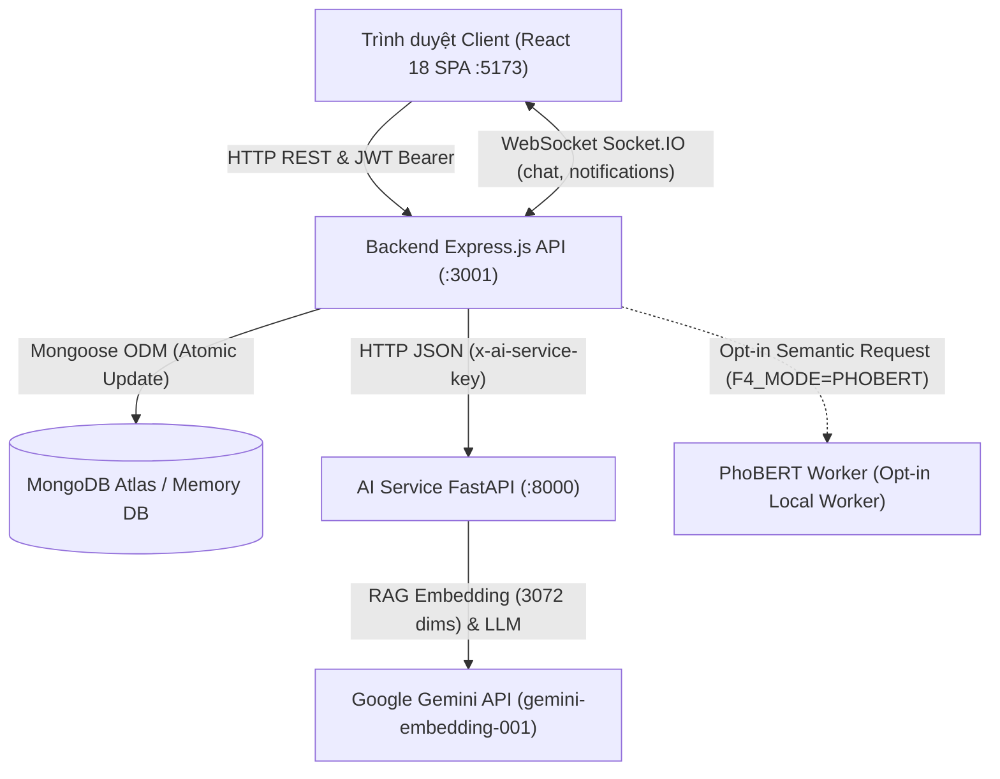
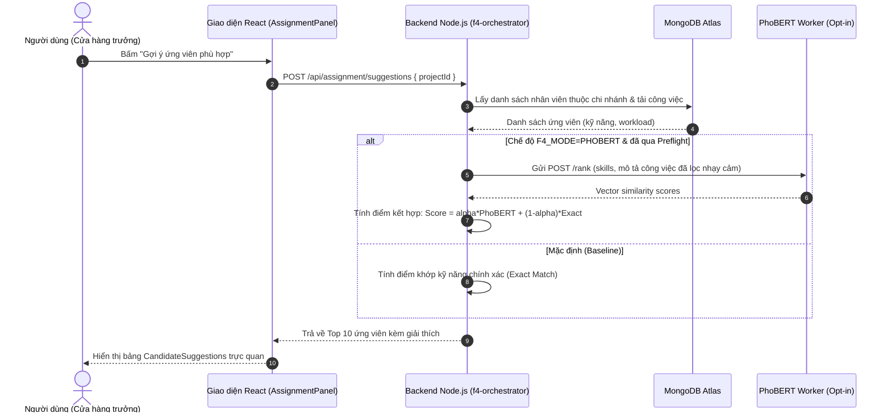
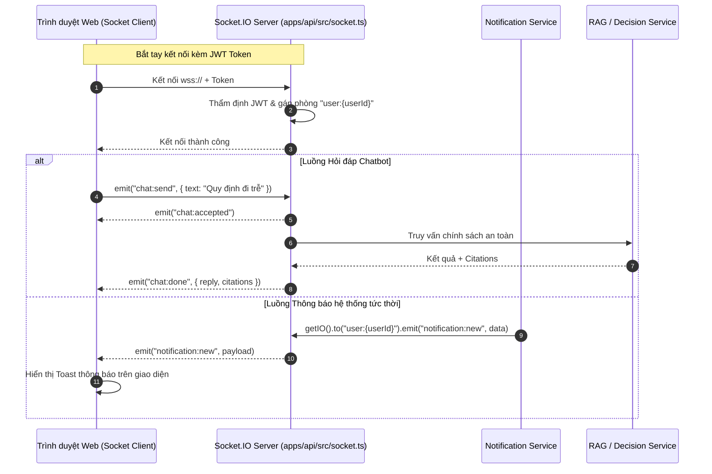

# CHƯƠNG 5: CÀI ĐẶT VÀ THỰC THI HỆ THỐNG

## Hướng dẫn dành cho sinh viên thực hiện báo cáo
1. Chương 5 là căn cứ thực chứng chứng minh ứng dụng web đã được xây dựng hoàn chỉnh, có thể biên dịch, chạy kiểm thử và phục vụ nghiệp vụ thực tế.
2. Sinh viên không sao chép nguyên văn mã nguồn dài vào Word. Hãy dùng các bảng thông số kỹ thuật, trích đoạn mã tiêu biểu (dưới 15 dòng) kèm chỉ dẫn file nguồn và các sơ đồ tuần tự/luồng dữ liệu bằng Mermaid đã được thiết kế sẵn để vẽ lại hoặc export ảnh đưa vào báo cáo.
3. Toàn bộ các vị trí có đánh dấu `[CHÈN ẢNH: ...]` tương ứng với các hình minh họa `**Hình 5.x: ...**`. Sinh viên mở file `05b-checklist-chup-anh-man-hinh.md`, khởi động môi trường local theo hướng dẫn và chụp đúng màn hình với vai trò được yêu cầu để dán vào Word.
4. Mọi thông tin về độ chính xác, tỷ lệ phần trăm hoặc tính năng thử nghiệm phải đối chiếu đúng phần "Ghi chú kiểm chứng" ở cuối chương, không tự bịa số liệu thực nghiệm.

---

## 5.1. Môi trường phát triển & Cấu trúc Monorepo

### 5.1.1. Môi trường kiểm thử & công cụ nền tảng
Hệ thống HR-BlockBot (Guta Workspace) được xây dựng theo mô hình Monorepo hiện đại, sử dụng công cụ quản lý gói pnpm workspace kết hợp TypeScript đồng nhất giữa Frontend, Backend và Shared Contracts. Dịch vụ AI Service chạy tách biệt trên nền tảng Python FastAPI.

**Bảng 5.1: Danh mục công cụ, phiên bản và môi trường đã kiểm chứng**
*Nguồn: docs/baseline-development.md:11-17, package.json:1-17*

| Thành phần | Công nghệ / Nền tảng | Phiên bản đã kiểm chứng | Ghi chú vận hành / Kiểm chứng |
| :--- | :--- | :--- | :--- |
| Hệ điều hành | Windows 10 / 11 x64 | win32 10.0.19045 | Môi trường chuẩn chạy baseline B01 |
| Nền tảng Node.js | Node.js | v24.15.0 | Khuyến nghị LTS Node 20+ trở lên |
| Package Manager | pnpm (Workspace pin) | v11.25.0 | Ghim trong root `packageManager: pnpm@11.25.0` |
| Ngôn ngữ Python | CPython | 3.13.5 (hỗ trợ 3.10+) | Dùng cho `apps/ai-service` qua virtualenv |
| Frontend Web | React 18 + Vite + Tailwind | React 18.3.1, Vite 5.4.1 | SPA độc lập, cấm đổi sang Next.js |
| Backend API | Express.js + TypeScript | Express 4.19.2, TS 5.5.4 | REST API + Socket.IO, cấm đổi sang NestJS |
| AI Service | FastAPI + Uvicorn | FastAPI 0.122.0, Uvicorn 0.38.0 | RAG Gateway, Policy Agent |
| Cơ sở dữ liệu | MongoDB Memory Server / Atlas | mongoose 8.5.2, mongodb-memory-server 11.3.0 | Kiểm thử regression cô lập trên loopback |
| Kiểm thử Browser | Playwright Chromium | Playwright 1.63.0 | Headless E2E test suite |

### 5.1.2. Cây thư mục Monorepo thực tế
*Nguồn: package.json, pnpm-workspace.yaml, apps/api/src, apps/web/src, apps/ai-service/app*

```text
hr-blockbot-f4/
├── package.json                         # Root package ghim pnpm@11.25.0 & lệnh điều phối
├── pnpm-workspace.yaml                  # Định nghĩa packages: apps/*, packages/*
├── docs/                                # Hồ sơ kỹ thuật, ADR, đặc tả kiến trúc & baseline
│   ├── baseline-development.md          # Quy chuẩn thiết lập môi trường và kiểm thử
│   └── word-handoff/                    # Tài liệu bàn giao phục vụ viết khóa luận
├── packages/
│   └── contracts/                       # @hr-blockbot/contracts: Zod schemas & Single Source of Truth
│       ├── package.json
│       └── src/                         # Schemas dùng chung cho Auth, KPI, Chat, Workflows
└── apps/
    ├── api/                             # Backend API Express.js (Port 3000 / 3001)
    │   ├── package.json
    │   ├── src/
    │   │   ├── index.ts & app.ts        # Điểm khởi động HTTP & thiết lập middleware
    │   │   ├── socket.ts                # Khởi tạo WebSocket Socket.IO server
    │   │   ├── routes/                  # REST API routes (auth, projects, kpi, chat...)
    │   │   ├── services/                # Nghiệp vụ core, authorization policy, audit
    │   │   ├── models/                  # Mongoose models (User, Employee, Project, Store...)
    │   │   └── middlewares/             # Xác thực JWT Bearer & giải quyết Principal
    │   └── test/                        # Bộ kiểm thử tích hợp dùng mongodb-memory-server
    ├── web/                             # Frontend React 18 SPA (Port 5173)
    │   ├── package.json
    │   ├── vite.config.ts
    │   └── src/
    │       ├── App.tsx                  # Điều hướng chính giữa Landing, CRM và Chat
    │       ├── context/                 # AuthContext, useAuthorization hook
    │       ├── services/                # apiFetch, auth client, socket client
    │       └── components/              # Các Views & Panels (FolioLandingView, CrmDashboardView...)
    └── ai-service/                      # Microservice AI FastAPI (Port 8000)
        ├── requirements.txt             # Ghim phiên bản cấp cao (fastapi, uvicorn, pydantic...)
        ├── start.py                     # Entry point khởi chạy Uvicorn
        └── app/
            ├── authorization_gateway.py # Gateway xử lý RAG chính sách và kiểm tra quyền
            ├── policy_rag.py            # RAG chính sách sử dụng gemini-embedding-001 (3072 chiều)
            ├── config.py                # Cấu hình model và biến môi trường AI
            ├── f4_gateway.py            # Gateway dịch vụ gợi ý ứng viên F4
            └── f4_encoder.py            # Worker PhoBERT trích xuất đặc trưng ngữ nghĩa (opt-in)
```

**Bảng 5.2: Phân công trách nhiệm các gói trong Monorepo**
*Nguồn: package.json:8-16, packages/contracts/package.json:1-12*

| Gói / Ứng dụng | Đường dẫn | Trách nhiệm chính | Phụ thuộc chính |
| :--- | :--- | :--- | :--- |
| `@hr-blockbot/contracts` | `packages/contracts` | Định nghĩa Zod schemas, types, validation envelopes chuẩn | `zod` |
| `api` | `apps/api` | Xử lý logic nghiệp vụ, quản trị quyền V1, kết nối DB, REST + Socket.IO | `contracts`, `express`, `mongoose`, `argon2`, `jose` |
| `web` | `apps/web` | Giao diện người dùng SPA, chuyển đổi Landing Page sang CRM Dashboard | `contracts`, `react`, `vite`, `socket.io-client` |
| `ai-service` | `apps/ai-service` | Trợ lý hỏi đáp chính sách RAG, Worker PhoBERT F4 (opt-in) | `fastapi`, `uvicorn`, `pydantic`, `pymongo` |

### 5.1.3. Lệnh cài đặt, build và khởi động
*Nguồn: docs/baseline-development.md:22-29, package.json:7-16*

Để đảm bảo tính toàn vẹn và không phụ thuộc vào credential bí mật từ môi trường ngoài, quy trình cài đặt và biên dịch được chuẩn hóa theo các bước sau:

```powershell
# Bước 1: Cài đặt toàn bộ thư viện theo file khóa (frozen-lockfile)
pnpm install --frozen-lockfile

# Bước 2: Build gói hợp đồng dữ liệu dùng chung (Contracts)
pnpm --filter @hr-blockbot/contracts build

# Bước 3: Kiểm tra kiểu dữ liệu toàn bộ dự án
pnpm -r typecheck

# Bước 4: Biên dịch mã nguồn Backend và Frontend
pnpm -r run build

# Bước 5: Khởi tạo môi trường ảo Python và cài đặt thư viện AI Service
python -m venv apps/ai-service/.venv-authz-v1
apps/ai-service/.venv-authz-v1/Scripts/python.exe -m pip install -r apps/ai-service/requirements.txt
```

Lệnh khởi chạy môi trường phát triển (Development):
- Chạy Backend API: `pnpm --filter api dev` (chạy qua `tsx watch src/index.ts`, lắng nghe cổng 3001).
- Chạy Frontend Web: `pnpm --filter web dev` (chạy qua `vite`, lắng nghe cổng 5173).
- Chạy AI Service: `cd apps/ai-service && python start.py` (chạy qua `uvicorn`, lắng nghe cổng 8000).


**Hình 5.1: Sơ đồ tương tác giữa các thành phần Monorepo trong quá trình thực thi**

---

## 5.2. Cài đặt các chức năng cơ bản của hệ thống

### 5.2.1. Đăng nhập hệ thống (Authentication - Login)
Hệ thống sử dụng cơ chế đăng nhập bằng tài khoản (`username` - mã nhân viên chuẩn hóa chữ thường, ví dụ `gt-ch18030009`), mật khẩu được băm bằng thuật toán Argon2id với salt an toàn. Nhằm ngăn chặn tấn công vét cạn (brute-force) và tấn công suy đoán định danh người dùng qua thời gian phản hồi (timing attack), hệ thống tích hợp bộ đếm giới hạn truy cập trong bộ nhớ (`login-attempt-limiter.ts`) và cơ chế tiêu thụ tài nguyên giả định (`dummyHash`).

- **Thành phần giao diện:** `apps/web/src/components/AccountLoginModal.tsx` và `FolioLandingView.tsx`.
- **File xử lý Backend:** `apps/api/src/routes/auth.ts`, `apps/api/src/services/auth.service.ts`.
- **Trích đoạn mã nguồn xử lý đăng nhập chống Timing Attack:**

```typescript
// Trích từ apps/api/src/routes/auth.ts:79-91
const user = await UserModel.findOne({ username: normalizedUsername });
if (!user) {
  // P1-4: burn comparable CPU on a dummy hash so "unknown username" and "wrong
  // password" take the same time. Response body stays identical either way.
  await verifyPassword(await dummyHash(), password).catch(() => false);
  res.status(401).json({
    error: {
      code: "UNAUTHENTICATED",
      message: "Invalid username or password",
    },
  });
  return;
}
```

[CHÈN ẢNH: Modal đăng nhập tài khoản — UI: AccountLoginModal hiển thị trên nền Folio Landing View — Form nhập Mã nhân viên (username) và Mật khẩu — Vai trò: Người dùng chưa đăng nhập]
**Hình 5.2: Giao diện đăng nhập hệ thống Guta Workspace**

### 5.2.2. Đăng xuất an toàn & Thu hồi phiên (Logout & Session Revocation)
Đăng xuất trong Guta Workspace không đơn thuần là xoá token ở client mà là một quy trình bảo mật hai đầu: API thu hồi bản ghi phiên trong cơ sở dữ liệu (`RefreshSessionModel.updateOne({ revokedAt: new Date() })`), vô hiệu hoá toàn bộ chuỗi token thuộc phiên đó và gửi chỉ thị xoá HTTP-only Cookie `refreshToken`.

- **Thành phần giao diện:** Nút đăng xuất tại Sidebar Userbar (`apps/web/src/components/CrmDashboardView.tsx:107-109`).
- **File xử lý Backend:** `apps/api/src/routes/auth.ts:194-205`, `apps/api/src/services/auth.service.ts`.
- **Trích đoạn mã nguồn thu hồi phiên đăng xuất:**

```typescript
// Trích từ apps/api/src/routes/auth.ts:194-205
router.post("/auth/logout", async (req: Request, res: Response) => {
  const rawRefreshToken = req.cookies?.refreshToken;
  try {
    await logoutSession(rawRefreshToken);
  } catch (err) {
    console.error("[Auth] Logout error:", err instanceof Error ? err.message : "internal error");
  } finally {
    res.clearCookie("refreshToken", getClearCookieOptions());
    res.status(204).send();
  }
});
```

[CHÈN ẢNH: Nút đăng xuất tại thanh điều hướng người dùng và Toast thông báo đăng xuất — UI: Userbar góc trái dưới màn hình CRM — Toast thông báo "Đã đăng xuất phiên làm việc an toàn" — Vai trò: Mọi tài khoản có phiên]
**Hình 5.3: Giao diện và cơ chế đăng xuất an toàn thu hồi phiên làm việc**

### 5.2.3. Đổi mật khẩu lần đầu & Khôi phục mật khẩu (Change / Reset Password)
Mật khẩu ban đầu do quản trị viên cấp phát là mật khẩu tạm. Khi cờ `mustChangePassword === true`, hệ thống kích hoạt màn hình chặn bắt buộc đổi mật khẩu trước khi người dùng có thể truy cập bất kỳ tài nguyên nghiệp vụ nào. Ngoài ra, tính năng khôi phục mật khẩu sử dụng cơ chế token một lần (`password-recovery.service.ts`) được kích hoạt qua liên kết bảo mật. Khi đổi mật khẩu thành công, trường `securityVersion` tăng lên 1 và toàn bộ các phiên Refresh Token cũ lập tức bị thu hồi đồng loạt.

- **Thành phần giao diện:** `apps/web/src/components/ChangePasswordModal.tsx` và `ActivationView.tsx`.
- **File xử lý Backend:** `apps/api/src/routes/auth.ts:259-274`, `apps/api/src/services/password-recovery.service.ts`.
- **Trích đoạn mã nguồn cập nhật mật khẩu và thu hồi phiên cũ:**

```typescript
// Trích từ apps/api/src/routes/auth.ts:259-274
const changed = await UserModel.updateOne(
  { _id: user._id, passwordHash: user.passwordHash, status: { $ne: "disabled" },
    ...securityVersionFilter(securityVersion(user)) },
  { $set: { passwordHash: await hashPassword(newPassword), mustChangePassword: false, passwordChangedAt: new Date() },
    $inc: { securityVersion: 1 } }
);
if (!changed.modifiedCount) {
  res.status(409).json({ error: { code: "ACCOUNT_VERSION_CONFLICT", message: "Account changed; sign in again" } });
  return;
}
await RefreshSessionModel.updateMany({ userId: user._id, revokedAt: null }, { $set: { revokedAt: new Date() } });
res.clearCookie("refreshToken", getClearCookieOptions());
```

[CHÈN ẢNH: Modal bắt buộc đổi mật khẩu tạm lần đầu — UI: ChangePasswordModal — Form nhập mật khẩu hiện tại, mật khẩu mới tối thiểu 8 ký tự và xác nhận — Vai trò: Tài khoản mới đăng nhập lần đầu]
**Hình 5.4: Giao diện đổi mật khẩu tạm bắt buộc ở lần đăng nhập đầu tiên**

[CHÈN ẢNH: Màn hình kích hoạt tài khoản / khôi phục mật khẩu một lần — Route: /#recover=<token> — Form thiết lập mật khẩu an toàn 12 ký tự — Vai trò: Nhân viên truy cập qua liên kết phục hồi]
**Hình 5.5: Giao diện thiết lập lại mật khẩu qua liên kết bảo mật một lần**

### 5.2.4. Phân quyền người dùng & Kiểm tra năng lực (Authorization V1)
Hệ thống loại bỏ hoàn toàn cơ chế phân quyền dựa trên chuỗi vai trò đơn giản (Role String) hay suy đoán từ chức danh công việc (Job Title). Quyền hạn được kiểm soát theo mô hình Authorization V1 với 9 profile nghiệp vụ chính thức (`system_admin`, `hr`, `om`, `aom`, `sam`, `am`, `sm`, `ptch`, `staff`). Mọi thao tác đều được kiểm tra thông qua hàm `requireCapability` kết hợp chặt chẽ giữa Năng lực (Capability), Phạm vi cửa hàng xác minh (`verifiedStores`) và Quan hệ quản lý trực tiếp (`managedByStore`).

- **Thành phần giao diện:** `apps/web/src/components/UserAccountsView.tsx` và `DelegationView.tsx`.
- **File xử lý Backend:** `apps/api/src/services/authorization-scope.service.ts:95-107`, `authorization-policy.service.ts`.
- **Trích đoạn mã nguồn hàm kiểm tra năng lực cốt lõi `requireCapability`:**

```typescript
// Trích từ apps/api/src/services/authorization-scope.service.ts:95-107
export function requireCapability(user: AuthenticatedUser, capability: AuthorizationCapability, resource?: AuthorizationResource): void {
  if (!hasCapability(user, capability)) throw new AuthorizationDeniedError();
  if (resource) {
    const decision = evaluateAuthorization(asPrincipal(user), capability, resource);
    if (!decision.allowed) {
      const delegated = (user.effectiveDelegations ?? []).some((item) => item.grant.capabilities.includes(capability) && activeWindow(item.grant, new Date()) &&
        scopeAllows(item.grant.scope, asPrincipal(user), resource) && (!resource.employeeId || !!resource.storeId && item.managedByStore[resource.storeId]?.includes(resource.employeeId)) &&
        (!resource.requiresIndependentApproval || resource.subjectEmployeeId !== user.employeeId && resource.employeeId !== user.employeeId && resource.requesterUserId !== user.userId && !resource.conflictUserIds?.includes(user.userId)));
      if (!delegated) throw new AuthorizationDeniedError(decision.reason);
    }
    if (user.authorization?.profile === "staff" && resource.storeId && resource.storeId !== user.canonical?.ownStoreId) throw new AuthorizationDeniedError();
  }
}
```

[CHÈN ẢNH: Màn hình danh sách tài khoản và phân quyền Authorization V1 — UI: UserAccountsView trong CRM — Bảng danh sách tài khoản, cột Profile V1, trạng thái Active, nút cấp quyền — Vai trò: Quản trị viên hệ thống (system_admin)]
**Hình 5.6: Giao diện quản lý tài khoản và phân quyền người dùng Authorization V1**

---

## 5.3. Cài đặt chi tiết các Use Case nghiệp vụ (UC01 – UC14)

**Bảng 5.3: Bảng tổng hợp ánh xạ kỹ thuật 14 Use Case trong hệ thống**
*Nguồn: apps/api/src/routes/, apps/web/src/components/, apps/api/src/services/*

| Mã UC | Tên Use Case | Component Giao diện (.tsx) | API Route chính | Service xử lý Backend | Model dữ liệu chính | Trạng thái mã nguồn |
| :--- | :--- | :--- | :--- | :--- | :--- | :--- |
| UC01 | Đăng nhập, đăng xuất, đổi/khôi phục mật khẩu | `AccountLoginModal.tsx`, `ChangePasswordModal.tsx`, `ActivationView.tsx` | `POST /api/auth/login`, `logout`, `change-password` | `auth.service.ts`, `password-recovery.service.ts` | `User`, `RefreshSession` | Hoàn chỉnh 100% |
| UC02 | Hồ sơ nhân sự & cấp bậc (F1) | `EmployeeListView.tsx`, `EmployeeProfileView.tsx` | `GET /api/employees`, `GET/PUT /api/profile` | `employee-profile.service.ts`, `employee-read-model.service.ts` | `Employee`, `Department` | Hoàn chỉnh 100% |
| UC03 | Tài khoản, phân quyền & ủy quyền (Authorization V1) | `UserAccountsView.tsx`, `DelegationView.tsx` | `GET/POST /api/admin/users`, `/api/delegations` | `authorization-scope.service.ts`, `delegation.service.ts` | `User`, `AuthorizationMapping`, `AuthorizationDelegation` | Hoàn chỉnh 100% |
| UC04 | Đề tài / công việc theo vòng đời (F2) | `ProjectListView.tsx`, `TaskDetailView.tsx` | `GET/POST /api/projects`, `PATCH /projects/:id/status` | `project-workflow.service.ts`, `project-audit.service.ts` | `Project`, `TaskInstance` | Hoàn chỉnh 100% |
| UC05 | Gợi ý ứng viên & phân công (F4) | `AssignmentPanel.tsx`, `CandidateSuggestions.tsx` | `POST /api/assignment/suggestions`, `/assign` | `f4-orchestrator.service.ts`, `assignment.service.ts` | `Employee`, `Project` | Hoàn chỉnh (Baseline + PhoBERT opt-in) |
| UC06 | Tiếp nhận, từ chối & bàn giao công việc (ADR-021) | `AssignmentPanel.tsx`, `WorkflowHistoryNavigation.tsx` | `POST /projects/:id/assignment/respond`, `/handover` | `assignment.service.ts`, `decision-anchor.service.ts` | `Project`, `DecisionAnchor` | Hoàn chỉnh 100% |
| UC07 | Nộp báo cáo & nghiệm thu (F7) | `ProjectListView.tsx`, `InitialReportingView.tsx` | `GET/POST /api/reports`, `POST /reports/:id/review` | `project-workflow.service.ts`, `project-audit.service.ts` | `Report`, `Project` | Hoàn chỉnh 100% |
| UC08 | Chatbot hỏi đáp chính sách RAG (F3) | `ChatPageView.tsx`, `ChatPanel.tsx` | `POST /api/chat`, `GET/DEL /api/chat/conversations` | `chat-authorization.service.ts`, `chat-history.service.ts` | `ChatConversation` | Hoàn chỉnh 100% |
| UC09 | Chatbot tra cứu KPI & xác nhận ghi (Preview-Confirm) | `ChatPageView.tsx`, `RevenueKpiOpenCard.tsx` | `POST /api/chat`, `POST /chat/actions/:id/decision` | `revenue-kpi.service.ts`, `revenue-kpi-ai.service.ts` | `RevenueKpiResult`, `ChatConversation` | Hoàn chỉnh 100% |
| UC10 | Đánh giá KPI hiệu suất & phân tích nhận xét (F5) | `PerformanceKpiView.tsx`, `KpiView.tsx` | `GET/POST /api/performance-kpi/evaluations/:id` | `performance-kpi-evaluation.service.ts`, `performance-kpi-ai.service.ts` | `PerformanceKpiFramework`, `Evaluation` | Hoàn chỉnh 100% |
| UC11 | KPI doanh thu cửa hàng & chuỗi Guta | `RevenueKpiView.tsx`, `StoreRevenue.tsx` | `GET/POST /api/revenue-kpi/periods`, `/assignments` | `revenue-kpi.service.ts`, `revenue-kpi-calc.service.ts` | `RevenueKpiPeriod`, `RevenueKpiResult` | Hoàn chỉnh 100% |
| UC12 | Xếp lịch ca & đăng ký ca | `SchedulingView.tsx`, `ScheduleRegistrationPanel.tsx` | `GET/POST /api/scheduling/weeks`, `/registrations` | `scheduling.service.ts`, `scheduler.service.ts` | `OperationalSchedule`, `ScheduleEntry` | Hoàn chỉnh 100% |
| UC13 | Dashboard CRM chuỗi GUTA (F6) | `CrmDashboardView.tsx`, `StoreDirectoryView.tsx` | `GET /api/dashboard/overview`, `GET /api/stores` | `crm-writer.service.ts`, `pos-reporting.service.ts` | `Store`, `PosOrder`, `Cash` | Hoàn chỉnh 100% |
| UC14 | Lịch hẹn SM & thông báo/nhắc hạn | `SmAppointments.tsx`, `Toast.tsx` | `GET/POST /api/sm-appointments`, `/notifications` | `sm-appointment.service.ts`, `notification.service.ts` | `SmAppointment`, `Notification` | Hoàn chỉnh 100% |

---

### Chi tiết cài đặt từng Use Case

#### UC01: Đăng nhập, đăng xuất, đổi/khôi phục mật khẩu
- **Giao diện:** `AccountLoginModal.tsx` mở từ trang chủ `FolioLandingView.tsx`; `ChangePasswordModal.tsx` bật tự động khi người dùng có cờ `mustChangePassword`; `ActivationView.tsx` xử lý đường dẫn kích hoạt/khôi phục mật khẩu hash fragment `/#recover=<token>`.
- **API & Xử lý:** Tuyến `POST /api/auth/login`, `POST /api/auth/logout`, `POST /api/auth/change-password`. Quá trình đăng nhập trả về Access Token trong payload JSON và tự động thiết lập Cookie `refreshToken` (HttpOnly, SameSite, Secure khi production).
- **Điểm kỹ thuật:** Khóa tấn công vét cạn bằng `registerLoginAttempt`, ngăn chặn timing attack bằng `dummyHash()`. Thu hồi phiên đồng loạt qua `securityVersion`.
- [CHÈN ẢNH: Quy trình đăng nhập và đổi mật khẩu thành công — UI: AccountLoginModal và thông báo phiên làm việc CRM — Dữ liệu tài khoản GT-CH18030009 — Vai trò: Barista / SM]
**Hình 5.7: Thực thi quy trình xác thực và quản lý phiên người dùng (UC01)**

#### UC02: Hồ sơ nhân sự & cấp bậc (F1)
- **Giao diện:** `EmployeeListView.tsx` (danh sách nhân sự phân trang, lọc theo chi nhánh/phòng ban) và `EmployeeProfileView.tsx` (hồ sơ chi tiết, kỹ năng, cấp bậc Intern đến Lead).
- **API & Xử lý:** Tuyến `GET /api/employees`, `GET /api/employees/:id`, `GET /api/profile`, `PUT /api/profile`.
- **Điểm kỹ thuật:** Dữ liệu hồ sơ chỉ cho phép xem thông tin vận hành (`employees.read_operational`); các thông tin nhạy cảm (CCCD, tài khoản ngân hàng) bị chặn cứng (`employees.read_sensitive` có trạng thái `DENIED` theo chính sách an toàn thông tin).
- [CHÈN ẢNH: Danh sách nhân viên và chi tiết hồ sơ cá nhân — UI: EmployeeListView và EmployeeProfileView — Danh sách nhân viên chi nhánh, hiển thị cấp bậc, kỹ năng — Vai trò: Quản lý cửa hàng (SM) / HR]
**Hình 5.8: Màn hình quản lý hồ sơ nhân sự và phân bổ cấp bậc F1 (UC02)**

#### UC03: Tài khoản, phân quyền & ủy quyền (Authorization V1)
- **Giao diện:** `UserAccountsView.tsx` (quản trị danh mục tài khoản) và `DelegationView.tsx` (giao diện ủy quyền nghiệp vụ tạm thời giữa SM và PTCH).
- **API & Xử lý:** Tuyến `GET /api/admin/users`, `POST /api/admin/users`, `GET /api/delegations`, `POST /api/delegations/request`, `POST /api/delegations/:id/review`.
- **Điểm kỹ thuật:** Tuân thủ ADR-020 về phân quyền độc lập. Quản lý ủy quyền kiểm tra nghiêm ngặt profile: SM chỉ được ủy quyền cho PTCH sau khi có sự chấp thuận độc lập từ Quản lý khu vực (AM/OM).
- [CHÈN ẢNH: Bảng phân quyền tài khoản và danh sách ủy quyền đang hoạt động — UI: UserAccountsView & DelegationView — Bảng profile V1, thời hạn ủy quyền và người duyệt độc lập — Vai trò: Quản trị viên / Cửa hàng trưởng]
**Hình 5.9: Giao diện quản trị tài khoản và cơ chế ủy quyền nghiệp vụ (UC03)**

#### UC04: Đề tài / công việc theo vòng đời (F2)
- **Giao diện:** `ProjectListView.tsx` và `TaskDetailView.tsx`.
- **API & Xử lý:** Tuyến `GET /api/projects`, `POST /api/projects`, `GET /api/projects/:id`, `PATCH /api/projects/:id/status`.
- **Điểm kỹ thuật:** Vòng đời công việc được quản lý bằng máy trạng thái hữu hạn (State Machine) với các trạng thái: `DRAFT` -> `ASSIGNED` -> `IN_PROGRESS` -> `PENDING_REVIEW` -> `COMPLETED` (hoặc `CANCELLED`). Mọi bước chuyển trạng thái đều lưu vết vào `statusHistory` và hash-chain kiểm toán.
- [CHÈN ẢNH: Danh sách đề tài công việc và chi tiết tiến độ — UI: ProjectListView — Bảng công việc kèm nhãn trạng thái tiến độ, thanh phần trăm hoàn thành — Vai trò: Quản lý hoặc Nhân viên thực hiện]
**Hình 5.10: Quản lý tiến độ công việc theo vòng đời trạng thái F2 (UC04)**

#### UC05: Gợi ý ứng viên & phân công (F4)
- **Giao diện:** `AssignmentPanel.tsx` tích hợp component con `CandidateSuggestions.tsx`.
- **API & Xử lý:** Tuyến `GET /api/projects/:id/assignment/candidates`, `POST /api/assignment/suggestions`, `POST /api/assignment/assign`.
- **Điểm kỹ thuật:** Bộ điều phối `f4-orchestrator.service.ts` thực hiện lọc nhân sự theo cửa hàng và thẩm quyền quản lý. Thuật toán hỗ trợ 2 chế độ: Mặc định là Baseline so khớp kỹ năng chính xác (`BASELINE_EXACT`); khi có cấu hình `F4_MODE=PHOBERT`, hệ thống gọi worker PhoBERT trích xuất vector ngữ nghĩa để tính điểm kết hợp: $Score = \alpha \cdot Score_{PhoBERT} + (1 - \alpha) \cdot Score_{Exact}$.
- [CHÈN ẢNH: Panel phân công công việc kèm danh sách gợi ý ứng viên — UI: AssignmentPanel & CandidateSuggestions — Danh sách ứng viên xếp hạng theo độ phù hợp, kỹ năng khớp và số việc đang gánh — Vai trò: Quản lý giao việc]
**Hình 5.11: Giao diện gợi ý ứng viên thông minh và phân công nhiệm vụ F4 (UC05)**

#### UC06: Tiếp nhận, từ chối & bàn giao công việc (ADR-021)
- **Giao diện:** `AssignmentPanel.tsx` (các nút Thao tác: Tiếp nhận, Từ chối kèm lý do, Yêu cầu bàn giao) và `WorkflowHistoryNavigation.tsx`.
- **API & Xử lý:** Tuyến `POST /api/projects/:id/assignment/respond`, `POST /api/projects/:id/assignment/requests/:requestId/review`, `POST /api/projects/:id/assignment/requests/:requestId/handover`.
- **Điểm kỹ thuật:** Triển khai quyết định kiến trúc ADR-021: Nhân sự được phân công có quyền chủ động chấp thuận hoặc từ chối công việc có lý do. Bàn giao công việc yêu cầu xác nhận 3 bên (Người giao, Người bàn giao, Người nhận mới) và được đóng dấu kiểm toán cục bộ `DecisionAnchor`.
- [CHÈN ẢNH: Thao tác tiếp nhận/từ chối và form bàn giao công việc — UI: AssignmentPanel — Hộp thoại nhập lý do từ chối hoặc chọn nhân sự thay thế để bàn giao — Vai trò: Nhân viên được giao việc]
**Hình 5.12: Quy trình tiếp nhận, từ chối và bàn giao công việc ADR-021 (UC06)**

#### UC07: Nộp báo cáo & nghiệm thu (F7)
- **Giao diện:** `ProjectListView.tsx` (khu vực Báo cáo nghiệm thu), `InitialReportingView.tsx` và `TaskDetailView.tsx`.
- **API & Xử lý:** Tuyến `POST /api/reports` (nộp báo cáo kèm tài liệu đính kèm), `POST /api/reports/:id/review` (nghiệm thu chấp thuận hoặc trả về yêu cầu sửa đổi).
- **Điểm kỹ thuật:** Chống tự duyệt (Anti Self-Approval): Nhân sự trực tiếp thực hiện công việc tuyệt đối không thể tự duyệt báo cáo do mình nộp. Sau khi báo cáo được duyệt (`APPROVE`), trạng thái công việc chuyển sang `COMPLETED`, tiến độ đạt 100%.
- [CHÈN ẢNH: Form nộp báo cáo kết quả và giao diện duyệt nghiệm thu của quản lý — UI: Form nộp báo cáo trong TaskDetailView — Đính kèm liên kết tài liệu, nút Duyệt nghiệm thu / Yêu cầu bổ sung — Vai trò: Nhân viên & Quản lý]
**Hình 5.13: Giao diện nộp báo cáo tiến độ và duyệt nghiệm thu F7 (UC07)**

#### UC08: Chatbot hỏi đáp chính sách RAG (F3)
- **Giao diện:** `ChatPageView.tsx` (giao diện hội thoại toàn màn hình) và `ChatPanel.tsx` (drawer tích hợp trong CRM).
- **API & Xử lý:** Tuyến `POST /api/chat`, `GET /api/chat/conversations`, `GET /api/chat/conversations/:id/messages`, `DELETE /api/chat/conversations/:id`.
- **Điểm kỹ thuật:** RAG hai bước: Backend Node.js xác thực quyền hạn người dùng trước khi chuyển tiếp ngữ cảnh an toàn sang AI Service FastAPI. Dịch vụ AI truy vấn kho tri thức Atlas Vector Search (vector 3072 chiều sinh bởi `gemini-embedding-001`), tổng hợp câu trả lời và trích xuất đúng căn cứ pháp quy (`citations`: văn bản, điều khoản, độ tương đồng).
- [CHÈN ẢNH: Màn hình hội thoại với Trợ lý chính sách Guta AI — UI: ChatPageView — Tin nhắn trả lời có trích dẫn văn bản quy định (Citations) và tài liệu đính kèm — Vai trò: Barista / Cửa hàng trưởng]
**Hình 5.14: Giao diện Chatbot tra cứu chính sách nhân sự tích hợp RAG F3 (UC08)**

#### UC09: Chatbot tra cứu KPI & xác nhận ghi (Preview-Confirm)
- **Giao diện:** `ChatPageView.tsx` nhúng thẻ tương tác `RevenueKpiOpenCard.tsx`.
- **API & Xử lý:** Tuyến `POST /api/chat` trả về hành động đề xuất `proposedAction`, sau đó xác nhận qua `POST /api/chat/actions/:id/decision` hoặc qua sự kiện WebSocket `chat:confirm`.
- **Điểm kỹ thuật:** Cơ chế an toàn "Xem trước - Xác nhận" (Preview-Confirm trước khi ghi): AI không bao giờ được tự ý ghi đè cơ sở dữ liệu. Thẻ `RevenueKpiOpenCard` hiển thị chi tiết các mục tiêu KPI dự kiến mở; chỉ khi người dùng có thẩm quyền bấm nút "Xác nhận thực hiện", hệ thống mới gọi service `decideRevenueKpiOpenAction` để ghi nhận vào DB.
- [CHÈN ẢNH: Thẻ xem trước kế hoạch KPI doanh thu bên trong khung chat — UI: RevenueKpiOpenCard trong ChatPageView — Thẻ tóm tắt chỉ tiêu doanh thu, nút Xác nhận mở kỳ / Hủy bỏ — Vai trò: Quản lý khu vực (AM) / Cửa hàng trưởng (SM)]
**Hình 5.15: Quy trình Chatbot đề xuất và xác nhận ghi nhận KPI (Preview-Confirm) (UC09)**

#### UC10: Đánh giá KPI hiệu suất & phân tích nhận xét (F5)
- **Giao diện:** `PerformanceKpiView.tsx` (bảng tổng hợp kỳ đánh giá, tự đánh giá, quản lý chấm điểm, khiếu nại).
- **API & Xử lý:** Tuyến `GET /api/performance-kpi/evaluations/:id`, `POST /api/performance-kpi/evaluations/:id/self-review`, `manager-score`, `finalize`, `appeal`, `ai-summary`.
- **Điểm kỹ thuật:** Phân tách rõ ràng giữa điểm tạm tính (`DRAFT`) và điểm chính thức (`FINAL`). Tích hợp tính năng AI tóm tắt đánh giá (`summarizePerformanceEvaluation`) giúp trích xuất điểm mạnh, điểm cần cải thiện từ nhận xét định tính mà không làm sai lệch điểm số định lượng.
- [CHÈN ẢNH: Bảng đánh giá KPI hiệu suất nhân viên và phân tích định tính — UI: PerformanceKpiView — Chi tiết tiêu chí đánh giá, điểm số tự đánh giá, điểm quản lý chấm và tóm tắt AI — Vai trò: Quản lý đánh giá hoặc Nhân viên]
**Hình 5.16: Giao diện đánh giá hiệu suất nhân viên và phân tích nhận xét F5 (UC10)**

#### UC11: KPI doanh thu cửa hàng & chuỗi Guta
- **Giao diện:** `RevenueKpiView.tsx`, `StoreRevenue.tsx` và `SalesReportView.tsx`.
- **API & Xử lý:** Tuyến `GET /api/revenue-kpi/periods`, `POST /api/revenue-kpi/periods`, `GET /api/revenue-kpi/dashboard`, `POST /api/revenue-kpi/assignments/:id/ai-proposal`.
- **Điểm kỹ thuật:** Dữ liệu doanh thu thực tế được đối soát trực tiếp từ các đơn hàng POS (`PosOrder`). Tính năng AI đề xuất chỉ tiêu (`proposeRevenueTarget`) tính toán dựa trên mức doanh thu trung bình lịch sử của từng cửa hàng trong chuỗi 45 chi nhánh.
- [CHÈN ẢNH: Bảng theo dõi KPI doanh thu theo chi nhánh và chuỗi — UI: RevenueKpiView & StoreRevenue — Bảng chỉ tiêu doanh thu, doanh số thực tế đạt được và tỷ lệ hoàn thành — Vai trò: Cửa hàng trưởng / Quản lý khu vực / Kế toán]
**Hình 5.17: Quản lý chỉ tiêu và theo dõi KPI doanh thu chuỗi cửa hàng (UC11)**

#### UC12: Xếp lịch ca & đăng ký ca
- **Giao diện:** `SchedulingView.tsx` (lịch tuần trực quan, phân ca Barista/Trưởng ca) và `ScheduleRegistrationPanel.tsx` (nhân viên đăng ký nguyện vọng làm việc).
- **API & Xử lý:** Tuyến `GET /api/scheduling/stores/:storeId/week`, `POST /api/scheduling/weeks/:weekId/draft`, `POST /api/scheduling/weeks/:weekId/publish`, `POST /api/scheduling/registrations`.
- **Điểm kỹ thuật:** Lịch ca có 2 trạng thái: Bản nháp (`DRAFT`) và Chính thức (`PUBLISHED`). Khi quản lý phát hành lịch (`publishWeek`), hệ thống tự động kích hoạt tiến trình kiểm tra trùng ca và gửi thông báo nhắc lịch làm việc đến từng nhân viên.
- [CHÈN ẢNH: Bảng lịch phân ca tuần và form đăng ký ca trực của nhân viên — UI: SchedulingView — Ma trận lịch ca sáng/trưa/chiều cho các Barista tại chi nhánh — Vai trò: Cửa hàng trưởng (SM) & Nhân viên (Staff)]
**Hình 5.18: Giao diện xếp lịch ca làm việc và đăng ký ca trực tuần (UC12)**

#### UC13: Dashboard CRM chuỗi GUTA (F6)
- **Giao diện:** `CrmDashboardView.tsx` (trung tâm điều hành CRM 45 chi nhánh), `StoreDirectoryView.tsx` và `StoreLeadership.tsx`.
- **API & Xử lý:** Tuyến `GET /api/dashboard/overview`, `GET /api/stores`, `GET /api/stores/:id`, `GET /api/dashboard/sales`.
- **Điểm kỹ thuật:** Cung cấp số liệu thống kê tổng thể tức thời: Tổng số cửa hàng đang hoạt động, tỷ lệ nhân sự trực thuộc, chỉ số doanh thu gom cụm. Bản thiết kế đạt chuẩn Zero-Yellow (màu chủ đạo Electric Sapphire `#2563eb`, nền tối cao cấp).
- [CHÈN ẢNH: Màn hình trung tâm điều hành CRM chuỗi Guta Cafe — UI: CrmDashboardView — Thẻ thống kê 45 chi nhánh, bản đồ nhân sự trực ca, nút trượt Slide-over Drawer — Vai trò: Quản lý cấp cao / Quản lý vận hành]
**Hình 5.19: Bảng điều khiển trung tâm CRM quản trị chuỗi Guta Cafe F6 (UC13)**

#### UC14: Lịch hẹn SM & thông báo/nhắc hạn
- **Giao diện:** `SmAppointments.tsx`, `StoreSmAppointments.tsx` và hệ thống hiển thị thông báo `Toast.tsx`.
- **API & Xử lý:** Tuyến `GET /api/sm-appointments`, `POST /api/sm-appointments`, `GET /api/notifications`, `POST /api/notifications/:id/read`.
- **Điểm kỹ thuật:** Hỗ trợ đặt lịch hẹn làm việc giữa Cửa hàng trưởng (SM) và nhân viên; cơ chế thông báo nội bộ (In-app Notification) lưu trữ tập trung tại bảng `notifications` và đồng bộ qua WebSocket.
- [CHÈN ẢNH: Danh sách lịch hẹn làm việc và thông báo nhắc nhở hạn công việc — UI: SmAppointments & Notification dropdown — Danh sách các buổi gặp định kỳ và thông báo deadline — Vai trò: Cửa hàng trưởng & Nhân viên]
**Hình 5.20: Quản lý lịch hẹn làm việc SM và hệ thống thông báo nhắc việc (UC14)**

---

## 5.4. Tích hợp thuật toán & Trí tuệ nhân tạo (Điểm gắn UI/API)
Chi tiết cấu trúc thuật toán và cơ sở toán học đã được trình bày chi tiết tại **Chương 4**. Dưới đây là các điểm tích hợp vật lý giữa giải thuật/mô hình AI với hệ thống web thực tế:

**Bảng 5.4: Bảng ánh xạ các điểm tích hợp thuật toán và AI trong mã nguồn**
*Nguồn: apps/api/src/services/, apps/ai-service/app/, apps/web/src/components/*

| Tên Giải thuật / Mô hình AI | Điểm gắn trên Giao diện (UI) | API Endpoint kích hoạt | File Service / Module xử lý | Vai trò & Kết quả xử lý |
| :--- | :--- | :--- | :--- | :--- |
| Gợi ý nhân sự thông minh (F4 Matching) | `CandidateSuggestions.tsx` (trong `AssignmentPanel`) | `POST /api/assignment/suggestions` | `f4-orchestrator.service.ts` -> `apps/ai-service/app/f4_gateway.py` | Tính điểm phù hợp kết hợp giữa kỹ năng cứng và vector ngữ nghĩa PhoBERT |
| Hỏi đáp chính sách RAG (Policy RAG) | Khung nhập tin nhắn `ChatPageView.tsx` | `POST /api/chat` (hoặc socket `chat:send`) | `chat-authorization.service.ts` -> `apps/ai-service/app/policy_rag.py` | Embedding câu hỏi (3072 chiều), vector search trên Atlas, sinh câu trả lời kèm citation |
| Đề xuất chỉ tiêu KPI doanh thu bằng AI | Thẻ xem trước `RevenueKpiOpenCard.tsx` | `POST /api/revenue-kpi/assignments/:id/ai-proposal` | `revenue-kpi-ai.service.ts` | Phân tích xu hướng doanh thu lịch sử chi nhánh để gợi ý mức khoán hợp lý |
| AI Tóm tắt nhận xét hiệu suất nhân sự | Thẻ phân tích nhận xét trong `PerformanceKpiView.tsx` | `POST /api/performance-kpi/evaluations/:id/ai-summary` | `performance-kpi-ai.service.ts` | Trích xuất điểm mạnh và điểm cần cải thiện từ nhận xét định tính |
| Đóng dấu kiểm toán & Đối chiếu Blockchain | Nút Kiểm tra toàn vẹn trong `AssignmentPanel.tsx` | `GET /projects/:id/assignment/proofs` | `project-audit.service.ts`, `decision-anchor.service.ts` | Kiểm toán chuỗi băm cục bộ (SHA-256) và đối chiếu checkpoint smart contract |


**Hình 5.21: Sơ đồ luồng tích hợp thuật toán gợi ý ứng viên thông minh F4**

---

## 5.5. Cài đặt Realtime & Hệ thống Thông báo (WebSocket / In-App Notifications)

### 5.5.1. Cơ chế kết nối và xác thực WebSocket Socket.IO
Hệ thống sử dụng thư viện `socket.io` trên Backend (`apps/api/src/socket.ts`) và `socket.io-client` trên Frontend (`apps/web/src/services/chatSocket.ts`). Để đảm bảo an toàn tuyệt đối, kết nối WebSocket áp dụng các quy chuẩn sau:
1. **Xác thực Handshake:** Bắt buộc gửi JWT Access Token qua `auth.token` hoặc header `Authorization: Bearer <token>`.
2. **Xác thực trên từng gói tin (Per-packet verification):** Middleware `socket.use` thẩm định lại trạng thái tài khoản và chữ ký số trên từng sự kiện gửi đến.
3. **Phân phòng cá nhân:** Mỗi socket khi kết nối thành công được gán vào phòng riêng `user:${userId}`, ngăn chặn rò rỉ dữ liệu giữa các người dùng.

### 5.5.2. Danh mục sự kiện Realtime chính
*Nguồn: apps/api/src/socket.ts:74-179, apps/api/src/services/notification.service.ts:40-49*

**Bảng 5.5: Danh mục các sự kiện truyền thông qua WebSocket Socket.IO**

| Tên sự kiện | Chiều truyền | Payload dữ liệu | Mục đích và Xử lý nghiệp vụ |
| :--- | :--- | :--- | :--- |
| `chat:send` | Client -> Server | `ChatSendPayloadSchema` (text, clientMessageId, conversationId) | Gửi tin nhắn câu hỏi cho trợ lý chính sách AI |
| `chat:accepted` | Server -> Client | `{ clientMessageId, messageId, acceptedAt }` | Xác nhận máy chủ đã tiếp nhận tin nhắn vào hàng đợi |
| `chat:done` | Server -> Client | `{ reply, citations, proposedAction, finishReason }` | Trả kết quả trả lời kèm trích dẫn pháp quy sau khi xử lý RAG |
| `chat:confirm` | Client -> Server | `ChatConfirmPayloadSchema` (actionId, approve, clientMessageId) | Người dùng phê duyệt hoặc từ chối hành động ghi (Preview-Confirm) |
| `chat:error` | Server -> Client | `{ code, message, retryable }` | Báo lỗi xử lý hội thoại hoặc lỗi kết nối dịch vụ AI |
| `notification:new` | Server -> Client | `NotificationNewPayloadSchema` (id, type, title, body, createdAt) | Đẩy thông báo tức thời tới phòng `user:${userId}` |


**Hình 5.22: Sơ đồ luồng trao đổi sự kiện WebSocket Realtime và thông báo tức thời**

[CHÈN ẢNH: Thông báo Toast hiển thị tức thời trên góc giao diện người dùng — UI: ToastContainer hiển thị Toast thông báo có lịch làm việc mới hoặc cập nhật KPI — Vai trò: Mọi người dùng đang đăng nhập]
**Hình 5.23: Thông báo thời gian thực hiển thị trên giao diện người dùng**

---

## 5.6. Ghi chú kiểm chứng & Các mục chưa kiểm chứng (Unverified facts)

Tuân thủ nguyên tắc trung thực học thuật của đề tài, các nội dung dưới đây phản ánh chính xác hiện trạng mã nguồn và giới hạn triển khai:

1. **Về mô hình PhoBERT trong phân công F4:**
   - Mã nguồn PhoBERT là worker tùy chọn (`opt-in`) chạy tách biệt, mặc định hệ thống chạy ở chế độ `F4_MODE=OFF` (dùng giải thuật so khớp kỹ năng chính xác Baseline).
   - [CHƯA KIỂM CHỨNG: Kết quả thử nghiệm PhoBERT chỉ mang tính thăm dò kỹ thuật (EXPLORATORY) trên 200 nhãn dữ liệu giả lập, chưa có bộ kiểm định tiêu chuẩn vàng từ chuyên gia nhân sự thực tế; không dùng điểm số F4 làm chỉ số đánh giá KPI].
2. **Về mô hình Embedding trong RAG Chính sách:**
   - Dịch vụ RAG sử dụng mô hình nhúng `gemini-embedding-001` sinh vector 3072 chiều lưu trên MongoDB Atlas Vector Search. Tuyệt đối không sử dụng PhoBERT cho tác vụ tìm kiếm chính sách.
3. **Về tích hợp gửi tin nhắn Telegram & SMS:**
   - Hệ thống đã cài đặt đầy đủ giao diện nút bấm và bộ khung gọi hàm thông báo (`handleSendTelegramAlert`).
   - [CHƯA KIỂM CHỨNG: Kênh webhook Telegram và SMS Gateway thực tế chưa được cấp khóa API môi trường sản xuất; hệ thống hiển thị thông báo an toàn "Chưa cấu hình kênh Telegram" để tránh gửi nhầm dữ liệu].
4. **Về tích hợp hợp đồng thông minh Blockchain:**
   - Hệ thống đã xây dựng hoàn chỉnh chuỗi băm kiểm toán cục bộ SHA-256 (`project-audit.service.ts`) và schema lưu vết `DecisionAnchor`.
   - [CHƯA KIỂM CHỨNG: Việc ghi dữ liệu lên mạng lưới Ethereum/Polygon thử nghiệm đòi hỏi người vận hành cấp cấu hình biến môi trường RPC URL và địa chỉ hợp đồng riêng; khi chưa cấu hình, hệ thống hoạt động ở chế độ kiểm toán mã băm an toàn nội bộ].
5. **Về quy mô chuỗi cửa hàng Guta:**
   - Dữ liệu 45 chi nhánh cửa hàng và danh mục nhân sự trong hệ thống là dữ liệu trích xuất chuẩn hóa phục vụ đề tài khóa luận theo danh mục cấp phép của chuỗi Guta Cafe.
