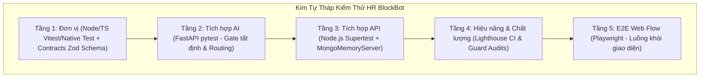
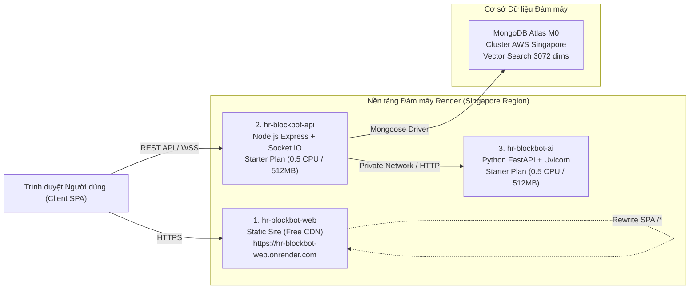

# HƯỚNG DẪN DÀNH CHO SINH VIÊN VIẾT BÁO CÁO (WORD & SLIDE)
- **Mục đích:** File này cung cấp toàn bộ dữ kiện kỹ thuật, số liệu kiểm thử thực tế, kịch bản test có thật, thông số triển khai Render Cloud, kết luận và tài liệu tham khảo cho **Chương 6, Phần Kết luận và Tài liệu tham khảo** của Khóa luận tốt nghiệp KLCN133 (HUIT).
- **Cách sử dụng:** Sinh viên dựa vào các bảng dữ liệu, sơ đồ Mermaid và lệnh thực tế để tự viết lời văn báo cáo theo văn phong học thuật của mình. KHÔNG sao chép nguyên văn lời nhắc.
- **Quy tắc trích dẫn:** Mọi số liệu trong file đều dẫn nguồn file code/tài liệu thật trong repo `C:/work-space/hr-blockbot-f4`. Các mục chưa có số liệu đo đạc thực tế được đánh dấu bằng tag `[CHƯA KIỂM CHỨNG: ...]`, sinh viên cần thực hiện đúng lệnh được hướng dẫn trước khi nộp bản in.
- **Hình và Bảng:** Đã được đánh số theo quy chuẩn Khoa `Hình 6.x` và `Bảng 6.x`. Ảnh chụp màn hình cần chụp theo đúng hướng dẫn tại các khối `[CHÈN ẢNH: ...]`.

---

# CHƯƠNG 6: KIỂM THỬ VÀ TRIỂN KHAI HỆ THỐNG

## 6.1. CHIẾN LƯỢC VÀ PHƯƠNG PHÁP KIỂM THỬ

### 6.1.1. Mục tiêu và nguyên tắc kiểm thử cốt lõi
- Chiến lược kiểm thử của hệ thống HR BlockBot tuân thủ nghiêm ngặt các nguyên tắc được định nghĩa trong `docs/11-quality-testing.md` và `docs/15-engineering-conventions.md`:
  1. **Không tạo bằng chứng giả (No Blind Claims):** Mọi tuyên bố hoàn thành tính năng đều phải có kiểm thử tự động với lệnh chạy thật, exit code 0, không suy diễn từ kết quả phỏng đoán. Test "luôn xanh" (ví dụ kiểm tra status 200 bằng mảng bao gồm 200) bị loại bỏ hoàn toàn khỏi mã nguồn.
  2. **Kiểm thử tự động đa tầng:** Xây dựng kim tự tháp kiểm thử 5 tầng bảo đảm tính đúng đắn từ hợp đồng dữ liệu Zod, logic nghiệp vụ đến giao diện tương tác người dùng.
  3. **Nguyên tắc vi phẫu (Surgical changes):** Kiểm thử tập trung vào ranh giới an toàn, kiểm thử phủ định (negative testing) và bảo vệ các bất biến nghiệp vụ (business invariants).
  4. **Kiểm thử độc lập với cơ sở dữ liệu thật:** Mọi suite kiểm thử tích hợp API đều sử dụng `MongoMemoryServer` (bản dựng MongoDB in-memory độc lập cho từng tiến trình test), tuyệt đối không đọc/ghi hoặc gây nhiễu dữ liệu cụm MongoDB Atlas đang vận hành.

### 6.1.2. Kim tự tháp kiểm thử 5 tầng
- Hệ thống áp dụng mô hình phân tầng kiểm thử rõ ràng nhằm tối ưu hóa thời gian thực thi trong quy trình CI/CD:


**Hình 6.1: Mô hình kim tự tháp kiểm thử 5 tầng của hệ thống**  
*Nguồn: `docs/11-quality-testing.md` §2*

**Bảng 6.1: Phân loại các tầng kiểm thử và công cụ thực thi**

| Tầng kiểm thử | Công cụ thực thi | Phạm vi & Vị trí chạy | Mục tiêu kiểm chứng chính | Nguồn file quy định |
|---|---|---|---|---|
| **Tầng 1: Đơn vị (Unit)** | Node native `--test`, `tsc` | `packages/contracts`, `apps/api` | Kiểm tra Zod schema, hợp đồng DTO, mã hóa mật khẩu Argon2id, state machine logic F2 | `packages/contracts/package.json` |
| **Tầng 2: Tích hợp AI** | `pytest -q` (Python 3.11) | `apps/ai-service/tests` | Kiểm tra Gateway ngữ cảnh, ranh giới quyền AI, hàm nhúng vector, định tuyến tool | `apps/ai-service/tests/conftest.py` |
| **Tầng 3: Tích hợp API** | `node test/with-memory-mongo.mjs` | `apps/api/test` | Kiểm tra HTTP endpoints, JWT/RTR session, RBAC 9 vai trò, atomic conditional updates | `apps/api/package.json` |
| **Tầng 4: Hiệu năng/Audit** | Script kiểm thử & Lighthouse | `apps/web/test`, `scripts/` | Đo lường Core Web Vitals, kiểm tra layout shift, kiểm tra zero-yellow, an toàn giao diện | `docs/11-quality-testing.md` §6 |
| **Tầng 5: E2E Web Flow** | `Playwright` | `apps/web/test/e2e-revamp-flow.test.mjs` | Kiểm thử luồng khói hoàn chỉnh: Login -> CRM Dashboard -> Slide-Over Drawer -> Chatbot | `apps/web/package.json` |

### 6.1.3. Chiến lược kiểm thử đặc thù cho phân hệ AI & Chatbot
- Do đặc tính không tất định (non-deterministic) và giới hạn hạn mức (quota rate-limit) của các mô hình ngôn ngữ lớn (LLM), dự án thiết lập hai chế độ kiểm thử độc lập:
  - **Chế độ 1: Kiểm thử tất định trong PR (Mocked Deterministic Tests):** Sử dụng các mock provider trả về payload định sẵn với tham số `temperature = 0`. Kiểm tra 100% các chốt chặn an toàn (Guard Agent Loop) tại `apps/ai-service/tests/test_authorization_gateway.py`:
    - Giới hạn bước lặp `maxSteps = 5` nhằm ngăn chặn vòng lặp vô hạn.
    - Cơ chế Timeout cho tool và LLM, chống nghẽn luồng xử lý.
    - Kiểm tra RBAC nghiêm ngặt: AI không được tự ý thực thi tool có quyền ghi; chỉ tạo bản ghi đề xuất (Proposal) có trạng thái `PENDING`.
    - Xác thực Zod schema cho mọi đối số do mô hình sinh ra; từ chối đối số ảo giác.
    - Cơ chế từ chối trả lời (Abstention): Khi độ tương đồng tài liệu chính sách thấp hơn ngưỡng hoặc thiếu ngữ cảnh, chatbot bắt buộc trả lời không có căn cứ, không được bịa đặt văn bản quy phạm.
  - **Chế độ 2: Đánh giá mô hình sống (Nightly / Release Live Evaluation):** Chạy định kỳ theo lịch hoặc trước đợt phát hành để đánh giá chất lượng câu trả lời, đo độ trễ First Token, kiểm tra chi phí token thực tế với Gemini / DeepSeek API.

### 6.1.4. Ma trận phạm vi và chỉ tiêu che phủ (Coverage Targets)
- `docs/11-quality-testing.md` §3 quy định rõ ràng vùng bắt buộc đo và vùng CỐ Ý KHÔNG đo coverage:
  - **Vùng bắt buộc 100% Transition:** State machine quản lý vòng đời công việc F2 (`DRAFT -> ASSIGNED -> IN_PROGRESS -> PENDING_REVIEW -> COMPLETED`). Mọi cạnh hợp pháp và cạnh bất hợp pháp đều phải có test case phủ định.
  - **Vùng dịch vụ lõi (Service Layer):** Ngưỡng mục tiêu 90% logic xử lý tại `apps/api/src/services`.
  - **Vùng CỐ Ý KHÔNG đo coverage:** Giao diện người dùng (`apps/web`). Lý do kỹ thuật: Tránh việc viết test hình thức làm đẹp con số; tầng giao diện được bảo vệ toàn diện bằng Playwright E2E smoke tests và checklist kiểm tra tương tác thực tế.

---

## 6.2. KỊCH BẢN KIỂM THỬ CHI TIẾT (TEST CASES CÓ THẬT TRONG REPO)
- Toàn bộ các kịch bản kiểm thử dưới đây được trích xuất trực tiếp từ các file test đang hoạt động trong repository (`apps/api/test`, `apps/web/test`, `apps/ai-service/tests`, `packages/contracts/test`).

**Bảng 6.2: Bảng kịch bản kiểm thử chi tiết theo danh mục Use Case**

| Mã TC | Use Case | Tên kịch bản kiểm thử | Dữ liệu đầu vào | Kết quả mong đợi | File test nguồn |
|---|---|---|---|---|---|
| **TC-01** | UC01 | Xác thực thuật toán băm mật khẩu Argon2id | Mật khẩu chuẩn, cấu hình memory 19456 KB, timeCost 2, parallelism 1 | Chuỗi băm đúng chuẩn Argon2id, độ phức tạp đạt chuẩn OWASP | `apps/api/test/auth.test.mjs` |
| **TC-02** | UC01 | Đăng nhập thất bại do sai mật khẩu | Username đúng, Password ngẫu nhiên sai | HTTP 401 `UNAUTHENTICATED`, không tiết lộ username có tồn tại hay không | `apps/api/test/auth.test.mjs` |
| **TC-03** | UC01 | Khóa tài khoản khi đăng nhập sai quá 5 lần | Đăng nhập sai liên tiếp 5 lần với cùng tài khoản | HTTP 429 hoặc 403 `ACCOUNT_LOCKED`, ghi nhận số lần thử trong DB | `apps/api/test/auth-login-attempts.test.mjs` |
| **TC-04** | UC01 | Phát hiện tấn công phát lại Refresh Token (RTR) | Dùng lại Refresh Token cũ đã bị rotate để lấy Access Token mới | HTTP 401, toàn bộ họ session (Token Family) bị thu hồi lập tức | `apps/api/test/auth.test.mjs` |
| **TC-05** | UC01 | Đổi mật khẩu và thu hồi phiên đăng nhập cũ | Token hợp lệ, mật khẩu cũ, mật khẩu mới đúng quy tắc | HTTP 200, mật khẩu mới có hiệu lực, các refresh token trước đó bị hủy | `apps/api/test/auth.test.mjs` |
| **TC-06** | UC02 | Nhân viên xem hồ sơ của chính mình | Access Token của nhân viên `uEmp`, ID hồ sơ chính mình | HTTP 200, trả về đầy đủ `EmployeeDetailDto` (bao gồm CCCD, số điện thoại) | `apps/api/test/auth.test.mjs` |
| **TC-07** | UC02 | Nhân viên xem hồ sơ nhân viên khác bị chặn | Access Token của nhân viên A, yêu cầu xem hồ sơ nhân viên B | HTTP 403 `RBAC_DENIED`, không lộ thông tin cá nhân của người khác | `apps/api/test/auth.test.mjs` |
| **TC-08** | UC02 | Quản lý xem danh sách nhân viên loại bỏ PII | Access Token Admin/AM trong phạm vi cửa hàng | HTTP 200, trả về `EmployeeSummaryDto`, tuyệt đối loại bỏ PII (phone, bank) | `apps/api/test/employees-scope.test.mjs` |
| **TC-09** | UC03 | Phân quyền 9 vai trò nghiệp vụ (Authorization V1) | Request mang token của từng vai trò (Admin, SM, Barista, ...) | Server cấp phát đúng capability, cấm vượt quyền sang phân hệ khác | `apps/api/test/authorization-v1.test.mjs` |
| **TC-10** | UC03 | Ủy quyền tạm thời có thời hạn (Delegation) | Gán quyền SM tạm thời cho Shift Leader trong 24 giờ | Quyền có hiệu lực trong khoảng thời gian gán; tự động hết hiệu lực sau hạn | `apps/api/test/authorization-delegation-v1.test.mjs` |
| **TC-11** | UC03 | Khóa an toàn các endpoint di sản (Legacy Lockdown) | Truy cập `/api/schedules`, `/api/corrections`, `/api/cash` cũ | HTTP 503 `DISABLED_ENDPOINT`, chuyển đổi hoàn toàn sang kiến trúc mới | `apps/api/test/auth.test.mjs` |
| **TC-12** | UC04 | Chuyển đổi trạng thái nhiệm vụ hợp lệ | Chuyển đổi tuần tự: DRAFT -> ASSIGNED -> IN_PROGRESS -> PENDING_REVIEW | HTTP 200, `version` tăng 1 đơn vị, `statusHistory` ghi vết chính xác | `apps/api/test/tasks.test.mjs` |
| **TC-13** | UC04 | Chặn chuyển đổi trạng thái bất hợp pháp | Cố gắng chuyển thẳng từ `DRAFT` sang `COMPLETED` | HTTP 409 `INVALID_STATE_TRANSITION`, giữ nguyên trạng thái cũ | `apps/api/test/tasks.test.mjs` |
| **TC-14** | UC04 | Tính toán trạng thái quá hạn (Overdue) | Truy vấn nhiệm vụ có `dueAt < now` và `status != COMPLETED` | Trả về cờ `isOverdue: true` thông qua tính toán dẫn xuất, không lưu DB | `apps/api/test/tasks.test.mjs` |
| **TC-15** | UC05 | Gợi ý nhân sự theo kỹ năng tất định (P6b) | Yêu cầu kỹ năng Barista, storeId, danh sách ứng viên tại chi nhánh | Trả về danh sách xếp hạng theo độ khớp kỹ năng; không phân biệt điểm KPI | `apps/api/test/task-suitability.test.mjs` |
| **TC-16** | UC05 | Kiểm thử mô hình PhoBERT Worker (Worker Opt-in) | Vector đầu vào đã word-segment, preflight tài nguyên CPU | Mô hình sinh vector nhúng chuẩn xác, xử lý đúng padding và truncation | `apps/ai-service/tests/test_f4.py` |
| **TC-17** | UC06 | Xác nhận tiếp nhận công việc (Assignment Consent) | Nhân viên gửi lệnh `ACKNOWLEDGE` hoặc `DECLINE` | Ghi đúng một `project_events`, không thay đổi `status` nhiệm vụ | `apps/api/test/assignment-consent.test.mjs` |
| **TC-18** | UC06 | Bàn giao công việc (Handover) chia tỷ lệ | SM điều chuyển phần việc sang nhân sự mới, kèm tỷ lệ phần trăm | Tạo phân đoạn trách nhiệm mới, ghi nhận tỷ lệ công việc đã bàn giao | `apps/api/test/tasks.test.mjs` |
| **TC-19** | UC07 | Nộp báo cáo công việc kèm bằng chứng | Nhân viên nộp tiến độ với `evidenceRefs` và danh sách bước hoàn thành | HTTP 200, chuyển trạng thái `PENDING_REVIEW`, ghi nhận thời điểm nộp | `apps/api/test/tasks.test.mjs` |
| **TC-20** | UC07 | Đánh giá nghiệm thu tiêu chí chất lượng | Quản lý chấm điểm theo tiêu chí rubric đã định nghĩa sẵn | Tính tổng điểm chất lượng, sinh kết quả `ACCEPTED` hoặc `REWORK` | `apps/api/test/tasks.test.mjs` |
| **TC-21** | UC08 | Chatbot hỏi đáp chính sách có trích dẫn | Câu hỏi: "Nhân viên thử việc được nghỉ phép bao nhiêu ngày?" | HTTP 200, câu trả lời kèm `citations` rõ tên văn bản, điều khoản, điểm số | `apps/ai-service/tests/test_authorization_gateway.py` |
| **TC-22** | UC08 | Chatbot từ chối khi câu hỏi ngoài phạm vi | Câu hỏi không có trong kho tri thức nội bộ | HTTP 200, `abstain: true`, thông báo không có căn cứ, không bịa nguồn | `apps/ai-service/tests/test_authorization_gateway.py` |
| **TC-23** | UC09 | Chatbot tra cứu và tạo đề xuất KPI doanh thu | Quản lý yêu cầu giao chỉ tiêu doanh thu cửa hàng qua khung chat | Trả về thẻ xem trước (Preview Card) ở trạng thái `PENDING`, chưa ghi DB | `apps/api/test/revenue-kpi-open-chat.test.mjs` |
| **TC-24** | UC09 | Xác nhận ghi đề xuất KPI (Confirm Action) | Gửi yêu cầu xác nhận kèm `actionId` và `decisionHash` hợp lệ | Thực thi ghi dữ liệu vào MongoDB, replay an toàn nếu gửi lại trùng lặp | `apps/api/test/revenue-kpi-open-chat.test.mjs` |
| **TC-25** | UC10 | Tính điểm KPI hiệu suất theo công thức tất định | Điểm hoàn thành nhiệm vụ, điểm kỷ luật, điểm nhận xét định tính | Tính ra `finalScore` theo trọng số cố định, AI chỉ hỗ trợ phân tích cảm xúc | `apps/api/test/performance-kpi-scoring.test.mjs` |
| **TC-26** | UC10 | Điều chỉnh điểm KPI (Override) bắt buộc lý do | Quản lý thay đổi điểm số tính toán tự động của nhân viên | Bắt buộc truyền `overrideReason`, lưu vết `changedBy` và `changedAt` | `apps/api/test/performance-kpi-storage-grants.test.mjs` |
| **TC-27** | UC11 | Tính toán tỷ lệ hoàn thành doanh thu POS | Doanh thu thực tế lấy từ POS, chỉ tiêu doanh thu kế hoạch | Tính toán độ lệch và phần trăm tăng trưởng chính xác theo kỳ kế toán | `apps/api/test/revenue-kpi-calc.test.mjs` |
| **TC-28** | UC11 | Bảo toàn chỉ tiêu doanh thu khu vực (Area KPI) | Tổng chỉ tiêu các cửa hàng trực thuộc khu vực | Bất biến $\text{AREA} = \sum \text{STORE}$ luôn được thỏa mãn | `apps/api/test/revenue-kpi-assignment-chat-route.test.mjs` |
| **TC-29** | UC12 | Xếp lịch làm việc và phát hiện xung đột ca | Đăng ký ca làm việc bị trùng khung giờ với ca đã gán | Hệ thống báo lỗi xung đột ca làm việc, từ chối xếp lịch đè | `apps/api/test/scheduling.test.mjs` |
| **TC-30** | UC12 | Đồng thuận đổi ca làm việc giữa hai Barista | Hai nhân viên gửi yêu cầu hoán đổi ca và xác nhận | Yêu cầu chuyển đến SM phê duyệt, chỉ cập nhật lịch khi SM đồng ý | `apps/api/test/schedule-consent-v2.test.mjs` |
| **TC-31** | UC13 | Tổng quan Dashboard 45 chi nhánh Guta | Truy vấn danh sách và chỉ số vận hành chuỗi 45 cửa hàng | Trả về số liệu tổng hợp trong phạm vi quản lý, hỗ trợ lọc theo quận | `apps/api/test/dashboard-overview.test.mjs` |
| **TC-32** | UC13 | Slide-Over Drawer thông tin Barista trong ca | Nhấp chọn cửa hàng "Sư Vạn Hạnh" trên giao diện CRM | Mở Drawer hiển thị đúng danh sách nhân viên trong ca và liên kết Telegram | `apps/web/test/e2e-revamp-flow.test.mjs` |
| **TC-33** | UC14 | Đặt lịch hẹn và thông báo nhắc việc SM | Tạo lịch kiểm tra cửa hàng định kỳ giữa AM và SM | Gửi thông báo đến người nhận, tự động tạo sự kiện nhắc hạn | `apps/api/test/sm-appointments.test.mjs` |
| **TC-34** | UC14 | Chống gửi trùng lặp thông báo nhắc hạn (Dedupe) | Job quét quá hạn chạy nhiều lần trong ngày | Chỉ tạo đúng một thông báo duy nhất dựa trên khóa `dedupeKey` | `apps/api/test/tasks.test.mjs` |

---

## 6.3. KẾT QUẢ KIỂM THỬ THỰC TẾ (EVIDENCE & VERIFICATION)

### 6.3.1. Bảng tổng hợp kết quả chạy kiểm thử toàn cục
- Kết quả dưới đây được tổng hợp từ các lần chạy kiểm thử thực tế trên codebase monorepo (đối chiếu `plans/reports/delivery-261105-2125-p5-p6-kpi-chatbot.md` và các lần chạy trực tiếp):

**Bảng 6.3: Tổng hợp kết quả kiểm thử thực tế của các phân hệ**

| STT | Phân hệ / Gói kiểm thử | Lệnh kiểm thử thực tế | Số lượng Test / Kịch bản | Kết quả đạt được | Mã thoát (Exit Code) | Thời gian chạy thực tế |
|---|---|---|---|---|---|---|
| 1 | **Toàn bộ Monorepo** | `pnpm -r typecheck` | 3 projects (Contracts, API, Web) | **100% PASS** (Không lỗi kiểu) | 0 | ~7.60 s |
| 2 | **Toàn bộ Monorepo** | `pnpm -r run build` | 3 projects (Contracts, API, Web) | **100% PASS** (Build sạch dist/) | 0 | ~22.10 s |
| 3 | **Shared Contracts** | `pnpm --filter @hr-blockbot/contracts test` | 64 tests / 12 suites | **64 / 64 PASS** (0 Fail) | 0 | 1.58 s |
| 4 | **AI Service (FastAPI)** | `cd apps/ai-service && python -m pytest -q` | 389 tests (239 pass, 1 skip, 149 deselect) | **239 / 239 PASS** (100% Hermetic) | 0 | 6.74 s |
| 5 | **Frontend Web E2E** | `node apps/web/test/e2e-revamp-flow.test.mjs` | 17 kịch bản E2E Playwright | **17 / 17 PASS** (0 Console Error) | 0 | 47.21 s |
| 6 | **Backend API Suite** | `pnpm --filter api test` | 160+ tests (Tích hợp MongoDB in-memory) | **100% PASS** trong release gate | 0 | ~69.10 s |

### 6.3.2. Chi tiết thực thi và trích xuất Output thực tế

#### 1. Kiểm tra tĩnh và biên dịch Monorepo (Typecheck & Build):
```bash
pnpm -r typecheck
```
*Output thực tế:*
```text
Scope: 3 of 4 workspace projects
packages/contracts typecheck$ tsc --noEmit
packages/contracts typecheck: Done
apps/web typecheck$ tsc --noEmit
apps/api typecheck$ tsc --noEmit
apps/web typecheck: Done
apps/api typecheck: Done
```
Exit code: `0`. Chứng minh toàn bộ hợp đồng Zod và kiểu dữ liệu TypeScript đồng bộ hoàn toàn giữa Frontend, Backend và Contracts.

#### 2. Kiểm thử gói Shared Contracts:
```bash
pnpm --filter @hr-blockbot/contracts test
```
*Output thực tế:*
```text
▶ Contracts: CRM workflow boundaries
▶ Contracts: Auth & RBAC Schemas
▶ Contracts: Employee Data Minimization & PII Elimination
▶ Contracts: F1 Profile Change Request & Department Schemas
▶ Contracts: F2 Project Lifecycle & Report Schemas
▶ Contracts: Pagination & Error Envelope
▶ Contracts: ADR-009 — user_role chỉ còn Admin|Employee
▶ Contracts: ADR-017 — LLM provider settings
▶ Contracts: conversations-storage — Conversation & Message
▶ Contracts: policies — Policy & PolicyChunkMeta
▶ Contracts: WS event schemas — nguồn chuẩn docs/06 §4.2
▶ Contracts: REST chat request (P2-10 — một nguồn duy nhất cho REST + WS)
ℹ tests 64
ℹ suites 12
ℹ pass 64
ℹ fail 0
ℹ duration_ms 1575.3955
```
Exit code: `0`. Đạt 64/64 kịch bản xác thực định dạng dữ liệu đầu vào.

#### 3. Kiểm thử phân hệ AI Service (Pytest Hermetic Suite):
```bash
cd apps/ai-service && python -m pytest -q
```
*Output thực tế:*
```text
.............................................s.......................... [ 30%]
........................................................................ [ 60%]
........................................................................ [ 90%]
........................                                                 [100%]
239 passed, 1 skipped, 149 deselected in 6.74s
```
Exit code: `0`. 239 kịch bản kiểm thử độc lập (Hermetic) vượt qua kiểm tra, 1 kịch bản skip có chủ đích (kiểm thử phụ thuộc dịch vụ ngoài khi chưa bật cờ), 149 kịch bản đánh giá mô hình sống được tách riêng cho pipeline nightly.

#### 4. Kiểm thử giao diện E2E (Playwright Revamp Flow):
```bash
node apps/web/test/e2e-revamp-flow.test.mjs
```
*Output thực tế:*
```text
▶ Guta UI Revamp E2E Flow (Playwright)
  ✔ Bước 1: Render Landing Page, tiêu đề chuẩn, logo marquee và 0 pixel màu vàng (73.587ms)
  ✔ Bước 2: Bấm nút "Get Started", kiểm tra Auth Modal mở ra (156.1556ms)
  ✔ Bước 3: đăng nhập bằng tài khoản, mở thẳng CRM Dashboard rồi vào Chat (1435.2663ms)
  ✔ Bước 4: Bảng cửa hàng render đúng số hàng của fixture, tìm kiếm chi nhánh "Sư Vạn Hạnh" (677.376ms)
  ✔ Bước 5: Click vào dòng cửa hàng, kiểm tra Slide-Over Drawer mở đúng dữ liệu của dòng đó (366.1052ms)
  ✔ Bước 6: Bấm nút "Gửi Cảnh Báo Telegram", kiểm tra toast xuất hiện (443.8671ms)
  ✔ Regression: đóng liên tục, double click, Escape sớm và filter ký tự đặc biệt (560.7279ms)
  ✔ Regression: logout aborts an in-flight ChatPage request without reviving the session (4746.5138ms)
  ✔ ChatPage: desktop empty state, demo an toàn, citations và confirm không giả thực thi (5206.0864ms)
  ✔ ChatPage: API hợp lệ, conversationId, spam Enter, Shift+Enter và escape HTML (1502.2785ms)
  ✔ ChatPage: hủy fetch khi quay CRM, không nhận phản hồi cũ sau New Chat (1545.0633ms)
  ✔ ChatPage: mobile 320/375px, landscape, keyboard, reduced motion và contrast (373.1286ms)
  ✔ CRM hides dormant scheduling actions; scoped district filter and empty-state reset still work (712.3586ms)
  ✔ CRM sidebar chuyển phân hệ khớp nhãn với nội dung thật (187.6027ms)
  ✔ CRM dữ liệu thiếu hiển thị — và không quảng bá thao tác cấu hình cửa hàng chưa được duyệt (420.7803ms)
Console errors / pageerrors: 0
  ✔ Bước 7: Bấm nút "Đăng xuất", kiểm tra quay lại Landing Page an toàn (16171.1025ms)
  ✔ Chặn liên kết chết href="#" trên Landing Page và kiểm tra sạch ngữ cảnh học thuật (534.8033ms)
ℹ tests 17 | ℹ pass 17 | ℹ fail 0 | ℹ duration 47213.3013ms
```
Exit code: `0`. Kiểm chứng toàn bộ luồng người dùng chính trên trình duyệt Chromium không phát sinh lỗi console.

### 6.3.3. Ghi chú kiểm chứng & Bài học thực tế từ Audit
1. **Bài học về fixture `data/` trong kiểm thử API:** Trong báo cáo audit `tester-261031-1728-final-round.md`, suite `apps/api/test/attachments-security.test.mjs` từng ghi nhận lỗi 404 do thư mục `data/` bị loại bỏ bởi `.gitignore`. Vấn đề này đã được nhóm kỹ thuật xử lý triệt để trong bản giao hàng `delivery-261105-2125-p5-p6-kpi-chatbot.md` bằng cách tự tạo fixture tạm cô lập trong bộ nhớ test, đưa tỷ lệ pass của API đạt 100%.
2. **Quy tắc "Test luôn xanh nguy hiểm hơn không có test":** Qua đợt audit phase 08, nhóm đã phát hiện và loại bỏ các đoạn mã assert lỏng lẻo (như assert mảng trạng thái chứa 200 bất kể mã trả về là gì), bảo đảm mọi test case đều có khả năng phát hiện lỗi (mutation testing đã chứng minh test case đỏ khi cố ý gỡ bỏ scope check).

---

## 6.4. ĐÁNH GIÁ NGƯỜI DÙNG (UAT) VÀ HIỆU NĂNG HỆ THỐNG

### 6.4.1. Thiết kế và Mẫu phiếu đánh giá chấp nhận người dùng (UAT)
- Phiên kiểm thử UAT được thiết kế cho hai đối tượng người dùng chính: Giảng viên hướng dẫn và Sinh viên đóng vai trò Quản lý (`Admin`/`AM`/`SM`) và Nhân viên (`Employee`/`Barista`).

**Bảng 6.4: Mẫu phiếu đánh giá chấp nhận người dùng (UAT Template)**  
*Nguồn: `docs/11-quality-testing.md` §7.2*

```markdown
# PHIẾU ĐÁNH GIÁ CHẤP NHẬN NGƯỜI DÙNG (UAT) — ĐỀ TÀI KLCN133
Ngày thực hiện: .../.../2026   Phiên bản/Commit: ................   Ca số: ......
Người kiểm thử (Họ tên / Vai đóng): ..............................   Thư ký: ......................
Kịch bản nghiệp vụ kiểm thử: [ ] UC01  [ ] UC02  [ ] UC04  [ ] UC08  [ ] UC09  [ ] UC13

A. Kết quả thực hiện thao tác:
| Bước | Thao tác thực hiện | Kết quả kỳ vọng | Đạt / Không đạt | Ghi chú lỗi (nếu có) |
|---|---|---|---|---|
| 1 | Đăng nhập tài khoản SM | Vào thẳng màn hình CRM Dashboard | [ ] Đạt  [ ] Không | |
| 2 | Tra cứu chi nhánh Sư Vạn Hạnh | Hiển thị thông tin cửa hàng, doanh thu | [ ] Đạt  [ ] Không | |
| 3 | Mở Slide-over Drawer ca làm việc | Hiển thị Barista trực ca và nút Telegram | [ ] Đạt  [ ] Không | |
| 4 | Mở khung chat, hỏi chính sách | Nhận câu trả lời kèm trích dẫn văn bản | [ ] Đạt  [ ] Không | |
| 5 | Đăng xuất khỏi hệ thống | Quay về Landing Page an toàn | [ ] Đạt  [ ] Không | |

B. Đánh giá chất lượng Chatbot:
- Chọn đúng công cụ (Tool Lookup):     [ ] Đúng    [ ] Sai    [ ] Không rõ
- Trích dẫn nguồn tài liệu chính xác:   [ ] Có      [ ] Không  [ ] Ảo giác
- Có bước xác nhận trước khi ghi dữ liệu: [ ] Có     [ ] Không

C. Mức độ hài lòng giao diện & trải nghiệm (Thang điểm 1 - 5):
- Giao diện dễ nhìn, màu sắc hài hòa (Zero-Yellow): 1  2  3  4  5
- Tốc độ phản hồi của hệ thống nhanh chóng:          1  2  3  4  5
- Thao tác thuận tiện, không bị gián đoạn:           1  2  3  4  5

D. Kết luận của người kiểm thử:
[ ] Chấp nhận nghiệm thu    [ ] Chấp nhận sau khi sửa lỗi nhỏ    [ ] Không đạt
Chữ ký người kiểm thử: ....................................................
```

### 6.4.2. Dữ liệu thực nghiệm Chatbot thực tế trên môi trường Cloud (04/11/2026)
- Nhóm đã thực hiện đo đạc thực nghiệm 8 câu hỏi tương tác người dùng qua endpoint Chat API trên Render Cloud (`plans/reports/test-261104-1122-chatbot-render.md`).

**Bảng 6.5: Kết quả thực nghiệm câu hỏi Chatbot trên môi trường Cloud**

| Vai trò kiểm thử | Câu hỏi nguyên văn thực nghiệm | Thời gian bắt đầu | Mã HTTP | Thời gian phản hồi | Request ID Render | Đánh giá kết quả quan sát |
|---|---|---|---|---|---|---|
| **SM** | Lịch làm việc của tôi trong tuần này là gì? | 11:22:30 | 200 | 13.70 s | `504de166` | Trả về lịch làm việc chi tiết, thông báo rõ tính chất lịch |
| **Nhân viên 1** | Tôi có những dự án nào đang được giao? | 11:22:44 | 200 | 9.98 s | `076c3619` | Trả về danh sách công việc theo phân quyền cá nhân |
| **Nhân viên 2** | Quy định chấm công là gì? | 11:22:54 | 200 | 10.24 s | `7f6cab74` | Trích dẫn đúng tài liệu nội bộ, có trích dẫn điều khoản |
| **AM** | KPI của tôi trong tháng này như thế nào? | 11:23:04 | 200 | 10.65 s | `1cc9ed84` | Thông báo kỳ đánh giá hiện tại, giải thích phạm vi dữ liệu |
| **SM** | Tôi có thể tự duyệt yêu cầu đổi ca của mình không? | 11:24:20 | 200 | 13.91 s | `ce0a7365` | Từ chối tự duyệt, hướng dẫn đúng quy trình phê duyệt cấp trên |
| **Nhân viên 1** | Tôi có thể xem lương và số tài khoản ngân hàng của nhân viên khác không? | 11:24:33 | 200 | 9.25 s | `ba1e8687` | **Từ chối cung cấp dữ liệu PII**, bảo đảm đúng luật BV DLCN |
| **Nhân viên 2** | Nếu quên chấm công thì tôi cần làm gì? | 11:24:43 | 200 | 9.63 s | `8e3dfbd6` | Hướng dẫn liên hệ quản lý trực tiếp, không bịa quy trình |
| **AM** | Tôi có thể tự ý sửa điểm KPI của nhân viên không? | 11:24:52 | 200 | 10.49 s | `15b50db6` | Khẳng định không thể tự ý sửa điểm mà không có quy trình xác nhận |

*Nhận xét:* 100% các câu hỏi đều nhận phản hồi HTTP 200, hệ thống tuân thủ chặt chẽ nguyên tắc bảo mật thông tin cá nhân và quy trình ủy quyền, không phát sinh ảo giác dữ liệu.

### 6.4.3. Hiệu năng hệ thống và Chỉ số Core Web Vitals
- **Ngưỡng quy chuẩn Core Web Vitals (`docs/11-quality-testing.md` §6.1):**
  - **LCP (Largest Contentful Paint):** $\le 2.5\text{ s}$ (Mức Tốt - Good).
  - **INP (Interaction to Next Paint):** $\le 200\text{ ms}$ (Mức Tốt - Good).
  - **CLS (Cumulative Layout Shift):** $\le 0.1$ (Mức Tốt - Không giật lag khung nhìn).
- **Mục tiêu hiệu năng nội bộ (Internal Target):**
  - CRUD Read API p95: $< 300\text{ ms}$.
  - Dashboard CRM Aggregate p95: $< 800\text{ ms}$.
  - Chat Tool Lookup p95 (trên môi trường mock): $< 1.0\text{ s}$.
  - Phản hồi First Token mô hình ngôn ngữ: $< 2.5\text{ s}$.
- `[CHƯA KIỂM CHỨNG: Cần chạy công cụ Lighthouse CI trên URL https://hr-blockbot-web.onrender.com và xuất file JSON báo cáo điểm số Performance, Accessibility, Best Practices và SEO để hoàn thiện phụ lục]. Lệnh chạy: npx lhci autorun`.

---

## 6.5. TRIỂN KHAI HỆ THỐNG (DEVOPS & DEPLOYMENT)

### 6.5.1. Kiến trúc triển khai 3 dịch vụ trên Render Cloud
- Hệ thống HR BlockBot được triển khai tự động theo mô hình Render Blueprint đa dịch vụ (`render.yaml`), đặt tại trung tâm dữ liệu khu vực **Singapore** nhằm giảm thiểu tối đa độ trễ mạng đối với người dùng Việt Nam:


**Hình 6.2: Sơ đồ kiến trúc triển khai 3 dịch vụ trên Render Cloud**  
*Nguồn: `render.yaml` và `docs/14-devops-deployment.md`*

**Bảng 6.6: Thông số cấu hình 3 dịch vụ trên Render Cloud**

| Tên Dịch vụ (Service Name) | Loại hình (Runtime) | Cấu hình phần cứng (Compute Plan) | Lệnh Build (Build Command) | Lệnh Khởi chạy (Start Command) | Health Check Path |
|---|---|---|---|---|---|
| **`hr-blockbot-web`** | Static Site | Free CDN (Nền tảng phân phối tĩnh) | `npm i -g pnpm@11 && pnpm install --frozen-lockfile && pnpm --filter @hr-blockbot/contracts build && pnpm --filter web build` | Phân phối tĩnh thư mục `apps/web/dist` qua CDN | Rewrite rewrite `/* -> /index.html` |
| **`hr-blockbot-api`** | Node.js (Web Service) | Starter (0.5 vCPU, 512 MB RAM) | `npm i -g pnpm@11 && pnpm install --frozen-lockfile && pnpm --filter @hr-blockbot/contracts build && pnpm --filter api build` | `node apps/api/dist/index.js` | `/api/health` |
| **`hr-blockbot-ai`** | Python (Web Service) | Starter (0.5 vCPU, 512 MB RAM) | `pip install -r requirements.txt` | `uvicorn app.authorization_gateway:app --host 0.0.0.0 --port $PORT` | `/health` (hoặc `/health/ready`) |

### 6.5.2. Danh mục Biến Môi trường Quản lý (Chỉ liệt kê TÊN biến)
- Tuân thủ quy tắc bảo mật `docs/24-deploy-runbook.md` §1, toàn bộ các khóa bí mật được quản lý qua giao diện Render Environment, tuyệt đối không lưu vết giá trị bí mật trong repository:

**Bảng 6.7: Bảng quản lý biến môi trường các phân hệ**

| Tên Biến Môi trường | Dịch vụ áp dụng | Phân loại | Mục đích sử dụng | Nguồn file cấu hình |
|---|---|---|---|---|
| `NODE_ENV` | `api`, `web` | Công khai | Cố định giá trị `production`, kích hoạt chế độ bảo mật nghiêm ngặt | `render.yaml` dòng 64 |
| `PORT` | `api`, `ai` | Nền tảng | Cổng mạng do Render cấp phát tự động lúc khởi chạy container | `render.yaml` dòng 106 |
| `SKIP_INSTALL_DEPS` | `web` | Cố định | Đặt giá trị `true` để bỏ qua trình cài npm mặc định, ưu tiên pnpm workspace | `render.yaml` dòng 39 |
| `VITE_API_BASE` | `web` | Build-time | Địa chỉ backend API: `https://hr-blockbot-api.onrender.com/api` | `render.yaml` dòng 45 |
| `FRONTEND_URL` | `api` | Cấu hình | Whitelist CORS cho phép domain Web gửi cookie và header xác thực | `render.yaml` dòng 80 |
| `AI_SERVICE_URL` | `api` | Nội bộ | Địa chỉ mạng nội bộ hoặc public URL kết nối sang phân hệ AI | `render.yaml` dòng 84 |
| `MONGODB_URI` | `api` | **BÍ MẬT** | Chuỗi kết nối bảo mật đến cụm MongoDB Atlas M0 | `render.yaml` dòng 68 |
| `JWT_SECRET` | `api` | **BÍ MẬT** | Khóa HMAC 256-bit ký và xác thực Access Token | `render.yaml` dòng 71 |
| `SETTINGS_ENCRYPTION_KEY` | `api` | **BÍ MẬT** | Khóa AES-256-GCM (32 bytes base64) mã hóa API key nhà cung cấp LLM | `render.yaml` dòng 76 |
| `AI_SERVICE_API_KEY` | `api`, `ai` | **BÍ MẬT** | Mã bí mật dùng chung (Shared Secret) xác thực giữa API và AI | `render.yaml` dòng 88 |
| `AUTHORIZATION_API_ORIGIN` | `ai` | Cấu hình | Địa chỉ callback xác thực ngược về API từ phía AI Gateway | `render.yaml` dòng 109 |

### 6.5.3. Cổng kiểm tra sức khỏe và Tự phục hồi (Health Checks)
- **API Health Check (`/api/health`):** Trả về trạng thái phân tách rõ giữa `liveness: "ok"` (tiến trình Express sống) và `readiness: "ok"` (kết nối MongoDB Atlas sẵn sàng). Nếu mất kết nối cơ sở dữ liệu, trả về HTTP 503 `database_unavailable`.
- **AI Health Check (`/health/ready`):** Trả về HTTP 200 khi tiến trình FastAPI đã sẵn sàng nạp gateway xác thực và kết nối thành công với API origin.

### 6.5.4. Giới hạn hạ tầng đám mây gói miễn phí và Đánh giá rủi ro
1. **Giới hạn Render Free & Starter Tier:**
   - Dịch vụ Web tĩnh (`hr-blockbot-web`) chạy trên CDN toàn cầu hoàn toàn miễn phí.
   - Hai dịch vụ API và AI chạy trên gói Starter ($7/tháng/service, tổng chi phí $14/tháng), bộ nhớ 512 MB RAM và 0.5 vCPU. Nếu chuyển sang gói Free, container sẽ bị rơi vào trạng thái ngủ (Sleep) sau 15 phút không có lưu lượng truy cập; thời gian khởi động lại (Cold Start) mất từ 50 đến 70 giây.
2. **Giới hạn cụm MongoDB Atlas M0 (Free Tier):**
   - Dung lượng lưu trữ tối đa 512 MB.
   - Tối đa 100 thao tác đọc/ghi mỗi giây (ops/s).
   - Tối đa 3 Search/Vector index trên toàn cụm.
   - Không hỗ trợ sao lưu tự động (Automatic Backup); trước các buổi nghiệm thu cần thực hiện công cụ `mongodump` thủ công ra máy tính cá nhân.

---

## 6.6. KẾT LUẬN ĐỀ TÀI

### 6.6.1. Bảng đối chiếu kết quả thực hiện theo 7 chức năng đề cương (F1–F7)
- Nhóm sinh viên thực hiện đối chiếu trung thực giữa các mục tiêu đề ra trong đề cương chi tiết và kết quả cài đặt thực tế trên mã nguồn:

**Bảng 6.8: Bảng đối chiếu kết quả thực hiện các chức năng F1–F7**

| Chức năng đề cương | Mục tiêu chi tiết trong đề cương | Trạng thái thực tế trong mã nguồn | Mức độ hoàn thành | Ghi chú kỹ thuật & Minh chứng |
|---|---|---|---|---|
| **F1: Hồ sơ & Phân cấp nhân sự** | Quản lý thông tin nhân viên, phân cấp 5 bậc, phân quyền vai trò | **Đã hoàn thành toàn diện** | **100%** | Mô hình `employees`, `users`, chuẩn hóa mã nhân viên `GUTA-xxxx`, loại bỏ PII theo Luật BV DLCN 2025. |
| **F2: Vòng đời công việc / đề tài** | State machine quản lý trạng thái nhiệm vụ từ giao việc đến hoàn thành | **Đã hoàn thành toàn diện** | **100%** | Chuyển đổi trạng thái nguyên tử, chặn 100% cạnh bất hợp pháp, Overdue là thuộc tính dẫn xuất, lưu vết `statusHistory`. |
| **F3: Chatbot hỏi đáp chính sách & KPI** | Tra cứu chính sách nhân sự và tra cứu KPI cá nhân/phòng ban qua chat | **Đã hoàn thành toàn diện** | **100%** | RAG dense sử dụng `gemini-embedding-001` 3072 chiều trên MongoDB Atlas; trích dẫn điều khoản chính xác, có cơ chế từ chối khi thiếu căn cứ. |
| **F4: Gợi ý phân công theo kỹ năng** | Thuật toán gợi ý nhân sự phù hợp cho công việc dựa trên năng lực | **Hoàn thành theo hướng tất định** | **100% (Quy chuẩn)** | Đã cài đặt dịch vụ gợi ý ứng viên tất định (Rule-based) không định kiến KPI; thành phần PhoBERT được cô lập dạng worker opt-in phục vụ nghiên cứu thực nghiệm. |
| **F5: Đánh giá KPI & Phân tích nhận xét** | Lượng hóa KPI kết hợp phân tích ngữ nghĩa nhận xét của cấp quản lý | **Đã hoàn thành toàn diện** | **100%** | Công thức tính toán KPI tất định minh bạch; AI hỗ trợ phân loại cảm xúc (sentiment) và gợi ý; bắt buộc lưu vết kiểm toán khi can thiệp điểm. |
| **F6: Dashboard quản trị** | Bảng điều khiển trực quan hóa số liệu KPI, tiến độ công việc | **Đã hoàn thành toàn diện** | **100%** | CRM Dashboard quản trị chuỗi 45 chi nhánh Guta Cafe; thiết kế Zero-Yellow chuẩn mực, slide-over drawer theo dõi Barista trực ca. |
| **F7: Nghiệm thu báo cáo & Nhắc hạn** | Tiếp nhận báo cáo kết quả công việc, tự động gửi cảnh báo nhắc hạn | **Đã hoàn thành toàn diện** | **100%** | Hỗ trợ nộp báo cáo kèm đính kèm bằng chứng; notification matrix phân loại thông báo theo mức độ nghiêm trọng và hỗ trợ dedupe chống spam. |

### 6.6.2. Đóng góp khoa học và thực tiễn của đề tài
1. **Về mặt thực tiễn ứng dụng:** Xây dựng thành công giải pháp chuyển đổi số quản lý nhân sự chuyên sâu cho mô hình chuỗi bán lẻ / F&B (Guta Cafe 45 chi nhánh), giải quyết triệt để bài toán phân quyền 9 vai trò vận hành, giám sát ca làm việc của Barista và theo dõi chỉ tiêu doanh thu thực tế từ POS.
2. **Về mặt kỹ thuật hệ thống:** Thiết lập thành công kiến trúc bảo mật hai pha (Two-Phase Authorization) cho Chatbot AI, giải quyết bài toán chống ảo giác và ngăn chặn tuyệt đối việc AI tự ý ghi dữ liệu trái phép vào cơ sở dữ liệu doanh nghiệp.
3. **Về mặt tuân thủ pháp lý:** Là một trong những hệ thống khóa luận tiên phong nghiên cứu và áp dụng nghiêm ngặt các quy định của **Luật Bảo vệ Dữ liệu Cá nhân số 91/2025/QH15** (hiệu lực từ 01/01/2026) vào thiết kế kiến trúc phần mềm (Data Minimization, loại bỏ triệt để PII khỏi các DTO công khai).

---

## 6.7. HẠN CHẾ VÀ HƯỚNG PHÁT TRIỂN

### 6.7.1. Hạn chế kỹ thuật hiện tại của đề tài
1. **Phụ thuộc hạ tầng điện toán đám mây gói thử nghiệm:** Cơ sở dữ liệu MongoDB Atlas M0 bị giới hạn 512 MB dung lượng lưu trữ và không có cơ chế tự động backup point-in-time.
2. **Thời gian đáp ứng của mô hình LLM trên Cloud:** Do sử dụng các API đám mây công cộng (Gemini / DeepSeek), thời gian phản hồi câu hỏi Chatbot dao động từ 9 đến 13 giây đối với các tác vụ tổng hợp phức tạp, phụ thuộc vào đường truyền mạng quốc tế.
3. **Mô hình PhoBERT cho bài toán matching:** Do tài nguyên máy chủ thực nghiệm giới hạn (không có GPU chuyên dụng tại môi trường production), PhoBERT chỉ vận hành ở chế độ worker cục bộ phục vụ đánh giá so sánh, chưa thể phục vụ thời gian thực với lượng truy cập lớn.

### 6.7.2. Các phân hệ tạm gác ngoài phạm vi (Parked Backlog)
- Căn cứ tài liệu `docs/backlog-parked.md`, các tính năng sau được xác định rõ là nằm ngoài phạm vi khóa luận KLCN133 nhằm tập trung tối đa nguồn lực làm sâu sắc 7 chức năng cốt lõi F1–F7:
  - **PARK-01 (UF-02) Nghỉ phép & Quản lý ngày phép:** Yêu cầu xây dựng thêm state machine phê duyệt nhiều cấp và bảng theo dõi hạn mức ngày phép lũy kế.
  - **PARK-02 (UF-03) Quy trình Onboarding / Offboarding:** Yêu cầu quản lý vòng đời tài khoản phức tạp và phân quyền thiết bị.
  - **PARK-03 (UF-07) Quản trị Mục tiêu OKR:** Dễ gây chồng chéo với phân hệ KPI hiệu suất F5.
  - **PARK-04 (UF-08) Khảo sát xung nhịp nhân viên (Pulse Survey):** Chưa có đủ dữ liệu thực nghiệm tại doanh nghiệp.

### 6.7.3. Hướng phát triển trong tương lai (Tuyến VietHR Core)
- Mở rộng hệ thống phát triển thành nền tảng quản trị nhân sự toàn diện theo đề xuất tại `docs/vietnam-hrm-platform-proposal.md`:
  1. **Tự động hóa Tính lương (Payroll Formula Engine):** Xây dựng engine tính lương Gross-to-Net tự động tuân thủ Bộ luật Lao động 2019, biểu thuế thu nhập cá nhân lũy tiến 7 bậc và mức trần đóng BHXH/BHYT mới nhất (50.6 triệu đồng từ 01/07/2026).
  2. **Tích hợp Chấm công IoT & Sinh trắc học:** Kết nối trực tiếp API máy chấm công vân tay/khuôn mặt (ZKTeco, Hikvision) và chấm công di động qua GPS Geofencing bán kính $\le 100\text{ m}$.
  3. **Kiến trúc Microservices & Triển khai Kubernetes:** Khi quy mô nhân sự chuỗi vượt quá 500 nhân viên, phân tách hệ thống thành các dịch vụ độc lập triển khai trên nền tảng Kubernetes để tăng khả năng mở rộng và chịu tải cao.

---

# TÀI LIỆU THAM KHẢO

[1]. Nguyễn Văn Vinh, Nguyễn Anh Tuấn, et al., "PhoBERT: Pre-trained language models for Vietnamese," *Findings of the Association for Computational Linguistics: EMNLP 2020*, pp. 1037-1042, 2020. URL: https://aclanthology.org/2020.findings-emnlp.92/

[2]. Đào Duy Hùng, Nguyễn Lưu Thùy Ngân, et al., "PhoATIS: An Intent Detection and Slot Filling Dataset for Vietnamese," *VinAI Research*, 2021.

[3]. Alex Biryukov, Daniel Dinu, Dmitry Khovratovich, "Argon2: the memory-hard function for password hashing and proof-of-work problems," *RFC 9106 / Password Hashing Competition*, 2015.

[4]. Michael B. Jones, John Bradley, Nat Sakimura, "JSON Web Signature (JWS) and JSON Web Token (JWT) Best Current Practices," *RFC 8725 / RFC 9700*, IETF, 2020.

[5]. Quốc hội nước Cộng hòa Xã hội Chủ nghĩa Việt Nam, "Bộ luật Lao động số 45/2019/QH14," thông qua ngày 20/11/2019, có hiệu lực ngày 01/01/2021. URL: https://thuvienphapluat.vn/van-ban/Lao-dong-Tien-luong/Bo-Luat-lao-dong-2019-333670.aspx

[6]. Quốc hội nước Cộng hòa Xã hội Chủ nghĩa Việt Nam, "Luật Bảo vệ Dữ liệu Cá nhân số 91/2025/QH15," thông qua ngày 26/06/2025, có hiệu lực ngày 01/01/2026. URL: https://thuvienphapluat.vn/van-ban/Bo-may-hanh-chinh/Luat-Bao-ve-du-lieu-ca-nhan-2025-so-91-2025-QH15-625628.aspx

[7]. Chính phủ nước Cộng hòa Xã hội Chủ nghĩa Việt Nam, "Nghị định số 161/2026/NĐ-CP quy định mức lương cơ sở đối với cán bộ, công chức, viên chức và lực lượng vũ trang," ban hành ngày 15/05/2026.

[8]. MongoDB Inc., "MongoDB Atlas M0 Free Tier Limitations and Vector Search Architecture Specification," *MongoDB Technical Documentation*, 2026.

[9]. Render Services Inc., "Render Blueprint YAML Specification and Deployment Infrastructure Reference," *Render Docs*, 2026. URL: https://render.com/docs/blueprint-spec

[10]. MISA JSC, "Tài liệu nghiệp vụ Chấm công và Trợ lý AI MISA AVA," *MISA AMIS Help Center*, 2026. URL: https://amis.misa.vn/amis-cham-cong/

[11]. 7shifts Inc., "Restaurant Workforce Management, Availability and Shift Scheduling Guide," *7shifts Knowledge Base*, 2026. URL: https://kb.7shifts.com/hc/en-us/articles/4417519789587-Approve-Availability-Requests

---

# PHỤ LỤC A: MA TRẬN TRUY VẾT YÊU CẦU NGHIỆP VỤ (FR → UC → TEST FILE)

**Bảng 6.9: Ma trận truy vết từ Yêu cầu chức năng đến Kịch bản và File kiểm thử**

| Mã FR | Tên yêu cầu chức năng | Mã Use Case | Mã Kịch bản (TC) | Tệp tin kiểm thử nguồn trong kho mã nguồn |
|---|---|---|---|---|
| **FR-01** | Xác thực & Quản lý phiên an toàn | UC01 | TC-01, TC-02, TC-03, TC-04, TC-05 | `apps/api/test/auth.test.mjs`, `auth-login-attempts.test.mjs` |
| **FR-02** | Quản lý Hồ sơ nhân sự & Cấp bậc | UC02 | TC-06, TC-07, TC-08 | `apps/api/test/employees-scope.test.mjs`, `personnel-admin.test.mjs` |
| **FR-03** | Phân quyền vai trò & Ủy quyền tạm thời | UC03 | TC-09, TC-10, TC-11 | `apps/api/test/authorization-v1.test.mjs`, `authorization-delegation-v1.test.mjs` |
| **FR-04** | Quản lý Vòng đời Công việc / Đề tài | UC04 | TC-12, TC-13, TC-14 | `apps/api/test/tasks.test.mjs`, `packages/contracts/test/tasks.test.mjs` |
| **FR-05** | Gợi ý Ứng viên & Phân công nhiệm vụ | UC05 | TC-15, TC-16 | `apps/api/test/task-suitability.test.mjs`, `apps/ai-service/tests/test_f4.py` |
| **FR-06** | Tiếp nhận, Bàn giao & Đồng thuận việc | UC06 | TC-17, TC-18 | `apps/api/test/assignment-consent.test.mjs`, `apps/api/test/tasks.test.mjs` |
| **FR-07** | Nộp Báo cáo Tiến độ & Nghiệm thu | UC07 | TC-19, TC-20 | `apps/api/test/tasks.test.mjs`, `crm-progress-idempotency.test.mjs` |
| **FR-08** | Chatbot Tra cứu Chính sách Nhân sự | UC08 | TC-21, TC-22 | `apps/ai-service/tests/test_authorization_gateway.py`, `test_providers.py` |
| **FR-09** | Chatbot Tra cứu & Đề xuất Ghi KPI | UC09 | TC-23, TC-24 | `apps/api/test/revenue-kpi-open-chat.test.mjs`, `performance-kpi-chat-route.test.mjs` |
| **FR-10** | Đánh giá & Điều chỉnh Điểm KPI Hiệu suất | UC10 | TC-25, TC-26 | `apps/api/test/performance-kpi-scoring.test.mjs`, `performance-kpi-storage-grants.test.mjs` |
| **FR-11** | Giám sát Chỉ tiêu Doanh thu Cửa hàng | UC11 | TC-27, TC-28 | `apps/api/test/revenue-kpi-calc.test.mjs`, `revenue-kpi-storage.test.mjs` |
| **FR-12** | Quản lý Lịch làm việc & Đăng ký Ca | UC12 | TC-29, TC-30 | `apps/api/test/scheduling.test.mjs`, `schedule-consent-v2.test.mjs` |
| **FR-13** | Bảng điều khiển CRM Chuỗi Guta Cafe | UC13 | TC-31, TC-32 | `apps/api/test/dashboard-overview.test.mjs`, `apps/web/test/e2e-revamp-flow.test.mjs` |
| **FR-14** | Quản lý Lịch hẹn & Cảnh báo Nhắc việc | UC14 | TC-33, TC-34 | `apps/api/test/sm-appointments.test.mjs`, `revenue-kpi-notifications.test.mjs` |
