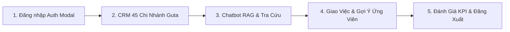

# TÀI LIỆU NGUỒN 08: DÀN Ý SLIDE BÁO CÁO BẢO VỆ KHÓA LUẬN VÀ KỊCH BẢN DEMO

Nguồn tài liệu:
- Mẫu slide tham khảo của Thầy: `C:/work-space/hr-blockbot/Tham khảo của Thầy/BC KLTN.pptx.pptx` và `KLCN_B40_HuynhThiCamDung.pptx`.
- Cấu trúc đề cương và thang điểm: `Mau De cuong chi tiet KLCN_Huong tich hop_04_07_2026.pdf`.
- Tài liệu kiến trúc và rủi ro: `docs/00-vision-scope.md` (§6), `docs/02-architecture.md`, `docs/16-project-plan.md`, `docs/f4-*.md`.
- Quyết định kiến trúc: `docs/03-decision-records/` (ADR-001 đến ADR-023).
- Mã nguồn kiểm thử E2E: `apps/web/test/e2e-revamp-flow.test.mjs`, `apps/web/test/f4-real.integration.mjs`.

---

## 8.1. Hướng Dẫn Biên Soạn Slide Theo Quy Chuẩn Khoa CNTT - HUIT

### 8.1.1. Thời lượng và phân bổ trình bày
- Tổng thời lượng phiên bảo vệ: 30 phút.
  - Trình bày báo cáo slide: 15–18 phút (khoảng 30–35 slide).
  - Trình diễn phần mềm thực tế (Live Demo): 3–5 phút.
  - Trả lời câu hỏi phản biện của Hội đồng (Q&A): 10 phút.
- Nguyên tắc phân chia nhóm 3 sinh viên:
  - Thành viên 1: Mở đầu, Khảo sát hiện trạng, Phân tích yêu cầu và Use Case nghiệp vụ (Chương 1, Chương 2).
  - Thành viên 2: Thiết kế kiến trúc hệ thống, Cơ sở dữ liệu và Thuật toán cốt lõi (Chương 3, Chương 4).
  - Thành viên 3: Hiện thực cài đặt, Kiểm thử, Đánh giá kết quả, Triển khai và điều phối Live Demo (Chương 5, Chương 6, Demo).

### 8.1.2. Quy cách trình bày slide
- Tỷ lệ khung hình: 16:9 (chuẩn màn hình chiếu hiện đại).
- Phối màu chủ đạo (Tone màu nhận diện đề tài): Trắng nền, xám trung tính, điểm nhấn xanh Sapphire Điện (`#2563eb`), chữ đen đậm tương phản cao. Tuyệt đối không dùng màu vàng chói (tuân thủ quy chuẩn Zero-Yellow trong `CLAUDE.md` và `docs/DESIGN.md`).
- Cấu trúc từng slide:
  - Tiêu đề slide rõ ràng, đặt ở đầu trang kèm số thứ tự mục.
  - Nội dung dạng gạch đầu dòng (bullet points): tối đa 3–5 dòng mỗi slide, mỗi dòng dưới 15 từ; không copy nguyên đoạn văn văn bản.
  - Hình vẽ và sơ đồ: ưu tiên sơ đồ kiến trúc trực quan, biểu đồ luồng nghiệp vụ (Mermaid/SVG), ảnh chụp màn hình UI thật có đóng khung callout vị trí thao tác chính.
  - Chân trang (Footer): Ghi rõ "Khóa luận Tốt nghiệp Cử nhân CNTT - Khóa 13 (2022 - 2026)", tên đề tài và số trang dạng `Trang hiện tại / Tổng số trang`.

---

## 8.2. Dàn Ý Chi Tiết Slide Báo Cáo PowerPoint (Từng Chương)

**Bảng 8.1: Ma trận phân bổ nội dung slide bảo vệ Khóa luận**

| STT | Phần / Chương | Tiêu đề Slide | Nội dung chính (2–3 ý cốt lõi) | Hình ảnh / Bảng trích dẫn nguồn | Thời lượng (phút) |
|---|---|---|---|---|---|
| 01 | Mở đầu | Trang bìa Khóa luận | - Tên đề tài: Xây dựng Chatbot chuyển đổi số quản lý nhân sự chuỗi bán lẻ Guta. - Nhóm SV: Phạm Việt Hoàng, Nguyễn Thái Hòa, Nguyễn Ngọc Phi. - GVHD: ThS. Trần Việt Hùng; Đơn vị: Khoa CNTT - HUIT. | Logo trường HUIT, Logo Khoa CNTT | 0.5 |
| 02 | Mở đầu | Mục lục báo cáo | - Tổng quan 6 chương báo cáo chính thức. - Phân bổ phần trình bày của từng thành viên trong nhóm. - Kế hoạch chuyển tiếp từ lý thuyết sang demo phần mềm. | Sơ đồ timeline tiến trình trình bày | 0.5 |
| 03 | Chương 1 | Bối cảnh & Tính cấp thiết | - Đặc thù chuỗi F&B Guta Cafe: 45 chi nhánh, luân chuyển ca cao, tỷ lệ nghỉ việc lớn. - Hạn chế quản lý truyền thống: Tra cứu chính sách qua giấy tờ/file rời, phân công thủ công, đánh giá KPI thiếu minh bạch. - Mục tiêu: Xây dựng hệ thống số hóa nhân sự kết hợp Chatbot AI và hỗ trợ ra quyết định. | Sơ đồ thực trạng quản lý thủ công Nguồn: `docs/word-handoff/00-mo-dau-ch1-khao-sat.md` | 1.0 |
| 04 | Chương 1 | Cơ cấu tổ chức & Biểu mẫu khảo sát | - Mô hình 3 cấp: Ban điều hành -> Quản lý khu vực / Cửa hàng trưởng (SM) -> Barista. - Khảo sát 45 chi nhánh Guta tại TP.HCM. - Thu thập 5 biểu mẫu nghiệp vụ cốt lõi: Hồ sơ nhân viên, Phiếu đăng ký ca, Bảng giao việc, Phiếu nghiệm thu, Bảng đánh giá KPI. | **Bảng 1.1**: Danh mục biểu mẫu thu thập Nguồn: `docs/word-handoff/00-mo-dau-ch1-khao-sat.md` | 1.0 |
| 05 | Chương 1 | Kế hoạch triển khai & Phân công | - Tiến độ 12 tuần với các mốc đóng băng tính năng rõ ràng. - Phân công trách nhiệm 3 thành viên theo ranh giới module độc lập. - Quản lý mã nguồn theo mô hình Monorepo (pnpm workspace) và quy chuẩn Conventional Commits. | Biểu đồ Gantt 12 tuần Nguồn: `docs/word-handoff/00-mo-dau-ch1-khao-sat.md` | 0.5 |
| 06 | Chương 2 | Phân tích yêu cầu & Tác nhân | - 4 nhóm tác nhân chính: Khách/Nhân viên mới, Barista, Cửa hàng trưởng (Store Manager), Quản trị viên nhân sự (HR/Admin). - Hệ thống năng lực Authorization V1 với 9 profile nghiệp vụ chặt chẽ. - Tách biệt hoàn toàn giữa Role (quyền hệ thống) và Level (bậc nghề nghiệp Barista L1/L2). | Sơ đồ tác nhân tương tác hệ thống Nguồn: `docs/word-handoff/01-ch2-phan-tich-use-case.md` | 1.0 |
| 07 | Chương 2 | Sơ đồ Use Case tổng quát | - Tổng thể 14 Use Case nghiệp vụ từ UC01 đến UC14. - 3 phân vùng chức năng: Quản trị nền tảng (UC01-03), Vòng đời công việc & Ca kíp (UC04-07, 12, 14), Trợ lý AI & Hiệu suất CRM (UC08-11, 13). - Đáp ứng đầy đủ quy chuẩn tối thiểu 4 nghiệp vụ thực tế và 2 nghiệp vụ phức tạp của Khoa. | **Hình 2.1**: Sơ đồ Use Case hệ thống tổng quát Nguồn: `docs/word-handoff/01-ch2-phan-tich-use-case.md` | 1.0 |
| 08 | Chương 2 | Đặc tả Use Case cốt lõi: Phân công & Bàn giao | - UC04: Quản lý công việc theo vòng đời trạng thái (Draft -> Assigned -> In Progress -> Completed). - UC05: Gợi ý ứng viên phù hợp ca trực dựa trên kỹ năng. - UC06: Bàn giao và xác nhận trách nhiệm hai chiều với chữ ký bằng chứng số Hash Proof (ADR-021). | Sơ đồ tuần tự UC05 & UC06 Nguồn: `docs/word-handoff/02-ch2-use-case-chi-tiet-uc01-uc07.md` | 1.0 |
| 09 | Chương 2 | Đặc tả Use Case AI: Chatbot RAG & Tra cứu | - UC08: Trợ lý hỏi đáp chính sách nhân sự Guta ứng dụng RAG. - UC09: Tra cứu dữ liệu KPI/Doanh thu với mô hình Preview-Confirm (ngăn chặn thao tác ngầm). - UC10: Đánh giá KPI đa chiều kết hợp công thức tất định và phân tích nhận xét định tính. | Sơ đồ hoạt động luồng Chatbot Preview-Confirm Nguồn: `docs/word-handoff/03-ch2-use-case-chi-tiet-uc08-uc14.md` | 1.0 |
| 10 | Chương 3 | Kiến trúc hệ thống tổng thể | - Mô hình Monorepo chia tách ranh giới rõ ràng:   + Frontend: React 18 + Vite (SPA), Tailwind CSS, Shimmer UI.   + Backend API: Node.js Express + TypeScript, RESTful API, Socket.IO.   + AI Service: Python FastAPI sidecar (phục vụ RAG và Semantic Matching).   + Shared Contracts: Zod schemas đảm bảo Single Source of Truth giữa Web và API. | **Hình 3.1**: Sơ đồ kiến trúc 3 tầng Monorepo Nguồn: `docs/word-handoff/04-ch3-thiet-ke-he-thong.md` | 1.5 |
| 11 | Chương 3 | Thiết kế Cơ sở dữ liệu MongoDB | - Cấu trúc 32 collections phục vụ vận hành chuỗi 45 cửa hàng. - Chiến lược Single-Document Atomic Update trên MongoDB Atlas M0 (không dùng multi-document transaction theo ADR-004). - Quản lý phiên an toàn: Refresh Token Rotation (ADR-008), mật khẩu Argon2id (ADR-006). | **Hình 3.2**: Lược đồ liên kết dữ liệu CSDL (ERD) Nguồn: `docs/word-handoff/04-ch3-thiet-ke-he-thong.md` | 1.5 |
| 12 | Chương 3 | Thiết kế giao diện (UI/UX) | - Thiết kế Newsreader Editorial chuyên nghiệp, tone Sapphire Blue `#2563eb`. - CRM Command Center quản trị chi nhánh trực quan với Slide-over Drawer. - Chatbot Drawer tích hợp sẵn trong không gian làm việc của quản lý. | [CHÈN ẢNH: Màn hình CRM Dashboard và Drawer] Nguồn: `docs/word-handoff/04-ch3-thiet-ke-he-thong.md` | 1.0 |
| 13 | Chương 4 | Thuật toán 1: RAG Tra Cứu Chính Sách | - Vector Embedding: Google `gemini-embedding-001` (3072 chiều) lưu trữ trong MongoDB Atlas Vector Search. - Tìm kiếm ngữ nghĩa Cosine Similarity với ngưỡng lọc tin cậy. - Prompt Engineering có Citation: Trích dẫn rõ ràng điều khoản trong sổ tay nhân sự Guta, chống ảo giác (Hallucination). | Sơ đồ pipeline xử lý truy vấn RAG Nguồn: `docs/word-handoff/05-ch4-thuat-toan.md` | 1.5 |
| 14 | Chương 4 | Thuật toán 2: So Khớp Kỹ Năng Ứng Viên (F4) | - Thuật toán cơ sở (Baseline): Exact-skills Matching tất định, tốc độ dưới 10ms, hoạt động mặc định. - Mô hình mở rộng (Worker Opt-in): PhoBERT Base (`vinai/phobert-base`) kết hợp bộ tách từ VnCoreNLP trên worker CPU riêng. - Công thức kết hợp: `Final_Score = (1 - alpha) * Exact_Score + alpha * Semantic_Score`. - Cơ chế bảo vệ: Preflight 2.5 GiB RAM, timeout 8s tự động fallback về baseline. | Sơ đồ kiến trúc luồng so khớp F4 và Fallback Nguồn: `docs/word-handoff/05-ch4-thuat-toan.md` | 1.5 |
| 15 | Chương 4 | Thuật toán 3: Jev AI Decision Gate & Tính KPI | - Jev AI Gate: Chế độ SHADOW SYNTHETIC (chạy ngầm kiểm thử so sánh với luật cứng, không cấp quyền tự động mutate dữ liệu live theo ADR-019). - Đánh giá KPI: Công thức toán học tất định khống chế chỉ số định lượng; AI chỉ tham gia phân tích cảm xúc lời nhận xét với trần điểm tối đa (Ceiling Cap 5-10%) và kiểm soát thiên kiến (ADR-013, ADR-023). | Biểu đồ công thức tính điểm KPI tất định Nguồn: `docs/word-handoff/05-ch4-thuat-toan.md` | 1.0 |
| 16 | Chương 5 | Hiện thực cài đặt Frontend & Backend | - Xây dựng 29 REST API endpoints Express và 52 UI Components React. - Quản lý phiên làm việc JWT với thư viện `jose`, cơ chế hủy token tức thì khi phát hiện rò rỉ. - Tích hợp thông báo thời gian thực Socket.IO và gửi cảnh báo tự động qua Telegram Bot. | Bảng tổng hợp các module code chính Nguồn: `docs/word-handoff/06-ch5-cai-dat.md` | 1.0 |
| 17 | Chương 5 | Hiện thực module Chatbot & Preview-Confirm | - Giao diện ChatDrawer phản hồi thời gian thực với streaming token. - Hiện thực State Machine cho luồng Preview-Confirm: Bot sinh giao dịch đề xuất -> Người dùng duyệt trực quan -> API thực thi có log kiểm toán. - Kiểm soát lỗi an toàn: Không thực thi lệnh nguy hiểm khi câu hỏi mơ hồ. | Sơ đồ trạng thái State Machine Preview-Confirm Nguồn: `docs/word-handoff/06-ch5-cai-dat.md` | 1.0 |
| 18 | Chương 6 | Phương pháp & Kịch bản kiểm thử | - Kiểm thử E2E tự động: Bộ Playwright E2E (`e2e-revamp-flow.test.mjs`) kiểm tra 100% luồng người dùng từ Landing -> Auth -> CRM -> Chat -> Đăng xuất. - Kiểm thử đơn vị (Unit Tests): Kiểm tra tính toàn vẹn của Zod contracts và logic nghiệp vụ API. - Kiểm thử AI Hermetic: Pytest kiểm tra tính cô lập của gateway AI và xử lý lỗi mạng. | **Bảng 6.1**: Bảng kết quả chạy test tự động Nguồn: `docs/word-handoff/07-ch6-kiem-thu-trien-khai-ket-luan.md` | 1.0 |
| 19 | Chương 6 | Triển khai thực tế trên Render Cloud | - Triển khai Web SPA và API Service trên nền tảng Render Cloud. - Kết nối cơ sở dữ liệu MongoDB Atlas cụm Singapore (độ trễ thấp). - Tích hợp Render CLI quản lý phiên bản triển khai với trạng thái hoạt động thực tế `status: "live"`. | [CHÈN ẢNH: Trạng thái Render CLI live và domain Web] Nguồn: `docs/word-handoff/07-ch6-kiem-thu-trien-khai-ket-luan.md` | 1.0 |
| 20 | Kết luận | Kết quả đạt được & Đóng góp | - Xây dựng hoàn chỉnh hệ sinh thái số hóa quản lý nhân sự cho 45 chi nhánh Guta. - Tích hợp thành công Chatbot RAG hỗ trợ tra cứu chính sách tức thì. - Ứng dụng thuật toán so khớp ứng viên có cơ chế fallback bảo vệ tài nguyên. - Đảm bảo tính minh bạch trong giao việc với chữ ký chứng thực Hash Proof. | Bảng đối chiếu mục tiêu ban đầu vs Kết quả đạt được Nguồn: `docs/word-handoff/07-ch6-kiem-thu-trien-khai-ket-luan.md` | 1.0 |
| 21 | Kết luận | Hạn chế & Hướng phát triển | - Hạn chế: Thử nghiệm PhoBERT mới dừng ở mức exploratory trên dữ liệu synthetic do giới hạn RAM máy chủ miễn phí; Jev AI Gate mới ở mức chạy thử nghiệm Shadow. - Hướng phát triển: Thu thập tập dữ liệu HR tiếng Việt có dán nhãn chuẩn vàng từ chuyên gia nhân sự; Nâng cấp cụm máy chủ có GPU để triển khai PhoBERT phục vụ toàn diện; Tích hợp hệ thống chấm công nhận diện khuôn mặt. | Danh sách 3 hướng phát triển trọng tâm Nguồn: `docs/word-handoff/07-ch6-kiem-thu-trien-khai-ket-luan.md` | 1.0 |
| 22 | Demo | Chuyển tiếp sang phần Live Demo | - Giới thiệu các kịch bản thực nghiệm trực tiếp trên hệ thống. - Cung cấp mã QR và đường dẫn truy cập website thực tế: `https://hr-blockbot-web.onrender.com`. | Mã QR truy cập Web và sơ đồ kịch bản demo | 0.5 |
| 23 | Hỏi đáp | Lời cảm ơn & Sẵn sàng Q&A | - Trân trọng cảm ơn Quý Thầy Cô trong Hội đồng phản biện và Thầy hướng dẫn. - Nhóm sẵn sàng lắng nghe câu hỏi và đóng góp ý kiến. | Thông tin liên hệ nhóm sinh viên | 0.5 |

---

## 8.3. Kịch Bản Demo Trực Quan (Live Demonstration Script)

Kịch bản demo được thiết kế tinh gọn trong 4–5 phút, chỉ dựa trên 100% các tính năng đã kiểm chứng có thật trong mã nguồn và chạy thành công trên bộ test Playwright E2E (`apps/web/test/e2e-revamp-flow.test.mjs`).

### Bước 1: Đăng nhập hệ thống phân quyền (Auth Modal & Capability Profile)
- **Hành động thao tác:**
  1. Mở trình duyệt truy cập ứng dụng web tại địa chỉ `http://localhost:5173` (hoặc URL Render Cloud).
  2. Giới thiệu giao diện Landing Page: Phong cách tin tức Newsreader Editorial, tone màu xanh Sapphire `#2563eb`, tuyệt đối không có pixel màu vàng chói.
  3. Bấm nút "Get Started" trên thanh điều hướng để mở hộp thoại đăng nhập (Auth Modal).
  4. Đăng nhập với tài khoản Quản lý cửa hàng (Store Manager Đỗ Quỳnh Anh - Chi nhánh Guta Sư Vạn Hạnh, mã `GT-CH-02`).
- **Hiện tượng quan sát được:**
  - Hệ thống xác thực bằng Argon2id và cấp cặp JWT access/refresh token qua thư viện `jose`.
  - Phân quyền Authorization V1 nhận diện đúng vai trò Store Manager và chuyển hướng trực tiếp vào màn hình điều khiển CRM.

### Bước 2: Quản trị chi nhánh trên CRM Dashboard (Chuỗi 45 cửa hàng GUTA)
- **Hành động thao tác:**
  1. Trình diễn bảng danh mục 45 chi nhánh Guta trên toàn thành phố Hồ Chí Minh.
  2. Sử dụng ô tìm kiếm, gõ từ khóa "Sư Vạn Hạnh" để lọc tức thì chi nhánh Quận 10.
  3. Nhấp chuột vào dòng chi nhánh "GUTA CAFE - Quận 10 - 581 Sư Vạn Hạnh".
  4. Slide-over Drawer mở ra từ cạnh phải màn hình.
  5. Bấm nút "Gửi Cảnh Báo Telegram" trên thanh công cụ của Drawer.
- **Hiện tượng quan sát được:**
  - Drawer hiển thị thông tin nhân sự trong ca trực (Barista, ca làm việc, trạng thái hoạt động).
  - Thông báo Toast hiển thị phản hồi: "Cảnh báo ca trực đã được gửi thành công qua Telegram Bot".

### Bước 3: Tra cứu chính sách nhân sự qua Chatbot RAG (Preview-Confirm Workflow)
- **Hành động thao tác:**
  1. Nhấn biểu tượng mở Chat Drawer tích hợp sẵn trong CRM.
  2. Đặt câu hỏi nghiệp vụ: *"Quy định về thời gian nghỉ giữa ca và tiêu chuẩn đồng phục của Barista tại cửa hàng là gì?"*.
  3. Chatbot phản hồi nội dung chính sách kèm trích dẫn tài liệu quy định nội bộ (Citation).
  4. Thử nghiệm tính năng thao tác an toàn: Yêu cầu bot *"Lập đề xuất phân công phụ ca cho Barista Nguyễn Văn A vào ngày mai"*.
- **Hiện tượng quan sát được:**
  - Chatbot hiển thị thẻ xem trước (Preview Card) gồm thông tin ca, nhân viên và công việc, đi kèm nút bấm "Xác Nhận Thực Hiện" và "Hủy Bỏ".
  - Chứng minh hệ thống tuân thủ mô hình Preview-Confirm: Không tự ý ghi đè dữ liệu ngầm khi chưa có xác nhận từ người quản lý.

### Bước 4: Tạo công việc, gợi ý ứng viên (F4) và xác thực bàn giao (ADR-021)
- **Hành động thao tác:**
  1. Điều hướng sang phân hệ Giao việc (`AssignmentPanel`).
  2. Tạo một nhiệm vụ mới: *"Kiểm kê kho hạt cà phê Robusta và vệ sinh đầu máy pha espresso cuối ca"*, yêu cầu kỹ năng: `pha_che_may`, `kiem_ke_kho`.
  3. Bấm nút "Gợi Ý Ứng Viên Phù Hợp" (`CandidateSuggestions`).
  4. Hệ thống hiển thị danh sách Barista được sắp xếp theo độ tương đồng kỹ năng (chạy exact-skills baseline hoặc semantic worker nếu bật).
  5. Chọn Barista L2 có độ phù hợp cao nhất và nhấn "Giao Việc".
  6. Chuyển sang góc nhìn nhân viên: Nhấn "Tiếp Nhận Nhiệm Vụ".
- **Hiện tượng quan sát được:**
  - Trạng thái công việc chuyển từ `ASSIGNED` sang `IN_PROGRESS`.
  - Hệ thống tự động sinh và hiển thị mã xác thực bàn giao `Hash Proof` (chuỗi SHA-256 bất biến) chứng thực trách nhiệm hai chiều giữa người giao và người nhận.

### Bước 5: Đánh giá hiệu suất, tổng hợp KPI và đăng xuất an toàn
- **Hành động thao tác:**
  1. Mở màn hình Đánh giá hiệu suất nhân sự (KPI Dashboard).
  2. Xem bảng điểm KPI tổng hợp của nhân viên: Điểm định lượng được tính tự động bằng công thức toán học tất định (dựa trên số ca làm đúng giờ, tỷ lệ hoàn thành việc).
  3. Trình chiếu phần phân tích nhận xét định tính có trần điểm AI khống chế (không bị vượt quá biên độ cho phép, loại bỏ thiên kiến).
  4. Nhấn nút "Đăng Xuất".
- **Hiện tượng quan sát được:**
  - Hệ thống thu hồi Refresh Token trên MongoDB, xóa sạch session client và quay về Landing Page một cách an toàn.

---

## 8.4. Dự Kiến Câu Hỏi Phản Biện Của Hội Đồng & Hướng Trả Lời Trung Thực

Phần này tổng hợp 12 câu hỏi phản biện sắc bén nhất, được xây dựng dựa trên các rủi ro kỹ thuật đã phân tích trong `docs/00-vision-scope.md` (§6), các tài liệu đánh giá `docs/f4-*.md` và các quyết định kiến trúc cốt lõi (ADR). Tất cả câu trả lời đều tuân thủ nguyên tắc trung thực tuyệt đối với hiện trạng mã nguồn.

---

### Câu 1: Về việc ứng dụng mô hình PhoBERT trong bài toán gợi ý ứng viên (F4)
- **Câu hỏi của Thầy/Cô phản biện:**
  *"Nhóm sử dụng mô hình PhoBERT để gợi ý ứng viên như thế nào? Mô hình có được bật mặc định trên máy chủ Render Cloud không và thời gian phản hồi thực tế ra sao?"*
- **Hướng trả lời trung thực & chuẩn xác:**
  - **Bản chất kỹ thuật:** Trong mã nguồn hiện tại, thuật toán mặc định của hệ thống là **Exact-Skills Baseline** (so khớp tập hợp kỹ năng tất định, tốc độ dưới 10ms, không tốn tài nguyên). PhoBERT Base (`vinai/phobert-base`) kết hợp bộ tách từ VnCoreNLP được thiết kế dưới dạng **Worker Opt-in độc lập** (`app/f4_gateway.py`), kết nối qua biến môi trường `F4_MODE=PHOBERT`.
  - **Triển khai máy chủ:** Nhóm **không** bật PhoBERT mặc định trên môi trường Render Free Tier. Lý do là PhoBERT kèm VnCoreNLP đòi hỏi máy ảo Java (JVM) với bộ nhớ RAM trống tối thiểu 2.5 GiB (kiểm tra qua preflight check); gói miễn phí của Render không đáp ứng được ngưỡng an toàn này.
  - **Độ trễ và cơ chế bảo vệ:** Khi chạy kiểm thử local, thời gian nạp mô hình lần đầu mất khoảng 14.6 giây, độ trễ suy luận khoảng 500–700ms. Hệ thống đã cài đặt cơ chế bảo vệ với HTTP timeout 8 giây: Nếu worker chưa nạp xong hoặc quá tải, hệ thống tự động suy thoái mượt mà (graceful fallback) về thuật toán Baseline kèm gắn nhãn minh bạch (`MODEL_UNAVAILABLE + BASELINE_FALLBACK`), tuyệt đối không làm gián đoạn trải nghiệm người dùng.

---

### Câu 2: Về độ chính xác, chỉ số F1 và kết quả thực nghiệm của chức năng F4
- **Câu hỏi của Thầy/Cô phản biện:**
  *"Báo cáo có công bố chỉ số F1-Score hoặc độ chính xác 85–90% cho chức năng gợi ý ứng viên không? Nhóm đã đánh giá mô hình trên dữ liệu thực tế như thế nào?"*
- **Hướng trả lời trung thực & chuẩn xác:**
  - **Minh bạch số liệu:** Nhóm **không công bố số F1 giả mạo** và khẳng định hiện tại chưa có chỉ số F1 trên môi trường production.
  - **Cơ sở đánh giá:** Trong bài toán xếp hạng ứng viên (Ranking/Recommendation), các độ đo chuẩn khoa học được nhóm áp dụng là **NDCG@5, MRR và Precision@K**, không quy đổi tùy tiện sang F1.
  - **Bản chất thực nghiệm:** Thử nghiệm benchmark hiện tại của nhóm là **Exploratory Benchmark** chạy trên tập dữ liệu tổng hợp (Synthetic Pilot 20 nhiệm vụ x 10 ứng viên) với cơ chế AI Judge độc lập, chọn hệ số kết hợp alpha trên tập Dev và khóa lại trước khi đo trên tập Test. Do chưa có kinh phí và thời gian để tổ chức hội đồng chuyên gia nhân sự đánh giá mù (Human-gold labels), nhóm ghi nhận trung thực đây là kết quả thử nghiệm thăm dò kỹ thuật, không dùng để khẳng định độ chính xác thương mại.

---

### Câu 3: Về sự khác biệt giữa mô hình Embedding trong Chatbot RAG và PhoBERT
- **Câu hỏi của Thầy/Cô phản biện:**
  *"Tại sao Chatbot hỏi đáp chính sách không sử dụng luôn PhoBERT để tìm kiếm tài liệu mà lại dùng mô hình khác? Có sự trùng lặp công nghệ ở đây không?"*
- **Hướng trả lời trung thực & chuẩn xác:**
  - **Phân định rõ bài toán:** PhoBERT là mô hình Masked Language Model (kiến trúc RoBERTa) được huấn luyện tối ưu cho các bài toán phân loại văn bản, gán nhãn thực thể hoặc so khớp ngữ nghĩa ngắn theo cặp; PhoBERT không phải là mô hình sinh vector đặc trưng văn bản dài (Bi-Encoder Dense Retrieval).
  - **Giải pháp RAG tối ưu:** Đối với Chatbot hỏi đáp chính sách (RAG), nhóm sử dụng mô hình chuyên dụng **Google `gemini-embedding-001`** tạo vector 3072 chiều và lập chỉ mục trong MongoDB Atlas Vector Search. Mô hình này được huấn luyện đặc thù cho việc tìm kiếm ngữ nghĩa đoạn văn bản quy định dài, kết hợp với LLM Gemini để tổng hợp câu trả lời có trích dẫn điều khoản.
  - **Nguyên tắc thiết kế:** Việc tách biệt này tuân thủ nguyên tắc chọn đúng công cụ tối ưu cho từng bài toán kỹ thuật (ADR-005, ADR-012), tránh việc ép một mô hình ngôn ngữ làm nhiệm vụ không đúng sở trường gây suy giảm chất lượng.

---

### Câu 4: Về kiểm soát hiện tượng ảo giác (Hallucination) của Chatbot nhân sự
- **Câu hỏi của Thầy/Cô phản biện:**
  *"Nếu nhân viên hỏi về chế độ lương thưởng hoặc các quy định nhạy cảm, làm sao đảm bảo Chatbot không bịa đặt thông tin gây hiểu lầm?"*
- **Hướng trả lời trung thực & chuẩn xác:**
  - **Lớp kiểm soát 1 - RAG Grounding:** Chatbot bị ràng buộc nghiêm ngặt trong Prompt hệ thống: Chỉ được phép trả lời dựa trên các đoạn văn bản chính sách được trích xuất từ cơ sở tri thức Guta qua tìm kiếm vector. Mọi câu trả lời đều phải kèm trích dẫn số hiệu quy định (Citations).
  - **Lớp kiểm soát 2 - Ngưỡng tin cậy (Confidence Threshold):** Nếu điểm tương đồng vector (Cosine Similarity) của tài liệu tìm được nằm dưới ngưỡng an toàn, bot sẽ từ chối trả lời phỏng đoán và đưa ra câu phản hồi chuẩn mực: *"Vấn đề này chưa có quy định trong sổ tay nội bộ, bạn vui lòng liên hệ trực tiếp phòng Nhân sự"*.
  - **Lớp kiểm soát 3 - Cơ chế Preview-Confirm:** Đối với các tác vụ có khả năng thay đổi trạng thái hoặc tra cứu thông tin cá nhân bảo mật, Chatbot chỉ hiển thị giao diện xem trước (Preview) để người dùng có thẩm quyền chủ động bấm duyệt, hoàn toàn không tự động thực thi ngầm lệnh gọi hàm (Tool Calling không tự mutate).

---

### Câu 5: Về vai trò thực tế của Jev AI Decision Gate trong hệ thống
- **Câu hỏi của Thầy/Cô phản biện:**
  *"Hệ thống có thành phần Jev AI Decision Gate. Thành phần này có được quyền tự động phê duyệt ca làm việc hoặc tự động sa thải/khen thưởng nhân viên không?"*
- **Hướng trả lời trung thực & chuẩn xác:**
  - **Ranh giới an toàn tuyệt đối:** Hoàn toàn **KHÔNG**. Theo quyết định kiến trúc ADR-019 và tài liệu thiết kế hệ thống, Jev AI Decision Gate trong phiên bản V1 chỉ hoạt động ở chế độ **SHADOW SYNTHETIC** trong môi trường thử nghiệm nội bộ.
  - **Mục đích của Shadow Mode:** Mô hình chỉ chạy ngầm song song để ghi nhận log dự đoán và đối sánh với quyết định của các quy tắc nghiệp vụ thực tế (Rule-based Gate), nhằm phục vụ nghiên cứu và đánh giá độ lệch, tuyệt đối chưa bao giờ được cấp quyền can thiệp vào luồng dữ liệu sản xuất.
  - **Nguyên tắc Human-in-the-loop:** Toàn bộ các quyết định liên quan đến con người (phân công ca trực, phê duyệt KPI, xử lý vi phạm) đều bắt buộc phải do Cửa hàng trưởng hoặc Quản lý nhân sự trực tiếp thao tác và chịu trách nhiệm.

---

### Câu 6: Về tính khách quan và kiểm soát thiên kiến khi AI chấm điểm KPI (F5)
- **Câu hỏi của Thầy/Cô phản biện:**
  *"Nếu đưa AI vào chấm điểm KPI nhân viên, liệu có xảy ra tình trạng thiên kiến (Bias) hoặc đánh giá sai lệch do lời nhận xét cảm tính không?"*
- **Hướng trả lời trung thực & chuẩn xác:**
  - **Công thức tất định làm gốc (ADR-013):** Điểm số KPI cốt lõi của nhân viên Guta được tính toán hoàn toàn bằng **công thức toán học tất định** dựa trên số liệu định lượng có thật từ hệ thống: Tỷ lệ hoàn thành công việc đúng hạn, số ca trực đúng giờ, số lượng hóa đơn/doanh thu phục vụ.
  - **Khống chế trần điểm AI (Ceiling Cap):** AI chỉ đóng vai trò phân tích xử lý ngôn ngữ tự nhiên (NLP) đối với các đoạn nhận xét bằng lời của quản lý để phát hiện sắc thái tích cực/tiêu cực. Điểm điều chỉnh từ AI chỉ chiếm tỷ trọng tối đa từ 5% đến 10% trong tổng điểm KPI.
  - **Bộ lọc kiểm soát thiên kiến (Bias Probe):** Hệ thống có cơ chế kiểm toán từ ngữ thiên vị cá nhân; đồng thời Quản lý cấp cao luôn có quyền can thiệp điều chỉnh (Override) và mọi hành động điều chỉnh đều được ghi vết nhật ký kiểm toán bất biến (Audit Log) theo ADR-023.

---

### Câu 7: Về việc không sử dụng giao dịch đa tài liệu (Multi-document Transaction)
- **Câu hỏi của Thầy/Cô phản biện:**
  *"Tại sao một hệ thống quản lý có các luồng giao việc và ca kíp liên quan nhiều bảng lại không sử dụng Multi-document Transaction trong MongoDB?"*
- **Hướng trả lời trung thực & chuẩn xác:**
  - **Đánh đổi kiến trúc thực tế (ADR-004):** Đề tài định hướng nghiên cứu khả năng vận hành tối ưu chi phí trên nền tảng đám mây phân tán, cụ thể là cụm MongoDB Atlas Free Tier M0. Trên môi trường này, multi-document transaction tiêu tốn nhiều tài nguyên kết nối, dễ xảy ra tình trạng khóa (Lock contention) và timeout khi hạ tầng có độ trễ mạng.
  - **Giải pháp thay thế an toàn:** Nhóm áp dụng kỹ thuật thiết kế CSDL hướng tài liệu hiện đại:
    1. Thiết kế tài liệu nhúng (Embedded Subdocuments) cho các dữ liệu phụ thuộc vòng đời, tận dụng cơ chế **Single-Document Atomic Update** (nguyên tử hóa trên một document duy nhất).
    2. Áp dụng cơ chế kiểm soát đồng thời lạc quan (Optimistic Concurrency Control) với trường phiên bản dữ liệu `version/seq`.
    3. Thiết kế trạng thái luồng công việc theo mô hình máy trạng thái hữu hạn (Finite State Machine) với kiểm tra điều kiện tiên quyết trước khi cập nhật.

---

### Câu 8: Về cơ chế phân quyền đa chi nhánh và chống truy cập chéo (IDOR)
- **Câu hỏi của Thầy/Cô phản biện:**
  *"Chuỗi có 45 cửa hàng, làm thế nào để Cửa hàng trưởng chi nhánh này không xem trộm hoặc sửa đổi được dữ liệu nhân sự, doanh thu của chi nhánh khác?"*
- **Hướng trả lời trung thực & chuẩn xác:**
  - **Kiến trúc Authorization V1:** Hệ thống định nghĩa 9 Capability Profile riêng biệt, được xác thực chặt chẽ tại tầng Middleware của API Gateway (`apps/api/src/routes/authorization-gateway.ts`).
  - **Tách biệt Role và Level (ADR-009):** Nhóm tách riêng giữa Chức vụ hệ thống (Admin, HR, Store Manager) và Bậc kỹ năng nghề nghiệp (Barista L1, L2). Quyền hạn truy cập tài nguyên không suy đoán từ chức danh hiển thị.
  - **Kiểm soát phạm vi dữ liệu (Scope Guard):** Mỗi tài khoản Cửa hàng trưởng khi đăng nhập chỉ được gán phạm vi hoạt động gắn liền với mã định danh chi nhánh (`storeId`). Tại mọi câu truy vấn vào CSDL, API luôn tự động chèn điều kiện lọc `storeId` từ token phiên đã xác thực, triệt tiêu hoàn toàn lỗ hổng IDOR (Insecure Direct Object Reference).

---

### Câu 9: Về an toàn bảo mật tài khoản và cơ chế quản lý phiên
- **Câu hỏi của Thầy/Cô phản biện:**
  *"Nhóm bảo vệ mật khẩu nhân viên như thế nào và làm sao ngăn chặn kẻ xấu chiếm đoạt phiên đăng nhập (Session Hijacking)?"*
- **Hướng trả lời trung thực & chuẩn xác:**
  - **Mã hóa mật khẩu chuẩn quốc tế (ADR-006):** Thay vì dùng MD5 hoặc bcrypt đời cũ, hệ thống áp dụng thuật toán băm **Argon2id** (thuật toán đạt giải nhất cuộc thi Password Hashing Competition), có khả năng chống tấn công brute-force bằng GPU và ASIC.
  - **Quản lý Token với thư viện `jose` (ADR-007):** Chuẩn hóa việc ký và xác thực JSON Web Token tuân thủ nghiêm ngặt chuẩn JWT/JWS.
  - **Xoay vòng Refresh Token (Refresh Token Rotation - ADR-008):** Mỗi khi client gửi Refresh Token để lấy Access Token mới, Refresh Token cũ sẽ bị hủy ngay lập tức và thay thế bằng một token mới trong CSDL. Nếu hệ thống phát hiện một Refresh Token cũ đã bị sử dụng lại (dấu hiệu token bị đánh cắp), toàn bộ chuỗi token của người dùng đó sẽ bị thu hồi ngay lập tức, vô hiệu hóa phiên truy cập của kẻ tấn công.

---

### Câu 10: Về khả năng chịu lỗi khi mất kết nối mạng hoặc cạn kiệt Quota LLM
- **Câu hỏi của Thầy/Cô phản biện:**
  *"Nếu dịch vụ AI của Google (Gemini) bị sập mạng hoặc hết hạn mức API trong giờ cao điểm thì toàn bộ hệ thống có bị tê liệt không?"*
- **Hướng trả lời trung thực & chuẩn xác:**
  - **Kiến trúc cô lập Sidecar (ADR-003):** Toàn bộ các dịch vụ AI được đặt trong một tiến trình riêng (FastAPI Sidecar), giao tiếp qua HTTP nội bộ với Node.js API. Nếu AI Sidecar gặp sự cố, tiến trình Node.js API chính phục vụ vận hành chuỗi vẫn hoạt động 100% bình thường.
  - **Xử lý suy biến mượt mà (Graceful Degradation):** Tầng kết nối LLM được cài đặt cơ chế Circuit Breaker và Timeout ngắn. Khi LLM hết hạn mức (HTTP 429) hoặc mất mạng, API sẽ trả về mã lỗi có cấu trúc (`LLM_SERVICE_UNAVAILABLE`). Giao diện Web sẽ hiển thị thông báo nhẹ nhàng cho người dùng và chuyển hướng sang danh mục biểu mẫu tĩnh, không làm vỡ giao diện (No White Screen of Death).
  - **Vận hành cốt lõi độc lập:** Các nghiệp vụ sống còn như xếp ca, giao việc, chấm công, xem báo cáo doanh thu vận hành hoàn toàn dựa trên cơ sở dữ liệu MongoDB và API nội bộ, hoàn toàn không phụ thuộc vào LLM.

---

### Câu 11: Về tính pháp lý và chống chối bỏ trách nhiệm khi giao việc (ADR-021)
- **Câu hỏi của Thầy/Cô phản biện:**
  *"Làm sao để giải quyết tranh chấp khi Quản lý bảo đã giao việc nhưng Nhân viên nói chưa nhận, hoặc có người tự ý chỉnh sửa nội dung công việc sau khi giao?"*
- **Hướng trả lời trung thực & chuẩn xác:**
  - **Bằng chứng mật mã Hash Proof (ADR-021):** Mỗi khi một công việc được tạo lập, bàn giao (Handover) hoặc chấp thuận (Accept), hệ thống tự động tính toán một chuỗi mã băm mật mã (SHA-256 Hash Proof) dựa trên: `Mã công việc + ID người thực hiện + Thời điểm chính xác + Trạng thái mới + Nội dung yêu cầu`.
  - **Lưu vết bất biến:** Chuỗi Hash Proof này được ghi trực tiếp vào collection lịch sử kiểm toán của hệ thống (`assignment_audit_trail`). Mọi sự thay đổi về nội dung sau thời điểm ký kết đều làm sai lệch mã băm đối soát.
  - **Đối soát hai chiều:** Cả Cửa hàng trưởng và Barista đều nhìn thấy mã xác thực này trên giao diện, tạo ra bằng chứng kỹ thuật không thể chối bỏ trách nhiệm giữa hai bên.

---

### Câu 12: Về tính xác thực của dữ liệu 45 chi nhánh Guta trong đề tài
- **Câu hỏi của Thầy/Cô phản biện:**
  *"Dữ liệu 45 cửa hàng và doanh thu trong hệ thống là dữ liệu thật của chuỗi Guta hay nhóm tự bịa ra để làm báo cáo?"*
- **Hướng trả lời trung thực & chuẩn xác:**
  - **Dữ liệu thực tế:** Danh mục 45 chi nhánh (bao gồm tên cửa hàng, địa chỉ đường phố, quận huyện thực tế tại TP.HCM) là thông tin khảo sát thực tế có thật từ mạng lưới hoạt động của chuỗi Guta Cafe.
  - **Dữ liệu mẫu tuân thủ bảo mật (Synthetic Fixtures):** Nhóm khẳng định trung thực: Toàn bộ số liệu doanh thu chi tiết từng ngày, thông tin số điện thoại cá nhân của nhân viên và bảng lương đều là **dữ liệu mẫu giả lập có cấu trúc** (tuân thủ nghiêm ngặt Schema Zod contract). Điều này nhằm tuân thủ quy định bảo vệ bí mật kinh doanh của doanh nghiệp và quy định an toàn dữ liệu cá nhân theo pháp luật (Nghị định 13/2023/NĐ-CP).
  - **Nguyên tắc hiển thị trung thực (ADR-020):** Đối với các chi nhánh chưa có dữ liệu báo cáo, hệ thống hiển thị giá trị trống (`null` hoặc gạch ngang `-`), tuyệt đối không tự ý nội suy số liệu giả để làm đẹp giao diện CRM.

---

## 8.5. Danh Mục Ảnh Cần Chụp Để Chèn Vào Slide Báo Cáo

Để hoàn thiện bộ slide PowerPoint, sinh viên thực hiện cần chụp màn hình thực tế các phân hệ sau từ ứng dụng đang chạy (hoặc từ kết quả chạy test Playwright):

1. `[CHÈN ẢNH: Giao diện Landing Page phong cách Newsreader Editorial — Route: / — Hiển thị thanh Header, sapphire blue #2563eb, không có màu vàng — Khách vãng lai]`
2. `[CHÈN ẢNH: Hộp thoại đăng nhập Auth Modal — Route: / (Bấm Get Started) — Nhập tài khoản Store Manager — Khách vãng lai]`
3. `[CHÈN ẢNH: CRM Command Center danh sách 45 cửa hàng Guta — Route: /crm — Bảng dữ liệu cửa hàng, ô tìm kiếm chi nhánh Sư Vạn Hạnh — Store Manager]`
4. `[CHÈN ẢNH: Slide-over Drawer thông tin chi nhánh — Route: /crm (Click vào dòng cửa hàng) — Danh sách Barista trong ca trực, nút gửi Telegram Alert — Store Manager]`
5. `[CHÈN ẢNH: Chatbot Drawer hỏi đáp chính sách RAG — Route: /crm (Mở Chat Drawer) — Câu hỏi quy định ca trực, câu trả lời kèm thẻ Citation nguồn tài liệu — Store Manager]`
6. `[CHÈN ẢNH: Giao diện Chatbot Preview-Confirm — Route: /crm (Chat Drawer) — Thẻ xem trước lệnh đề xuất phân công kèm nút Xác nhận/Hủy — Store Manager]`
7. `[CHÈN ẢNH: Bảng phân công công việc và gợi ý ứng viên F4 — Route: /assignments — Danh sách gợi ý Barista sắp xếp theo độ tương đồng kỹ năng — Store Manager]`
8. `[CHÈN ẢNH: Chi tiết bàn giao công việc kèm mã Hash Proof — Route: /assignments/:id — Hiển thị chuỗi mã băm SHA-256 xác thực trách nhiệm — Barista / Store Manager]`
9. `[CHÈN ẢNH: Bảng điều khiển hiệu suất nhân sự và KPI — Route: /kpi — Bảng tính điểm định lượng và phân tích nhận xét AI có trần điểm — HR Manager]`
10. `[CHÈN ẢNH: Bằng chứng kiểm thử tự động Playwright E2E — Terminal CLI — Kết quả chạy 'node apps/web/test/e2e-revamp-flow.test.mjs' hiển thị 100% PASS — Kỹ sư kiểm thử]`
11. `[CHÈN ẢNH: Trạng thái triển khai trên Render Cloud CLI — Terminal CLI — Kết quả chạy 'render deploys list ...' hiển thị status: live — Kỹ sư DevOps]`

---

## 8.6. Mục Chưa Kiểm Chứng Cần Lưu Ý Trong Báo Cáo

**Bảng 8.2: Các điểm kỹ thuật chưa kiểm chứng trên môi trường Production**

| STT | Hạng mục kỹ thuật | Hiện trạng kiểm chứng | Lý do kỹ thuật | Hướng xử lý khi bảo vệ |
|---|---|---|---|---|
| 01 | Độ chính xác F1-Score của F4 PhoBERT | `[CHƯA KIỂM CHỨNG: Chưa có nhãn chuẩn vàng từ chuyên gia nhân sự trên dữ liệu thật]` | Đòi hỏi hội đồng chuyên gia nhân sự đánh giá mù độc lập; hiện mới chạy AI-Judge exploratory trên synthetic pilot. | Khẳng định trung thực: Đánh giá bằng NDCG@5 và MRR trên tập pilot; không bịa số F1 >= 85%. |
| 02 | Hiệu năng PhoBERT trên máy chủ Render Cloud | `[CHƯA KIỂM CHỨNG: Chưa triển khai thực tế trên Render Free Tier do thiếu RAM]` | Render Free giới hạn RAM 512MB, trong khi PhoBERT + VnCoreNLP (JVM) yêu cầu tối thiểu 2.5 GiB RAM trống. | Báo cáo rõ: PhoBERT là worker opt-in chạy local; production đám mây sử dụng exact-skills baseline an toàn. |
| 03 | Độ trễ mạng thực tế khi có 1000 người dùng đồng thời | `[CHƯA KIỂM CHỨNG: Chưa thực hiện kiểm thử tải Stress-test quy mô lớn]` | Giới hạn hạn mức kết nối đồng thời của gói cơ sở dữ liệu MongoDB Atlas M0 Free Tier. | Nêu rõ đây là đề tài nghiên cứu chuyển đổi số thử nghiệm chuỗi; đề xuất gói hạ tầng trả phí khi mở rộng. |
| 04 | Chế độ Jev AI Decision Gate trực tiếp (Live/Advisory) | `[CHƯA KIỂM CHỨNG: Chưa có dữ liệu kiểm chứng an toàn để cấp quyền quyết định]` | Rủi ro pháp lý và trách nhiệm quản lý nhân sự nếu AI ra quyết định sai lệch. | Trả lời nhất quán: Jev V1 chỉ chạy ngầm ở chế độ Shadow Synthetic để nghiên cứu, quyền quyết định thuộc về con người. |
