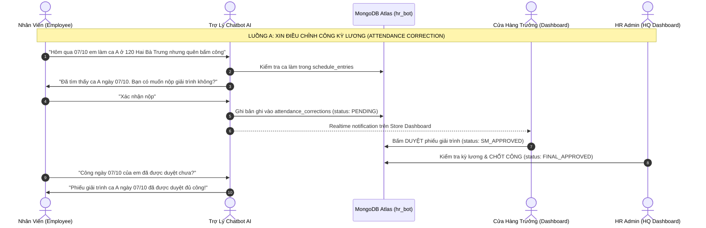

# Kế Hoạch Thiết Kế Hệ Thống Quản Trị & Dày Đặc Hóa Luồng Nghiệp Vụ (Dashboard + Chatbot)

- **Mã báo cáo:** `pm-261008-0952-role-matrix-dashboard-chatbot-flows`
- **Ngày lập:** 08/10/2026 (Múi giờ Asia/Bangkok)
- **Dự án:** Khóa luận KLCN133 — Chatbot & Dashboard Chuyển Đổi Số Quản Lý Nhân Sự (HR BlockBot)
- **Cơ sở dữ liệu thực tế:** Cluster `hr-blockbot` (144 cửa hàng Guta Cafe, 2,439 nhân viên)
- **Tác giả:** Project Manager & System Architect Agent (AgentKit)

---

## 1. Tóm Tắt Định Hướng (Executive Summary)

Báo cáo này giải quyết bài toán: **Xây dựng cấu trúc phân quyền (Role Matrix) và làm dày đặc các luồng tương tác thực tế kết hợp giữa Web Dashboard và Chatbot AI** dựa trên cơ sở dữ liệu thực tế 144 cửa hàng.

**Mục tiêu đạt điểm tối đa trước Hội đồng Đồ án:**
1. **Rõ ràng về vai trò (Role Matrix):** Chuẩn hóa **3 vai trò cốt lõi** (`Employee`, `Store Manager`, `HR/Operations Admin`) với không gian làm việc chuyên biệt.
2. **Tính liên hoàn Chatbot $\longleftrightarrow$ Dashboard:** Chatbot không chỉ để "nói chuyện phiếm" mà là **kênh nhập liệu & tra cứu ngoại vi (Conversational UI)** của nhân viên; Dashboard là **trung tâm điều hành & phê duyệt (Operational Backoffice)** của quản lý.
3. **6 luồng nghiệp vụ dày dặn (Dense End-to-End Flows):** Phủ kín từ xếp ca, điều phối vắng đột xuất, giải trình công kỳ lương 6/X–5/Y, kiểm đếm quỹ tiền mặt két ca, đào tạo hội nhập đến RAG chính sách.

---

## 2. Ma Trận Phân Quyền Hợp Lý (Role Matrix)

Mô hình 3 vai trò phân cấp dọc chuẩn mực nhất cho chuỗi bán lẻ/F&B:

| Vai Trò (Role) | Đối tượng thực tế | Không gian giao diện chính | Quyền hạn dữ liệu (Data Scope) | Điểm nhấn trình diễn |
|---|---|---|---|---|
| **1. Employee (Nhân viên cửa hàng)** | 2,439 nhân viên (Pha chế, Bếp, Thu ngân) | Mobile Web / Chatbot Widget (Zalo, Telegram, Web) | Chỉ xem dữ liệu của chính mình: ca làm, giải trình công, kiểm đếm két ca mình phụ trách | Thao tác 100% bằng ngôn ngữ tự nhiên qua Chatbot |
| **2. Store Manager (Cửa hàng trưởng - SM)** | 144 Cửa hàng trưởng | **Store Dashboard** (Giao diện ca & nhân sự quán) | Quản lý trọn vẹn 1 cửa hàng phụ trách: nhân sự quán, lịch ca tuần, duyệt giải trình, chốt két | Calendar xếp ca kéo thả + duyệt công 1 chạm |
| **3. HR / Operations Admin (Trụ sở - HQ)** | Ban Giám Đốc, Phòng Nhân sự, Kế toán | **Head Office Admin Dashboard** | Toàn quyền trên 144 cửa hàng, 2,439 nhân sự, chính sách, báo cáo tổng | Analytics toàn chuỗi + RAG Policy Manager |

---

## 3. Kiến Trúc Màn Hình Dashboard (Web Dashboard Spec)

Dashboard được thiết kế theo 2 cấp độ phân quyền:

### 3.1 Store Dashboard (Dành cho Cửa Hàng Trưởng - SM)
1. **Lịch làm việc cửa hàng (Shift Schedule Planner):**
   - Chế độ xem theo tuần (`schedule_weeks`).
   - Khung ca chia theo ngày: Ca A (Sáng), Ca B (Chiều), Ca gãy.
   - Hiển thị cảnh báo thiếu nhân sự theo chức danh (ví dụ: thiếu 1 Pha chế ca sáng).
2. **Hộp thư phê duyệt công (Attendance Approvals):**
   - Danh sách 115 phiếu giải trình (`attendance_corrections`) của nhân viên tại quán.
   - Thao tác: Duyệt nhanh (Approve), Từ chối (Reject kèm lý do).
3. **Khóa két tiền ca (Cash Reconciliation Sheet):**
   - Bảng nhập và xác nhận đếm tiền theo mệnh giá (`cash_denominations`).
   - Đối chiếu chênh lệch giữa tiền thực tế và doanh thu POS (`cash_counts`).
4. **Trợ lý AI Đổi ca (AI Roster Copilot):**
   - Widget Chatbot nội bộ hỗ trợ tìm người thay thế từ các cửa hàng lân cận khi có nhân viên báo nghỉ gấp.

### 3.2 HQ Admin Dashboard (Dành cho HR Admin & Ban Lãnh Đạo)
1. **Tổng quan điều hành toàn chuỗi (Executive Overview):**
   - Bản đồ 144 cửa hàng, tổng số 2,439 nhân viên.
   - Chỉ số tỷ lệ đi làm (Attendance Rate), số ca thiếu người trong ngày.
2. **Quản lý Hồ sơ & Vòng đời Nhân sự (Master Employee Directory):**
   - Bảng quản lý 2,439 nhân viên: Mã NV, chức danh, ngày vào, ngày nghỉ, trạng thái hồ sơ.
   - Bộ lọc theo chi nhánh (`store_name`), chức danh (`job_title`).
3. **Trung tâm Kỳ Lương (Payroll & Timesheet Settlement):**
   - Quản lý kỳ lương cố định (Chu kỳ 6/X - 5/Y).
   - Tổng hợp số giờ công chuẩn và giờ công điều chỉnh sau khi SM duyệt.
   - Xuất file bảng lương ngân hàng (kết nối số tài khoản ACB, VCB...).
4. **Quản trị Tri thức RAG (Policy & SOP Knowledge Base):**
   - Giao diện tải lên và biên tập các quy chế, nội quy lao động, quy định thưởng phạt.
   - Nút "Sync Vector Index" đẩy dữ liệu vào MongoDB Atlas Vector Search.
5. **Cảnh báo Lệch Quỹ Tiền Mặt (Cash Discrepancy Alerts):**
   - Báo cáo các cửa hàng có tiền mặt két lệch quá hạn mức cho phép để kế toán kiểm tra đột xuất.

---

## 4. Chi Tiết 6 Luồng Nghiệp Vụ Dày Dặn (Dense End-to-End Flows)

### Luồng 1: Xếp Ca Tuần & Đồng Bộ Lịch Cho Nhân Viên
- **Bước 1:** SM mở Store Dashboard, chọn tuần làm việc (`schedule_weeks`).
- **Bước 2:** Kéo thả nhân viên vào các ca A/B (`schedule_entries`). Hệ thống tự động kiểm tra định mức (mỗi ca tối thiểu 1 Pha chế, 1 Thu ngân).
- **Bước 3:** SM bấm **"Công bố lịch tuần"**.
- **Bước 4 (Tương tác Chatbot):** Nhân viên mở Chatbot hỏi: *"Tuần này em làm những ca nào?"* $\to$ Chatbot đọc `schedule_entries` trả về danh sách ngày và giờ làm việc cụ thể.

### Luồng 2: Xin Nghỉ Đột Xuất & AI Tìm Người Thay Thế Lân Cận
- **Bước 1:** Nhân viên ốm, nhắn Chatbot: *"Mai em bị sốt xin nghỉ ca sáng ở cửa hàng Hai Bà Trưng"*.
- **Bước 2:** Chatbot ghi nhận yêu cầu nghỉ, chuyển trạng thái ca sang `ABSENT_REQUESTED`.
- **Bước 3 (AI Matching):** Thuật toán AI chạy:
  - Lọc các nhân viên có cùng chức danh `PHA CHẾ` ở các cửa hàng lân cận (Quận 1, Quận 3).
  - Lọc những người **không có lịch làm việc** vào ngày mai trong `schedule_entries`.
- **Bước 4:** Chatbot đề xuất ngay cho SM trên Dashboard danh sách 3 ứng viên khả dụng kèm khoảng cách cửa hàng.
- **Bước 5:** SM bấm **"Gán ca thay thế"** $\to$ Hệ thống tự động cập nhật lịch và gửi thông báo mời ca tới nhân viên được chọn.

### Luồng 3: Giải Trình Bổ Sung Công Kỳ Lương (6/X - 5/Y)
- **Bước 1:** Nhân viên phát hiện thiếu công, nhắn Chatbot: *"Hôm qua IT chưa cấp mã ca nên em không chấm được, bổ sung công giúp em"*.
- **Bước 2:** Chatbot trích xuất thông tin: Ngày làm việc, mã ca, lý do $\to$ Lưu vào `attendance_corrections`.
- **Bước 3:** Phiếu hiển thị trên Store Dashboard của SM với nhãn *"Lý do: Lỗi IT/NVM"*.
- **Bước 4:** SM xác nhận nhân viên có mặt thực tế $\to$ Bấm duyệt cấp 1.
- **Bước 5:** Đến ngày 6 hàng tháng, HR Admin mở HQ Dashboard xem danh sách tổng $\to$ Bấm khóa sổ kỳ lương. Bảng công được tổng hợp tự động vào bảng lương.

### Luồng 4: Kiểm Đếm Két Tiền Cuối Ca & Đối Soát Thất Thoát
- **Bước 1:** Cuối ca làm việc, nhân viên thu ngân mở Chatbot (hoặc Form ca trên tablet quán):
  - Nhập số tờ tiền mặt theo mệnh giá: 500k, 200k, 100k, 50k... $\to$ Hệ thống tính ra tổng tiền mặt trong `cash_denominations`.
  - Nhập doanh thu khách vãng lai và doanh thu POS $\to$ Lưu vào `cash_counts`.
- **Bước 2:** Hệ thống tự động tính độ lệch:
  $$\Delta = \text{Tổng tiền đếm} - \text{Doanh thu hệ thống}$$
- **Bước 3:** Nếu $\Delta < 0$ (thiếu tiền): Chatbot yêu cầu nhân viên nhập lý do giải trình ngay tại chỗ.
- **Bước 4:** Cửa hàng trưởng vào Store Dashboard ký duyệt bàn giao quỹ két. Toàn bộ thông tin được ghi nhận vào `cash_summary`.

### Luồng 5: Tra Cứu Quy Chế Bằng RAG (Chính Sách & Quy Định F&B)
- **Bước 1:** Nhân viên hỏi Chatbot: *"Quên bấm vân tay thì bị phạt thế nào và hạn nộp giải trình là ngày mấy?"* hoặc *"Làm ca đêm ngày lễ Tết được tính lương hệ số mấy?"*.
- **Bước 2:** Hệ thống chạy pipeline **Advanced RAG**:
  - Vector search trên MongoDB Atlas `policies.chunks`.
  - Lọc Top-5 đoạn quy chế nội bộ liên quan nhất.
  - Re-rank bằng Cross-Encoder.
- **Bước 3:** Chatbot phản hồi ngắn gọn, dẫn nguồn: *"Theo Quy chế Chấm công & Khen thưởng (Phiên bản 2026 - Điều 8, Khoản 2), nhân viên có 48 giờ để gửi giải trình..."*.
- **Bước 4:** Nếu câu hỏi nằm ngoài tài liệu quy chế $\to$ Áp dụng quy tắc **Abstention**, từ chối đoán và hướng dẫn liên hệ trực tiếp phòng Nhân sự.

### Luồng 6: Đào Tạo Hội Nhập & Cấp Quyền Ra Ca Cho Nhân Viên Mới
- **Bước 1:** Nhân sự mới đăng ký học việc tại cơ sở đào tạo (`training_attendance`).
- **Bước 2:** Giảng viên đào tạo điểm danh trên hệ thống: xác nhận đạt kỹ năng pha chế và an toàn thực phẩm.
- **Bước 3:** Khi cập nhật trạng thái `COMPLETED` trong `training_attendance`, mã nhân viên mới chính thức được mở khóa trạng thái `ĐÃ HOÀN TẤT` trong `employees`.
- **Bước 4:** Store Manager lúc này mới nhìn thấy nhân sự mới trong danh sách để phân ca trên Calendar.

---

## 5. Kịch Bản Trình Bày Demo Đồ Án Điểm Cao (Live Demo Storyboard)

Khi báo cáo trước Hội đồng chấm khóa luận, nhóm trình diễn theo kịch bản "Một ngày làm việc thực tế tại chuỗi Guta Cafe":

| Phút | Vai trò trình diễn | Hành động trên hệ thống | Điểm nhấn kỹ thuật / AI |
|---|---|---|---|
| **00 - 03** | **HR Admin (HQ Dashboard)** | Chiếu bản đồ 144 cửa hàng, tổng quan 2,439 nhân sự; xem kỳ lương hiện tại 6/X - 5/Y. | MongoDB Aggregation Pipeline xử lý số liệu lớn tức thì. |
| **03 - 06** | **Store Manager (Store Dashboard)** | Mở lịch tuần của cửa hàng Hai Bà Trưng, kéo thả xếp ca A cho Barista. | UI Calendar trực quan, ràng buộc nghiệp vụ không để ca trống. |
| **06 - 09** | **Employee (Chatbot)** | Nhân viên mở Chatbot hỏi lịch ca, hỏi quy chế nghỉ phép (RAG), báo giải trình quên chấm công hôm trước. | Xử lý ngôn ngữ tự nhiên tiếng Việt, Function Calling ghi DB, RAG dẫn nguồn. |
| **09 - 11** | **SM & Employee (Tương tác kép)** | SM lập tức thấy thông báo phiếu giải trình trên Dashboard $\to$ Bấm Duyệt $\to$ Employee hỏi lại bot thấy công đã được duyệt ngay lập tức. | WebSocket realtime đồng bộ 2 chiều tức thì. |
| **11 - 13** | **Employee & SM (Kiểm két)** | Thu ngân nhập đếm tiền cuối ca qua bot, phát hiện lệch tiền $\to$ SM nhận cảnh báo trên Dashboard. | Tính toán tài chính chính xác, kiểm soát thất thoát két tiền. |
| **13 - 15** | **Kết luận & Đánh giá** | Trình chiếu kết quả đo lường AI, độ trễ và khả năng mở rộng. | AI Evaluation Gate (`09-ai-evaluation.md`). |

---

## 6. Lộ Trình Triển Khai (Sprint Breakdown)

- **Sprint 1 (Tuần 1 - 2):** Thiết lập Express Backend REST API & WebSocket Server, kết nối MongoDB Atlas `hr_bot`. Tạo các endpoint chuẩn hóa cho `employees`, `stores`, `schedule_entries`, `attendance_corrections`.
- **Sprint 2 (Tuần 3 - 4):** Xây dựng Chatbot Agent Loop với 10 Tools cốt lõi kết nối trực tiếp vào DB (`get_my_schedule`, `submit_correction`, `check_policy`...).
- **Sprint 3 (Tuần 5 - 7):** Phát triển Store Dashboard (Calendar xếp ca + Duyệt giải trình công + Kiểm quỹ tiền mặt).
- **Sprint 4 (Tuần 8 - 9):** Phát triển HQ Admin Dashboard (Thống kê chuỗi 144 cửa hàng + Quản lý kỳ lương + Vector Search RAG Management).
- **Sprint 5 (Tuần 10 - 12):** Tối ưu hóa UI/UX, kiểm thử tích hợp toàn diện và diễn tập kịch bản demo bảo vệ.

---

## 7. Các Câu Hỏi Mở (Unresolved Questions)

1. **Giao diện Chatbot cho Employee:** Nhóm muốn triển khai Chatbot dưới dạng Web Widget nhúng trực tiếp trên mobile web, hay kết nối bot webhook qua Zalo/Telegram? *(Khuyến nghị: Dùng Web Chat Widget trên mobile web để dễ demo trọn gói trên localhost/Vercel trước hội đồng).*
2. **Kỳ lương hiển thị:** Cần thống nhất giao diện chốt công hiển thị theo đúng chu kỳ ngày 6 tháng này đến ngày 5 tháng sau như trong dữ liệu thực tế.
