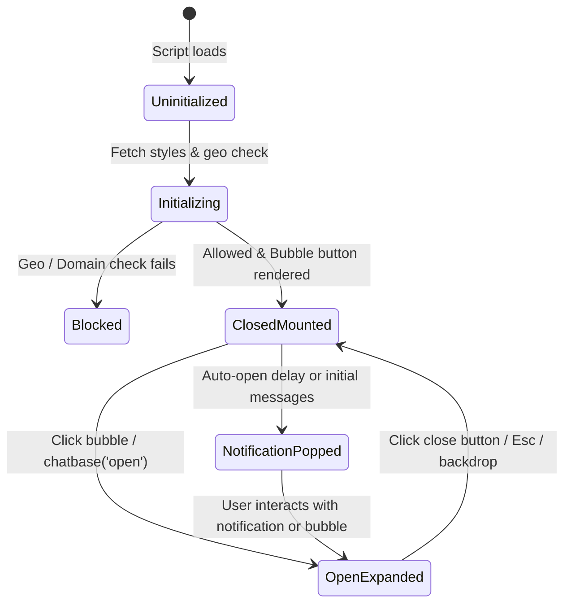

# SPEC-01: Chatbase Web Widget & Client Protocol

**Artifact Analyzed**: `https://www.chatbase.co/embed.min.js` (SHA-256 live capture)  
**Target Platform**: Web Embed (HTML5 / Shadow-DOM / postMessage / Iframe runtime)  
**Analysis Mode**: Clean-Room Specification (Evidence-driven)

---

## 1. Evidence Ledger (ID References)

- **E1.1**: Embed Loader URL `https://www.chatbase.co/embed.min.js`.
- **E1.2**: Style & Config Endpoint: `GET https://www.chatbase.co/api/get-chatbot-styles/{chatbotId}`.
- **E1.3**: Geo Blocking Endpoint: `GET https://www.chatbase.co/api/geo`.
- **E1.4**: Iframe Host URL: `https://www.chatbase.co/chatbot-iframe/{chatbotId}?theme={dark|light}&hostLang={lang}`.
- **E1.5**: Cookie Storage: `chatbase_anon_id={uuid4}; path=/; SameSite=Lax; Secure`.
- **E1.6**: Session Flag: `sessionStorage["message_bubbles_have_been_shown"] = "true"`.
- **E1.7**: Traffic Splitting: `localStorage["chatbase_traffic_roll_{chatbotId}"] = Float[0, 1)`.

---

## 2. Host - Iframe postMessage Protocol Matrix

All cross-frame communication uses bidirectional `window.postMessage`.

### 2.1 Inbound Messages (Iframe -> Host)

| Message Type (`event.data.type`) | Payload Schema | Host Behavior / State Change |
|---|---|---|
| `iframeReady` | `{ windowInnerWidth?: number }` | Flushes queued `identify` call, flushes pending options, unhides iframe |
| `assistant-message-stream-start` | `{}` | Sets chat window visibility to visible, hides notifications list |
| `user-message` | `{ message: string, timestamp: number }` | Dispatches internal listener event to host consumers |
| `assistant-message` | `{ message: string, citations?: Array<{ title, url, id }> }` | Updates message DOM state, renders citations badges |
| `dictation-transcript` | `{ text: string, isFinal: boolean }` | Triggers dictation waveform and updates input |
| `CHATBOT_TOOL_CALL` | `{ toolName: string, args: Record<string, any>, user: any }` | Executes registered host tool `m[toolName](args, user)`, returns `CHATBOT_TOOL_RESULT` |
| `WIDGET_ACTION_CALL` | `{ functionName: string, args: any }` | Invokes `p[functionName](args)`, returns `WIDGET_ACTION_RESULT` |
| `GET_FORM_SCHEMA` | `{ toolName: string, args: any, user: any }` | Resolves schema via `f[toolName](args, user)`, returns `FORM_SCHEMA_RESULT` |
| `close` / `widgetClosed` | `{}` | Hides bubble window, resets viewport scroll lock on mobile, updates aria attributes |
| `open` | `{}` | Displays bubble window, sets mobile body scroll lock |

### 2.2 Outbound Messages (Host -> Iframe)

| Message Type (`postMessage.type`) | Params Schema | Description |
|---|---|---|
| `identify` | `{ token?: string, user_id?: string, user_hash?: string, user_metadata?: Record<string, any>, chatbase_anon_id: string }` | Authenticates or fingerprints user session with HMAC verification |
| `setOptions` | `{ footer?: string, messagePlaceholder?: string, suggestedMessages?: string[], bubbleText?: string, dictationOnly?: boolean }` | Dynamically updates runtime options without iframe reloads |
| `setInitialMessages` | `{ messages: string[] }` (Length ≤ 1000 chars total) | Overrides greeting / conversation starters |
| `CHATBOT_TOOL_RESULT` | `{ toolName: string, result: any }` | Resolves async tool call back to bot engine |
| `WIDGET_ACTION_RESULT` | `{ functionName: string, result: any }` | Resolves custom UI action execution |
| `FORM_SCHEMA_RESULT` | `{ toolName: string, schema: Record<string, any> }` | Passes client-validated form schema into dynamic form UI |
| `changeUrl` | `{ lang: string }` | Notifies embedded chatbot of host language / route transition |

---

## 3. UI State Machine & Invariants



### Invariants:
1. **Z-Index Hierarchy**:
   - `#chatbase-bubble-button`: `2147483645`
   - `#chatbase-bubble-window`: `2147483646`
   - Notification popover list: `2147483644`
   - Tooltip badge: `2147483643`
2. **Mobile Viewport Lock**:
   When window width < 640px, opening the widget applies `html.__cb_widget_active body { position: fixed !important; overscroll-behavior: none; }` to prevent background scroll drift, storing scroll offset `(scrollX, scrollY)` and restoring on close.
3. **Traffic Splitting**:
   If `styles.traffic_percentage < 100`, client computes deterministic dice roll via `localStorage["chatbase_traffic_roll_" + chatbotId]`. If float >= threshold, widget self-destructs (`button.remove()`, `iframe.remove()`).

---

## 4. SSE Streaming & Citations Data Contract

The internal iframe connects to `/api/chat/{chatbotId}` via Server-Sent Events (`Accept: text/event-stream`).

### Event Stream Frame Format:
```http
event: message
data: {"text": "Hello, according to our HR policy"}

event: citations
data: [{"title": "Leave Policy 2026", "url": "https://guta.vn/hr/leave", "snippet": "Annual leave consists of 14 days...", "id": "doc_01"}]

event: done
data: [DONE]
```

Client merges `citations` into the active assistant bubble footer, rendering clickable pill badges that expand preview drawer on hover/click.

---

## 5. Residual Unknowns (§8)

1. Backend vector reranking pipeline prior to SSE citation emission (cannot be observed from client bundle).
2. HMAC algorithm used on server side to verify `user_hash = HMAC(user_id, secret)` (client treats it as opaque string).
