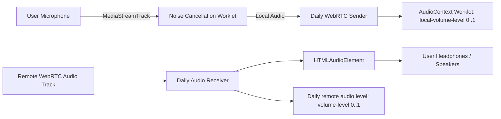

# SPEC-02: Vapi AI Web SDK Architecture & Protocol

**Artifact Analyzed**: `@vapi-ai/web@3.0.0` (`dist/vapi.js`, `dist/vapi.d.ts`, `dist/api.d.ts`)  
**Target Platform**: Browser Web Audio / WebRTC Data Channel / WebRTC Audio Streaming  
**Analysis Mode**: Clean-Room Specification (Evidence-driven)

---

## 1. Evidence Ledger (ID References)

- **E2.1**: Package npm entry: `@vapi-ai/web@3.0.0` wrapping `@daily-co/daily-js` for WebRTC transport.
- **E2.2**: Transport handshake: Web call joined via `webCallUrl` (`DailyCall.join({ url, token })`).
- **E2.3**: Data Channel Transport: Daily `app-message` event channel (`call.on('app-message', onAppMessage)`).
- **E2.4**: Local Audio Monitoring: `AudioContext` + `AudioWorklet` observer for microphone levels (`local-volume-level`).
- **E2.5**: Noise Suppression: Daily input processor update `{ audio: { processor: { type: 'noise-cancellation' } } }` (Krisp).

---

## 2. Real-time Event & Message Framing Matrix

Messages flow over Daily's WebRTC data channel via JSON serialization:

### 2.1 Inbound Events (Vapi Server -> Client SDK)

| Message Type (`parsedMessage.type`) | Key Fields | UI / State Handler |
|---|---|---|
| `listening` (raw string) | N/A | Triggers `call-start` event; activates microphone |
| `transcript` | `role: 'user'\|'assistant'`, `transcript: string`, `transcriptType: 'partial'\|'final'` | Real-time live speech captioning UI |
| `speech-update` | `status: 'started'\|'stopped'`, `role: 'assistant'\|'user'` | Speech indicator animation (pulsing ring / waveform) |
| `tool-calls` | `toolCalls: Array<{ id, type: 'function', function: { name, arguments } }>` | **Function Calling UI Indicator** (displays active tool execution chip: "Querying database...", "Transferring...") |
| `tool-calls-result` | `toolCallId: string, name: string, result: string` | Tool completion chip transition (Success/Error icon) |
| `status-update` | `status: 'ended'\|'in-progress'\|'idle'` | Call lifecycle management (`hasEmittedCallEndedStatus`) |
| `conversation-update` | `conversation: Array<OpenAIMessage>` | Full synced conversation history tree |
| `user-interrupted` | `{ timestamp: number }` | Immediately cancels in-flight assistant playback queue |
| `model-output` | `output: string` | Raw LLM streaming chunk |

### 2.2 Client Live Control Messages (Client SDK -> Vapi Server)

All commands sent via `DailyCall.sendAppMessage(JSON.stringify(payload))`:

```typescript
type VapiClientToServerMessage =
  | { type: 'add-message'; message: { role: string; content: string }; triggerResponseEnabled?: boolean }
  | { type: 'control'; control: 'mute-assistant' | 'unmute-assistant' | 'say-first-message'; videoRecordingStartDelaySeconds?: number }
  | { type: 'say'; message: string; endCallAfterSpoken?: boolean; interruptionsEnabled?: boolean; interruptAssistantEnabled?: boolean }
  | { type: 'end-call' };
```

---

## 3. Audio Pipeline & Worklet Architecture



### Invariants:
1. **AudioContext Worklet Race**:
   `AudioWorklet.addModule` must execute *after* noise cancellation has attached. If Krisp swaps the microphone track while `addModule` is in flight, Chrome/Firefox throw `AbortError`. Vapi guards this with `maybeStartLocalAudioLevelObserver()` triggered post noise-cancellation resolution.
2. **Audio Element Detach Safety**:
   `AudioPlayer` reference is set before emitting `audio` event, avoiding detached element leak if listener invokes `getAudioPlayer()` immediately.
3. **Volume Clamping**:
   `setVolume(v)` strictly clamps `Math.max(0, Math.min(1, v))`. Non-finite values (`NaN`, `Infinity`) are dropped to prevent DOM `IndexSizeError` halts.

---

## 4. Function Calling UI Indicator Spec

When `parsedMessage.type === "tool-calls"`:
1. UI maps `function.name` to human-readable label via metadata dictionary:
   - `getLeaveBalance` -> "Đang kiểm tra quỹ phép..."
   - `lookupEmployee` -> "Đang tra cứu thông tin nhân sự..."
2. Displays active spinner chip inside the transcript stream.
3. Upon receiving `parsedMessage.type === "tool-calls-result"`, chip transitions from spinning indicator to a confirmed tag with latency metadata.

---

## 5. Residual Unknowns (§8)

1. Server-side VAD (Voice Activity Detection) threshold parameterization (Cartesia / Deepgram endpointing timing).
2. Proprietary WebRTC TURN fallbacks when UDP is blocked on corporate enterprise firewalls.
