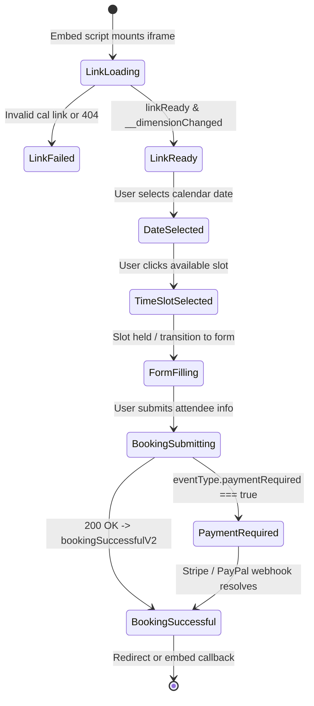

# SPEC-03: Cal.com Embed State Machine & Timezone Synchronization

**Artifact Analyzed**: `@calcom/embed-core@1.5.3` (`dist/src/sdk-action-manager.d.ts`, `dist/embed/embed.js`)  
**Target Platform**: Multi-tenant Web Embed / Booking Iframe / SdkActionManager  
**Analysis Mode**: Clean-Room Specification (Evidence-driven)

---

## 1. Evidence Ledger (ID References)

- **E3.1**: Cal Embed Package: `@calcom/embed-core@1.5.3` with namespaced event system `Cal.ns("<namespace>")`.
- **E3.2**: Event Dictionary: `sdk-action-manager.d.ts` specifying `linkReady`, `__dimensionChanged`, `bookingSuccessfulV2`, `rescheduleBookingSuccessfulV2`.
- **E3.3**: Dimensional syncing: `__dimensionChanged` event `{ iframeHeight: number, iframeWidth: number, isFirstTime: boolean }` dynamically adjusting iframe height without layout shift.
- **E3.4**: Timezone query param: `?timeZone=${encodeURIComponent(Intl.DateTimeFormat().resolvedOptions().timeZone)}`.

---

## 2. Booker State Machine



---

## 3. Host-Iframe Action Protocol (`SdkActionManager`)

Each message transmitted via `window.postMessage` follows the schema:
```json
{
  "calEventType": "CAL:BOOKING_SUCCESSFUL_V2",
  "data": {
    "uid": "bkg_abc123",
    "title": "HR Onboarding with Recruiter",
    "startTime": "2026-10-22T09:00:00.000Z",
    "endTime": "2026-10-22T09:30:00.000Z",
    "eventTypeId": 42,
    "status": "ACCEPTED",
    "paymentRequired": false,
    "isRecurring": false,
    "videoCallUrl": "https://meet.guta.vn/hr-bkg_abc123"
  }
}
```

### Protocol Invariants:
1. **Namespace Isolation**:
   When multiple Cal embeds exist on a single host page, actions are prefixed with `namespace`: `__cal__<ns>__<action>`. An event targeted at `default` namespace does not trigger listeners bound to `floating-popup`.
2. **Auto-Resize Handshake**:
   Embed sets up a resize listener on iframe dimensions. When content expands (e.g. from calendar grid to form fields), child iframe fires `__dimensionChanged` with `iframeHeight`. Host applies `iframe.style.height = iframeHeight + 'px'`.

---

## 4. Timezone Resolution & Slot Locking Mechanics

1. **Attendee vs Organizer Timezone Normalization**:
   - Organizer sets availability in local business hours (e.g. `08:00 - 17:00 Asia/Ho_Chi_Minh`, UTC+7).
   - Server stores slot availability rules in standard recurrence rules (RRULE) in UTC.
   - Client sends detected attendee timezone (`Intl.DateTimeFormat().resolvedOptions().timeZone`).
   - Server projects UTC slots onto attendee timezone boundaries, slicing into `interval` chunks (e.g. 15m, 30m).
2. **Conflict Prevention & Temporary Slot Hold**:
   - To prevent double bookings when two candidates choose the same 10:00 slot simultaneously, selecting a slot initiates a reservation lock (`slot_lock:eventTypeId:timestamp:salt`) in Redis/database with a 5-minute TTL.
   - If user completes booking within TTL, lock transitions to persistent booking record.
   - If TTL expires or user cancels, lock drops immediately. If collision occurs on final submit, server throws `409 Conflict: slot_already_booked`.

---

## 5. Residual Unknowns (§8)

1. Precise Redis key generation scheme for ephemeral slot locks across distributed clusters.
2. Webhook replay detection TTL on external calendar integration callbacks (Google/Outlook calendar push).
