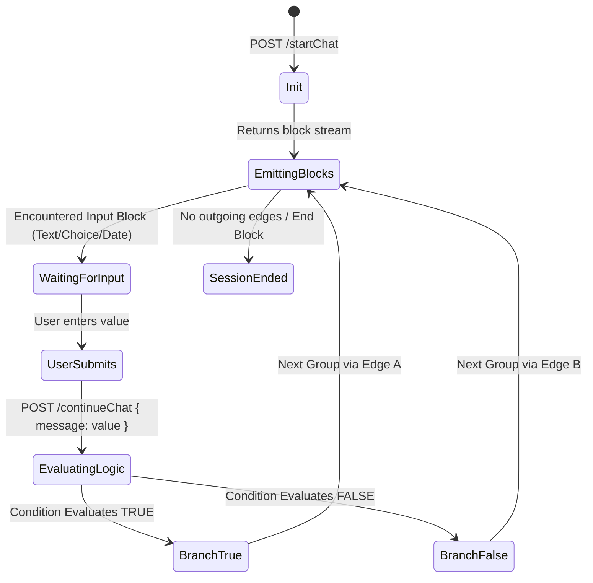

# SPEC-04: Typebot Conversational Form & Dynamic Branching Engine

**Artifact Analyzed**: `@typebot.io/js@0.10.11` (`dist/index.js`, `dist/web.js`) & Typebot Runtime Protocol  
**Target Platform**: Web Components (`<typebot-standard>`, `<typebot-bubble>`) / REST Step Execution  
**Analysis Mode**: Clean-Room Specification (Evidence-driven)

---

## 1. Evidence Ledger (ID References)

- **E4.1**: Client SDK: `@typebot.io/js@0.10.11` dispatching postMessage commands `{ isFromTypebot: true, command: '...' }`.
- **E4.2**: Session Initialization: `POST /api/v1/typebots/{typebotId}/startChat` with prefilled variables payload.
- **E4.3**: Step Transition: `POST /api/v1/sessions/{sessionId}/continueChat` resolving variable memory and routing edges.
- **E4.4**: Web Component Custom Elements: `customElements.define('typebot-standard')`, `customElements.define('typebot-bubble')`.

---

## 2. Conversational Step Engine State Machine



---

## 3. Session Protocol & Schema Contracts

### 3.1 Start Chat Request / Response Contract
```typescript
interface StartChatRequest {
  isStreamEnabled?: boolean;
  prefilledVariables?: Record<string, string | number | boolean>;
  isPreview?: boolean;
  resultId?: string;
}

interface StartChatResponse {
  sessionId: string;
  typebot: {
    id: string;
    theme: {
      general: { background: { type: string; content: string }; font: string };
      chat: { hostAvatar: { url: string }; hostBubbles: { backgroundColor: string } };
    };
  };
  messages: Array<{
    id: string;
    type: 'text' | 'image' | 'video' | 'embed' | 'audio';
    content: { richText?: Array<{ type: string; children: Array<{ text: string }> }>; url?: string };
  }>;
  input?: {
    id: string;
    type: 'text input' | 'choice input' | 'number input' | 'date input' | 'email input';
    options?: {
      isMultipleChoice?: boolean;
      buttonLabel?: string;
      variableId?: string;
      items?: Array<{ id: string; content: string }>;
    };
  };
  dynamicTheme?: Record<string, any>;
}
```

### 3.2 Dynamic Branching Logic Evaluation
During `POST /continueChat`, the server evaluates conditions sequentially:
```typescript
interface ConditionItem {
  id: string;
  variableId: string;
  comparisonOperator: 'EQUAL' | 'NOT_EQUAL' | 'CONTAINS' | 'GREATER' | 'LESS' | 'IS_SET' | 'MATCHES_REGEX';
  value: string;
}

interface ConditionBlock {
  type: 'condition';
  items: Array<{
    id: string;
    outgoingEdgeId?: string;
    comparisons: ConditionItem[];
  }>;
}
```
Evaluation Rule:
`matches = comparisons.every(c => evaluate(getVariable(c.variableId), c.comparisonOperator, c.value))`  
If matches, follow `outgoingEdgeId`; otherwise proceed to fallback or next group.

---

## 4. Client Command Bus (`isFromTypebot`)

Host and Typebot communicate via `window.postMessage` with payload format:
```json
{
  "isFromTypebot": true,
  "command": "setPrefilledVariables",
  "variables": { "employeeId": "NV-0982", "department": "HR" },
  "id": "optional_instance_id"
}
```
Supported commands in `@typebot.io/js`:
- `open`, `close`, `toggle`
- `showPreviewMessage`, `hidePreviewMessage`
- `setInputValue`, `submitInput`
- `setPrefilledVariables`
- `sendCommand`
- `reset`, `reload`, `unmount`

---

## 5. Residual Unknowns (§8)

1. JavaScript sandbox execution engine inside backend webhook/custom code blocks (isolated-vm vs Node vm2).
2. Maximum recursion limit when cyclic edges are inadvertently configured in graph edges.
