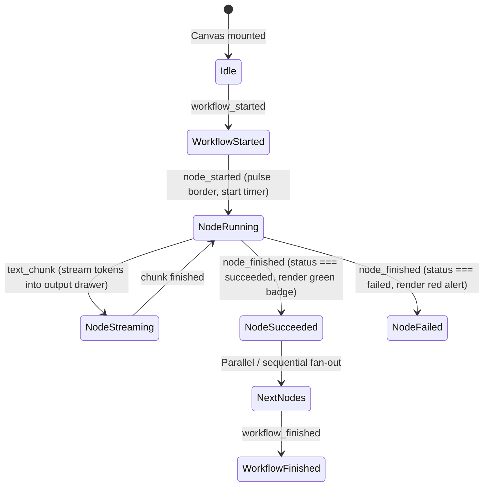

# SPEC-06: Dify Workflow Execution Trace & Streaming Markdown UI

**Artifact Analyzed**: Dify Workflow Protocol & UI Execution Engine (`langgenius/dify`)  
**Target Platform**: React / React Flow / SSE Streaming Engine / Markdown Chunk Parser  
**Analysis Mode**: Clean-Room Specification (Evidence-driven)

---

## 1. Evidence Ledger (ID References)

- **E6.1**: Workflow Run Endpoint: `POST /api/workflows/run` with `{ response_mode: "streaming" }`.
- **E6.2**: SSE Event Multiplexing: `workflow_started`, `node_started`, `node_finished`, `workflow_finished`, `text_chunk`.
- **E6.3**: Node Execution Telemetry: Output token counting, execution duration, and predecessor edge tracking.
- **E6.4**: Markdown Stream Buffer: Chunk aggregation with unclosed syntax guard.

---

## 2. Real-Time Workflow SSE Protocol

```http
POST /api/workflows/run HTTP/1.1
Content-Type: application/json
Accept: text/event-stream

{
  "inputs": { "candidate_cv": "text...", "job_code": "HR-002" },
  "response_mode": "streaming",
  "user": "usr_998234"
}
```

### Event Stream Chronology:

```http
event: workflow_started
data: {"event": "workflow_started", "task_id": "t-1", "workflow_run_id": "wf-101", "data": {"id": "wf-101", "created_at": 1774224000}}

event: node_started
data: {"event": "node_started", "task_id": "t-1", "workflow_run_id": "wf-101", "data": {"id": "run-n-1", "node_id": "start-node", "node_type": "start", "title": "Start", "index": 1, "created_at": 1774224001}}

event: node_finished
data: {"event": "node_finished", "task_id": "t-1", "workflow_run_id": "wf-101", "data": {"id": "run-n-1", "node_id": "start-node", "status": "succeeded", "elapsed_time": 0.05, "outputs": {"query": "HR-002"}}}

event: node_started
data: {"event": "node_started", "task_id": "t-1", "workflow_run_id": "wf-101", "data": {"id": "run-n-2", "node_id": "llm-eval", "node_type": "llm", "title": "CV Analyzer", "index": 2, "predecessor_node_id": "start-node"}}

event: text_chunk
data: {"event": "text_chunk", "task_id": "t-1", "data": {"text": "### Đánh giá ứng viên\n\nỨng viên đạt yêu cầu..."}}

event: node_finished
data: {"event": "node_finished", "task_id": "t-1", "workflow_run_id": "wf-101", "data": {"id": "run-n-2", "node_id": "llm-eval", "status": "succeeded", "elapsed_time": 2.45, "execution_metadata": {"total_tokens": 420, "currency": "USD", "total_price": 0.00084}}}

event: workflow_finished
data: {"event": "workflow_finished", "task_id": "t-1", "workflow_run_id": "wf-101", "data": {"id": "wf-101", "status": "succeeded", "total_steps": 2, "total_tokens": 420, "elapsed_time": 2.50}}
```

---

## 3. UI Node Trace State Machine



---

## 4. Streaming Markdown Chunk Invariants

1. **Unclosed Syntax Guard**:
   When LLM streams tokens character-by-character, raw Markdown parsers flicker on unclosed tokens (e.g. ````javascript\nconst a = 1;` without closing ```` `). Dify UI maintains an incremental AST or appends an ephemeral invisible closing token during render passes.
2. **Batch Render Throttling**:
   Incoming SSE chunks arrive at intervals down to 10ms. Re-rendering the full document on every single token causes CPU lag. The UI buffers chunks into an accumulator and flushes to React state via `requestAnimationFrame` (capped at 60fps).
3. **Trace Node Inspection**:
   Clicking any completed node on the canvas opens a side panel displaying the exact snapshot: `{ inputs, outputs, elapsed_time, total_tokens, error }` captured at the time of `node_finished`.

---

## 5. Residual Unknowns (§8)

1. Memory eviction policy for very large workflow runs (> 500 nodes) in the React Flow viewport canvas.
2. Exact checkpointing interval for durable workflow state recovery on server process crash.
