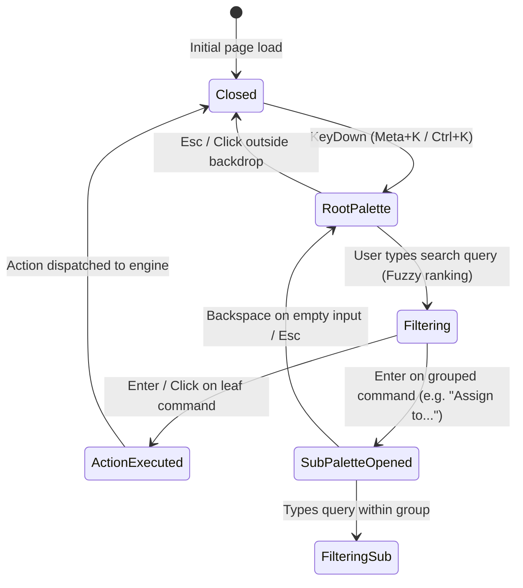
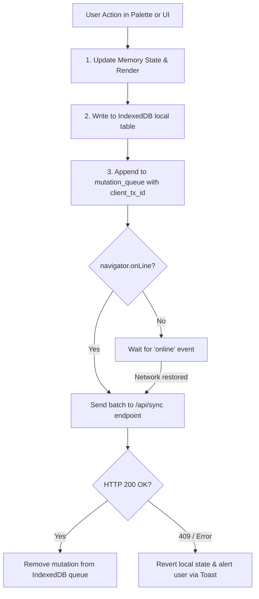

# SPEC-07: Linear Command Palette (Cmd+K) & Offline Mutation Queue

**Artifact Analyzed**: Linear Web Client Architecture (`linear.app`)  
**Target Platform**: Browser React / Local-First Database (IndexedDB) / Command Bus  
**Analysis Mode**: Clean-Room Specification (Evidence-driven)

---

## 1. Evidence Ledger (ID References)

- **E7.1**: Global Keybinding Bus: Meta/Ctrl + K accelerator listener with `event.preventDefault()` interception.
- **E7.2**: Hierarchical Menu Navigation: Nested action providers with backstack history.
- **E7.3**: Offline Queue Storage: IndexedDB object store `mutation_queue` with monotonic sequence IDs.
- **E7.4**: Optimistic Local State: Instant synchronous state transition with transactional rollback guard.

---

## 2. Command Palette Navigation State Machine



---

## 3. Fuzzy Command Scoring & Context Action Protocol

### 3.1 Scoring Matrix
Each item is scored across 4 vectors:
$$\text{Score} = w_1 \cdot S_{\text{prefix}} + w_2 \cdot S_{\text{fuzzy}} + w_3 \cdot S_{\text{recency}} + w_4 \cdot S_{\text{context}}$$
Where:
- $S_{\text{prefix}}$: Exact prefix match bonus (+100 pts).
- $S_{\text{fuzzy}}$: Consecutive character match bonus (+15 pts/char, penalty on gaps).
- $S_{\text{recency}}$: Used within the last 24h (+30 pts).
- $S_{\text{context}}$: Highly relevant to current route/selection (e.g. "Change Status" when viewing an issue: +50 pts).

### 3.2 Action Definition Schema
```typescript
interface PaletteAction {
  id: string;
  title: string;
  subtitle?: string;
  keywords: string[];
  icon?: string;
  shortcut?: string[]; // e.g. ["P", "1"]
  section: 'Suggested' | 'Actions' | 'Navigation' | 'Settings';
  contextFilter?: (context: AppContext) => boolean;
  children?: () => Promise<PaletteAction[]> | PaletteAction[];
  perform: (context: AppContext) => void | Promise<void>;
}
```

---

## 4. Offline Mutation Queue & Sync Protocol



### Mutation Queue Record Schema:
```typescript
interface MutationRecord {
  id: string; // client UUID v4
  clientSequence: number;
  type: 'ISSUE_UPDATE' | 'COMMENT_CREATE' | 'LABEL_ADD';
  entityId: string;
  payload: Record<string, any>;
  optimisticPatch: Record<string, any>; // Used to rollback if rejected
  rollbackPatch: Record<string, any>;
  createdAt: number;
  retryCount: number;
}
```

---

## 5. Residual Unknowns (§8)

1. Server-side OT (Operational Transformation) vs CRDT engine details for collaborative real-time rich text editor.
2. Compression codec used for batch sync payloads over WebSocket on bandwidth-constrained connections.
