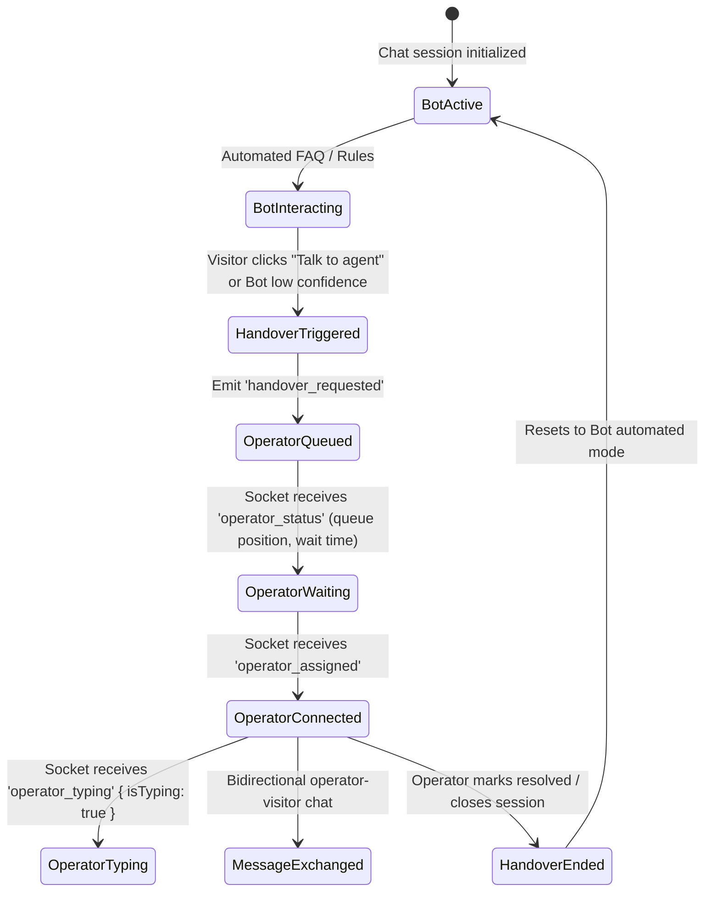

# SPEC-08: Tidio Live Chat Connection Manager & Bot Handover Engine

**Artifact Analyzed**: `@tidio/tidio-chat-connection-manager@2.3.0` (`lib/SocketConnectionManager.types.d.ts`, `lib/SocketConnectionManager.js`)  
**Target Platform**: Socket.IO Client / State Store (Redux-style Dispatch/GetState) / Real-Time Handover  
**Analysis Mode**: Clean-Room Specification (Evidence-driven)

---

## 1. Evidence Ledger (ID References)

- **E8.1**: Socket Connection Module: `@tidio/tidio-chat-connection-manager@2.3.0` wrapping `socket.io-client`.
- **E8.2**: Emit Queue Architecture: Monotonic emit queue `ToEmitItem = [emitName: string, newArgs: Record<string, unknown>, ack: EventCallback | null]`.
- **E8.3**: State Integration: `StoreType<ApplicationState>` consuming `{ dispatch, getState }`.
- **E8.4**: Reconnection Handlers: Reserved manager events (`reconnect`, `reconnect_attempt`, `reconnect_failed`, `disconnect`).

---

## 2. Bot-to-Operator Handover State Machine



---

## 3. Socket Event & Queue Protocol

### 3.1 Emit Queue Draining Contract
When the socket connection is severed (`disconnect`), outbound actions cannot be delivered immediately. Tidio pushes items to an internal FIFO queue:
```typescript
type ToEmitItem = [
  emitName: string,
  newArgs: Record<string, unknown>,
  ack: EventCallback | null
];
```
Upon socket `reconnect`:
1. Connection manager executes `FirstEmitCallback` to re-authenticate session with session token.
2. Drains queued `ToEmitItem` items sequentially.
3. Each item expects server `ack(result, message)` before advancing, preventing dropped messages during cellular handover or Wi-Fi interruptions.

### 3.2 Key Handover Socket Events Matrix

| Event Name | Direction | Payload Schema | Description |
|---|---|---|---|
| `visitor_init` | Client -> Server | `{ visitorId, url, referrer, lang }` | Initial socket handshake and session restoration |
| `handover_requested` | Client -> Server | `{ reason?: string, previousBotId?: string }` | Escalates session from automated bot to human agent pool |
| `operator_status` | Server -> Client | `{ isOnline: boolean, queueLength: number, waitTimeEstimateSeconds: number }` | Updates UI queue banner |
| `operator_assigned` | Server -> Client | `{ operatorId: string, name: string, avatarUrl: string }` | Injects agent persona into header and transcript |
| `operator_typing` | Server -> Client | `{ operatorId: string, isTyping: boolean }` | Toggles dynamic typing bubble in chat pane |
| `message_delivered` | Server -> Client | `{ messageId: string, timestamp: number }` | Double checkmark delivery acknowledgment |

---

## 4. UI Invariants & Anti-Throttling Behavior

1. **Typing Indicator Debounce**:
   Visitor typing emits `visitor_typing` with a 2-second trailing debounce to avoid saturating the socket channel.
2. **Ping / Heartbeat Management**:
   The manager intercepts `ping` and `packet` low-level socket frames to update internal latency meters without polluting Redux state actions.
3. **Graceful Disconnect Notice**:
   When `disconnect` occurs with reason `io server disconnect`, manager does not auto-retry immediately (signaling explicit session kick or ban), whereas `transport close` or `ping timeout` initiates exponential backoff reconnects.

---

## 5. Residual Unknowns (§8)

1. Server-side skill-based routing rules determining which operator receives the handover ping first.
2. Long-term chat log encryption scheme on cold storage database backups.
