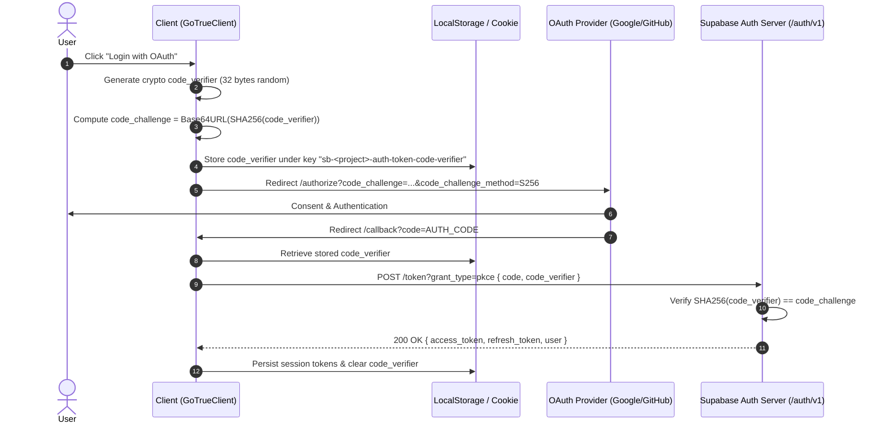

# SPEC-09: Supabase Auth PKCE Flow & Cross-Tab NavigatorLock Engine

**Artifact Analyzed**: `@supabase/auth-js@2.118.0` (`dist/module/index.d.ts`, `dist/module/lib/locks.js`, `dist/module/GoTrueClient.js`)  
**Target Platform**: Browser / SSR / OAuth PKCE / Web Crypto API / Navigator Lock API  
**Analysis Mode**: Clean-Room Specification (Evidence-driven)

---

## 1. Evidence Ledger (ID References)

- **E9.1**: Library Entry: `@supabase/auth-js@2.118.0` implementing `GoTrueClient`.
- **E9.2**: Cross-Tab Concurrency Lock: `navigator.locks.request` (`navigatorLock` in `lib/locks.ts`) preventing concurrent token refresh races.
- **E9.3**: PKCE Generation: SHA-256 code challenge with `crypto.subtle.digest('SHA-256', verifier)` and base64url encoding.
- **E9.4**: Token Family Invalidation: Single-use refresh token rotation with immediate session family revocation on replay detection.
- **E9.5**: Cookie Chunking: Multi-part cookie storage splitting payloads exceeding 3180 bytes (`${key}.${index}`).

---

## 2. PKCE Authorization State Machine



---

## 3. Cross-Tab Refresh Protection (`navigatorLock`)

When multiple browser tabs are open, automatic background token refresh creates a race condition:
- If Tab A and Tab B both send `refresh_token_1` simultaneously, Tab A succeeds and gets `refresh_token_2`.
- When Tab B's request arrives with `refresh_token_1`, server detects a **Replay Attack** and revokes the entire user session family!

### NavigatorLock Implementation:
```typescript
async function acquireLock<R>(name: string, acquireTimeout: number, fn: () => Promise<R>): Promise<R> {
  if (typeof navigator !== 'undefined' && 'locks' in navigator) {
    return await navigator.locks.request(name, { mode: 'exclusive' }, async () => {
      return await fn();
    });
  }
  // Fallback to BroadcastChannel / localStorage polling for older environments
  return await fn();
}
```
**Invariant**:
Only the lock holder performs `POST /token?grant_type=refresh_token`. The updated tokens are written to shared storage (`localStorage` / cookies), and subsequent tabs read the refreshed token directly without firing duplicate HTTP requests.

---

## 4. Chunked Cookie Storage Protocol

Due to the 4096-byte cookie size limit imposed by HTTP specifications, large JWT claims (containing extensive RBAC roles or metadata) are chunked:
```typescript
function setChunkedCookie(name: string, value: string, maxChunkSize = 3180) {
  const chunks = Math.ceil(value.length / maxChunkSize);
  for (let i = 0; i < chunks; i++) {
    const chunkName = `${name}.${i}`;
    const chunkValue = value.substring(i * maxChunkSize, (i + 1) * maxChunkSize);
    document.cookie = `${chunkName}=${encodeURIComponent(chunkValue)}; path=/; SameSite=Lax; Secure`;
  }
}
```
On read, chunks `${name}.0`, `${name}.1`, ... are concatenated in order until no subsequent index is found.

---

## 5. Residual Unknowns (§8)

1. Server-side sliding session window maximum lifetime enforcement on inactive user accounts.
2. Internal rate-limiting algorithms governing password recovery email dispatch across multiple tenants.
