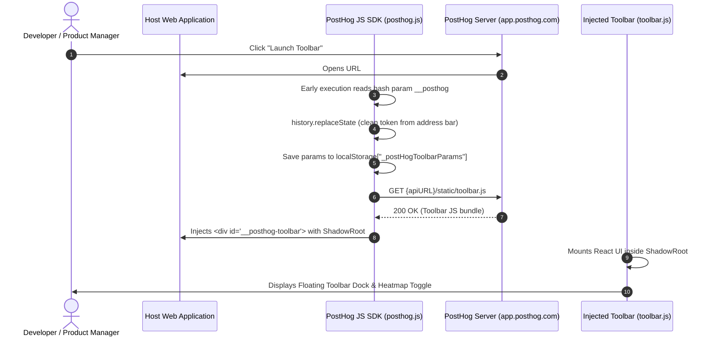

# SPEC-10: PostHog In-App Toolbar & Shadow-DOM Inspector Overlay

**Artifact Analyzed**: `posthog-js@1.438.13` (`lib/src/extensions/toolbar.js`, `dist/src/extensions/toolbar.d.ts`)  
**Target Platform**: Browser Extension / Shadow DOM / Canvas Heatmap Overlay / Pointer Interception  
**Analysis Mode**: Clean-Room Specification (Evidence-driven)

---

## 1. Evidence Ledger (ID References)

- **E10.1**: Hash Param Handshake: Parsing `__posthog` or `state` from `window.location.hash` before single-page app routers strip it.
- **E10.2**: Storage Key: `_postHogToolbarParams` in `localStorage` preserving active toolbar state across page navigations.
- **E10.3**: Dynamic Asset Loader: Injects `${apiURL}/static/toolbar.js?_=${Date.now()}` with credentials.
- **E10.4**: Shadow DOM Isolation: Mounts container inside `element.attachShadow({ mode: 'open' })`.
- **E10.5**: Inspector Coordinate Engine: `document.elementsFromPoint(x, y)` and `getBoundingClientRect()` bounding overlay.

---

## 2. Toolbar Authentication & Launch State Machine



---

## 3. DOM Inspector & Canvas Overlay Architecture

### 3.1 Pointer Event Interception Engine
```typescript
class ElementInspector {
  private highlightCanvas: HTMLCanvasElement;
  private ctx: CanvasRenderingContext2D;
  private activeElement: HTMLElement | null = null;

  start() {
    window.addEventListener('pointermove', this.onPointerMove, { passive: true, capture: true });
    window.addEventListener('click', this.onClick, { capture: true });
  }

  private onPointerMove = (e: PointerEvent) => {
    // Exclude clicks inside the toolbar UI itself
    if (this.isInsideToolbar(e.target)) return;

    const elements = document.elementsFromPoint(e.clientX, e.clientY);
    const target = elements.find(el => !this.isIgnoredElement(el)) as HTMLElement;
    if (target && target !== this.activeElement) {
      this.activeElement = target;
      this.drawHighlight(target.getBoundingClientRect());
    }
  };

  private drawHighlight(rect: DOMRect) {
    // Renders viewport-aligned bounding box with CSS dashed border and metric tooltip
  }
}
```

### 3.2 Element Selector Generator Algorithm
To create robust action definitions that survive CSS/class changes, the inspector extracts:
1. `data-attr` (e.g. `data-testid`, `data-qa`).
2. Element ID (if not dynamically generated with numeric hashes).
3. Tag + distinctive class names.
4. Relative structural path (`parentElement > child:nth-child(n)`).

---

## 4. Shadow DOM Isolation & Cross-Origin Boundaries

1. **CSS Boundary Isolation**:
   The toolbar injects its complete styling system (Tailwind / CSS modules) exclusively inside `#posthog-toolbar-shadow-root`.
   - Host rules like `* { margin: 0; box-sizing: border-box; }` do not leak into toolbar UI.
   - Toolbar floating dock rules do not disrupt host application layouts.
2. **PostMessage Security**:
   When launching action editors or heatmap details within an iframe preview, messages exchanged with `app.posthog.com` must strictly validate `event.origin === allowedApiUrl` before processing state mutations.

---

## 5. Residual Unknowns (§8)

1. Heatmap clustering density algorithm for high-frequency viewport resize events.
2. Server-side session recording DOM mutation patch compression algorithm (rrweb pack format).
