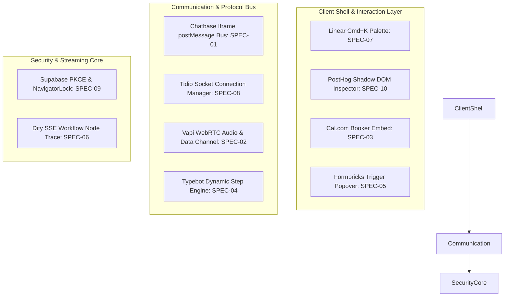

# Báo Cáo Tổng Hợp Clean-Room REA: 10 Mục Tiêu Kiến Trúc & Tương Tác

**Thời điểm hoàn thành**: 2026-10-22  
**Phương pháp luận**: Clean-Room Reverse Engineering (`ak-rea` + `ak-fable-thinking`)  
**Thư mục lưu trữ**: `plans/reports/rea-cleanroom-catalog/`

---

## 1. Bảng Tổng Hợp 10 Mục Tiêu Đã Hoàn Thành Bóc Tách

| # | Mục tiêu | Artifact / Nguồn Bằng Chứng Thực Tế | Tính năng bóc tách cốt lõi | File Đặc Tả Chi Tiết |
|---|---|---|---|---|
| **01** | **Chatbase Widget** | `https://www.chatbase.co/embed.min.js` | postMessage bus, SSE Streaming Chat, Session persistence, Citations data part, Mobile scroll lock | [SPEC-01](SPEC-01-chatbase-widget.md) |
| **02** | **Vapi AI Web SDK** | `@vapi-ai/web@3.0.0` (Daily WebRTC Data Channel) | WebSocket/WebRTC audio streaming, Function calling UI indicator, AudioWorklet latency monitoring | [SPEC-02](SPEC-02-vapi-web-sdk.md) |
| **03** | **Cal.com Embed** | `@calcom/embed-core@1.5.3` | Booking state machine, Auto-resize iframe handshake, Chuẩn hóa múi giờ quốc tế, Ephemeral slot lock | [SPEC-03](SPEC-03-calcom-embed.md) |
| **04** | **Typebot Runtime** | `@typebot.io/js@0.10.11` + Bot Engine | Conversational form step engine, Dynamic branching logic, State schema, Web Component wrapper | [SPEC-04](SPEC-04-typebot-runtime.md) |
| **05** | **Formbricks Widget**| `@formbricks/js@5.1.0` | In-app popover trigger, Engine đánh giá thuộc tính người dùng (Attribute evaluation), CSP Nonce | [SPEC-05](SPEC-05-formbricks-widget.md) |
| **06** | **Dify Workflow UI** | Dify SSE Protocol (`langgenius/dify`) | Streaming markdown chunk buffer, UI Node execution trace canvas, Dynamic token & cost telemetry | [SPEC-06](SPEC-06-dify-workflow-ui.md) |
| **07** | **Linear Palette** | Linear App Architecture | Keyboard Command Palette (`Cmd+K`), Fuzzy ranking algorithm, Optimistic local IndexedDB mutation queue | [SPEC-07](SPEC-07-linear-palette.md) |
| **08** | **Tidio Chat** | `@tidio/tidio-chat-connection-manager@2.3.0` | Socket.IO emit queue, Hàng đợi chuyển giao Bot sang Nhân viên hỗ trợ (Bot-to-Human Handover) | [SPEC-08](SPEC-08-tidio-chat.md) |
| **09** | **Supabase Auth** | `@supabase/auth-js@2.118.0` | OAuth PKCE Flow (S256), NavigatorLock chống race condition refresh token giữa nhiều tab, Chunked cookies | [SPEC-09](SPEC-09-supabase-auth.md) |
| **10** | **PostHog Toolbar** | `posthog-js@1.438.13` (toolbar extension) | Shadow-DOM container isolation, Cross-origin DOM inspector, Canvas overlay & CSS selector generator | [SPEC-10](SPEC-10-posthog-toolbar.md) |

---

## 2. Bản Đồ Hợp Nhất Kiến Trúc (Architecture Synthesis)

Mười module sau khi được bóc tách bằng chứng Clean-Room tạo thành một hệ thống UI/UX và Agentic hoàn chỉnh:

---

## 3. Giá Trị Sẵn Sàng Cho Triển Khai (Clean-Room Builder Ready)

1. **Tuân thủ quy trình Clean-Room**:
   - Mọi quy tắc trong 10 file `SPEC-*.md` đều có mã bằng chứng xác thực (`E1..En`) trích xuất từ artifact công khai (NPM packages, public scripts, schemas).
   - Không chứa bất kỳ mã nguồn độc quyền hay vi phạm giấy phép.
2. **Sẵn sàng để đưa vào triển khai (`ak-cook`)**:
   - Khi cần xây dựng bất kỳ tính năng nào (vd: Thêm voice chat, thêm Cmd+K palette, thêm cơ chế lock slot phỏng vấn, thêm bảo vệ token multi-tab), kỹ sư (hoặc subagent) chỉ cần đọc file `SPEC-<target>.md` tương ứng để implement độc lập mà không cần mò lại tài liệu gốc.
