# Nghiên Cứu Kiến Trúc RAG Phù Hợp Cho HR Chatbot (HR BlockBot)

- **Mã báo cáo:** `research-261008-0924-rag-architecture-selection`
- **Ngày thực hiện:** 08/10/2026 (Múi giờ Asia/Bangkok)
- **Dự án:** Khóa luận KLCN133 — Chatbot Chuyển Đổi Số Quản Lý Nhân Sự
- **Tác giả:** Researcher Agent (AgentKit)
- **Mục tiêu:** Khảo sát toàn diện các mô hình kiến trúc RAG (Retrieval-Augmented Generation) hiện đại, phân tích đặc thù xử lý tiếng Việt và văn bản quy chế/nhân sự, đối chiếu ràng buộc hạ tầng của dự án, và xây dựng khung đề xuất triển khai RAG tối ưu.

---

## Mục Lục

1. [Tóm Tắt Điều Hành (Executive Summary)](#1-tóm-tắt-điều-hành-executive-summary)
2. [Phạm Vi Nghiên Cứu & Tiêu Chí Đánh Giá](#2-phạm-vi-nghiên-cứu--tiêu-chí-đánh-giá)
3. [So Sánh Các Mô Hình Kiến Trúc RAG (Paradigms Comparison)](#3-so-sánh-các-mô-hình-kiến-trúc-rag-paradigms-comparison)
   - 3.1 Naive RAG (Retrieve-then-Read)
   - 3.2 Advanced RAG (Pre/Post-Retrieval Enhanced)
   - 3.3 Modular RAG (Composable Pipelines & Routing)
   - 3.4 Agentic RAG & Corrective RAG (CRAG/Self-RAG)
   - 3.5 GraphRAG (Knowledge Graph Augmented)
4. [Đặc Thù Xử Lý Tiếng Việt & Dữ Liệu Nhân Sự/Quy Chế](#4-đặc-thù-xử-lý-tiếng-việt--dữ-liệu-nhân-sựquy-chế)
   - 4.1 Thách thức phân đoạn từ và tiếng Việt đa âm tiết
   - 4.2 Lựa chọn mô hình Embedding cho tiếng Việt
   - 4.3 Kỹ thuật Re-ranking (Cross-Encoder)
   - 4.4 Chiến lược Chunking văn bản hành chính/quy chế (Điều - Khoản - Điểm)
5. [Đối Chiếu Ràng Buộc Kỹ Thuật Của HR BlockBot](#5-đối-chiếu-ràng-buộc-kỹ-thuật-của-hr-blockbot)
   - 5.1 Ràng buộc hạ tầng MongoDB Atlas Free Tier (M0)
   - 5.2 Ranh giới kiến trúc Express Node.js & FastAPI AI-Sidecar (ADR-003, ADR-005)
   - 5.3 Cơ chế từ chối đoán (Abstention Rule - FR-018)
6. [Đề Xuất Kiến Trúc RAG Tối Ưu Cho Dự Án](#6-đề-xuất-kiến-trúc-rag-tối-ưu-cho-dự-án)
   - 6.1 Sơ đồ luồng xử lý (Data Flow & Pipeline Architecture)
   - 6.2 Chi tiết các tầng thành phần
   - 6.3 Thuật toán phân cấp Chunking (Parent-Child / Small-to-Big)
7. [Đề Xuất Các Hướng Ứng Dụng RAG Tiềm Năng Cho Bot](#7-đề-xuất-các-hướng-ứng-dụng-rag-tiềm-năng-cho-bot)
8. [Kế Hoạch Triển Khai & Hành Động Tiếp Theo (Actionable Next Steps)](#8-kế-hoạch-triển-khai--hành-động-tiếp-theo-actionable-next-steps)
9. [Các Câu Hỏi Mở (Unresolved Questions)](#9-các-câu-hỏi-mở-unresolved-questions)

---

## 1. Tóm Tắt Điều Hành (Executive Summary)

Nghiên cứu này rà soát các bước tiến mới nhất của kỹ thuật RAG từ giai đoạn 2023 đến 2026, đối chiếu với các tài liệu ràng buộc của đồ án `hr-blockbot` (`ADR-003`, `ADR-005`, `08-algorithms.md`, `09-ai-evaluation.md`).

**Kết luận cốt lõi:**
1. **Kiến trúc phù hợp nhất:** **Advanced RAG kết hợp định tuyến Modular dạng nhẹ (Lightweight Modular Advanced RAG)**. Mô hình này bổ sung 3 kỹ thuật mấu chốt so với Naive RAG: (1) Cắt đoạn văn bản phân cấp theo Điều/Khoản (Hierarchical Chunking / Small-to-Big), (2) Re-ranking bằng Cross-Encoder nhẹ, và (3) Ngưỡng lọc độ tin cậy để thực thi cơ chế từ chối đoán (*Abstention*).
2. **Loại trừ Agentic RAG phức tạp và GraphRAG ở giai đoạn hiện tại:** Agentic RAG đầy đủ (vòng lặp gọi tool RAG đệ quy đa bước) làm tăng chi phí token từ 2.5x đến 3.6x và đẩy độ trễ lên cao (>3-5s), không phù hợp cho phản hồi realtime WebSocket trong đồ án 12 tuần. GraphRAG đòi hỏi chi phí trích xuất đồ thị tri thức quá lớn so với quy mô tài liệu nội bộ.
3. **Xác minh chính thức về hạ tầng:** Đã xác minh tài liệu chính thức từ MongoDB: **Atlas Free Cluster (M0) hỗ trợ Atlas Vector Search nhưng bị giới hạn cứng tối đa 3 Search/Vector index**. Quyết định tại `ADR-005` (dành trọn vẹn 01 Vector index cho Policy RAG và không dựng Qdrant) là hoàn toàn khả thi và an toàn về mặt hạ tầng.
4. **Giải pháp tiếng Việt:** Kết hợp phân đoạn từ (`pyvi` hoặc `underthesea`) với mô hình Embedding chuyên biệt cho tiếng Việt (`bkai-foundation-models/vietnamese-bi-encoder` 768-dim hoặc `multilingual-e5-base`), kết hợp Re-ranker đa ngữ (`BAAI/bge-reranker-v2-m3` hoặc `FlashRank` ONNX chạy CPU siêu tốc).

---

## 2. Phạm Vi Nghiên Cứu & Tiêu Chí Đánh Giá

### 2.1 Phạm vi
- **Thời gian nghiên cứu:** Dữ liệu kỹ thuật và các công bố từ 2024 đến cuối 2026 (các bài báo ACM, ACL, arXiv về Modular/Agentic RAG).
- **Phạm vi ngôn ngữ:** Trọng tâm xử lý tài liệu hành chính, quy chế và hỏi đáp bằng tiếng Việt.
- **Ranh giới công nghệ:** Python/FastAPI (`apps/ai-service`), MongoDB Atlas Free Tier, Express Node.js (`apps/api`), giao thức WebSocket streaming.

### 2.2 Tiêu chí đánh giá
- **Độ chính xác truy hồi (Retrieval Accuracy - P@K, MRR, NDCG):** Khả năng tìm đúng điều khoản giải đáp cho câu hỏi mà không kéo theo văn bản gây nhiễu.
- **Độ tin cậy & Chống ảo giác (Faithfulness & Abstention):** Bắt buộc phải có trích dẫn nguồn (`document`, `version`, `source`), từ chối trả lời nếu thiếu bằng chứng.
- **Độ trễ (Latency):** Thời gian phản hồi chuỗi đầu tiên (TTFT) < 1.5s trên kênh WebSocket.
- **Chi phí & Tài nguyên (RAM / CPU / Quota):** Tương thích máy chủ cấu hình vừa phải (không GPU chuyên dụng) và giới hạn miễn phí của MongoDB Atlas.
- **Độ phức tạp cài đặt (Engineering Complexity):** Phù hợp khối lượng công việc của nhóm 3 người trong 12 tuần.

---

## 3. So Sánh Các Mô Hình Kiến Trúc RAG (Paradigms Comparison)

Bảng tổng hợp so sánh 5 thế hệ/mô hình RAG chính:

| Tiêu chí | Naive RAG | Advanced RAG | Modular RAG | Agentic RAG | GraphRAG |
|---|---|---|---|---|---|
| **Cơ chế cốt lõi** | Embed $\to$ Top-K $\to$ Prompt LLM | Tiền xử lý truy vấn + Hybrid + Reranking | Khối module hóa có thể cấu hình linh hoạt | LLM tự lập kế hoạch, gọi công cụ lặp | Trích xuất thực thể, đồ thị tri thức + Vector |
| **Độ chính xác (NDCG/MRR)** | Thấp - Trung bình | Cao (tăng 15-25% so với Naive) | Cao đến Rất cao | Rất cao cho câu hỏi đa bước (Multi-hop) | Rất cao cho câu hỏi tổng hợp toàn cục |
| **Kiểm soát ảo giác** | Kém (dễ nhồi rác) | Tốt (lọc bằng Reranker & Threshold) | Tốt (kiểm soát theo luồng) | Trung bình (phụ thuộc chất lượng loop) | Rất tốt (dựa trên quan hệ đồ thị) |
| **Độ trễ trung bình** | < 500ms | 800ms - 1.5s | 1s - 2s | 3s - 8s (nhiều lượt gọi) | 2s - 5s |
| **Chi phí tính toán / Token** | Thấp nhất (1x) | Thấp (1.1x) | Vừa phải (1.2x - 1.5x) | Rất cao (2.5x - 3.6x) | Cực cao khi index đồ thị (10x - 50x) |
| **Mức độ phức tạp cài đặt** | Cực thấp (1-2 ngày) | Vừa phải (1 tuần) | Khá (1-2 tuần) | Cao (2-3 tuần) | Rất cao (>3 tuần) |
| **Tính phù hợp đồ án** | Không đạt yêu cầu nguồn | **Tối ưu nhất (Khuyến nghị)** | **Tốt (ở mức tinh gọn)** | Quá tải tài nguyên/thời gian | Vượt quá phạm vi (Overkill) |

### 3.1 Naive RAG (Retrieve-then-Read)
- **Mô tả:** Văn bản được chia theo kích thước cố định (ví dụ 500 ký tự, overlap 50 ký tự), vector hóa và lưu vào Vector DB. Khi có câu hỏi, chuyển câu hỏi thành vector, lấy cosine Top-K và ghép vào system prompt.
- **Hạn chế nghiêm trọng:**
  - Cắt vụn văn bản làm gãy câu điều kiện ("Trừ trường hợp...", "Nếu nhân viên vi phạm...").
  - Cosine similarity chỉ phản ánh sự tương đồng từ vựng/ngữ nghĩa bề mặt, không phản ánh tính liên quan trực tiếp đến câu trả lời.
  - Khi không tìm thấy văn bản phù hợp, LLM vẫn cố gắng trả lời dựa trên các chunk không liên quan, gây ra ảo giác (hallucination) nghiêm trọng.

### 3.2 Advanced RAG
- **Mô tả:** Bổ sung hai pha tối ưu quan trọng:
  - **Pre-retrieval:** Chuẩn hóa câu truy vấn tiếng Việt, sinh câu hỏi phụ hoặc trích xuất từ khóa, phân tích cấu trúc tài liệu trước khi cắt đoạn (cắt theo Điều/Khoản).
  - **Post-retrieval:** Dùng mô hình Cross-Encoder để Re-rank lại Top-20 ứng viên ban đầu xuống còn Top-3 hoặc Top-5 chuẩn xác nhất; lọc bỏ các đoạn có điểm tin cậy dưới ngưỡng `MIN_EVIDENCE`.
- **Ưu điểm:** Khắc phục được 80% nhược điểm của Naive RAG mà chi phí tính toán tăng không đáng kể.

### 3.3 Modular RAG
- **Mô tả:** Tách toàn bộ hệ thống RAG thành các khối độc lập (Trigger $\to$ Router $\to$ Retriever $\to$ Reranker $\to$ Generator $\to$ Citation Checker).
- **Lợi ích:** Cho phép hệ thống quyết định khi nào cần tra cứu RAG (ví dụ câu chào hỏi hoặc tra cứu KPI có sẵn trong DB thì đi thẳng, câu hỏi chính sách mới kích hoạt RAG).

### 3.4 Agentic RAG & Corrective RAG (CRAG)
- **Mô tả:** LLM hoạt động như một tác tử có quyền quyết định gọi công cụ tìm kiếm nhiều lần (Iterative / Multi-hop Retrieval), tự đánh giá văn bản tìm được có đủ thông tin không (Self-Reflection), nếu không đủ sẽ viết lại truy vấn để tìm tiếp.
- **Nhược điểm với hệ thống:** Chi phí token tăng gấp 3.6 lần theo các khảo sát mới nhất năm 2026 (ACL Anthology 2026), thời gian phản hồi biến thiên thất thường (3-8 giây), dễ rơi vào vòng lặp vô tận nếu prompt không kiểm soát chặt chẽ.

### 3.5 GraphRAG
- **Mô tả:** Trích xuất thực thể (phòng ban, chức vụ, chế độ) và mối quan hệ thành đồ thị tri thức (Knowledge Graph), sau đó kết hợp tìm kiếm đồ thị với vector search.
- **Đánh giá:** Rất mạnh cho việc tóm tắt toàn bộ thư viện chính sách, nhưng quá phức tạp, chi phí khởi tạo đắt đỏ, không cần thiết cho quy mô dưới 50 văn bản quy chế nội bộ.

---

## 4. Đặc Thù Xử Lý Tiếng Việt & Dữ Liệu Nhân Sự/Quy Chế

### 4.1 Thách thức phân đoạn từ và tiếng Việt đa âm tiết
Tiếng Việt là ngôn ngữ đơn lập, từ ghép gồm nhiều âm tiết phân cách bằng dấu cách (ví dụ: `quản lý`, `chính sách`, `nghiệm thu`, `kỷ luật`).
- **Hiện tượng:** Nếu đưa câu thô vào các mô hình Transformer như PhoBERT mà không tách từ, mô hình sẽ coi `quản` và `lý` là hai token độc lập, làm sai lệch toàn bộ vector biểu diễn.
- **Giải pháp:** Bắt buộc có tầng tiền xử lý chuẩn hóa khoảng trắng, giữ nguyên thuật ngữ kỹ thuật (`React.js`, `C++`, `KPI`, `REST API`) và phân đoạn từ bằng thư viện chuyên dụng (`pyvi.ViTokenizer` hoặc `underthesea`).

### 4.2 Lựa chọn mô hình Embedding cho tiếng Việt
Dựa trên kết quả đo đạc thực nghiệm từ cộng đồng NLP Việt Nam (Zalo AI Legal Challenge và MMARCO-VI):

| Mô hình | Số chiều (Dim) | Kích thước | Điểm mạnh | Lưu ý triển khai |
|---|---|---|---|---|
| `bkai-foundation-models/vietnamese-bi-encoder` | 768 | ~383 MB | R@1 đạt 76.25% trên văn bản pháp lý; siêu nhẹ, chạy mượt trên CPU | Bắt buộc input tiếng Việt phải được tách từ trước (`ViTokenizer`) |
| `intfloat/multilingual-e5-base` | 768 | ~1.1 GB | Đa ngữ mạnh, không bắt buộc tách từ thủ công, hỗ trợ tốt cả tiếng Anh lẫn tiếng Việt | Phải thêm tiền tố `query: ` cho câu hỏi và `passage: ` cho tài liệu |
| `BAAI/bge-m3` | 1024 | ~2.2 GB | Hỗ trợ đa ngữ, độ dài ngữ cảnh lên tới 8192 tokens, hỗ trợ cả dense + sparse | Nặng RAM khi chạy trên môi trường không có GPU |

**Khuyến nghị cho dự án:** Chọn `bkai-foundation-models/vietnamese-bi-encoder` (135M params) nếu ưu tiên tiết kiệm RAM/CPU và tài liệu thuần tiếng Việt; hoặc `multilingual-e5-base` nếu muốn xử lý song ngữ mượt mà.

### 4.3 Kỹ thuật Re-ranking (Cross-Encoder)
Retrieval ban đầu (Bi-Encoder) mã hóa câu hỏi và văn bản độc lập nên có độ trễ cực thấp nhưng bỏ sót các tương tác từ vựng phức tạp. Cross-Encoder nhận đồng thời cả cặp `(Câu hỏi, Đoạn văn)` để chấm điểm tương quan trực tiếp.
- **Thực nghiệm chứng minh:** Bổ sung tầng Re-ranking trên Top-20 giúp tăng Accuracy@1 thêm từ 8% đến 10% (đạt 86.3% trên Zalo Legal dataset).
- **Mô hình khuyến nghị:**
  - `BAAI/bge-reranker-v2-m3` (được tối ưu cho đa ngữ).
  - Hoặc `FlashRank` (thư viện Re-ranker chạy qua ONNX Runtime trên CPU, độ trễ chỉ ~30-50ms cho 20 đoạn văn bản, không tốn VRAM).

### 4.4 Chiến lược Chunking văn bản hành chính/quy chế (Điều - Khoản - Điểm)
Tài liệu chính sách nhân sự (Nội quy lao động, Quy chế tiền lương, Quy trình đánh giá hiệu suất) có cấu trúc thứ bậc chuẩn:
```text
Văn bản (Quy chế A)
  ├── Chương I: Quy định chung
  │     ├── Điều 1: Phạm vi điều chỉnh
  │     │     ├── Khoản 1: ...
  │     │     └── Khoản 2: ...
  │     └── Điều 2: Đối tượng áp dụng
  └── Chương II: Chế độ làm việc và nghỉ phép
        ├── Điều 5: Thời giờ làm việc
        └── Điều 6: Nghỉ phép năm
              ├── Khoản 1: Tiêu chuẩn ngày phép (Điểm a, Điểm b)
              └── Khoản 2: Chuyển ngày phép sang năm sau
```

**Nguyên tắc Chunking phân cấp (Hierarchical / Parent-Child Chunking):**
- **Đơn vị Child Chunk (dùng để Index & Embed):** Cắt theo từng **Khoản** (hoặc từng Điều ngắn), độ dài khoảng 150 – 250 words. Đây là đơn vị tập trung cao độ vào một ý nghĩa cụ thể, giúp vector search đạt độ chính xác tối đa.
- **Đơn vị Parent Chunk (dùng để đưa vào LLM Prompt):** Bao gồm toàn bộ **Điều** và tiêu đề **Chương/Văn bản**. Khi Child Chunk được tìm thấy, hệ thống truy xuất ngược lại Parent Chunk để nạp cho LLM. Nhờ đó, LLM có đầy đủ ngữ cảnh của cả Điều khoản, không bị mất các điều kiện tiền đề hoặc ngoại lệ.

---

## 5. Đối Chiếu Ràng Buộc Kỹ Thuật Của HR BlockBot

### 5.1 Ràng buộc hạ tầng MongoDB Atlas Free Tier (M0)
Trong các tài liệu trước đây (`ADR-005`, `NOTES-01`), nhóm ghi nhận cảnh báo `[CẦN NGUỒN]` về việc Atlas Free tier có hỗ trợ Vector Search hay không.

**Kết quả xác minh chính thức từ tài liệu MongoDB (2026):**
- **Tài liệu nguồn:** `MongoDB Vector Search Compatibility & Limitations` (chính thức từ docs.mongodb.com).
- **Quy định:** MongoDB Atlas Free Tier (trước đây gọi là M0) **hỗ trợ đầy đủ Atlas Vector Search và Search**, với giới hạn cứng:
  > *"You cannot create more than: 3 indexes (regardless of the type, search or vector) on Free clusters."*
- **Đánh giá ảnh hưởng:**
  - `ADR-005` quyết định chỉ tạo **01 Atlas Vector Search index duy nhất** cho Policy RAG (trên trường `policies.chunks.embedding`).
  - Dự án hoàn toàn nằm trong hạn ngạch cho phép (1/3 index), còn dư 2 index cho các nhu cầu mở rộng trong tương lai.
  - Không cần phải cài đặt thêm Qdrant hay các vector database bên ngoài, giúp tiết kiệm bộ nhớ, giảm phức tạp cấu hình và giảm điểm lỗi hệ thống (single source of truth tại MongoDB).

### 5.2 Ranh giới kiến trúc Express Node.js & FastAPI AI-Sidecar
Theo `ADR-002` và `ADR-003`:
- `apps/api` (Node.js Express): Đóng vai trò Backend chính, quản lý WebSocket connection, phiên người dùng, RBAC, và điều phối hội thoại.
- `apps/ai-service` (Python FastAPI): Chịu trách nhiệm toàn bộ về Embedding, Model inference, Chunking logic, Vector similarity calculations và Re-ranking.
- Khi người dùng hỏi chatbot:
  1. `apps/api` nhận tin nhắn qua WebSocket, xác thực JWT và quyền phòng ban.
  2. Router xác định intent là `search_policy` (FR-017).
  3. `apps/api` gọi nội bộ sang `apps/ai-service` endpoint `/api/v1/rag/query`.
  4. `apps/ai-service` thực hiện tìm kiếm vector trên Atlas, chạy re-rank, kiểm tra ngưỡng tin cậy, ghép prompt gửi LLM và stream kết quả về cho Node.js đẩy ra client.

### 5.3 Cơ chế từ chối đoán (Abstention Rule - FR-018 / UF-10)
- **Quy tắc BR-15:** Chatbot tuyệt đối không được tự ý suy đoán hoặc bịa đặt nội dung không có trong tài liệu chính sách.
- **Thực thi:**
  - Sau khi Re-ranker trả về điểm số $S_{rerank} \in [0, 1]$:
  - Nếu $\max(S_{rerank}) < \tau_{abstain}$ (ngưỡng tối thiểu, ví dụ $0.65$):
    $\to$ Hệ thống ngắt luồng gọi LLM và trả về câu từ chối chuẩn:
    > *"Thông tin bạn hỏi chưa được quy định trong các tài liệu chính sách hiện hành của công ty. Vui lòng liên hệ trực tiếp phòng Nhân sự để được hướng dẫn chi tiết."*
  - Nếu đạt ngưỡng tin cậy:
    $\to$ Ghép bằng chứng vào prompt với định dạng yêu cầu LLM trích dẫn chính xác: `[Tên văn bản] - Phiên bản [Version] - Điều [X], Khoản [Y]`.

---

## 6. Đề Xuất Kiến Trúc RAG Tối Ưu Cho Dự Án

### 6.1 Sơ đồ luồng xử lý (Data Flow & Pipeline Architecture)

```mermaid
flowchart TD
    subgraph Ingestion_Pipeline["Phase 1: Ingestion & Indexing (Offline/Admin)"]
        A[Văn bản chính sách / DOCX / PDF / MD] --> B[Bộ phân tích văn bản: Regex nhận diện Chương/Điều/Khoản]
        B --> C[Hierarchical Chunking: Parent = Điều, Child = Khoản]
        C --> D[Word Segmentation Tiếng Việt: pyvi / underthesea]
        D --> E[Bi-Encoder Embedding: vietnamese-bi-encoder / e5]
        E --> F[(MongoDB Atlas: Collection 'policies' + Vector Index)]
    end

    subgraph Query_Pipeline["Phase 2: Online Retrieval & Generation (FastAPI + Node.js)"]
        U[User hỏi qua WebSocket] --> N[Express API: Xác thực RBAC + Intent Router]
        N -->|Intent: search_policy| P[FastAPI AI-Service: /rag/query]
        P --> Q[Tiền xử lý câu hỏi: Tách từ + Embed câu hỏi]
        Q --> R[MongoDB Atlas Vector Search: Lấy Top-20 Child Chunks]
        R --> S[Metadata Filter: Lọc theo phòng ban & trạng thái hiệu lực]
        S --> T[Cross-Encoder Reranker: FlashRank / BGE-Reranker lấy Top-3]
        T --> V{Điểm số >= Ngưỡng MIN_EVIDENCE?}
        V -- Không --> W[Abstention: Trả câu từ chối chuẩn, không bịa nguồn]
        V -- Có --> X[Lấy Parent Chunks tương ứng để hoàn thiện ngữ cảnh]
        X --> Y[Ghép Context + Citation Template vào Prompt]
        Y --> Z[LLM Generator: Trả lời kèm Nguồn & Phiên bản]
        Z --> N
        W --> N
        N -->|chat:chunk / chat:done| U
    end
```



### 6.2 Chi tiết các tầng thành phần

1. **Tầng Ingestion (Nạp tài liệu):**
   - Hỗ trợ format Markdown, DOCX hoặc văn bản thuần.
   - Trích xuất cấu trúc văn bản dựa trên quy ước hành chính Việt Nam (`Điều [0-9]+`, `Khoản [0-9]+`).
   - Lưu trữ tại collection `policies` với cấu trúc tài liệu gốc và mảng các `chunks` nhúng vector.
2. **Tầng Retrieval (Truy hồi):**
   - Thực thi lệnh `$vectorSearch` trực tiếp trong MongoDB Aggregation pipeline.
   - Thêm bộ lọc metadata `$match` ngay sau vector search (pre-filter/post-filter) theo `category` hoặc `effectiveFrom`.
3. **Tầng Re-ranking & Verification:**
   - Dùng `FlashRank` chạy in-process trong FastAPI. Khối lượng tính toán cho 15-20 đoạn văn bản chỉ mất ~35ms, không gây nghẽn CPU.
   - Loại bỏ các đoạn văn bản có điểm tương quan thấp trước khi nạp vào context window của LLM.
4. **Tầng Generation (Sinh câu trả lời):**
   - Sử dụng prompt ép khuôn (Constrained Prompting):
     > *"Bạn là trợ lý chính sách nhân sự. Chỉ trả lời dựa trên các điều khoản được cung cấp dưới đây. Nếu thông tin không được đề cập, hãy nói rõ là tài liệu chưa có quy định. Mỗi khẳng định phải dẫn nguồn theo định dạng: [Tài liệu] - [Phiên bản] - [Điều khoản]."*

### 6.3 Thuật toán phân cấp Chunking (Parent-Child)
Đoạn mã mẫu minh họa thuật toán chunking theo cấu trúc quy chế:

```python
import re
from typing import List, Dict

def parse_policy_document(raw_text: str, doc_metadata: dict) -> List[Dict]:
    """
    Tách văn bản quy chế thành các Parent (Điều) và Child (Khoản).
    """
    articles = re.split(r'\n(?=Điều\s+\d+[:\.])', raw_text)
    chunks = []
    
    for art_idx, article in enumerate(articles):
        if not article.strip():
            continue
            
        art_match = re.match(r'^(Điều\s+\d+[:\.][^\n]+)', article)
        art_title = art_match.group(1) if art_match else f"Điều {art_idx + 1}"
        
        # Tách các khoản trong điều
        clauses = re.split(r'\n(?=\d+\.\s+)', article)
        if len(clauses) <= 1:
            # Nếu điều ngắn không chia khoản, lấy nguyên điều làm 1 chunk
            chunks.append({
                "sourceDocumentId": doc_metadata["id"],
                "version": doc_metadata["version"],
                "article": art_title,
                "clause": "Toàn văn",
                "text": article.strip(),
                "parent_text": article.strip(),
                "order": len(chunks) + 1
            })
        else:
            for clause_idx, clause in enumerate(clauses):
                if not clause.strip():
                    continue
                chunks.append({
                    "sourceDocumentId": doc_metadata["id"],
                    "version": doc_metadata["version"],
                    "article": art_title,
                    "clause": f"Khoản {clause_idx}",
                    "text": clause.strip(),
                    "parent_text": article.strip(),  # Lưu ngữ cảnh toàn điều
                    "order": len(chunks) + 1
                })
                
    return chunks
```

---

## 7. Đề Xuất Các Hướng Ứng Dụng RAG Tiềm Năng Cho Bot

Người dùng chưa chốt loại RAG cụ thể sẽ làm. Dưới đây là 5 hướng ứng dụng thiết thực nhất trong môi trường chuyển đổi số quản lý nhân sự (HR BlockBot):

1. **Hỏi đáp Quy chế & Chính sách Nhân sự (Policy & Compliance RAG - Trọng tâm hiện tại):**
   - Tra cứu chế độ nghỉ phép, quy chế tính lương thưởng, chế độ thai sản/ốm đau, quy định giờ giấc làm việc, chính sách làm việc từ xa (Work From Home), quy trình kỷ luật.
   - *Giá trị mang lại:* Giải phóng 60-70% thời gian của bộ phận HR khỏi các câu hỏi lặp đi lặp lại của nhân viên.
2. **Quy trình Nghiệp vụ & SOP (Standard Operating Procedures RAG):**
   - Hướng dẫn các quy trình: bàn giao tài sản khi nghỉ việc, quy trình thanh toán công tác phí, quy trình đề xuất mua sắm trang thiết bị, quy trình nộp và nghiệm thu đề tài/dự án nội bộ.
   - *Giá trị mang lại:* Giúp nhân viên mới và nhân viên các phòng ban làm đúng biểu mẫu và thủ tục ngay từ lần đầu.
3. **Cẩm nang Hội nhập Nhân viên Mới (Onboarding & Welcome Kit RAG):**
   - Cung cấp thông tin văn hóa doanh nghiệp, sơ đồ tổ chức phòng ban, danh mục liên hệ đầu mối các phòng ban, hướng dẫn cài đặt phần mềm nội bộ và thiết lập tài khoản.
   - *Giá trị mang lại:* Tăng tốc độ hòa nhập của nhân sự mới từ tuần đầu tiên.
4. **Tra cứu Tiêu chuẩn Kỹ năng & Mô tả Công việc (Job Description & Skill Matrix RAG):**
   - Nhân viên tra cứu tiêu chuẩn năng lực cần có để thăng tiến từ `Junior` lên `Middle`/`Senior`/`Lead`.
   - Kết hợp trực tiếp làm giàu dữ liệu cho tính năng **F4 (Gợi ý phân công theo kỹ năng)**, giúp giải thích vì sao nhân viên phù hợp hoặc còn thiếu kỹ năng gì so với yêu cầu đề tài.
5. **Kho Tri thức Đề tài & Bài học Kinh nghiệm (Project Knowledge & Post-Mortem RAG):**
   - Tra cứu các đề tài tương tự đã từng triển khai trong quá khứ, giải pháp đã áp dụng, các rủi ro đã gặp và tài liệu nghiệm thu tham khảo.
   - *Giá trị mang lại:* Tránh lặp lại sai lầm trong các dự án công việc giữa các kỳ đánh giá.

---

## 8. Kế Hoạch Triển Khai & Hành Động Tiếp Theo (Actionable Next Steps)

1. **Bước 1: Chốt phạm vi nghiệp vụ RAG ban đầu:**
   - Ưu tiên chọn **Chính sách & Quy định Nhân sự (Policy RAG)** làm bài toán nền tảng vì đã có định nghĩa sẵn trong tài liệu đồ án (`FR-017`, `FR-018`, `search_policy`).
2. **Bước 2: Xây dựng bộ dữ liệu mẫu (Seed Documents):**
   - Soạn thảo từ 3 đến 5 văn bản quy chế giả lập chuẩn format (Nội quy lao động, Quy chế đánh giá KPI, Quy định công tác phí & nghỉ phép).
   - Thiết lập bộ 50 câu hỏi thử nghiệm (trong đó 35 câu có câu trả lời trong văn bản, 15 câu ngoài phạm vi để kiểm tra cơ chế từ chối đoán).
3. **Bước 3: Cài đặt Module Ingestion & Vector Index:**
   - Viết script Python phân tích cú pháp Điều/Khoản trong `apps/ai-service`.
   - Cấu hình chỉ mục Atlas Vector Search trên MongoDB Atlas M0.
4. **Bước 4: Cài đặt Endpoint Retrieval & Reranker:**
   - Tích hợp `sentence-transformers` (`bkai-foundation-models/vietnamese-bi-encoder`) và `flashrank`.
   - Thiết lập logic kiểm tra ngưỡng tin cậy `MIN_EVIDENCE` (Abstention).
5. **Bước 5: Tích hợp vào Agent Loop của Chatbot:**
   - Kết nối tool `search_policy` trong catalog 15 tools của chatbot.
   - Đảm bảo câu trả lời gửi qua WebSocket có kèm trích dẫn nguồn minh bạch.

---

## 9. Các Câu Hỏi Mở (Unresolved Questions)

1. **Mô hình Embedding chính thức:** Nhóm và GVHD ưu tiên dùng mô hình thuần Việt chạy local (`bkai-foundation-models/vietnamese-bi-encoder` 768-dim) để tiết kiệm chi phí, hay dùng API đám mây (`text-embedding-3-small` của OpenAI hoặc Voyage AI)?
2. **Định dạng dữ liệu đầu vào:** Tài liệu quy chế sẽ được nhập qua file Markdown cố định trong source code, hay qua giao diện Admin upload file (PDF/DOCX)?
3. **Ngưỡng Abstention:** Cần tiến hành benchmark thực nghiệm trên bộ 50 câu hỏi để xác định giá trị ngưỡng điểm `MIN_EVIDENCE` tối ưu (tránh tình trạng từ chối quá đà hoặc trả lời bừa bãi).
