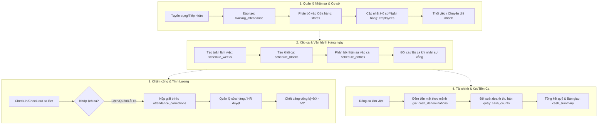
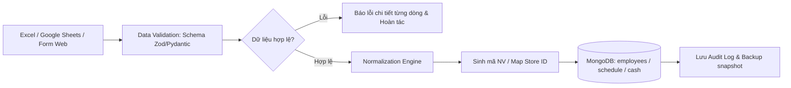

# Nghiên Cứu Các Luồng Nghiệp Vụ & Kỹ Thuật Quản Trị Cơ Sở Dữ Liệu Thực Tế (Database `hr_bot`)

- **Mã báo cáo:** `research-261008-0942-hr-bot-db-management-flows`
- **Ngày thực hiện:** 08/10/2026 (Múi giờ Asia/Bangkok)
- **Hệ thống phân tích:** Database `hr_bot` trên MongoDB Atlas (Cluster `hr-blockbot`)
- **Tác giả:** Researcher & Database Architect Agent
- **Mục tiêu:** Phân tích cấu trúc thực tế của database đang vận hành (dữ liệu chuỗi chuỗi F&B / bán lẻ GUTA CAFE với 144 cửa hàng, 2,439 nhân sự); từ đó thiết kế toàn diện các luồng vận hành (operational flows), kiểm soát dữ liệu (data governance), phân quyền (RBAC) và tích hợp Chatbot AI để quản trị hiệu quả hệ thống trong thực tế.

---

## Mục Lục

1. [Tổng Quan Hiện Trạng Database Thực Tế](#1-tổng-quan-hiện-trạng-database-thực-tế)
   - 1.1 Thông số hạ tầng và các collections
   - 1.2 Đặc điểm dữ liệu: Từ Excel/Google Sheets sang MongoDB
2. [Khoảng Cách Giữa Thiết Kế Lý Thuyết & Dữ Liệu Thực Tế](#2-khoảng-cách-giữa-thiết-kế-lý-thuyết--dữ-liệu-thực-tế)
3. [Các Luồng Nghiệp Vụ Cốt Lõi Cần Quản Trị (Core Business Flows)](#3-các-luồng-nghiệp-vụ-cốt-lõi-cần-quản-trị-core-business-flows)
   - 3.1 Luồng 1: Quản lý Vòng đời Nhân sự Cửa hàng (Store Staff Lifecycle)
   - 3.2 Luồng 2: Xếp ca, Điều phối & Đổi ca Linh hoạt (Shift Scheduling & Swapping)
   - 3.3 Luồng 3: Chấm công, Giải trình & Chốt Kỳ Lương (Attendance & Correction)
   - 3.4 Luồng 4: Kiểm kê Quỹ Tiền Mặt & Đối Soát Doanh Thu Ca (Cash Count Reconciliation)
   - 3.5 Luồng 5: Đào tạo Hội nhập & Đạt chuẩn Ra ca (Training & Readiness)
4. [Các Luồng Kỹ Thuật & Kiến Trúc Dữ Liệu (Technical & Data Flows)](#4-các-luồng-kỹ-thuật--kiến-trúc-dữ-liệu-technical--data-flows)
   - 4.1 Luồng Data Ingestion & Chuẩn Hóa ETL (Thay thế nhập tay)
   - 4.2 Chuẩn Hóa Khóa Ngoại & Integrity Constraints
   - 4.3 Mô hình Phân quyền Dữ liệu (Hierarchical RBAC: Cửa hàng $\to$ Vùng $\to$ Trụ sở)
5. [Tích Hợp Trợ Lý Chatbot (AI & RAG Flows Trên Nền DB Thực Tế)](#5-tích-hợp-trợ-lý-chatbot-ai--rag-flows-trên-nền-db-thực-tế)
   - 5.1 Tra cứu ca làm & Giải trình công qua Chat
   - 5.2 RAG Chính sách & Quy chuẩn Vận hành Cửa hàng (SOP)
   - 5.3 Điều phối nhân sự ca thiếu người (Skill & Availability Matching)
6. [Lộ Trình Triển Khai Thực Tế (Implementation Roadmap)](#6-lộ-trình-triển-khai-thực-tế-implementation-roadmap)
7. [Các Câu Hỏi Mở & Khuyến Nghị (Unresolved Questions & Recommendations)](#7-các-câu-hỏi-mở--khuyến-nghị-unresolved-questions--recommendations)

---

## 1. Tổng Quan Hiện Trạng Database Thực Tế

### 1.1 Thông số hạ tầng và các collections
Khác với mô hình lý thuyết ban đầu của đồ án (mô phỏng nhân sự văn phòng làm đề tài dự án), database `hr_bot` trên MongoDB Atlas hiện đang lưu trữ **dữ liệu vận hành thực tế của một chuỗi bán lẻ/F&B quy mô lớn (GUTA CAFE)** với các thông số đo đạc trực tiếp:

| Tên Collection | Số lượng bản ghi | Dung lượng / Mục đích nghiệp vụ thực tế |
|---|---|---|
| `employees` | **2,439** | Danh sách nhân viên toàn hệ thống: Mã NV (`GT-CH...`), Họ tên, Ngày vào, Ngày nghỉ, Chức danh (`BẾP - Bếp nấu`, `PHA CHẾ`, `THU NGÂN`), Tài khoản ngân hàng, Cửa hàng phân bổ (`store_raw`) |
| `stores` | **144** | Mạng lưới 144 điểm bán (`GUTA CAFE - Quận 3 - 100 Nguyễn Thị Minh Khai`, `GUTA CAFE - Thủ Đức...`), số lượng nhân viên mỗi điểm (`employee_count`) |
| `schedule_weeks` | **29** | Danh mục tuần làm việc (ví dụ tuần `25/05 - 31/05/2026`, `sheet_name`) |
| `schedule_blocks` | **105** | Khung ca làm việc theo cụm cửa hàng (`block_code`: `1BNK`, `AB1-B219`, `employee_rows`) |
| `schedule_entries` | **3,275** | Chi tiết phân ca theo ngày: Ngày làm việc, ca làm việc (`shift_code`: `A`, `A1.749`, `B2`), mã NV, mã khối ca, loại lịch (`actual`) |
| `attendance_corrections` | **115** | Phiếu khiếu nại / giải trình điều chỉnh công theo kỳ lương (`CHẤM THEO KỲ LƯƠNG 6/5-5/6/2026`): lý do quên chấm, lỗi IT, nhân viên mới (NVM) |
| `training_attendance` | **8** | Điểm danh học việc / đào tạo nhân sự mới: địa điểm, ngày đào tạo, khung giờ (`10H30 - 14H`) |
| `cash_counts` | **9** | Kiểm kê tiền mặt tại két cửa hàng theo ca: tổng tiền nộp, tổng tiền khách vãng lai (`walkin_total_vnd`), tổng doanh thu |
| `cash_denominations` | **9** | Đếm chi tiết các mệnh giá tiền mặt (`denomination_vnd`: 500k, 200k, 100k, 50k...), số tờ (`note_count`), thành tiền |
| `cash_summary` | **1** | Bảng tổng kết quỹ tiền mặt toàn ca |
| `raw_cells` | **32,980** | Dữ liệu thô lưu từng ô tính từ bảng tính Excel (`col_idx`, `row_idx`, `sheet_name`: `BẢNG KÊ`, `value`) |

### 1.2 Đặc điểm dữ liệu: Từ Excel/Google Sheets sang MongoDB
1. **Dữ liệu được nạp qua cơ chế ETL từ bảng tính:** Sự hiện diện của `raw_cells` (32,980 bản ghi) và các trường `source_row`, `sheet_name` chứng minh toàn bộ dữ liệu này được xuất từ các file bảng tính vận hành hàng ngày của quản lý cửa hàng.
2. **Khóa liên kết chủ yếu là Text tự nhiên (Unnormalized):** 
   - `store_raw`: Dạng chuỗi mô tả (ví dụ `"BẾP - Quận 1 - 120 Hai Bà Trưng"`), chưa được liên kết chặt với `_id` của collection `stores`.
   - `employee_name` ở một số bảng bị `null`, dựa hoàn toàn vào `employee_code` (`GT-CH...`).
3. **Kỳ lương đặc thù:** Chu kỳ lương tính từ **ngày 6 tháng này đến ngày 5 tháng sau** (`CHẤM THEO KỲ LƯƠNG 6/5-5/6/2026`), đặc thù phổ biến của các chuỗi F&B tại Việt Nam.

---

## 2. Khoảng Cách Giữa Thiết Kế Lý Thuyết & Dữ Liệu Thực Tế

Việc nhận diện sự khác biệt giữa tài liệu đồ án lý thuyết (`docs/`) và dữ liệu thực tế trên Atlas là điều kiện tiên quyết để xây dựng hệ thống chạy được:

```text
[Thiết kế lý thuyết trong docs/]                  [Hiện trạng dữ liệu thực tế trên Atlas]
---------------------------------                  --------------------------------------
• Doanh nghiệp văn phòng / công nghệ               • Chuỗi F&B / Bán lẻ (144 cửa hàng Guta Cafe)
• Quản lý đề tài dự án (projects)                 • Quản lý lịch xếp ca (schedule_entries: 3,275 ca)
• Nghiệm thu công việc (reports)                  • Kiểm kê két tiền mặt ca (cash_counts, denominations)
• Đánh giá KPI theo tháng (evaluations)           • Giải trình thiếu công kỳ lương (attendance_corrections)
• Phân công theo kỹ năng code (PhoBERT)            • Xếp ca theo chức danh: Bếp, Pha chế, Thu ngân
• Nhân viên cố định theo phòng ban                • Nhân viên xoay ca giữa các chi nhánh cửa hàng
```

**Định hướng quản trị:** Thay vì xóa DB thực tế để quay về schema giả định, **cần giữ nguyên dữ liệu giá trị này** và xây dựng hệ thống phần mềm / chatbot xoay quanh đúng bài toán vận hành chuỗi cửa hàng F&B.

---

## 3. Các Luồng Nghiệp Vụ Cốt Lõi Cần Quản Trị (Core Business Flows)



### 3.1 Luồng 1: Quản lý Vòng đời Nhân sự Cửa hàng (Store Staff Lifecycle)
- **Đầu vào:** Thông tin ứng viên mới (Sinh viên làm bán thời gian / Nhân viên toàn thời gian).
- **Các bước:**
  1. *Đăng ký đào tạo:* Ghi nhận lịch học việc vào `training_attendance` (địa điểm, ca học).
  2. *Cấp mã nhân viên chuẩn hóa:* Sinh mã định dạng `GT-CH[YY][MM][STT]` (ví dụ: `GT-CH26057943`).
  3. *Khai báo hồ sơ:* Điền họ tên, số tài khoản ngân hàng (ACB, Vietcombank...), chức danh (`Pha chế`, `Bếp`, `Thu ngân`) vào `employees`.
  4. *Phân bổ cửa hàng chính:* Gán vào `store_raw` tương ứng với `stores.store_name`.
  5. *Theo dõi trạng thái:* Cập nhật `profile_status` (`ĐÃ HOÀN TẤT` / `THIẾU HỒ SƠ`), ghi nhận ngày nghỉ việc (`leave_date`) và lý do (`leave_reason`).

### 3.2 Luồng 2: Xếp ca, Điều phối & Đổi ca Linh hoạt (Shift Scheduling & Swapping)
- **Đặc thù ngành F&B:** Tần suất đổi ca cao, nhân viên nghỉ đột xuất, cần bù ca giữa các cửa hàng lân cận.
- **Các bước:**
  1. *Lập kế hoạch tuần:* Cửa hàng trưởng mở tuần mới tại `schedule_weeks` (xác định `week_start`, `week_end`).
  2. *Thiết lập khối ca:* Định nghĩa các ca chuẩn tại `schedule_blocks` (Ca A: 6h00 - 14h00, Ca B: 14h00 - 22h00, Ca gãy/tăng cường: A1.749).
  3. *Phân bổ nhân viên:* Quản lý gán từng nhân viên vào `schedule_entries` theo ngày.
  4. *Xử lý đổi ca / thiếu người:* 
     - Khi một nhân viên xin nghỉ, hệ thống tự động tìm kiếm nhân viên có cùng chức danh (`job_title`) ở các cửa hàng lân cận đang rảnh ca đó.
     - Sinh bản ghi thay thế và cập nhật trạng thái ca.

### 3.3 Luồng 3: Chấm công, Giải trình & Chốt Kỳ Lương (Attendance & Correction)
- **Hiện tượng thực tế từ DB:** Bảng `attendance_corrections` có 115 bản ghi khiếu nại với lý do: *"NVM (Nhân viên mới)"*, *"Dạ IT chưa thêm mã ca nên mấy bạn không vào ca được ạ"*, *"Quên bấm vân tay/chấm công"*.
- **Các bước chuẩn hóa:**
  1. *Ghi nhận sai lệch:* So khớp giờ làm thực tế với `schedule_entries`. Nếu không khớp $\to$ đánh dấu "Chưa hợp lệ".
  2. *Nộp yêu cầu điều chỉnh:* Nhân viên gửi phiếu giải trình: chọn ngày (`work_date`), ca (`shift_code`), cửa hàng (`store_name`), và lý do cụ thể (`note`).
  3. *Quy trình phê duyệt (Approval Gate):*
     - Cửa hàng trưởng (SM) duyệt vòng 1 (xác nhận nhân viên có mặt thật sự).
     - Bộ phận HR duyệt vòng 2 (đảm bảo không vượt quá số giờ quy định).
  4. *Chốt công kỳ lương:* Hệ thống tổng hợp toàn bộ công hợp lệ và công đã được duyệt điều chỉnh trong chu kỳ ngày 6 tháng này $\to$ ngày 5 tháng kế tiếp để xuất bảng lương.

### 3.4 Luồng 4: Kiểm kê Quỹ Tiền Mặt & Đối Soát Doanh Thu Ca (Cash Count Reconciliation)
- **Hiện tượng thực tế:** Các bảng `cash_counts`, `cash_denominations`, `cash_summary` phản ánh nghiệp vụ kiểm két cuối mỗi ca hoặc cuối ngày để tránh thất thoát tiền mặt.
- **Các bước:**
  1. *Đếm tiền lẻ và tiền chẵn:* Nhân viên thu ngân kiểm đếm từng xấp tiền theo mệnh giá (500k, 200k, 100k, 50k, 20k, 10k...) $\to$ ghi vào `cash_denominations`.
  2. *Đối soát doanh thu bán quầy:* Nhập doanh thu khách vãng lai (`walkin_total_vnd`), đối chiếu với phần mềm POS bán hàng $\to$ lưu vào `cash_counts`.
  3. *Kiểm tra chênh lệch (Discrepancy Check):*
     $$\Delta = \text{Tiền mặt đếm thực tế} - (\text{Tiền đầu ca} + \text{Doanh thu tiền mặt theo POS})$$
     - Nếu $\Delta \neq 0$: Yêu cầu nhân viên giải trình ngay lập tức trước khi giao ca.
  4. *Khóa sổ két tiền:* Cửa hàng trưởng ký duyệt `cash_summary` và bàn giao két cho ca tiếp theo.

### 3.5 Luồng 5: Đào tạo Hội nhập & Đạt chuẩn Ra ca (Training & Readiness)
- Bảng `training_attendance` quản lý việc huấn luyện kỹ năng pha chế và tiêu chuẩn an toàn thực phẩm.
- Chỉ khi nhân sự có bản ghi tham gia đầy đủ buổi đào tạo và có xác nhận đạt chuẩn thì hệ thống mới cho phép Cửa hàng trưởng đưa vào danh sách xếp ca trong `schedule_entries`.

---

## 4. Các Luồng Kỹ Thuật & Kiến Trúc Dữ Liệu (Technical & Data Flows)

### 4.1 Luồng Data Ingestion & Chuẩn Hóa ETL (Thay thế nhập tay)
Hiện tại hệ thống vẫn đang dựa dẫm vào bảng tính (`raw_cells` 32,980 bản ghi). Cần chuyển dịch sang pipeline tự động:



1. **Validation Engine:** Kiểm tra định dạng ngày (`YYYY-MM-DD`), mã nhân viên (`GT-CH...`), số tiền không được âm.
2. **Loại bỏ dần `raw_cells`:** Chuyển sang lưu trữ file gốc trên Object Storage (S3/MinIO), chỉ ghi dữ liệu đã chuẩn hóa vào collections nghiệp vụ để tiết kiệm quota 512MB của MongoDB Atlas.

### 4.2 Chuẩn Hóa Khóa Ngoại & Integrity Constraints
Hiện trạng dữ liệu chứa nhiều trường dạng Text tự do (`store_raw`, `employee_name: null`). Cần chuẩn hóa cấu trúc quan hệ:
- Bổ sung trường `store_id: ObjectId` tham chiếu sang `stores._id` trong bảng `employees` và `schedule_entries`.
- Đảm bảo tính duy nhất: Tạo chỉ mục `UNIQUE` trên `employee_code` trong bảng `employees`.
- Tạo chỉ mục ghép phục vụ truy vấn lịch ca nhanh:
  ```javascript
  db.schedule_entries.createIndex({ employee_code: 1, work_date: 1 }, { unique: true });
  db.schedule_entries.createIndex({ block_code: 1, work_date: 1 });
  ```

### 4.3 Mô hình Phân quyền Dữ liệu (Hierarchical RBAC)
Quản trị hệ thống 144 cửa hàng đòi hỏi phân quyền phân cấp 4 tầng:

```text
[Head Office / HR Admin / Ban Giám Đốc]
  └── Toàn quyền đọc/ghi 144 cửa hàng, chốt lương, cấu hình chính sách
        │
[Quản lý khu vực - Area Manager (AM)]
  └── Quản lý cụm 10 - 20 cửa hàng trong khu vực (ví dụ Quận 1, Gò Vấp, Thủ Đức)
        │
[Cửa hàng trưởng - Store Manager (SM)]
  └── Chỉ quản lý cửa hàng của mình: Xếp ca, duyệt giải trình công, ký chốt két tiền
        │
[Nhân viên cửa hàng - Store Crew / Barista / Kitchen]
  └── Chỉ xem lịch ca của bản thân, nộp giải trình công, kiểm đếm tiền ca của mình
```

---

## 5. Tích Hợp Trợ Lý Chatbot (AI & RAG Flows Trên Nền DB Thực Tế)

Dữ liệu thực tế của `hr_bot` mở ra các kịch bản tương tác Chatbot cực kỳ giá trị cho nhân viên và quản lý:

### 5.1 Tra cứu ca làm & Giải trình công qua Chat (Agent Function Calling)
Chatbot đóng vai trò giao diện chính qua Zalo / Telegram / Web cho nhân viên:

| Câu hỏi của nhân viên | Tool thực thi tương ứng | Hành động trên Database |
|---|---|---|
| *"Mai em làm ca mấy ở đâu vậy bot?"* | `get_my_schedule(date)` | Query `schedule_entries` theo `employee_code` và ngày mai |
| *"Hôm nay ai làm chung ca A với em ở Hai Bà Trưng?"* | `get_coworkers(shift, store, date)` | Query `schedule_entries` cùng `block_code` và ngày |
| *"Hôm qua em quên bấm vân tay, cho em báo bổ sung công"* | `submit_attendance_correction(...)` | Ghi bản ghi mới vào `attendance_corrections` |
| *"Kỳ lương này em được bao nhiêu công rồi?"* | `get_my_attendance_summary(period)` | Đếm số ca hoàn thành từ ngày 6 đến ngày 5 |

### 5.2 RAG Chính sách & Quy chuẩn Vận hành Cửa hàng (SOP)
Sử dụng kiến trúc **Advanced RAG** đã nghiên cứu ở báo cáo trước để phục vụ tra cứu tài liệu quy chế:
1. **Nội dung nạp vào RAG:**
   - Quy định chấm công và xử lý quên quẹt vân tay (hạn chót nộp giải trình trước ngày mấy).
   - Quy trình vệ sinh quầy pha chế, quy chuẩn an toàn vệ sinh thực phẩm (ATVSTP).
   - Quy định phạt tiền thiếu két tiền mặt và quy trình bàn giao ca.
   - Chính sách thưởng doanh số cửa hàng, chế độ hỗ trợ nhân viên part-time.
2. **Cơ chế:** Khi nhân viên hỏi quy định, bot trích xuất đúng điều khoản quy chế, dẫn nguồn rõ ràng và từ chối đoán mò nếu tài liệu không quy định.

### 5.3 Điều phối nhân sự ca thiếu người (Skill & Availability Matching)
- **Kịch bản:** Sáng sớm cửa hàng Hai Bà Trưng có 1 nhân viên pha chế bị ốm đột xuất, thiếu người mở ca A.
- **Hành động của AI:**
  1. Quét trong `stores` các chi nhánh lân cận trong bán kính 3km (Quận 1, Quận 3).
  2. Lọc trong `employees` các nhân sự có chức danh `PHA CHẾ`.
  3. Kiểm tra trong `schedule_entries` xem nhân sự nào **không có lịch làm** ca A ngày hôm đó.
  4. Gợi ý cho Cửa hàng trưởng danh sách 3 ứng viên phù hợp nhất kèm số điện thoại để liên hệ điều chuyển ca.

---

## 6. Lộ Trình Triển Khai Thực Tế (Implementation Roadmap)

1. **Giai đoạn 1: Dọn dẹp & Giải phóng Quota Database (Tuần 1)**
   - Xóa database mẫu `sample_mflix` (đang chiếm 151 MB trên cluster Atlas M0) để giải phóng dung lượng, đưa mức sử dụng về < 2% (chỉ còn 5.8 MB của `hr_bot`).
   - Đặt chỉ mục `classic` bổ sung trên `employee_code`, `work_date`, `store_name`.
2. **Giai đoạn 2: Xây dựng Backend API Quản trị Nghiệp vụ (Tuần 2 - 4)**
   - Viết API CRUD cho `employees`, `stores`, `schedule_entries`, `attendance_corrections`.
   - Viết luồng import/export Excel chuẩn hóa (thay thế việc lưu thô vào `raw_cells`).
3. **Giai đoạn 3: Phát triển Giao diện Quản trị & Xếp ca Web (Tuần 5 - 7)**
   - Màn hình lịch trực quan (Calendar/Gantt view) để quản lý kéo thả xếp ca theo tuần.
   - Màn hình duyệt phiếu khiếu nại chấm công cho HR.
   - Màn hình đối soát két tiền mặt theo ngày.
4. **Giai đoạn 4: Tích hợp Trợ lý Chatbot AI & RAG (Tuần 8 - 10)**
   - Tích hợp 15 tool function calling vào chatbot phục vụ nhân viên tra cứu lịch ca và nộp giải trình.
   - Nạp tài liệu Nội quy lao động & Quy chế vận hành F&B vào Vector Search của Atlas.
5. **Giai đoạn 5: Kiểm thử Toàn diện & Bàn giao (Tuần 11 - 12)**
   - Chạy thử nghiệm trên tập dữ liệu thật của 144 cửa hàng.
   - Đánh giá hiệu năng truy vấn và bảo mật RBAC.

---

## 7. Các Câu Hỏi Mở & Khuyến Nghị (Unresolved Questions & Recommendations)

1. **Xử lý bảng `raw_cells`:** 32,980 bản ghi trong `raw_cells` hiện chỉ là dữ liệu staging từ Excel. Có nên xuất lưu trữ ra file JSON/CSV nén và dọn sạch collection này khỏi Atlas để tối ưu hóa bộ nhớ RAM và IOPS hay không? *(Khuyến nghị: Nên dọn dẹp sau khi đã kiểm tra đủ dữ liệu).*
2. **Chuẩn hóa liên kết Cửa hàng:** Cần chạy một script migration chuyển đổi `store_raw` (dạng text) trong `employees` thành `store_id` (ObjectId) liên kết chính xác với collection `stores`.
3. **Kênh Chatbot chính thức:** Với nhân viên chuỗi cửa hàng F&B, nhân viên ít khi mở web máy tính. Nhóm có dự định kết nối Chatbot vào Zalo OA hoặc Telegram Bot để nhân viên thao tác trực tiếp trên điện thoại không?
