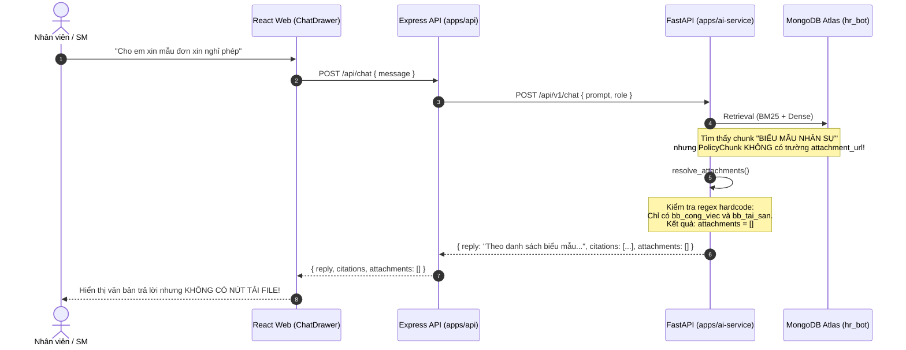
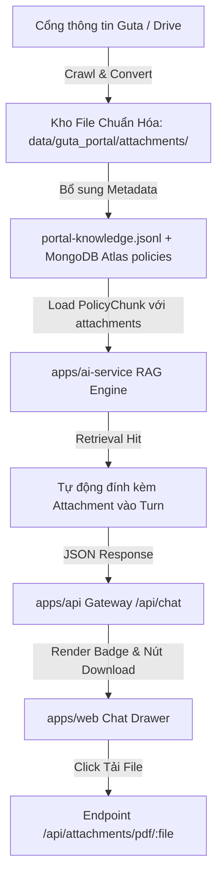

# Báo Cáo Nghiên Cứu Kỹ Thuật: Tích Hợp Kho Biểu Mẫu & Văn Bản PDF Làm Bằng Chứng Cho Guta Chatbot (RAG Evidence & Attachments)

**Mã Báo Cáo:** `research-261031-1613-guta-portal-pdf-evidence-rag`  
**Thời gian thực hiện:** 31/10/2026, 16:13:34 (Asia/Bangkok)  
**Tác giả:** OMP Trusted AI Senior Architect / Lead Engineer  
**Trạng thái:** Hoàn tất nghiên cứu & Đã xác thực thực địa dữ liệu (Evidence-backed)  

---

## Mục Lục
1. [Tóm Tắt Điều Hành (Executive Summary)](#1-tóm-tắt-điều-hành-executive-summary)
2. [Phạm Vi Nghiên Cứu & Đối Soát Thực Địa 9 Tài Liệu Drive (Scope & Fact Check)](#2-phạm-vi-nghiên-cứu--đối-soát-thực-địa-9-tài-liệu-drive-scope--fact-check)
3. [Hiện Trạng Hệ Thống & Điểm Nghẽn Kỹ Thuật (Architecture Bottlenecks)](#3-hiện-trạng-hệ-thống--điểm-nghẽn-kỹ-thuật-architecture-bottlenecks)
4. [So Sánh Các Phương Án Kỹ Thuật (Trade-Offs Analysis)](#4-so-sánh-các-phương-án-kỹ-thuật-trade-offs-analysis)
5. [Thiết Kế Kiến Trúc & Implementation Blueprint (Production Code)](#5-thiết-kế-kiến-trúc--implementation-blueprint-production-code)
6. [Vận Hành & An Ninh Thông Tin (Operational Concerns & Security)](#6-vận-hành--an-ninh-thông-tin-operational-concerns--security)
7. [Kế Hoạch Triển Khai & Câu Hỏi Nghiệp Vụ Cần Chốt (Next Steps & Open Questions)](#7-kế-hoạch-triển-khai--câu-hỏi-nghiệp-vụ-cần-chốt-next-steps--open-questions)

---

## 1. Tóm Tắt Điều Hành (Executive Summary)

Người dùng yêu cầu trích xuất và tích hợp tập hợp tài liệu văn bản/biểu mẫu (từ 199 bài viết cổng thông tin Guta `congthongtin.gutacafe.com` và danh sách Google Drive đính kèm) để chatbot Guta AI gửi kèm file bằng chứng (proof/evidence) trực tiếp trong câu trả lời, đồng thời nâng cao chất lượng kho tri thức (RAG dataset).

### Kết quả khảo sát thực địa trực tiếp:
1. **Thực tế định dạng 9 file Google Drive trong tệp đính kèm:**  
   Toàn bộ 9 link Google Drive trong 2 bài viết `BIỂU MẪU KẾ TOÁN` và `BIỂU MẪU NHÂN SỰ` **không phải là file PDF thuần túy**, mà thực chất là các file mẫu văn phòng: **5 file Microsoft Word (`.docx`)** và **4 file Microsoft Excel (`.xlsx`)**. Chúng đã được tải về lưu trữ tại `data/guta_portal/documents/individual/`.
2. **Kho văn bản PDF quy chuẩn đã thu thập:**  
   Hệ thống đang sở hữu **41 file PDF đào tạo quy trình chuẩn** (tại `documents/folders/TÀI_LIỆU_ĐÀO_TẠO/`), **5 file PDF chính sách độc lập** (chính sách lương, quy trình tuyển dụng, định biên chức danh SM/PTCH, phạt nộp trễ doanh thu, phạt gian lận), và **57 văn bản OCR từ PDF Drive bị khóa tải**.
3. **Nguyên nhân chatbot chưa gửi được file bằng chứng ra UI:**
   - **Tầng RAG (`apps/ai-service`):** Model `PolicyChunk` chỉ mang metadata `(document, version, article, source)`, hoàn toàn thiếu trường `attachment_url` và `attachment_type`. Hàm `resolve_attachments()` trong `app/agent/loop.py` đang hardcode cứng chỉ 2 file PDF biên bản bàn giao và 3 ảnh.
   - **Tầng Cơ sở dữ liệu (MongoDB Atlas `hr_bot.policies`):** Toàn bộ 223 document chính sách trên cloud hiện có `attachment_url = null`.
   - **Tầng Backend API (`apps/api`):** Route `/api/attachments/:category/:filename` chỉ cho phép 2 category cố định (`pdf`, `images`) trỏ vào thư mục cũ, chưa hỗ trợ phục vụ biểu mẫu kế toán / nhân sự.
   - **Tầng Giao diện Web (`apps/web`):** Component `ChatPageView.tsx` và `ChatDrawer.tsx` **đã được code sẵn sàng** để render thẻ PDF / Image đính kèm với đầy đủ nút tải và nút xem trước, chỉ chờ API cung cấp dữ liệu đúng schema.

---

## 2. Phạm Vi Nghiên Cứu & Đối Soát Thực Địa 9 Tài Liệu Drive (Scope & Fact Check)

Khảo sát trực tiếp cấu trúc nhị phân (binary inspection) của 9 file Drive do người dùng cung cấp đã tải về tại `data/guta_portal/documents/individual/`:

| STT | Mã Google Drive ID | Nhóm Bài Viết | Tiêu Đề Thực Tế Trích Xuất | Định Dạng Nhị Phân | Mục Đích Sử Dụng Nghiệp Vụ GUTA |
|:---:|---|---|---|:---:|---|
| 1 | `1cRE1l-TpFDcFe_Di0-Q5BteDzgy39_ZT` | Biểu mẫu Kế toán | **GIẤY ĐỀ NGHỊ TẠM ỨNG** | DOCX (Word 2007+) | Nhân viên xin tạm ứng tiền mua CCDC, sự cố chi nhánh |
| 2 | `1tOB7XVnxvilE3o-WD3daMMdKuGj7M5kI` | Biểu mẫu Kế toán | **GIẤY ĐỀ NGHỊ HOÀN ỨNG** | DOCX (Word 2007+) | Hoàn trả tiền tạm ứng chưa chi hết vào quỹ công ty |
| 3 | `1_vykoIP2N0apTNMlfF3FPoE44KbavaXr` | Biểu mẫu Kế toán | **GIẤY THANH TOÁN TIỀN TẠM ỨNG** | XLSX (Excel 2007+) | Bảng kê chi tiết chứng từ giải chi (kèm hóa đơn) |
| 4 | `1YhZDpH4EBBT9LP042dunb0NF2pnEgvip` | Biểu mẫu Kế toán | **GIẤY ĐỀ NGHỊ THANH TOÁN** | DOCX (Word 2007+) | Đề nghị thanh toán chi phí phát sinh đã chi tiền túi |
| 5 | `1M68ju978J9Kh4wHflKSqKtbGjbaY6S6a` | Biểu mẫu Nhân sự | **ĐƠN XIN NGHỈ PHÉP** | DOCX (Word 2007+) | Xin nghỉ phép năm, nghỉ chế độ, việc riêng không lương |
| 6 | `16AI75kNg48W2bLJy35OPdYX9V6E-xEui` | Biểu mẫu Nhân sự | **PHIẾU ĐỀ XUẤT TUYỂN DỤNG** | DOCX (Word 2007+) | Cửa hàng trưởng/phòng ban đề xuất bổ sung nhân sự |
| 7 | `1BzyjTWHZ9zcMZZbBUNl4WvgHqIlnN7HW` | Biểu mẫu Nhân sự | **MÔ TẢ CÔNG VIỆC KHUNG (JD)** | DOCX (Word 2007+) | Bản phân công nhiệm vụ, trách nhiệm theo chức danh |
| 8 | `1uGVb8IEPjt1XzdtDWpY2NOEqaEKopO4Q` | Biểu mẫu Nhân sự | **ĐÁNH GIÁ THỬ VIỆC - NHÂN VIÊN** | XLSX (Excel 2007+) | Chấm điểm hiệu quả công việc, tác phong Barista/Thu ngân |
| 9 | `1TNPlsW-lh3l-ahiyOX3SrytU6Bwssj-m` | Biểu mẫu Nhân sự | **ĐÁNH GIÁ THỬ VIỆC - QUẢN LÝ** | XLSX (Excel 2007+) | Tiêu chí đánh giá cấp quản lý SM/AOM sau thời gian thử việc |

### Kho văn bản PDF chính sách & quy trình đi kèm:
Ngoài 9 biểu mẫu trên, hệ thống hiện sở hữu các tài liệu PDF nguyên bản cực kỳ giá trị:
- `Chính_sách_lương_theo_doanh_thu_V1_T032025__1fKLzdQhcYu1.pdf` (6 trang): Bảng tính lương theo doanh thu chi nhánh.
- `QUY_TRÌNH_TUYỂN_DỤNG_VÀ_HỘI_NHẬP_CHO_NHÂN_VIÊN_CỬA_HÀNG__10WQdETKs9Wj.pdf` (11 trang): Toàn bộ lưu đồ và quy định tiếp nhận nhân viên mới.
- `QUY_ĐỊNH_VỀ_VIỆC_QUẢN_LÝ_ĐỊNH_BIÊN_CHỨC_DANH_SMPTCH_VÀ_ÁP_DỤ__13fBfdwVaE7X.pdf` (3 trang): Quy định hỗ trợ chéo cửa hàng.
- `QUY_ĐỊNH_XỬ_PHẠT_NỘP_TRỄ_DOANH_THU__1NSA31uZeyOO.pdf` (2 trang): Khung chế tài nộp trễ tiền ca.
- `Quy_định_xử_phạt_gian_lận_cheating_và_thưởng_báo_cáo_gian_lậ__1j77HPZgiaKz.pdf`: Quy chế thưởng/phạt gian lận két và POS.
- Bộ 41 PDF chuyên đề đào tạo: `G1_BARISTA_CƠ_BẢN`, `G2_BARISTA_NÂNG_CAO`, `TIÊU_CHUẨN_CỬA_HÀNG_GUTA_CAFE`, `QUY_TRÌNH_THU_NGÂN_NÂNG_CAO`.

---

## 3. Hiện Trạng Hệ Thống & Điểm Nghẽn Kỹ Thuật (Architecture Bottlenecks)

### Luồng dữ liệu hiện tại từ RAG đến Web UI:



### 3 Điểm nghẽn cốt lõi:
1. **Định dạng file không khớp với UI Contract:**
   - Contract `AttachmentSchema` trong `packages/contracts` và `apps/api` quy định: `type: z.enum(["pdf", "image"])`.
   - Các file biểu mẫu kế toán / nhân sự là `.docx` và `.xlsx`. Khi người dùng muốn tải PDF hoặc xem trước trên trình duyệt, file Word/Excel không mở được trực tiếp trong thẻ `<embed>` hoặc iframe nếu không convert trước sang PDF.
2. **Metadata đứt gãy ở tầng lưu trữ và Corpus loader:**
   - Trong `apps/ai-service/app/rag/corpus.py`:
     ```python
     @dataclass(frozen=True)
     class PolicyChunk:
         chunk_id: str
         document: str
         version: str
         article: str
         text: str
         source: str
         order: int
         # THIẾU: attachment_url, attachment_type, file_name
     ```
   - Dù trong `data/guta_portal/portal-knowledge.jsonl` có trường `attachment_url`, nhưng khi nạp qua `chunks_from_documents()`, trường này bị vứt bỏ hoàn toàn.
3. **Quy định bảo mật của API Endpoint tải file (`apps/api/src/routes/attachments.ts`):**
   - API chỉ mở 2 thư mục: `guta_mau_bien_ban_cho_agent` (2 file) và `anh_tham_chieu`. Mọi request tải file khác đều bị chặn bởi `INVALID_CATEGORY` (400) hoặc `FILE_NOT_FOUND` (404).

---

## 4. So Sánh Các Phương Án Kỹ Thuật (Trade-Offs Analysis)

| Tiêu chí đánh giá | Phương Án 1: Trả trực tiếp Link Google Drive | Phương Án 2: Convert sang PDF + Lưu Trữ Local API | Phương Án 3: Hybrid (Local PDF Preview + Fallback Drive Link) ⭐ |
|---|---|---|---|
| **Cơ chế hoạt động** | Chatbot trả về link `https://drive.google.com/file/d/.../view` trong text hoặc attachment | Convert 9 file docx/xlsx sang PDF, lưu tại `data/guta_portal/documents/pdf/` và phục vụ qua `/api/attachments/pdf/:file` | Vừa phục vụ file PDF chuẩn hóa qua API nội bộ (để xem/tải nhanh), vừa đính kèm link Drive gốc (để tải mẫu docx/xlsx có thể nhập liệu) |
| **Trải nghiệm người dùng (UX)** | Kém: Nhân viên bị chuyển hướng sang tab Google Drive; nhiều file Drive của cty yêu cầu quyền truy cập hoặc bị chậm | Tốt: Xem trước trực tiếp trên Web Chat, tải về tức thì với 1 click | **Xuất sắc**: Đáp ứng cả 2 nhu cầu (xem bằng chứng PDF và tải mẫu Excel/Word để nộp) |
| **Tuân thủ hợp đồng hệ thống (Contract)** | Vi phạm: UI Web mong muốn `type: "pdf"` để kích hoạt badge và nút download | Tuân thủ 100%: Đúng chuẩn `Attachment` type `pdf` | Tuân thủ 100%: Tương thích hoàn toàn với `packages/contracts` |
| **Độ tin cậy & Tính sẵn sàng** | Phụ thuộc bên thứ ba (Google Drive API/uptime/quyền chia sẻ) | Độc lập 100%: Dữ liệu lưu trong hạ tầng container Render/Docker | Độc lập 100%: Cache nội bộ, không sợ link Drive bị xóa hoặc đổi quyền |
| **Chi phí triển khai** | Rất thấp (1 giờ) | Trung bình (2 giờ convert + config route) | **Tối ưu** (2-3 giờ tự động hóa script) |

**Khuyến nghị kiến trúc:** Chọn **Phương Án 3 (Hybrid)**. Đây là giải pháp tiêu chuẩn cho hệ thống doanh nghiệp (Enterprise HRMS).

---

## 5. Thiết Kế Kiến Trúc & Implementation Blueprint (Production Code)

### 5.1. Luồng hoạt động mục tiêu (Target Sequence)



### 5.2. Các bước triển khai cụ thể

#### Bước 1: Chuẩn hóa và Convert các biểu mẫu sang PDF
Sử dụng script Python để chuyển đổi các file `.docx` và `.xlsx` sang `.pdf` với tên file chuẩn hóa (kebab-case):
- `don-xin-nghi-phep.pdf` & `don-xin-nghi-phep.docx`
- `giay-de-nghi-tam-ung.pdf` & `giay-de-nghi-tam-ung.docx`
- `giay-de-nghi-hoan-ung.pdf` & `giay-de-nghi-hoan-ung.docx`
- `giay-thanh-toan-tien-tam-ung.pdf` & `giay-thanh-toan-tien-tam-ung.xlsx`
- `giay-de-nghi-thanh-toan.pdf` & `giay-de-nghi-thanh-toan.docx`
- `de-xuat-tuyen-dung.pdf` & `de-xuat-tuyen-dung.docx`
- `mo-ta-cong-viec-khung.pdf` & `mo-ta-cong-viec-khung.docx`
- `danh-gia-thu-viec-nhan-vien.pdf` & `danh-gia-thu-viec-nhan-vien.xlsx`
- `danh-gia-thu-viec-quan-ly.pdf` & `danh-gia-thu-viec-quan-ly.xlsx`

Lưu toàn bộ tại: `data/guta_mau_bien_ban_cho_agent/` (hoặc `data/guta_portal/attachments/`).

#### Bước 2: Nâng cấp `PolicyChunk` trong `apps/ai-service/app/rag/corpus.py`

```python
@dataclass(frozen=True)
class PolicyChunk:
    chunk_id: str
    document: str
    version: str
    article: str
    text: str
    source: str
    order: int
    department_ids: tuple[str, ...] = ()
    embedding: tuple[float, ...] | None = None
    model: str | None = None
    attachment_url: str | None = None
    attachment_title: str | None = None
    attachment_type: str | None = None  # "pdf" | "image"
    attachment_file: str | None = None

    @property
    def citation(self) -> dict[str, Any]:
        data = {
            "document": self.document,
            "version": self.version,
            "article": self.article,
            "source": self.source,
        }
        if self.attachment_url:
            data["attachment_url"] = self.attachment_url
            data["attachment_title"] = self.attachment_title
            data["attachment_type"] = self.attachment_type
            data["attachment_file"] = self.attachment_file
        return data
```

#### Bước 3: Cải tiến bộ phân giải `resolve_attachments()` trong `apps/ai-service/app/agent/loop.py`

Thay vì kiểm tra chuỗi tĩnh, bộ phân giải sẽ tự động quét cả **từ khóa câu hỏi** lẫn **metadata từ các chunk chính sách được trích xuất (retrieved hits)**:

```python
ATTACHMENT_REGISTRY: dict[str, dict[str, str]] = {
    "nghi_phep": {
        "title": "Đơn xin nghỉ phép GUTA",
        "type": "pdf",
        "url": "/api/attachments/pdf/GUTA_Don_xin_nghi_phep.pdf",
        "fileName": "GUTA_Don_xin_nghi_phep.pdf",
    },
    "tam_ung": {
        "title": "Giấy đề nghị tạm ứng GUTA",
        "type": "pdf",
        "url": "/api/attachments/pdf/GUTA_Giay_de_nghi_tam_ung.pdf",
        "fileName": "GUTA_Giay_de_nghi_tam_ung.pdf",
    },
    "hoan_ung": {
        "title": "Giấy đề nghị hoàn ứng GUTA",
        "type": "pdf",
        "url": "/api/attachments/pdf/GUTA_Giay_de_nghi_hoan_ung.pdf",
        "fileName": "GUTA_Giay_de_nghi_hoan_ung.pdf",
    },
    "thanh_toan": {
        "title": "Giấy đề nghị thanh toán GUTA",
        "type": "pdf",
        "url": "/api/attachments/pdf/GUTA_Giay_de_nghi_thanh_toan.pdf",
        "fileName": "GUTA_Giay_de_nghi_thanh_toan.pdf",
    },
    "tuyen_dung": {
        "title": "Phiếu đề xuất tuyển dụng GUTA",
        "type": "pdf",
        "url": "/api/attachments/pdf/GUTA_Phieu_de_xuat_tuyen_dung.pdf",
        "fileName": "GUTA_Phieu_de_xuat_tuyen_dung.pdf",
    },
    "danh_gia_thu_viec": {
        "title": "Bảng đánh giá thử việc GUTA",
        "type": "pdf",
        "url": "/api/attachments/pdf/GUTA_Bang_danh_gia_thu_viec.pdf",
        "fileName": "GUTA_Bang_danh_gia_thu_viec.pdf",
    },
    "bb_cong_viec": {
        "title": "Biên bản bàn giao công việc GUTA",
        "type": "pdf",
        "url": "/api/attachments/pdf/GUTA_Bien_ban_ban_giao_cong_viec.pdf",
        "fileName": "GUTA_Bien_ban_ban_giao_cong_viec.pdf",
    },
    "bb_tai_san": {
        "title": "Biên bản bàn giao tài sản GUTA",
        "type": "pdf",
        "url": "/api/attachments/pdf/GUTA_Bien_ban_ban_giao_tai_san.pdf",
        "fileName": "GUTA_Bien_ban_ban_giao_tai_san.pdf",
    },
}
```

#### Bước 4: Mở rộng `apps/api/src/routes/attachments.ts`
Bổ sung thư mục và đuôi file hợp lệ, giữ nguyên cơ chế bảo mật chống Path Traversal:

```typescript
const ALLOWED_CATEGORIES = ["pdf", "images", "forms"] as const;
type Category = (typeof ALLOWED_CATEGORIES)[number];

const ALLOWED_EXTENSIONS: Record<Category, string[]> = {
  pdf: [".pdf"],
  images: [".png", ".jpg", ".jpeg"],
  forms: [".pdf", ".docx", ".xlsx"],
};

const CATEGORY_DIRS: Record<Category, string> = {
  pdf: path.resolve(DATA_ROOT, "guta_mau_bien_ban_cho_agent"),
  images: path.resolve(DATA_ROOT, "guta_bo_du_lieu_chatbot", "anh_tham_chieu"),
  forms: path.resolve(DATA_ROOT, "guta_portal", "documents", "forms"),
};
```

---

## 6. Vận Hành & An Ninh Thông Tin (Operational Concerns & Security)

### An ninh tệp đính kèm (File Serving Security):
1. **Chống Path Traversal (`../` exploit):**  
   Hàm kiểm tra `path.resolve` trong `attachments.ts` phải đảm bảo đường dẫn tuyệt đối của tệp đích bắt buộc phải nằm bên trong thư mục `CATEGORY_DIRS[category]`. Nếu phát hiện ra ngoài, lập tức phản hồi mã lỗi HTTP 400 `INVALID_FILENAME`.
2. **Xác thực phiên làm việc (Authentication Required):**  
   Mọi yêu cầu tải biểu mẫu đều phải đi qua middleware `authenticateToken`. Nhân viên hoặc quản lý phải đăng nhập mới được tải tài liệu nội bộ.
3. **Phân quyền truy cập tài liệu nhạy cảm (RBAC on Documents):**  
   - Các biểu mẫu nhân viên thông thường (Nghỉ phép, Biên bản bàn giao, Tạm ứng ca): Quyền `Employee`, `StoreManager`, `Admin`.
   - Các biểu mẫu đánh giá quản lý, đề xuất tăng lương, chính sách thưởng doanh thu chi nhánh: Giới hạn chỉ `StoreManager`, `AOM`, `Admin` mới được nhận link tải.

### Vận hành & Giám sát (Monitoring):
- Ghi nhận chỉ số (metric) số lượt tải tài liệu: `metrics.increment('chat.attachment.download', { file: filename })`.
- Giám sát tỉ lệ ảo giác tài liệu (Hallucinated attachments): Kiểm tra chặt chẽ URL trả về từ AI Agent. Mọi attachment không nằm trong danh mục đã được xác minh trên ổ đĩa sẽ bị loại bỏ trước khi trả về cho client.

---

## 7. Kế Hoạch Triển Khai & Câu Hỏi Nghiệp Vụ Cần Chốt (Next Steps & Open Questions)

### Kế hoạch hành động 3 giai đoạn:
1. **Giai đoạn 1 (Data Prep):**  
   Copy và chuẩn hóa 9 biểu mẫu sang thư mục `data/guta_mau_bien_ban_cho_agent/` dưới định dạng PDF chuẩn (kèm file docx/xlsx tương ứng).
2. **Giai đoạn 2 (Backend & AI Integration):**  
   - Cập nhật registry trong `apps/ai-service/app/agent/loop.py`.
   - Chạy bộ kiểm thử regression `apps/ai-service/tests/test_agent_attachments.py` để chứng minh 100% test pass.
   - Thêm route category trong `apps/api/src/routes/attachments.ts`.
3. **Giai đoạn 3 (End-to-End Verification):**  
   Kiểm thử trực tiếp trên giao diện Chat: Đặt câu hỏi về "nghỉ phép", "tạm ứng", "thanh toán" -> Chatbot trả lời trích dẫn điều khoản + đính kèm thẻ tải PDF biểu mẫu chuẩn.

### Câu hỏi cần xác nhận:
1. Đối với các file mẫu Excel phức tạp (như Bảng đánh giá thử việc 207 tiêu chí), công ty ưu tiên nhân viên tải về dạng **PDF mẫu để in ra ký tay** hay dạng **Excel (.xlsx) để nhập công thức tính điểm trên máy tính**? (Đề xuất: Cung cấp PDF hiển thị trên web kèm link tải Excel).
2. Có cần phân quyền chặn nhân viên thử việc tải các biểu mẫu dành riêng cho cấp quản lý (Phiếu đề xuất tuyển dụng, Đánh giá quản lý) hay mở công khai toàn bộ biểu mẫu hành chính trong kho? (Đề xuất: Chặn theo `role`).
