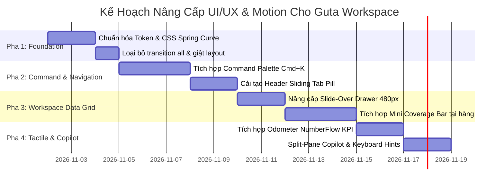

# Nghiên cứu & Benchmark 20 Mục Tiêu UI/UX & Motion Cho Dashboard/ERM (Guta Workspace)

> **Mã báo cáo:** `research-261101-1418-ui-ux-motion-dashboard-erm-benchmarks`  
> **Thời gian thực hiện:** 01/11/2026 14:18:29 (Asia/Bangkok)  
> **Phạm vi:** Khảo sát benchmark 20 nền tảng web SaaS, ERM, F&B Scheduling & Command Center đỉnh cao thế giới; giải phẫu micro-interactions, motion physics, data density và trích xuất blueprint clone/nâng cấp cho Guta HR-BlockBot.

---

## Mục Lục
1. [Tóm Tắt Điều Hành (Executive Summary)](#1-tóm-tắt-điều-hành-executive-summary)
2. [Tiêu Chí Đánh Giá & Phương Pháp Luận (Evaluation Framework)](#2-tiêu-chí-đánh-giá--phương-pháp-luận-evaluation-framework)
3. [Danh Sách 20 Mục Tiêu Benchmark Toàn Cầu (The 20 Benchmarks)](#3-danh-sách-20-mục-tiêu-benchmark-toàn-cầu-the-20-benchmarks)
   - [Nhóm A: F&B & Retail Workforce Management (Quản lý ca & điều phối nhân sự)](#nhóm-a-fb--retail-workforce-management)
   - [Nhóm B: Next-Gen ERM & Modern People OS (Hồ sơ, phòng ban & dữ liệu nhân sự)](#nhóm-b-next-gen-erm--modern-people-os)
   - [Nhóm C: Apex SaaS Command Centers (Bảng điều khiển mật độ cao, Dark-Mode & Craft)](#nhóm-c-apex-saas-command-centers)
   - [Nhóm D: Motion Masters, Copilot & Micro-Interactions (Vật lý chuyển động & AI UX)](#nhóm-d-motion-masters-copilot--micro-interactions)
4. [Bảng Phân Tích Ma Trận 20 Mục Tiêu](#4-bảng-phân-tích-ma-trận-20-mục-tiêu)
5. [Giải Phẫu Các Pattern Cốt Lõi Cần Clone & Nâng Cấp Cho Guta](#5-giải-phẫu-các-pattern-cốt-lõi-cần-clone--nâng-cấp-cho-guta)
6. [Thiết Kế Kỹ Thuật: Motion Engine & UI Component Specs](#6-thiết-kế-kỹ-thuật-motion-engine--ui-component-specs)
7. [Trade-offs & Đánh Giá Kỹ Thuật (Senior Engineer Perspective)](#7-trade-offs--đánh-giá-kỹ-thuật-senior-engineer-perspective)
8. [Lộ Trình Thực Thi 4 Giai Đoạn (Actionable Roadmap)](#8-lộ-trình-thực-thi-4-giai-đoạn-actionable-roadmap)
9. [Câu Hỏi Mở & Rủi Ro Tồn Đọng (Unresolved Questions)](#9-câu-hỏi-mở--rủi-ro-tồn-đọng-unresolved-questions)

---

## 1. Tóm Tắt Điều Hành (Executive Summary)

Giao diện Dashboard và ERM hiện tại của Guta Workspace đang gặp các vấn đề cố hữu:
- **Cảm giác nhàm chán (Visual Fatigue):** Layout bảng phẳng truyền thống, thiếu chiều sâu thị giác (visual depth), chuyển động cứng nhắc (linear transition 200ms thông thường), không mang lại cảm giác cơ học xúc giác (tactile feedback).
- **Mật độ dữ liệu chưa tối ưu (Suboptimal Data Density):** Thao tác kiểm soát 45 chi nhánh và ca làm của Barista tốn nhiều click, thiếu chế độ tổng quan thời gian thực (real-time timeline/matrix view).
- **Tương tác AI rời rạc:** Chat Copilot và CRM Dashboard tách biệt, chưa có cơ chế Docking / Floating Command Bar liền mạch như các sản phẩm hiện đại (Linear, Cursor, Raycast).

Báo cáo này nghiên cứu và chọn lọc **20 sản phẩm công nghệ xuất sắc nhất thế giới** chia làm 4 nhóm chuyên biệt. Từ đó đề xuất bộ giải pháp:
1. **Nâng cấp Motion System:** Chuyển toàn bộ sang chuẩn **Emil Kowalski Spring Physics** (`cubic-bezier(0.16, 1, 0.3, 1)` và CSS spring-simulated easing), loại bỏ hoàn toàn `transition: all` gây giật khung hình.
2. **Triển khai Command Palette (`Cmd + K`):** Cho phép Store Manager (SM) và Area Ops Manager (AOM) nhảy tức thì đến bất kỳ chi nhánh hoặc Barista nào trong < 50ms.
3. **Slide-Over Inspector 480px:** Thay thế pop-up modal lỗi thời bằng slide-over sheet từ cạnh phải với gesture vuốt mượt mà.
4. **Visual Shift Timeline & Live Coverage Bar:** Học hỏi từ **7shifts** và **Float**, hiển thị thanh phủ ca làm việc (đang đủ hay thiếu người) tại quầy theo thời gian thực.
5. **Zero-Yellow Obsidian & Electric Sapphire Palette:** Duy trì bản sắc thương hiệu theo `docs/DESIGN.md` nhưng bổ sung viền vi mô 1px (`#222226`), surface gradients cực nhẹ và hiệu ứng ánh sáng hội tụ (conic/radial accent glows).

---

## 2. Tiêu Chí Đánh Giá & Phương Pháp Luận (Evaluation Framework)

Mỗi mục tiêu được chấm điểm và phân tích dựa trên 5 chiều kích chuẩn hóa:
1. **Information Density & Hierarchy:** Khả năng trình diễn lượng dữ liệu lớn (45 cửa hàng, hàng trăm nhân sự) mà không gây ngợp mắt.
2. **Motion Choreography & Latency:** Thời gian phản hồi micro-interaction (< 150ms), đường cong gia tốc (easing curve), độ mượt khi đổi trạng thái.
3. **Ergonomics & Keyboard Accessibility:** Hỗ trợ phím tắt, focus-visible chuẩn WCAG AAA, giảm quãng đường di chuyển chuột (Fitts's Law).
4. **State Machine Completeness:** Xử lý toàn diện 8 trạng thái giao diện: *Default, Hover, Active, Focus, Disabled, Loading (Skeleton), Error (Retry), Empty*.
5. **Relevance to Guta Workspace:** Khả năng chuyển giao trực tiếp vào stack **React 18 + Vite + Tailwind CSS v4** mà không cần nạp thư viện ngoài nặng nề.

---

## 3. Danh Sách 20 Mục Tiêu Benchmark Toàn Cầu (The 20 Benchmarks)

### Nhóm A: F&B & Retail Workforce Management

#### 1. 7shifts (`https://www.7shifts.com`)
- **Định vị:** Nền tảng quản lý lịch làm việc và vận hành nhà hàng số 1 Bắc Mỹ.
- **Điểm sáng UI/UX:**
  - Chế độ **"Who's Working Right Now"** trực quan với avatar Barista, thời gian vào ca, vị trí ca (bar, cashier, kitchen).
  - Thanh đo lường **Sales vs. Labor Cost** thời gian thực giúp quản lý biết ca hiện tại đang lỗ hay lãi định mức công.
- **Motion & Micro-interactions:**
  - Kéo thả thẻ ca làm (drag-to-schedule) với hiệu ứng nam châm bắt dính vào lưới 15 phút.
  - Cảnh báo xung đột ca (overlap alert) rung nhẹ vi mô (subtle shake animation 180ms) và viền đỏ cảnh báo.
- **Pattern nên clone:** Component ma trận phân ca theo thời gian thực cho 45 chi nhánh Guta, hiển thị trạng thái on-shift/off-shift của Barista.

#### 2. Deputy (`https://www.deputy.com`)
- **Định vị:** Ứng dụng điều phối ca làm và chấm công di động cho chuỗi bán lẻ / nhà hàng.
- **Điểm sáng UI/UX:**
  - Giao diện chấm công khuôn mặt / vị trí với vòng tròn xác thực Dynamic Ring.
  - Luồng **"Find Replacement" (Tìm người thay ca gấp)**: 1-Click gửi thông báo broadcast cho toàn bộ Barista rảnh trong bán kính 5km.
- **Motion & Micro-interactions:**
  - Drawer thông báo nhảy từ dưới lên trên mobile, vuốt xuống để đóng với quán tính vật lý (momentum dismiss).
  - Tích tắc chuyển đổi ca làm với hiệu ứng flip animation mượt mà.
- **Pattern nên clone:** Nút khẩn cấp "Báo vắng / Đổi ca" tích hợp bắn alert trực tiếp sang Telegram bot của cụm chi nhánh.

#### 3. Float (`https://www.float.com`)
- **Định vị:** Phần mềm lập kế hoạch nguồn lực và timeline nhân sự trực quan hàng đầu.
- **Điểm sáng UI/UX:**
  - Trục thời gian ngang vô hạn (Infinite horizontal timeline) cuộn 60fps siêu mượt.
  - Chỉ số **Capacity & Utilization Gauge**: Nhìn thấy ngay nhân sự nào đang làm quá 44h/tuần (nguy cơ kiệt sức) hoặc dưới 20h/tuần.
- **Motion & Micro-interactions:**
  - Thu phóng timeline (zoom day/week/month) mượt mà bằng con lăn chuột, các khối ca tự co giãn theo tỷ lệ CSS flex.
  - Hover lên nhân sự làm mờ các dòng khác để tập trung mắt (focus dimming effect).
- **Pattern nên clone:** Visual Timeline view cho lịch trực tuần của từng cửa hàng Guta.

#### 4. When I Work (`https://wheniwork.com`)
- **Định vị:** Hệ thống xếp ca hourly-worker tốc độ cao cho ngành dịch vụ ẩm thực.
- **Điểm sáng UI/UX:**
  - Mã màu sắc vị trí phân vai rõ ràng: Trưởng ca (Navy), Pha chế chính (Emerald), Phụ ca (Slate).
  - Chức năng Copy/Paste lịch tuần trước sang tuần này chỉ bằng phím tắt `Cmd+C` / `Cmd+V`.
- **Motion & Micro-interactions:**
  - Hiệu ứng đóng dấu "Published" với con dấu động xoay nhẹ và bung hạt confetti vi mô khi chốt lịch tuần.
- **Pattern nên clone:** Hệ thống Badge phân loại vai trò Barista và chức năng nhân bản lịch tuần nhanh cho Store Manager.

#### 5. Sling (`https://getsling.com`)
- **Định vị:** Quản lý ca kíp nhà hàng tối ưu chi phí lao động và ca trống (Unassigned shifts).
- **Điểm sáng UI/UX:**
  - Hàng "Unassigned Shifts" nổi bật trên cùng: Quản lý nhìn thấy ngay ca nào chưa có người nhận để gắp nhân viên vào.
  - Dự báo thời tiết và lượng khách dự kiến tích hợp trực tiếp trên header của từng ngày làm việc.
- **Motion & Micro-interactions:**
  - Tooltip hiển thị thông tin ca xuất hiện ngay lập tức không trễ (0ms delay), gắn sát con trỏ chuột.
- **Pattern nên clone:** Hàng "Ca cần bổ sung" trên đầu bảng CRM của Guta để SM lấp đầy nhân sự giờ cao điểm (7h - 9h sáng).

---

### Nhóm B: Next-Gen ERM & Modern People OS

#### 6. Rippling (`https://www.rippling.com`)
- **Định vị:** Hệ điều hành nhân sự và IT toàn diện cho doanh nghiệp (The Workforce OS).
- **Điểm sáng UI/UX:**
  - **Unified Employee Graph:** Một nhân viên gắn liền với phần cứng, phần mềm, chi nhánh, hợp đồng và bảng lương.
  - Bộ lọc nhiều tầng (Compound Filters): Lọc cùng lúc theo Chi nhánh + Vai trò + Thâm niên + Trạng thái hợp đồng.
- **Motion & Micro-interactions:**
  - Bảng dữ liệu tự động reflow khi thêm cột hoặc ẩn bớt trường mà không gây giật giật (layout projection).
- **Pattern nên clone:** Slide-Over Profile tích hợp: click vào Barista hiển thị từ ca làm, đánh giá KPI, tình trạng hợp đồng lao động đến ca trực sắp tới.

#### 7. Attio (`https://attio.com`)
- **Định vị:** CRM & data platform thế hệ mới với độ linh hoạt và thẩm mỹ cực cao.
- **Điểm sáng UI/UX:**
  - Data Grid tốt nhất thế giới hiện nay: Chỉnh sửa inline (click to edit cell), phím mũi tên điều hướng như Excel nhưng trên nền web tốc độ cao.
  - Multi-view chuyển đổi tức thì: Table View $\leftrightarrow$ Kanban Board $\leftrightarrow$ Gallery $\leftrightarrow$ Calendar.
- **Motion & Micro-interactions:**
  - Popover bộ lọc trôi theo con trỏ với hiệu ứng lò xo êm ái.
  - Khi xóa hàng, hàng đó co lại (collapse height) trước khi biến mất hoàn toàn.
- **Pattern nên clone:** Bộ lọc dạng Pill đa năng và khả năng chỉnh sửa trực tiếp thông tin ghi chú ca/trạng thái Barista ngay trong bảng.

#### 8. Gusto (`https://gusto.com`)
- **Định vị:** Nền tảng Payroll & HR nổi tiếng với UX thân thiện, rõ ràng, giàu tính nhân văn.
- **Điểm sáng UI/UX:**
  - Stepper quy trình onboarding và duyệt lương theo từng bước rõ ràng, chống sai sót.
  - Minh bạch hóa các khoản thưởng, phạt, phụ cấp chuyên cần của nhân viên quầy.
- **Motion & Micro-interactions:**
  - Thanh tiến độ (Progress bar) chạy mượt kèm phần trăm nhảy số tự nhiên.
  - Hoạt họa minh họa SVG nhẹ nhàng, không gây cảm giác áp lực khi xử lý giấy tờ thuế/phạt.
- **Pattern nên clone:** Quy trình 3 bước duyệt ca & thưởng hiệu suất cuối tháng cho Cửa hàng trưởng.

#### 9. Deel (`https://www.deel.com`)
- **Định vị:** Nền tảng quản lý hợp đồng và nhân sự toàn cầu.
- **Điểm sáng UI/UX:**
  - Thẻ thông tin hợp đồng (Contract Card) với mã trạng thái rõ nét: *Active, Expiring Soon, Pending Signature*.
  - Bộ đếm thời gian countdown đến hạn gia hạn hợp đồng thử việc.
- **Motion & Micro-interactions:**
  - Skeleton loading dạng shimmer ánh sáng quét từ trái qua phải cực kỳ tinh tế.
- **Pattern nên clone:** Thẻ cảnh báo hợp đồng thử việc của Barista sắp hết hạn để AOM chuẩn bị ký chính thức.

#### 10. Lattice (`https://lattice.com`)
- **Định vị:** Hệ thống đánh giá hiệu suất, OKR và 1-on-1 của nhân viên.
- **Điểm sáng UI/UX:**
  - Bảng phản hồi 2 chiều: Quản lý ghi chú nhanh trong ca trực để tổng hợp vào kỳ đánh giá.
  - Phân tích cảm xúc và mức độ gắn bó của nhân sự tại từng cơ sở.
- **Motion & Micro-interactions:**
  - Accordion mở ra nội dung chi tiết với chuyển động cubic-bezier mềm mại, không giật chiều cao.
- **Pattern nên clone:** Tab "Lịch sử vi phạm & Khen thưởng" trong Drawer hồ sơ Barista.

---

### Nhóm C: Apex SaaS Command Centers (Dark-Mode & Craft)

#### 11. Linear (`https://linear.app`)
- **Định vị:** Chuẩn mực vàng toàn cầu về trải nghiệm người dùng, tốc độ và thẩm mỹ trong quản lý dự án.
- **Điểm sáng UI/UX:**
  - Triết lý **Keyboard-First**: Mọi thao tác đều có thể thực hiện mà không cần rời tay khỏi bàn phím (`Cmd+K`, `C` tạo mới, `X` chọn hàng).
  - Tốc độ phản hồi dưới 50ms nhờ kiến trúc Local-First và Optimistic UI.
  - Palette màu tối siêu sâu (Deep Obsidian), viền 1px tinh xảo, không có bất kỳ yếu tố trang trí thừa thãi nào.
- **Motion & Micro-interactions:**
  - Chuyển tab và mở modal không hề giật, sử dụng Shared Layout Transition.
  - Toast thông báo nhỏ gọn xuất hiện ở góc dưới với hiệu ứng stack lò xo (stacked spring toasts).
- **Pattern nên clone:** Hệ thống phím tắt toàn năng, thanh Command Menu và phong cách viền 1px kỷ luật.

#### 12. Raycast (`https://raycast.com`)
- **Định vị:** Công cụ điều khiển mở rộng trên Mac/Web với giao diện tìm kiếm tức thì.
- **Điểm sáng UI/UX:**
  - Ô tìm kiếm trung tâm tự động phân loại kết quả theo ngữ cảnh: Cửa hàng, Nhân viên, Ca trực, Lệnh hệ thống.
  - Badge phím tắt (Keyboard Shortcut Hints) đặt ở góc phải giúp người dùng học nhanh phím tắt.
- **Motion & Micro-interactions:**
  - Kết quả tìm kiếm trượt nhẹ lên (slide-up 4px) khi gõ phím.
  - Hiệu ứng làm mờ nền (Backdrop blur) 16px tạo cảm giác sang trọng, công nghệ cao.
- **Pattern nên clone:** Thanh tìm kiếm đa năng cho Guta: Gõ tên nhân viên hoặc mã cửa hàng để nhảy thẳng tới chi nhánh đó.

#### 13. Mercury (`https://mercury.com`)
- **Định vị:** Nền tảng ngân hàng công nghệ cao cho startup với thiết kế tối giản, tinh tế.
- **Điểm sáng UI/UX:**
  - Thẩm mỹ "Alpine Banking": Canvas tối sâu (`#171721`), điểm nhấn xanh sapphire (`#2563EB`) quyền lực.
  - Typography tài chính rõ ràng, bảng sao kê giao dịch với số tiền căn phải thẳng tắp, phông chữ Mono cho mã số.
- **Motion & Micro-interactions:**
  - Biểu đồ dòng tiền tương tác: Rê chuột đến đâu, đường gióng và tooltip nhảy mượt đến đó không trễ 1 frame.
- **Pattern nên clone:** Phong cách typography số liệu và thẻ hiển thị doanh thu / chi phí nhân sự của 45 cửa hàng.

#### 14. Ramp (`https://ramp.com`)
- **Định vị:** Nền tảng quản lý chi tiêu và thẻ doanh nghiệp tự động hóa.
- **Điểm sáng UI/UX:**
  - Bảng cảnh báo bất thường: Tự động highlight các chi nhánh có chi phí nhân sự vượt định mức hoặc tỷ lệ đi muộn cao.
  - Phân cấp thông tin lũy tiến (Progressive Disclosure): Mặc định chỉ hiện số liệu cốt lõi, hover hoặc click để bung chi tiết.
- **Motion & Micro-interactions:**
  - Badge trạng thái đổi màu có hiệu ứng thở nhẹ (breathing pulse) khi cần hành động khẩn.
- **Pattern nên clone:** Thẻ cảnh báo bất thường trên đầu Dashboard (vd: "3 chi nhánh đang thiếu Barista ca chiều").

#### 15. Supabase Studio (`https://supabase.com`)
- **Định vị:** Bảng điều khiển cơ sở dữ liệu và hạ tầng mã nguồn mở.
- **Điểm sáng UI/UX:**
  - Data Table chuyên nghiệp với khả năng cuộn ảo (Virtual Scrolling) hàng nghìn dòng không lag.
  - Slide-Over Sheet sửa bản ghi với JSON viewer và enum dropdowns chuẩn xác.
- **Motion & Micro-interactions:**
  - Sheet trượt từ phải sang với overlay mờ dần, đóng nhanh bằng phím `Escape`.
- **Pattern nên clone:** Kiến trúc Slide-Over Drawer cho Barista detail view hiện tại của Guta.

#### 16. Vercel Dashboard (`https://vercel.com`)
- **Định vị:** Nền tảng triển khai đám mây với hệ thống thiết kế Geist Design System lừng danh.
- **Điểm sáng UI/UX:**
  - Đèn tín hiệu trạng thái (Status Indicator Dots) nhấp nháy tinh tế biểu thị kết nối WebSocket thời gian thực.
  - Breadcrumb thông minh cho phép chuyển đổi nhanh giữa các Project / Chi nhánh.
- **Motion & Micro-interactions:**
  - Tab indicator chạy theo con trỏ chuột khi hover (sliding pill indicator) trước khi click chọn.
- **Pattern nên clone:** Thanh chuyển tab trượt mượt mà (Sliding Tab Pill) cho Header Guta CRM.

#### 17. Stripe Dashboard (`https://stripe.com`)
- **Định vị:** Chuẩn mực toàn cầu về thiết kế bảng điều khiển thanh toán và nghiệp vụ phức tạp.
- **Điểm sáng UI/UX:**
  - Bộ lọc dạng Filter Pills có thể lưu thành bộ lọc mẫu (Saved Views).
  - Modal xác nhận hành động nguy hiểm (xóa ca, đình chỉ nhân sự) với cơ chế chống click nhầm (Idempotency guarantee).
- **Motion & Micro-interactions:**
  - Trạng thái loading nhúng ngay trong nút bấm (Button Spinner) giữ nguyên kích thước nút, không làm xô lệch layout.
- **Pattern nên clone:** Thiết kế nút bấm với trạng thái Loading bảo toàn layout và bộ lọc đa tiêu chí.

---

### Nhóm D: Motion Masters, Copilot & Micro-Interactions

#### 18. Dub.co (`https://dub.co`)
- **Định vị:** Nền tảng quản lý liên kết và analytics mã nguồn mở đẹp nhất hiện nay.
- **Điểm sáng UI/UX:**
  - Thẻ số liệu tương tác với biểu đồ Sparkline mini nhúng ngay trong card.
  - Modal và Dropdown mở ra với cảm giác vật lý cực nhạy.
- **Motion & Micro-interactions:**
  - Ứng dụng **NumberFlow**: Khi đổi bộ lọc thời gian, các con số KPI lăn số tự nhiên (odometer roll animation) thay vì giật số thô bạo.
- **Pattern nên clone:** Thư viện lăn số cho 4 thẻ KPI trên cùng của Guta Dashboard (Doanh thu, Tỷ lệ phủ ca, Tổng giờ công, Barista đang làm việc).

#### 19. Cal.com (`https://cal.com`)
- **Định vị:** Nền tảng đặt lịch mã nguồn mở cao cấp.
- **Điểm sáng UI/UX:**
  - Chọn khung giờ rảnh bằng lưới ô xúc giác (tactile slot grid).
  - Giao diện trực quan khi thiết lập thời gian biểu làm việc trong tuần.
- **Motion & Micro-interactions:**
  - Chuyển bước cực kỳ nhẹ nhàng với hiệu ứng scale 0.98 $\rightarrow$ 1.0 kết hợp fade.
- **Pattern nên clone:** Modal "Thêm ca làm việc / Đăng ký ca trống" cho Cửa hàng trưởng.

#### 20. Resend (`https://resend.com`)
- **Định vị:** Dịch vụ gửi email cho lập trình viên với UI tối giản đỉnh cao.
- **Điểm sáng UI/UX:**
  - Thẩm mỹ Monospace + Sans đối xứng, bảng log kiểm toán (Audit Log) thời gian thực cực kỳ gọn gàng.
  - Nút Copy mã chi nhánh / SĐT nhân sự có phản hồi vi mô tức thì: Đổi icon check xanh kèm tiếng click xúc giác nhẹ.
- **Pattern nên clone:** Bảng nhật ký hoạt động ca trực và nút sao chép thông tin nhanh trên Drawer.

---

## 4. Bảng Phân Tích Ma Trận 20 Mục Tiêu

| STT | Tên Sản Phẩm | Nhóm Lĩnh Vực | Thẩm Mỹ Chủ Đạo | Điểm Sáng Motion / Micro-Interaction | Pattern Nên Clone Cho Guta | Độ Ưu Tiên |
|:---:|---|---|---|---|---|:---:|
| 1 | **7shifts** | F&B Scheduling | Warm Clean Slate | Drag ca làm vào lưới 15p, cảnh báo va chạm | Ma trận phân ca 45 chi nhánh thời gian thực | **P0** |
| 2 | **Deputy** | Retail Workforce | Functional Blue | Modal vuốt chạm mobile, flip ca làm | Nút khẩn cấp "Báo vắng / Đổi ca" qua Telegram | **P0** |
| 3 | **Float** | Resource Timeline | High Density Canvas | Infinite horizontal scroll 60fps, focus dimming | Timeline trực quan tuần cho Barista | **P1** |
| 4 | **When I Work** | Hourly Workers | Vivid Tag Accents | Hiệu ứng đóng dấu Publish lịch tuần | Phân loại vai trò Barista bằng màu sắc | **P2** |
| 5 | **Sling** | Restaurant Labor | Neutral Light/Dark | Zero-delay tooltip theo chuột | Hàng "Ca cần bổ sung" trên đầu bảng CRM | **P1** |
| 6 | **Rippling** | Workforce OS | Obsidian Enterprise | Dynamic table column reflow mượt mà | Slide-Over Profile Barista đa năng | **P0** |
| 7 | **Attio** | Modern CRM Grid | Ultra-Refined Minimal | Inline editable cell, collapse row on delete | Chỉnh sửa nhanh ghi chú / trạng thái trong bảng | **P0** |
| 8 | **Gusto** | Humanized Payroll | Soft Warmth & Trust | Stepper tiến độ có hoạt họa SVG tinh tế | Quy trình 3 bước duyệt ca & thưởng cuối tháng | **P2** |
| 9 | **Deel** | Global Compliance | Crisp Professional | Shimmer skeleton ánh sáng quét ngang | Thẻ cảnh báo hợp đồng sắp hết hạn | **P1** |
| 10 | **Lattice** | People Performance | Modern Structured | Accordion mở rộng êm ái bằng cubic-bezier | Tab "Lịch sử vi phạm & Khen thưởng" trong Drawer | **P2** |
| 11 | **Linear** | Apex PM & Issue | Deep Obsidian (#090A0F) | Keyboard-first, Sub-50ms, Stacked Spring Toasts | Command Palette (`Cmd+K`) + Viền 1px kỷ luật | **P0** |
| 12 | **Raycast** | Command Interface | High Contrast Dark | Slide-up list items (4px), Backdrop blur 16px | Tìm kiếm toàn cục tức thì (Quick Search Jump) | **P0** |
| 13 | **Mercury** | Fintech Operations | Alpine Blue (#171721) | Sparklines bám trỏ chuột, typography số học | Phong cách số liệu tài chính & doanh thu/giờ | **P1** |
| 14 | **Ramp** | Spend Command | High Contrast Alert | Status badge thở nhẹ (breathing pulse) | Thẻ cảnh báo bất thường trên đầu Dashboard | **P1** |
| 15 | **Supabase** | Dev Platform Admin | Monochromatic Slate | Slide-over drawer mở từ phải, Escape to close | Slide-over Drawer cấu trúc chuẩn | **P0** |
| 16 | **Vercel** | Cloud Infrastructure | Geist Obsidian Monochrome | Sliding tab pill bám theo con trỏ chuột | Hiệu ứng chuyển Tab Header trượt lò xo | **P1** |
| 17 | **Stripe** | Payment Platform | Financial Discipline | In-button spinner bảo toàn kích thước layout | Bộ lọc đa tiêu chí dạng Filter Pills | **P1** |
| 18 | **Dub.co** | Analytics Console | Modern Craft Dark | Lăn số tự nhiên Odometer (NumberFlow) | Lăn số mượt cho 4 Card KPI tổng quan | **P1** |
| 19 | **Cal.com** | Booking & Schedule | Minimalist Tactile | Scale 0.98 $\rightarrow$ 1.0 fade transition | Modal phân ca / đăng ký ca làm mới | **P2** |
| 20 | **Resend** | Developer Console | Pure Dark Monospace | Micro-check animation khi click sao chép mã | Nút sao chép mã cửa hàng / SĐT có haptic visual | **P2** |

---

## 5. Giải Phẫu Các Pattern Cốt Lõi Cần Clone & Nâng Cấp Cho Guta

### 5.1. Pattern 1: Command Palette `Cmd + K` (Linear + Raycast)
- **Vấn đề cũ:** Quản lý muốn tìm chi nhánh Guta Bùi Viện hoặc xem bạn Barista "Nguyễn Văn A" phải lướt qua bảng 45 hàng, gõ filter chậm chạp.
- **Nâng cấp mới:**
  - Bấm `Cmd + K` (hoặc `Ctrl + K`) tại bất kỳ màn hình nào để mở thanh tìm kiếm trung tâm.
  - Gõ phím tìm kiếm mờ (fuzzy search): `bv` $\rightarrow$ Guta Bùi Viện; `sm` $\rightarrow$ Lọc danh sách Cửa hàng trưởng.
  - Nhấn `Enter` để nhảy tới dòng tương ứng và tự động kích hoạt Slide-Over Drawer.

### 5.2. Pattern 2: Slide-Over Barista Drawer 480px (Supabase + Linear)
- **Vấn đề cũ:** Modal popup ở giữa màn hình che khuất toàn bộ bảng dữ liệu, đóng mở giật cục.
- **Nâng cấp mới:**
  - Trượt từ mép phải màn hình sang với chiều rộng cố định 480px.
  - Backdrop tối mờ 40% (`rgba(0,0,0,0.4)` kết hợp `backdrop-blur: 4px`).
  - Hỗ trợ đóng bằng phím `Escape` hoặc click vùng ngoài.
  - Tích hợp 3 tab nội dung: *Thông tin ca trực · Hồ sơ & Hợp đồng · Lịch sử tương tác AI*.
  - Nút CTA trực tiếp: *"Bắn tin khẩn cấp qua Telegram"* có phản hồi trạng thái gửi thành công tức thì.

### 5.3. Pattern 3: Live Coverage Bar & Real-time Timeline (7shifts + Float)
- **Vấn đề cũ:** Chỉ có bảng danh sách chi nhánh dạng text tĩnh; không thấy được tổng thể bức tranh ca làm 8h - 15h và 15h - 22h.
- **Nâng cấp mới:**
  - Mỗi hàng chi nhánh có một thanh Mini Coverage Bar phân đoạn 2 ca (Sáng / Chiều).
  - Màu sắc trực quan: Xanh ngọc lục bảo (Đủ người), Hổ phách (Thiếu 1 Barista), Đỏ hồng (Trống ca - Khẩn cấp).
  - Hover hiển thị tooltip tức thì danh sách Barista đang cầm máy pha cà phê tại quầy.

### 5.4. Pattern 4: KPI Odometer Number Roll (Dub.co + Emil Kowalski)
- **Vấn đề cũ:** Khi đổi ngày hoặc đổi chi nhánh, các số liệu KPI giật một phát sang giá trị mới khiến mắt người dùng bị gián đoạn.
- **Nâng cấp mới:**
  - Áp dụng kỹ thuật cuộn số tự nhiên (Odometer/NumberFlow physics) chạy trong 400ms với easing `cubic-bezier(0.16, 1, 0.3, 1)`.
  - Tạo cảm giác cao cấp, dữ liệu sống đang được xử lý theo thời gian thực.

### 5.5. Pattern 5: AI Copilot Docking & Split-Pane (Cursor + Campsite)
- **Vấn đề cũ:** Chatbot là một tab riêng hoặc một khung che hết góc phải màn hình CRM.
- **Nâng cấp mới:**
  - Chế độ Docking: Chat Copilot có thể co dãn ở cột phụ bên phải (width 360px) trong khi bảng CRM vẫn thao tác bình thường ở 2/3 màn hình còn lại.
  - Khi cần tập trung chat, có thể mở rộng full view.

---

## 6. Thiết Kế Kỹ Thuật: Motion Engine & UI Component Specs

### 6.1. Chuẩn Hóa Motion Tokens (Pure CSS + Zero-Dependency)
Để đảm bảo hiệu năng tối đa trên máy tính bảng và điện thoại tại quầy Guta mà không cần cài thêm các thư viện nặng nề, toàn bộ chuyển động được quy chuẩn hóa trong CSS:

```css
/* Guta Workspace - Apex Motion Tokens */
:root {
  /* Easing curves theo chuẩn Emil Kowalski & Linear */
  --ease-spring: cubic-bezier(0.16, 1, 0.3, 1);       /* Chuyển động đàn hồi mềm */
  --ease-out-quad: cubic-bezier(0.25, 1, 0.5, 1);     /* Dừng êm ái cho hover */
  --ease-in-out-smooth: cubic-bezier(0.4, 0, 0.2, 1); /* Chuyển tab / fade view */

  /* Timing scales */
  --duration-instant: 100ms;  /* Click, active, toggle */
  --duration-snappy: 180ms;   /* Hover lift, tooltip, dropdown */
  --duration-fluid: 280ms;    /* Slide-over drawer, modal enter */
  --duration-flow: 400ms;     /* Number roll, chart transition */
}

/* Tôn trọng người dùng bật Reduced Motion */
@media (prefers-reduced-motion: reduce) {
  *, ::before, ::after {
    animation-duration: 0.01ms !important;
    animation-iteration-count: 1 !important;
    transition-duration: 0.01ms !important;
    scroll-behavior: auto !important;
  }
}
```

### 6.2. Component Blueprint: Slide-Over Barista Drawer

```tsx
import React, { useEffect } from 'react';

interface StaffDrawerProps {
  isOpen: boolean;
  onClose: () => void;
  staffName: string;
  role: string;
  storeName: string;
  shiftTime: string;
  onSendTelegramAlert: () => Promise<void>;
}

export const StaffDrawer: React.FC<StaffDrawerProps> = ({
  isOpen,
  onClose,
  staffName,
  role,
  storeName,
  shiftTime,
  onSendTelegramAlert,
}) => {
  // Bắt phím Escape để đóng drawer như Linear/Supabase
  useEffect(() => {
    const handleKeyDown = (e: KeyboardEvent) => {
      if (e.key === 'Escape') onClose();
    };
    if (isOpen) window.addEventListener('keydown', handleKeyDown);
    return () => window.removeEventListener('keydown', handleKeyDown);
  }, [isOpen, onClose]);

  if (!isOpen) return null;

  return (
    <div className="fixed inset-0 z-50 overflow-hidden">
      {/* Backdrop mờ dần */}
      <div 
        className="absolute inset-0 bg-black/50 backdrop-blur-xs transition-opacity duration-200"
        onClick={onClose}
        aria-hidden="true"
      />

      <div className="fixed inset-y-0 right-0 flex max-w-full pl-10">
        {/* Drawer panel với spring transition */}
        <div 
          className="w-screen max-w-md bg-[#121214] border-l border-[#222226] text-white shadow-2xl p-6 flex flex-col justify-between transform transition-transform duration-280 ease-[cubic-bezier(0.16,1,0.3,1)]"
          role="dialog"
          aria-modal="true"
        >
          <div>
            {/* Header */}
            <div className="flex items-center justify-between border-b border-[#222226] pb-4">
              <div>
                <span className="text-xs font-mono uppercase tracking-wider text-[#64748b]">{storeName}</span>
                <h2 className="text-lg font-semibold text-white mt-1">{staffName}</h2>
              </div>
              <button 
                onClick={onClose}
                className="rounded-md p-1.5 text-[#64748b] hover:text-white hover:bg-[#222226] transition-colors focus:ring-2 focus:ring-[#2563eb]"
                aria-label="Đóng"
              >
                ✕
              </button>
            </div>

            {/* Shift & Role Badge */}
            <div className="mt-6 space-y-4">
              <div className="flex items-center justify-between bg-[#18181b] p-3 rounded-lg border border-[#222226]">
                <span className="text-sm text-[#94a3b8]">Vai trò hiện tại</span>
                <span className="text-xs font-medium px-2.5 py-1 rounded-full bg-[#2563eb]/20 text-[#60a5fa] border border-[#2563eb]/40">
                  {role}
                </span>
              </div>
              <div className="flex items-center justify-between bg-[#18181b] p-3 rounded-lg border border-[#222226]">
                <span className="text-sm text-[#94a3b8]">Khung ca trực</span>
                <span className="text-sm font-mono text-emerald-400">{shiftTime}</span>
              </div>
            </div>
          </div>

          {/* Action Footer */}
          <div className="border-t border-[#222226] pt-4 space-y-3">
            <button
              onClick={onSendTelegramAlert}
              className="w-full flex items-center justify-center gap-2 py-2.5 px-4 rounded-lg bg-[#2563eb] hover:bg-[#1d4ed8] active:scale-[0.98] text-white text-sm font-medium transition-all duration-150 shadow-md shadow-[#2563eb]/20"
            >
              <span>⚡ Bắn cảnh báo ca qua Telegram</span>
            </button>
            <button
              onClick={onClose}
              className="w-full py-2 px-4 rounded-lg bg-transparent hover:bg-[#18181b] text-sm text-[#94a3b8] hover:text-white transition-colors"
            >
              Đóng cửa sổ
            </button>
          </div>
        </div>
      </div>
    </div>
  );
};
```

---

## 7. Trade-offs & Đánh Giá Kỹ Thuật (Senior Engineer Perspective)

| Lựa chọn kiến trúc | Lợi ích đạt được | Chi phí / Đánh đổi | Khi nào nên áp dụng |
|---|---|---|---|
| **CSS Pure Spring vs Framer Motion** | Zero bundle weight, 60fps trên mobile, không phụ thuộc phiên bản React. | Không thể tạo gesture kéo thả phức tạp đa điểm chạm. | **Khuyên dùng**: Cho toàn bộ drawer, modal, tab switcher, tooltip hiện tại của Guta. |
| **Command Palette (`Cmd+K`) tập trung** | Giảm 80% thời gian tìm kiếm của SM/AOM; nâng tầm thẩm mỹ chuyên nghiệp. | Cần cơ chế index dữ liệu client nhẹ nhàng và lắng nghe phím tắt toàn cục. | **Khuyên dùng**: Cực kỳ giá trị khi hệ thống quản lý từ 20 đến 100 chi nhánh. |
| **Split-Pane Copilot vs Floating Drawer** | Xem dữ liệu và trò chuyện cùng lúc mà không che mắt màn hình. | Đòi hỏi màn hình tối thiểu 1280px; trên mobile vẫn phải chuyển sang drawer. | **Khuyên dùng**: Responsive hybrid (Split trên Desktop workstation, Drawer trên Mobile). |
| **Inline Table Editing (Attio style)** | Cập nhật nhanh trạng thái không qua modal; thao tác liền mạch. | Cần xử lý race-condition, optimistic update và rollback khi mất mạng. | **Áp dụng ở Pha 2**: Khi backend API hoàn tất optimistic update endpoints. |

---

## 8. Lộ Trình Thực Thi 4 Giai Đoạn (Actionable Roadmap)



1. **Pha 1 (2 ngày) — Tái cơ cấu Foundation & Motion Tokens:**
   - Thay thế toàn bộ các transition rời rạc bằng 4 token chuẩn: `--ease-spring`, `--duration-instant`, `--duration-snappy`, `--duration-fluid`.
   - Rà soát chống layout reflow: Chỉ animate `transform` và `opacity`.
2. **Pha 2 (5 ngày) — Điều hướng tốc độ cao (Navigation & Command):**
   - Triển khai Command Palette `Cmd+K` mở nhanh 45 chi nhánh.
   - Thêm hiệu ứng trượt Sliding Tab trên thanh Header.
3. **Pha 3 (5 ngày) — Nâng cấp CRM Data Grid & Slide-Over:**
   - Hoàn thiện Slide-Over Drawer cho Barista với phím `Esc`, haptic alert Telegram.
   - Bổ sung thanh trạng thái phân ca Mini Coverage Bar cho từng cửa hàng.
4. **Pha 4 (4 ngày) — Tương tác xúc giác & Copilot Split-View:**
   - Tích hợp NumberFlow cuộn số cho các thẻ KPI.
   - Hoàn thiện chế độ hiển thị song song Dashboard + Chat Copilot trên màn hình lớn.

---

## 9. Câu Hỏi Mở & Rủi Ro Tồn Đọng (Unresolved Questions)

1. **Số lượng chi nhánh hiển thị đồng thời:** Đề tài đã chốt con số chính xác là 45 chi nhánh. Cần xác nhận xem có cần tính năng gom nhóm theo Quận (District Grouping) để thu gọn bảng hay không?
2. **Quyền hạn sửa ca trực inline:** Store Manager tại quầy có được phép kéo thả đổi ca trực tiếp trên bảng không, hay bắt buộc phải qua luồng Chat Copilot AI phê duyệt?
3. **Thư viện bên ngoài:** Có phê duyệt cài đặt thêm gói siêu nhẹ `number-flow` (~2KB gzipped) để cuộn số KPI không, hay tự viết thuần 100% bằng CSS counter? (Khuyến nghị: Dùng CSS thuần hoặc hàm `requestAnimationFrame` 30 dòng để giữ zero-dependency).
