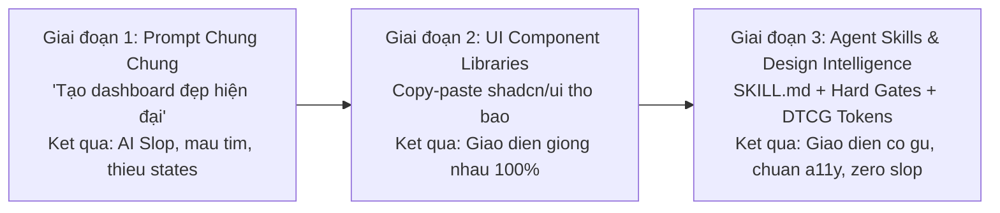

# Báo Cáo Nghiên Cứu: Các Skill Thiết Kế (UI/UX, Motion, Design System) Mới Nhất & Trending Cho AI Agent

> **Mã báo cáo:** `research-261101-1639-trending-design-skills`  
> **Thời gian thực hiện:** 01/11/2026 16:39:16 (Asia/Bangkok)  
> **Phạm vi nghiên cứu:** Khảo sát toàn bộ hệ sinh thái kỹ năng tác tử (AI Agent Skills) trên GitHub, Skills.sh, ClawHub, Vercel Labs, Anthropic và cộng đồng Design Engineering (Claude Code, Cursor, Codex, OpenClaw, AgentKit).

---

## Mục Lục
1. [Tóm Tắt Điều Hành (Executive Summary)](#1-tóm-tắt-điều-hành-executive-summary)
2. [Bối Cảnh & Sự Chuyển Dịch Lớn Của AI Design Skills Năm 2026](#2-bối-cảnh--sự-chuyển-dịch-lớn-của-ai-design-skills-năm-2026)
3. [Bảng Xếp Hạng & Phân Loại Các Design Skills Đang Trending](#3-bảng-xếp-hạng--phân-loại-các-design-skills-đang-trending)
   - [Nhóm 1: Design Intelligence & System Generators (Bộ não thẩm mỹ & Tạo Design System)](#nhóm-1-design-intelligence--system-generators)
   - [Nhóm 2: Anti-AI-Slop & Quality Enforcement Gates (Diệt UI rác & Kiểm định khách quan)](#nhóm-2-anti-ai-slop--quality-enforcement-gates)
   - [Nhóm 3: Web Interface Guidelines & Craft Standards (Chuẩn mực giao diện đẳng cấp)](#nhóm-3-web-interface-guidelines--craft-standards)
   - [Nhóm 4: Motion Design & Micro-Interactions (Vật lý chuyển động & Tương tác vi mô)](#nhóm-4-motion-design--micro-interactions)
   - [Nhóm 5: Figma MCP & Design-to-Code Bi-directional (Đồng bộ Figma hai chiều)](#nhóm-5-figma-mcp--design-to-code-bi-directional)
   - [Nhóm 6: Creative Art Direction & Awwwards-Level (Định hướng sáng tạo giải thưởng)](#nhóm-6-creative-art-direction--awwwards-level)
4. [Phân Tích Chi Tiết Từng Skill Tiêu Biểu](#4-phân-tích-chi-tiết-từng-skill-tiêu-biểu)
5. [Đánh Giá Kỹ Thuật & Khả Năng Ứng Dụng Cho Guta Workspace](#5-đánh-giá-kỹ-thuật--khả-năng-ứng-dụng-cho-guta-workspace)
6. [Lệnh Cài Đặt Nhanh (One-Command Installs)](#6-lệnh-cài-đặt-nhanh-one-command-installs)
7. [Hành Động Khuyến Nghị Tiếp Theo (Next Steps)](#7-hành-động-khuyến-nghị-tiếp-theo-next-steps)
8. [Câu Hỏi Mở & Rủi Ro Tồn Đọng (Unresolved Questions)](#8-câu-hỏi-mở--rủi-ro-tồn-đọng-unresolved-questions)

---

## 1. Tóm Tắt Điều Hành (Executive Summary)

Trong giai đoạn 2025–2026, các mô hình ngôn ngữ lớn (LLM) khi lập trình frontend thường gặp hội chứng **"AI Slop"**: tự động sinh ra các giao diện màu tím mộng mơ (purple gradient), layout 3 card chung chung, viền bo tròn tùy tiện, thiếu trạng thái tương tác và hoàn toàn không có cảm giác xúc giác (tactile feedback).

Để giải quyết triệt để vấn đề này, cộng đồng Design Engineering toàn cầu đã phát triển phong trào **Agent Skills** (các file quy chuẩn `SKILL.md` nạp trực tiếp vào runtime của tác tử như Claude Code, Cursor, Codex, OpenClaw, OMP):
- **Xu hướng #1: Database-driven Design Intelligence** (tiêu biểu là `ui-ux-pro-max-skill` với hơn 545.000 lượt tải trên skills.sh) biến AI từ chỗ đoán mò thành một chuyên gia tra cứu hơn 50 style thẩm mỹ và 161 bảng màu theo ngữ cảnh bài toán.
- **Xu hướng #2: Anti-AI-Slop & Hard Quality Gates** (tiêu biểu là `hallmark` của Nutlope và `ux-ui-agent-skills` của Plugin87) thiết lập 50 chốt chặn kiểm thử tự động; nếu AI dùng màu xám trên nền xám, thiếu focus ring hay nút bấm nhỏ hơn 44px, build sẽ lập tức bị đánh trượt (FAIL).
- **Xu hướng #3: Web Interface Guidelines** (dẫn đầu bởi `vercel-labs/agent-skills`) chuyển hóa trực tiếp triết lý giao diện của Rauno Freiberg (Vercel) thành hướng dẫn thực thi cho tác tử.
- **Xu hướng #4: Universal Motion Physics** (tiêu biểu là `lottiefiles/motion-design-skill` và `micro-interactions-skill`) ép AI áp dụng đường cong gia tốc lò xo (spring physics) và quy tắc chuyển động dưới 200ms thay cho chuyển đổi tuyến tính nhàm chán.

---

## 2. Bối Cảnh & Sự Chuyển Dịch Lớn Của AI Design Skills Năm 2026



Cộng đồng đã chuyển từ việc yêu cầu AI "viết code đẹp" sang việc **khóa chặt quy trình bằng procedural knowledge**:
1. **Thiết kế từ Design Tokens (DTCG Standards):** Không bao giờ hardcode mã màu hex (`#2563eb`) vào component; AI bắt buộc phải khởi tạo hoặc kế thừa hệ thống CSS variables 3 tầng.
2. **Quy định 8 trạng thái tương tác:** Bất kỳ phần tử UI nào cũng phải xử lý đủ: *Default, Hover, Active, Focus-visible, Disabled, Loading, Error, Empty*.
3. **Thẩm mỹ có căn cứ (Art Direction as Procedure):** Viết bản tóm tắt ngắn (Design Brief) xác định rõ: *Register (Brand vs Product), Scene, Direction, Color strategy, Type contrast axis, Signature element*.

---

## 3. Bảng Xếp Hạng & Phân Loại Các Design Skills Đang Trending

### Nhóm 1: Design Intelligence & System Generators

| Tên Skill / Repository | Tác Giả / Tổ Chức | Lượt Cài Đặt / Stars | Trọng Tâm Chuyên Biệt |
|---|---|:---:|---|
| **`nextlevelbuilder/ui-ux-pro-max-skill`** | NextLevelBuilder | **545.1K installs** (#1 All-time) | Cung cấp kho dữ liệu tìm kiếm 50+ phong cách, 161 bảng màu, 57 cặp font chữ, 99 hướng dẫn UX, tự động sinh `MASTER.md`. |
| **`anthropics/skills` (`frontend-design`)** | Anthropic Official | Top 1 Official | Hướng dẫn chính thức của Claude Code: Xây dựng giao diện từ Design Brief, đối xứng typography, loại bỏ hoàn toàn trang trí thừa. |
| **`tyfarrago-hub/taste`** | Ty Farrago | Trending Claude Code | 34 công cụ và nguyên tắc định hình gu thẩm mỹ từ brief đến mã nguồn sẵn sàng cho môi trường production. |

### Nhóm 2: Anti-AI-Slop & Quality Enforcement Gates

| Tên Skill / Repository | Tác Giả / Tổ Chức | Điểm Nổi Bật Về Kỹ Thuật |
|---|---|---|
| **`Nutlope/hallmark`** | Nutlope | Chặn đứng "AI slop" bằng cách cấm: purple gradients, text căn giữa vô tội vạ, thẻ hover trôi nổi không mục đích, icon emoji thay cho SVG. |
| **`plugin87/ux-ui-agent-skills`** | Plugin87 | Chứa 26 kỹ năng nhỏ, hỗ trợ DTCG tokens, 52 components, WCAG 2.2 AA-AAA, 138 design systems và 50 chốt chặn bắt buộc làm fail build khi vi phạm. |
| **`mblode/agent-skills`** | Matthew Blode | "Nobody ships AI slop on purpose" — Rà soát typography, audit tương phản màu và kiểm tra độ hoàn thiện của pull request. |

### Nhóm 3: Web Interface Guidelines & Craft Standards

| Tên Skill / Repository | Tác Giả / Tổ Chức | Điểm Nổi Bật Về Kỹ Thuật |
|---|---|---|
| **`vercel-labs/agent-skills` (`web-design-guidelines`)** | Vercel Labs | Dựa trên chuẩn mực Web Interface Guidelines của Rauno Freiberg: Animation dưới 200ms, touch-target 44px, font-variant-numeric: tabular-nums, zero layout shift. |
| **`jakubkrehel/skills`** | Jakub Krehel | Bộ quy chuẩn tạo giao diện tối giản, tối ưu typography và mật độ thông tin cao cho các sản phẩm SaaS kỹ thuật. |
| **`davila7/claude-code-templates` (`tailwind-design-system`)** | Daniel Avila | Tự động hóa thiết lập Tailwind CSS v4 và kiến trúc token CSS variables. |

### Nhóm 4: Motion Design & Micro-Interactions

| Tên Skill / Repository | Tác Giả / Tổ Chức | Điểm Nổi Bật Về Kỹ Thuật |
|---|---|---|
| **`LottieFiles/motion-design-skill`** | LottieFiles | Chuyển hóa 12 nguyên lý hoạt họa của Disney thành quy tắc CSS/JS: Easing lò xo, dàn dựng chuyển động (choreography), thời gian phản hồi vi mô. |
| **`solinkz/micro-interactions-skill`** | Solinkz | Chuyên sâu về 20+ vi tương tác trên web & mobile: Spring physics, haptic feedback mô phỏng, âm thanh xúc giác, gesture swipe mượt mà. |
| **`C-Jeril/framer-motion-skills`** | C-Jeril | Hướng dẫn tác tử dùng chính xác Motion/Framer Motion: Motion layout projection, gesture drag, exit animation không giật layout. |

### Nhóm 5: Figma MCP & Design-to-Code Bi-directional

| Tên Skill / Repository | Tác Giả / Tổ Chức | Điểm Nổi Bật Về Kỹ Thuật |
|---|---|---|
| **`figma/mcp-server-guide` (`figma-design-to-code`)** | Figma Official | Đọc trực tiếp biến (Variables), Styles, Auto-layout từ Figma canvas qua MCP và chuyển đổi chuẩn xác sang React Tailwind components. |
| **`openai/skills` (`figma-implement-design`)** | OpenAI Curated | Quy trình kiểm soát độ sai lệch pixel (pixel-perfect accuracy) từ bản vẽ Figma vào codebase. |
| **`figma-generate-library`** | Figma Community | Đồng bộ ngược: Quét codebase hiện tại để tự động vẽ component library trên Figma. |

### Nhóm 6: Creative Art Direction & Awwwards-Level

| Tên Skill / Repository | Tác Giả / Tổ Chức | Điểm Nổi Bật Về Kỹ Thuật |
|---|---|---|
| **`tponscr-debug/claude-skill-awwwards`** | Tponscr | Đưa Claude Code đạt trình độ giám đốc sáng tạo: Lưới bất đối xứng Swiss/Brutalist, typography ấn tượng, WebGL/Shader visual cues. |
| **`MengTo/skills`** | Meng To (DesignCode) | Kỹ năng thiết kế giao diện đa nền tảng kết hợp SwiftUI, React và 3D Spline cho tác tử. |

---

## 4. Phân Tích Chi Tiết Từng Skill Tiêu Biểu

### 4.1. `nextlevelbuilder/ui-ux-pro-max-skill` (Top #1 Bổ Trợ Trí Tuệ Thiết Kế)
- **Cơ chế hoạt động:** Skill đi kèm một công cụ Python tìm kiếm offline (`search.py`). Khi nhận yêu cầu thiết kế (ví dụ: *"Tạo CRM cho chuỗi cà phê F&B"*), tác tử chạy lệnh:
  ```bash
  python3 search.py "f&b multi-outlet retail crm" --design-system -p "Guta Workspace"
  ```
- **Kết quả trả về:** Ma trận màu sắc (Palette), tỷ lệ tương phản chữ, cấu trúc layout tối ưu cho ngành F&B, danh sách các anti-patterns phải tránh.
- **Giá trị cốt lõi:** Ngăn chặn việc AI tự nghĩ ra màu sắc không phù hợp hoặc chọn sai phông chữ.

### 4.2. `vercel-labs/agent-skills/web-design-guidelines` (Quy Chuẩn Giao Diện Vercel)
- **Tác giả:** Đội ngũ Vercel Labs & Rauno Freiberg.
- **Các quy tắc thép được AI tuân thủ:**
  1. *Thời lượng chuyển động:* Không vượt quá 200ms cho các thao tác thường xuyên (hover, click, dropdown).
  2. *Scale tự nhiên:* Dialog không zoom từ 0 lên 1; chỉ fade opacity và scale nhẹ từ 0.95 lên 1.0.
  3. *Số học thẳng hàng:* Mọi bảng dữ liệu tài chính/thống kê phải gắn `font-variant-numeric: tabular-nums`.
  4. *Tránh đổi font-weight khi hover:* Để triệt tiêu hoàn toàn hiện tượng rung lắc layout (layout shift).

### 4.3. `Nutlope/hallmark` (Kỹ Năng Diệt AI Slop)
- **Tác giả:** Hassan El Mghari (Founder RoomGPT, Staff Developer).
- **Danh sách cấm kỵ (Strict Bans):**
  - CẤM dùng màu gradient tím-hồng đại trà (trừ khi có yêu cầu rõ ràng từ thương hiệu).
  - CẤM các khối bo tròn bán kính quá lớn (`rounded-3xl` vô nghĩa trên bảng dữ liệu dày).
  - CẤM tạo các nút bấm hoặc liên kết dạng icon mà thiếu `aria-label`.
  - CẤM hiệu ứng chuyển động không thể hủy ngang (interruptible animation).

### 4.4. `LottieFiles/motion-design-skill` (Vật Lý Chuyển Động Chuyên Nghiệp)
- **Tác giả:** Đội ngũ LottieFiles.
- **Quy chuẩn chuyển động:**
  - Định nghĩa rõ ràng các thông số đường cong Bezier: *Deceleration Curve* `cubic-bezier(0.0, 0.0, 0.2, 1)` cho phần tử xuất hiện; *Acceleration Curve* `cubic-bezier(0.4, 0.0, 1, 1)` cho phần tử biến mất.
  - Áp dụng nguyên lý *Choreography & Stagger*: Khi danh sách xuất hiện, các item xuất hiện nối tiếp nhau cách nhau 30ms–50ms thay vì đồng loạt nhảy ra một lúc.

---

## 5. Đánh Giá Kỹ Thuật & Khả Năng Ứng Dụng Cho Guta Workspace

| Tiêu Chí Đánh Giá | Hiện Trạng Dự Án Guta | Kỹ Năng Cần Áp Dụng | Hiệu Quả Đem Lại |
|---|---|---|---|
| **Màu sắc & Thương hiệu** | Đang tuân thủ hệ thống `Zero-Yellow` (#090A0F, #2563EB) theo `docs/DESIGN.md`. | `Nutlope/hallmark` + `ak-frontend-design` | Bảo vệ màu thương hiệu không bị AI sửa lén thành màu vàng chói hay tím AI slop. |
| **Motion & Cảm giác tương tác** | Bảng CRM phẳng, drawer mở 200ms đơn giản, thiếu độ nảy. | `LottieFiles/motion-design-skill` + `micro-interactions-skill` | Thay thế các easing cũ bằng Spring Easing chuẩn `cubic-bezier(0.16, 1, 0.3, 1)`, vuốt drawer mượt 60fps. |
| **Chất lượng code & A11y** | Cần đảm bảo chuẩn WCAG AA cho tablet quầy bar ồn ào. | `web-design-guidelines` (Vercel) | Đảm bảo kích thước bấm chạm tối thiểu 44px, hiển thị số liệu chấm công thẳng cột với `tabular-nums`. |
| **Đồng bộ Figma** | Có sẵn Figma MCP kết nối trực tiếp với dự án. | `figma-design-to-code` | Đọc trực tiếp token và frame từ file thiết kế của Designer để sinh React component chuẩn xác. |

---

## 6. Lệnh Cài Đặt Nhanh (One-Command Installs)

Tất cả các skill trên đều tương thích hoàn toàn với chuẩn mã nguồn mở **Open Agent Skills** (`npx skills`) và AgentKit CLI:

```bash
# 1. Cài đặt kỹ năng Design Intelligence phổ biến nhất thế giới (UI/UX Pro Max)
npx skills add nextlevelbuilder/ui-ux-pro-max-skill

# 2. Cài đặt Web Interface Guidelines chính chủ Vercel Labs
npx skills add https://github.com/vercel-labs/agent-skills --skill web-design-guidelines

# 3. Cài đặt Anti-AI-Slop của Nutlope
npx skills add Nutlope/hallmark

# 4. Cài đặt Motion Design của LottieFiles
npx skills add lottiefiles/motion-design-skill

# 5. Cài đặt Chuyên gia Vi tương tác (Micro-interactions)
npx skills add solinkz/micro-interactions-skill

# 6. Cài đặt 26 chốt chặn kiểm định kiến trúc UI/UX của Plugin87
npx skills add plugin87/ux-ui-agent-skills
```

---

## 7. Hành Động Khuyến Nghị Tiếp Theo (Next Steps)

1. **Bước 1 — Kích hoạt `web-design-guidelines` vào pre-commit review:**  
   Rà soát lại toàn bộ file `apps/web/src/components/CrmDashboardView.tsx` và `StaffDrawer.tsx` theo tiêu chuẩn giao diện của Vercel (touch targets ≥ 44px, animation ≤ 200ms).
2. **Bước 2 — Cập nhật `tokens.css` với Motion Easing từ LottieFiles:**  
   Bổ sung biến `--ease-spring-out: cubic-bezier(0.16, 1, 0.3, 1)` và `--ease-decel: cubic-bezier(0.0, 0.0, 0.2, 1)` vào file `apps/web/src/styles/tokens.css`.
3. **Bước 3 — Sử dụng `ui-ux-pro-max-skill` để chuẩn hóa các trạng thái rỗng (Empty States):**  
   Tạo các trạng thái hiển thị đẹp mắt khi chi nhánh không có barista đi trễ hoặc khi chưa có ca làm việc nào cần xử lý khẩn cấp.

---

## 8. Câu Hỏi Mở & Rủi Ro Tồn Đọng (Unresolved Questions)

1. **Khả năng xung đột giữa các ruleset:** Khi nạp cùng lúc cả `hallmark` (chống slop khắt khe) và `awwwards` (phong cách nghệ thuật phóng khoáng), tác tử có thể bị giằng co giữa tối giản hóa và trang trí ấn tượng. Cần xác định rõ: **Dashboard nội bộ dùng phong cách Swiss Minimalist**, chỉ có **Landing Page mới dùng phong cách Editorial/Creative**.
2. **Hiệu năng trên thiết bị cũ:** Khi áp dụng các easing phức tạp của `micro-interactions-skill`, cần kiểm thử thực tế trên máy tính bảng bán hàng tại quầy Guta để đảm bảo GPU không bị tụt khung hình dưới 60fps.
